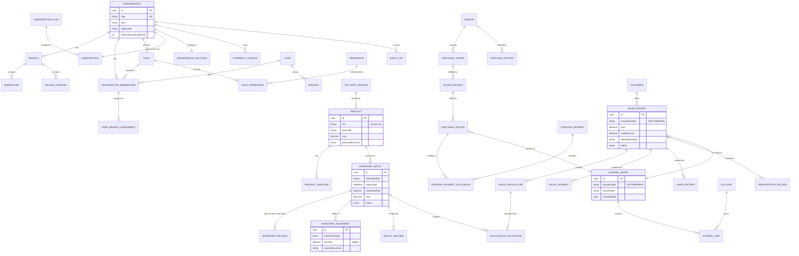
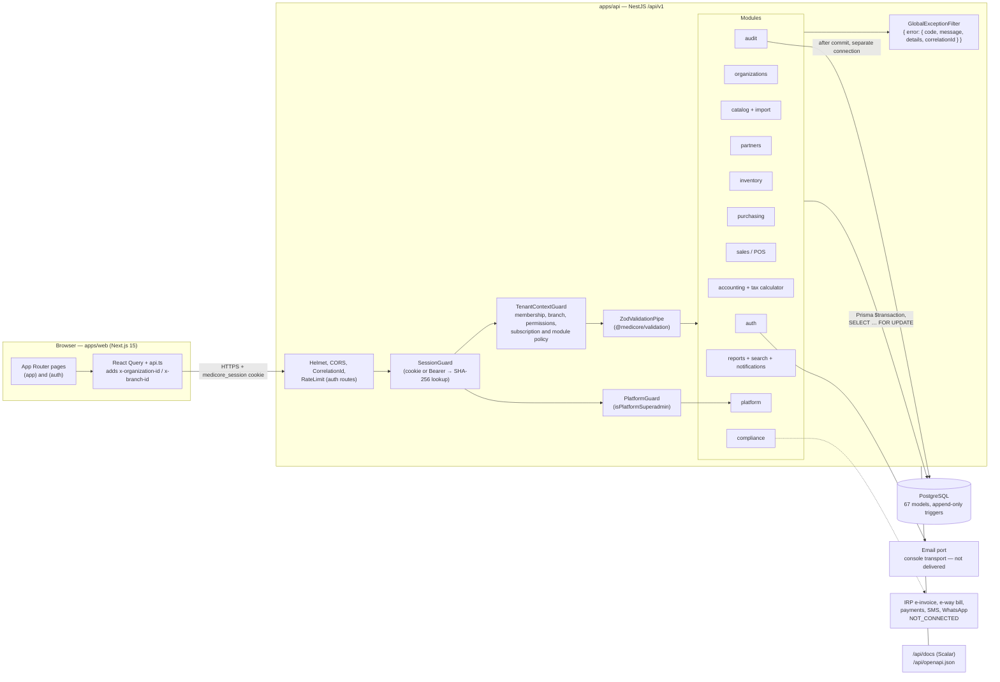

# MediCore Pharmacy ERP — Product Specification

> Indian pharmacy management, billing, batch inventory, procurement, accounting, statutory compliance and multi-tenant SaaS platform.

---

## 1. Document control

| Field | Value |
|---|---|
| Document | MediCore Pharmacy ERP — Product Specification |
| Version | 1.0 |
| Date | 27 Oct 2026 |
| Status | Baseline (as-built). Describes the implemented system in the `MedShop` monorepo and flags partial and planned items explicitly |
| Owner | MediCore product & engineering |
| Audience | Product management, engineering (API, web, QA), implementation and support teams, compliance reviewers, prospective customers' technical evaluators |
| Source of truth | Source code wins wherever documentation disagrees. Primary sources: `apps/api/prisma/schema.prisma`, `apps/api/prisma/seed.ts`, `apps/api/src/rbac/permission-catalog.ts`, `apps/api/src/**/*.controller.ts` and services, `packages/shared-types`, `packages/validation`, `apps/web/src/**`, `docs/api/openapi.json`, `e2e-results.json` |
| Related documents | [`docs/user-guide/MediCore-User-Guide.md`](../user-guide/MediCore-User-Guide.md) (screen-by-screen user guide with screenshots), `README.md`, `DECISIONS.md`, `docs/Initial/MedStore_PRD.md` (original PRD, referenced as "PRD §n"), `docs/product/module-catalog.md`, `docs/architecture/*.md`, `docs/compliance/*.md`, `docs/operations/deployment.md`, `docs/testing/*.md` |

### 1.1 Status vocabulary used in this document

| Status | Meaning |
|---|---|
| **Implemented** | Server logic, persistence and UI exist; covered by automated tests and/or the end-to-end journey |
| **Partial** | Some of the behaviour exists, but a stated part is missing or enforced only in the UI |
| **Planned** | Not built. Appears in the PRD, docs, schema or catalog only |
| **Not connected** | External integration that is deliberately shown as not operational (PRD §1.32) |

### 1.2 Where the existing docs and the code disagree

The code was taken as correct for every item below.

| Topic | Existing doc says | Code shows |
|---|---|---|
| Permission count | `security-model.md`, `system-architecture.md`: 34 permissions | 51 keys in `PERMISSIONS`, 50 of them tenant-assignable (`TENANT_PERMISSIONS`) |
| Admin role name | "Organization Admin" | Key `ORGANIZATION_ADMIN`; the display name generated at registration is **"Admin"** |
| Linting | `DECISIONS.md` #3 and `test-strategy.md`: "No ESLint" | ESLint 9 with type-aware rules is configured (`eslint.config.mjs`, `pnpm lint` with `--max-warnings 0`) |
| Integration test count | `feature-verification-matrix.md`: 77 tests | **169** `it(...)` cases in **15** files under `apps/api/test/integration` (also stated in README) |
| Append-only enforcement | `database-design.md`: by service convention, with `REVOKE` outstanding | Migration `20261027055803_tax_cess_returns` adds `BEFORE UPDATE OR DELETE` triggers (`medicore_forbid_mutation`) on `InventoryMovement`, `JournalLine` and `AuditLog`. `ProductChangeHistory` and `SubscriptionEvent` are still convention-only |
| Setup "posting gate" | Feature matrix: posting gate enforced for sales/purchases | The checklist and `POST /organizations/setup-complete` exist, but no check of `Organization.setupCompletedAt` was found in the sales or purchasing posting paths. Treated as **Partial** |
| Bearer token format | OpenAPI `session-token` scheme declares `bearerFormat: JWT` | Tokens are opaque 32-byte random values; only their SHA-256 hash is stored (DECISIONS #7) |

---

## 2. Product overview

### 2.1 Vision

MediCore aims to be the operating system for Indian pharmacy businesses. One multi-tenant SaaS product covers counter billing, batch- and expiry-aware stock, purchasing from distributors, GST, double-entry books, and the registers that the Drugs & Cosmetics Rules require. Every figure on screen traces back to an immutable ledger entry.

### 2.2 Problem statement

Indian pharmacies typically run on desktop billing tools or spreadsheets that:

- do not track batches and expiry reliably, so expired or recalled stock gets sold (Drugs Rules 65(17));
- calculate GST on tax-inclusive MRP inconsistently and cannot produce GSTR-1/3B-ready summaries;
- keep accounting separate from billing and stock, so books and stock drift apart;
- keep the Schedule H1 register on paper and lose track of drug licence expiry;
- are single-machine, with no multi-branch view, no role-based access and no audit trail.

### 2.3 Target customers

| Segment | Profile | Typical plan | Key needs |
|---|---|---|---|
| **Independent retail pharmacy** | One shop, 1–3 counters, owner-pharmacist plus 1–4 staff | Starter / Professional | Fast POS with barcode scanning, FEFO, MRP ceiling, H1 register, GST invoices, expiry dashboard |
| **Pharmacy chain** | Multiple branches, central purchasing, branch-level stock | Professional / Business | Branch and warehouse model, inter-warehouse transfers, per-branch user assignment, consolidated reports, roles |
| **Distributor / wholesaler** | B2B sales to retailers and clinics on credit | Business / Enterprise | Credit customers with limits, receivables aging, B2B GST (GSTR-1 B2B), purchase three-way match, vendor ledgers, wholesale flag |

The PRD (§2) also lists hospital/institutional pharmacies and multi-counter shops. These are served by the same model: billing counters are modelled but not yet used by the POS.

### 2.4 Value proposition

1. **Correct by construction.** Money is held as integer paise with HALF_UP rounding. Stock is an append-only movement ledger with row-locked balances. Every posting produces a balanced journal. Tax rates are never hardcoded.
2. **Compliance built in.** Expired, recalled and quarantined batches cannot be sold. Schedule H1 sales require prescriber and patient details. Sales above MRP are rejected. Invoices use FY-scoped gap-free numbering. GSTR-1 JSON and GSTR-3B computations are generated. Licence expiry is tracked.
3. **Counter speed.** Keyboard-first POS (F2 search, F8 hold, F9 charge), barcode scan, automatic FEFO, split tender, held bills, and idempotent retries so a flaky network never double-bills.
4. **Multi-branch SaaS.** Tenant isolation is enforced on the server, with per-branch assignment, plan-based module entitlement, platform administration, and an audit trail on sensitive actions.
5. **Honest status.** Integrations that are not connected (IRP e-invoice, e-way bill, payments, messaging, email delivery) are shown as `NOT_CONNECTED`, never faked.

---

## 3. Personas & roles

### 3.1 Role model

- A user may belong to several organizations. Each `OrganizationMembership` has one role (`roleId`), an `isOwner` flag and optional branch assignments (`UserBranchAssignment`).
- At registration (`POST /auth/register`) one transaction creates an **Owner** role (key `ORGANIZATION_OWNER`, no explicit permission rows) and one system role for every entry in `SYSTEM_ROLE_PERMISSIONS` except `PLATFORM_SUPERADMIN`: 9 templated roles, 10 system roles in total.
- **Roles grant only their explicitly assigned permissions.** The name of a role grants nothing.
- **Owner** (`isOwner = true`): `TenantContextGuard` adds every catalogued permission to the owner's effective set and lets the owner act in every branch. Owners cannot be suspended.
- Users holding `branches.manage` can also operate across all branches. Everyone else must be assigned to the branch named in `x-branch-id`.
- **Custom roles** can be created from templates (`GET /organizations/roles/templates`). They must grant at least one permission, need a unique case-insensitive name, and may never include `platform.*` keys. System roles are locked against edits. Roles that are in use cannot be deleted.
- **Platform superadmin** is a user flag (`User.isPlatformSuperadmin`), not a tenant role. It is checked by `PlatformGuard` and grants no access to tenant business data.

### 3.2 Personas mapped to code role templates

Permission counts come from evaluating `SYSTEM_ROLE_PERMISSIONS` in `permission-catalog.ts`. The catalog has 51 keys, 50 of which are tenant-assignable.

| Persona | Code role key | Display name | Permissions | Primary goals | Scope highlights |
|---|---|---|---|---|---|
| Business owner | `ORGANIZATION_OWNER` (`isOwner`) | Owner | All 50 tenant permissions (implicit) | Full control, onboarding, plan and billing | All branches; cannot be suspended |
| Administrator | `ORGANIZATION_ADMIN` | Admin | **50** | Run the workspace on the owner's behalf | Every tenant permission (`TENANT_PERMISSIONS`) |
| Pharmacist | `PHARMACIST` | Pharmacist | **29** | Dispense, bill, handle returns, H1 register, recalls | sales.read/create/void/receipts, returns.read/create, compliance.read/manage, products.read/create/update/deactivate, all inventory keys including `inventory.override.batch`, customers.read/manage, purchases.read, vendors.read, tax.read, reports.read, branches.read, users.read, roles.read, organization.read |
| Cashier | `CASHIER` | Cashier | **9** | Counter billing and collections | products.read, inventory.read, customers.read/manage, sales.read/create/receipts, branches.read, organization.read |
| Store manager | `STORE_MANAGER` | Store Manager | **17** | Branch stock control and staff oversight | products.read/update, inventory.read/opening/adjust/count/transfer, customers.read/manage, vendors.read, reports.read/export, branches.read, users.read, roles.read, organization.read, categories.manage |
| Inventory manager | `INVENTORY_MANAGER` | Inventory Manager | **20** | Catalogue, batches, counts, transfers, recalls, imports | products.read/create/update/deactivate/import, inventory.read/opening/adjust/count/transfer/recall, vendors.read, tax.read, reports.read/export, branches.read, users.read, roles.read, organization.read, categories.manage |
| Purchase manager | `PURCHASE_MANAGER` | Purchase Manager | **14** | PO → GRN → supplier invoice → payment → debit note | all five `purchases.*` keys, products.read, vendors.read/manage, inventory.read, returns.read, tax.read, branches.read, organization.read, reports.read |
| Accountant | `ACCOUNTANT` | Accountant | **21** | Journals, expenses, period locks, GST, supplier payments | accounting.read/post, purchases.read/pay, returns.read, sales.read/receipts, compliance.read, products.read, inventory.read, customers.read, vendors.read, tax.read/manage, reports.read/export, branches.read, users.read, roles.read, organization.read, subscription.read |
| Auditor | `AUDITOR` | Auditor | **18** | Read-only review including the audit trail | audit.read, accounting.read, compliance.read, sales.read, purchases.read, returns.read, products.read, inventory.read, customers.read, vendors.read, tax.read, reports.read/export, branches.read, users.read, roles.read, organization.read, subscription.read |
| Analyst | `ANALYST` | Analyst | **8** | Reporting | products.read, inventory.read, customers.read, vendors.read, tax.read, reports.read, branches.read, organization.read |
| Platform superadmin | `PLATFORM_SUPERADMIN` (template is empty) / `User.isPlatformSuperadmin` | — | **0** tenant permissions | Manage tenants, plans, subscriptions, suspension | `/platform/*` via `PlatformGuard`; bootstrapped from `SUPERADMIN_EMAILS` during seed |

---

## 4. Module catalogue

Conventions used below: all API paths are relative to `/api/v1`. "Perm" means the permission enforced by `@RequirePermissions`; when several are listed, all are required. "Plan module" means the `@RequireModule` gate.

### 4.1 Dashboard

- **Scope.** The landing workspace after sign-in: live KPIs, the setup checklist, alerts and shortcuts.
- **Key capabilities**
  - KPIs for today and the month (sales, invoices), receivables, payables and stock value, with a trend endpoint for charts.
  - Setup checklist with progress and a "complete onboarding" action.
  - "Needs attention" panel showing licence expiry and alerts. Recent invoices. Module tiles.
  - Auto-refresh every 60 s (React Query `refetchInterval: 60_000`). A welcome state is shown to users without a workspace.
- **Business rules**
  - Checklist steps (`getSetupChecklist`): `business_profile` (address line 1, city and state set); `gst` (GSTIN present when the registration is `REGULAR` or `COMPOSITION`); `branch` (at least one); `warehouse` (at least one); `users` (at least one ACTIVE member); `tax_rates` (at least one active rate version — `required: false`, recommended only).
  - `POST /organizations/setup-complete` (perm `organization.settings.onboard`) fails with `STATE_TRANSITION_INVALID` until every required step is complete.
  - Money figures come from the P&L and ledger (DECISIONS #34).
- **UI route.** `/`
- **Primary API.** `GET /reports/dashboard`, `GET /reports/dashboard/trend` (perm `organization.read`), `GET /organizations/setup-checklist`, `POST /organizations/setup-complete`
- **Status.** Implemented (E2E-46).

### 4.2 POS billing

- **Scope.** Retail and wholesale counter billing with batch allocation, GST and tenders.
- **Key capabilities**
  - Product search (F2), barcode scan, arrow-key and Enter selection, line editing, line discounts.
  - Automatic FEFO allocation shown as "Auto FEFO", with explicit batch selection. Ineligible batches are disabled in the picker.
  - Customer selection or walk-in name (default `Walk-in customer`). Inter-state customers get IGST.
  - Split tender: `CASH`, `UPI`, `CARD`, `BANK`, `CREDIT`. Shows change due. Charge with F9 or Ctrl/⌘+Enter.
  - Schedule H1 prescription form (patient name and phone; prescriber name, address and registration number).
  - Held (parked) bills: F8 to hold, then resume or discard.
  - Idempotent retry: the client keeps the same `idempotencyKey` when it retries.
  - Line warnings before charging for stock, MRP and GST issues (for example "No rate").
- **Business rules**
  - Unit price may not exceed the product MRP (DPCO para 26), otherwise `422 VALIDATION_ERROR`.
  - Products must be `ACTIVE`, otherwise `BATCH_INELIGIBLE`. Quantities must be positive. A discount may not exceed the line amount.
  - Every line needs an effective GST rate, otherwise `422 TAX_RATE_MISSING`.
  - Prices are tax-inclusive. Intra-state supplies split into CGST + SGST; inter-state supplies (customer state ≠ organization state) use IGST.
  - The bill total is rounded to the whole rupee (half-up). The tenders must equal the rounded total exactly.
  - Credit tender requires a registered customer. If `creditLimit > 0`, outstanding + new credit must stay within the limit, otherwise `CREDIT_LIMIT_EXCEEDED`. A limit of 0 means no limit.
  - The monthly invoice quota (`monthlyInvoiceLimit`, counted per IST calendar month) gives `PLAN_LIMIT_REACHED` when exhausted.
  - Held bills: at most **20 per branch**. The list returns the latest 50.
  - The invoice, its lines, batch allocations, stock movements, payments, H1 records and journal are written in **one transaction**. Numbering is `SI/<FY>/NNNNNN`.
- **UI route.** `/pos` (nav perm `sales.create`, plan module `pos`)
- **Primary API.** `POST /sales/invoices` (perm `sales.create`), `GET|POST /sales/held-bills`, `DELETE /sales/held-bills/{id}`, `GET /catalog/products/barcode/{barcode}`, `POST /inventory/allocate`. Plan module `pos` applies to the whole `/sales` controller.
- **Status.** Implemented (E2E-38/39/40). Discount approval beyond limits (`sales.discount.approve`) is **Planned**: the key is catalogued but no endpoint enforces it.

### 4.3 Sales & returns

- **Scope.** Invoice history, printable invoices, cancellation, credit notes, and exports.
- **Key capabilities**
  - Searchable and filterable invoice list, summary KPIs, CSV export.
  - Invoice detail with A4 and 72 mm thermal print (`body.print-thermal .print-area { width: 72mm }`), HSN summary, amount in words and licence printing. The heading reads "Tax invoice" when the seller has a GSTIN and "Bill of supply" otherwise.
  - Cancellation, with the stock and the journal reversed.
  - Sales returns (credit notes, `SRET/<FY>/NNNNNN`) spanning several batches, with per-line restock.
- **Business rules**
  - **Cancel** (perm `sales.void`): only `POSTED` invoices with no returns, no receipts recorded after billing, and an invoice date in the **current IST month** (earlier months may already be filed in GSTR-1). Stock goes back to the original batches as `SALE_CANCELLED_IN`. The original journal is reversed and linked through `reversedById`. Status becomes `CANCELLED`.
  - **Return** (perm `returns.create`, plan module `returns`): the quantity may not exceed sold minus already returned (`RETURN_QUANTITY_EXCEEDS_ORIGINAL`). The refund first settles the invoice's open credit (`creditAdjusted`); the rest is refunded via `refundMethod` (default `CASH`). Restocked lines go back to the original batch (`SALES_RETURN_IN`) and reverse COGS at batch cost. The invoice status becomes `PARTIALLY_RETURNED` or `RETURNED`.
- **UI routes.** `/sales-history`, `/sales-history/[id]`
- **Primary API.** `GET /sales/invoices`, `GET /sales/invoices/summary`, `GET /sales/invoices/{invoiceId}`, `GET /sales/invoices/export` (perm `sales.read` + `reports.export`), `POST /sales/invoices/{invoiceId}/cancel`, `POST|GET /sales/returns`, `GET /sales/returns/export`
- **Status.** Implemented (E2E-41).

### 4.4 Customers

- **Scope.** Customer master, credit control, statements and receipts.
- **Key capabilities.** CRUD with GSTIN, state, credit days, credit limit, opening balance and the `isWholesale` flag. Status `ACTIVE`, `INACTIVE` or `BLOCKED`. Outstanding balance, statement, top products, and receipts against credit.
- **Business rules**
  - Outstanding = opening balance + Σ `SalesInvoice.creditAmount` (DECISIONS #22).
  - Non-`ACTIVE` customers cannot be billed.
  - Receipts reduce open credit on invoices.
  - Default `creditDays = 0`, `creditLimit = 0` (no limit).
- **UI route.** `/customers` (with an edit drawer)
- **Primary API.** `GET|POST /partners/customers`, `GET|PUT /partners/customers/{customerId}`, `GET /partners/customers/{customerId}/top-products` (perm `customers.read` + `sales.read`), `GET /sales/customers/{customerId}/outstanding`, `GET /sales/customers/{customerId}/statement`, `POST /sales/receipts` (perm `sales.receipts`)
- **Status.** Implemented (E2E-12, E2E-42).

### 4.5 Purchasing

- **Scope.** Procure-to-pay: purchase order → goods receipt (GRN) → supplier invoice → payment → purchase return (debit note).
- **Key capabilities**
  - POs with lines. Actions `send`, `confirm`, `cancel`.
  - Batch-wise GRN with partial receipt, split batches, free quantity, MRP and expiry.
  - Supplier invoice with three-way match against the GRN, duplicate check, and input GST.
  - Supplier payments (`CASH`, `BANK`, `UPI`) allocated across several invoices.
  - Purchase returns that reverse input GST.
  - Purchasing summary, reorder suggestions, vendor ledger with running balance and overdue days.
- **Business rules**
  - PO state machine: `send` DRAFT→SENT; `confirm` SENT→CONFIRMED; `cancel` from DRAFT, SENT or CONFIRMED to CANCELLED. Receipts move a PO to `PARTIALLY_RECEIVED` or `RECEIVED`. An invalid transition gives `409 STATE_TRANSITION_INVALID`.
  - Vendors must be `ACTIVE`.
  - GRN: receiving more than the open PO quantity gives `RECEIPT_QUANTITY_MISMATCH`. Batches merge on (org, product, warehouse, batchNumber, expiryDate). Up to 500 lines per GRN.
  - Supplier invoice: duplicate (vendor, invoiceNumber) gives `DUPLICATE_ENTITY` (also enforced by a unique index). A GRN can be invoiced only once. Billed quantity per product must equal received quantity, otherwise `RECEIPT_QUANTITY_MISMATCH` with per-product details. The invoice date may not be in the future. Line costs are tax-exclusive. `dueDate` defaults to invoice date + vendor `creditDays` (default 30).
  - GL: Dr Inventory (taxable), Dr GST Input, Cr Accounts Payable. **Inventory is booked at the supplier invoice, not at the GRN** (DECISIONS #23).
  - Payment allocation above an invoice's outstanding amount gives `ALLOCATION_EXCEEDS_BALANCE`.
  - Purchase return quantity above the invoiced quantity gives `RETURN_QUANTITY_EXCEEDS_ORIGINAL`.
  - Numbering: `PO/<FY>/NNNNNN`, `GRN/<FY>/NNNNNN`, `SPAY/<FY>/NNNNNN`, `PRET/<FY>/NNNNNN`.
- **UI route.** `/purchasing` (tabs with GRN and invoice drawers; plan module `purchases`)
- **Primary API** (plan module `purchases` on the whole controller): `POST|GET /purchasing/purchase-orders`, `POST /purchasing/purchase-orders/{poId}/action` (perm `purchases.approve`), `POST|GET /purchasing/goods-receipts` (perm `purchases.receive`), `POST|GET /purchasing/invoices`, `GET /purchasing/invoices/check-duplicate`, `POST|GET /purchasing/payments` (perm `purchases.pay`), `POST|GET /purchasing/purchase-returns`, `GET /purchasing/vendors/{vendorId}/ledger`, `GET /purchasing/summary`, `GET /purchasing/reorder-suggestions`
- **Status.** Implemented (E2E-34…37). Checking a supplier's drug licence (`Vendor.drugLicenceNumber/Expiry`) before purchase is **Partial**: the data is stored, but posting only checks that the vendor status is ACTIVE.

### 4.6 Vendors

- **Scope.** Supplier and distributor master.
- **Key capabilities.** Legal and trade name, GSTIN, PAN, GST registration type (`REGULAR`, `COMPOSITION`, `UNREGISTERED`), address and state, contact, credit days and limit, opening balance, drug licence number and expiry (Form 20B/21B), bank account and IFSC, status `ACTIVE`, `INACTIVE` or `BLOCKED`. Supplier product mappings. Ledger, open invoices and overdue badges.
- **Business rules**
  - GSTIN format and check digit are validated. The GSTIN state prefix must match the state code. The PAN must be embedded in the GSTIN.
  - IFSC must match `^[A-Z]{4}0[A-Z0-9]{6}$`. Account numbers must be 9–18 digits.
  - A positive opening balance means the business owes the supplier.
- **UI route.** `/vendors` (with drawer)
- **Primary API.** `GET|POST /partners/vendors`, `GET|PUT /partners/vendors/{vendorId}`, `GET /partners/vendors/{vendorId}/products` (perm `vendors.read` + `purchases.read`)
- **Status.** Implemented (E2E-11).

### 4.7 Products / catalogue

- **Scope.** Medicine and product master with barcodes, tax classification and prescription class.
- **Key capabilities**
  - Fields: SKU, name, generic name, brand, category, manufacturer, dosage form (15 values from `TABLET` to `OTHER`), strength, pack size and units per pack, purchase and sale unit with conversion factor, HSN, pinned tax rate version, MRP, purchase, selling and trade price, prescription class (`OTC`, `PRESCRIPTION_ONLY`, `SCHEDULE_H1`, `SCHEDULE_X`, `NARCOTIC`), storage instructions, refrigeration flag, rack location, reorder, max stock and minimum order quantity, status (`DRAFT`, `ACTIVE`, `INACTIVE`).
  - Multiple barcodes per product with POS lookup.
  - Strength-aware duplicate check. Substitutes lookup. Append-only change history. Deactivate and reactivate.
  - The GST column shows the resolved rate or a "No rate" badge.
- **Business rules**
  - SKU is unique per organization.
  - Selling price must not exceed MRP, and MRP must not be below cost (`india-rules.test.ts`).
  - HSN must be 4, 6 or 8 digits.
  - Duplicate detection never merges products with different strengths or forms.
- **UI route.** `/products` (with edit drawer)
- **Primary API.** `GET|POST /catalog/products`, `GET|PUT /catalog/products/{productId}`, `PUT /catalog/products/{productId}/deactivate|reactivate` (perm `products.deactivate`), `GET /catalog/products/barcode/{barcode}`, `POST /catalog/products/duplicates-check`, `GET /catalog/products/{productId}/substitutes`, `GET /catalog/products/{productId}/history`
- **Status.** Implemented. The duplicate-detection UI is not started (feature matrix).

### 4.8 Batch inventory

- **Scope.** Batch-level stock per warehouse.
- **Key capabilities**
  - Opening stock creates or merges a batch.
  - Batch list with status, expiry, cost and MRP. Stock summary.
  - Batch status changes. FEFO allocation preview.
  - Ledger-to-balance reconciliation.
- **Business rules**
  - A batch is one manufacturer lot of one product in one warehouse, unique on (organizationId, productId, warehouseId, batchNumber, expiryDate). The same lot received twice merges into one batch; a different expiry creates a different batch.
  - Statuses: `SALEABLE`, `QUARANTINED`, `RECALLED`, `DAMAGED`, `EXPIRED_BLOCKED`. Only `SALEABLE` batches with expiry ≥ today are eligible for sale.
  - `PUT /inventory/batches/{batchId}/status` allows `SALEABLE`, `QUARANTINED`, `DAMAGED` and `EXPIRED_BLOCKED`. `RECALLED` is set only through a recall.
  - The manufacturing date may not be after expiry.
- **UI route.** `/batches`
- **Primary API.** `POST /inventory/batches` (perm `inventory.opening`), `GET /inventory/batches`, `PUT /inventory/batches/{batchId}/status` (perm `inventory.recall`), `POST /inventory/allocate`, `GET /inventory/stock-summary`, `GET /inventory/reconcile`
- **Status.** Implemented (E2E-13…16, E2E-25). `StockReservation` and `InventoryBalance.reservedQty` exist in the schema but nothing uses them.

### 4.9 Expiry

- **Scope.** Near-expiry and expired stock visibility and write-off.
- **Key capabilities.** Bucketed dashboard with value at risk (cost and MRP), a configurable custom horizon, and bulk write-off.
- **Business rules**
  - Buckets: `EXPIRED` (< 0 days), `DAYS_30` (≤ 30), `DAYS_60` (≤ 60), `DAYS_90` (≤ 90), `CUSTOM` (≤ `customDays`, default 90), `OK`.
  - Bulk write-off (perm `inventory.adjust`) posts an expiry write-off, sets the batch to `EXPIRED_BLOCKED`, and fails with `INSUFFICIENT_STOCK` if the selected batches hold no stock.
  - Near-expiry notifications cover a 30-day horizon.
  - The `expiryAlertDays` setting (1–730) is stored in organization settings.
- **UI route.** `/expiry`
- **Primary API.** `GET /inventory/expiry-dashboard`, `POST /inventory/expiry/bulk-writeoff`, `GET /reports/expiry-value`
- **Status.** Implemented (E2E-17).

### 4.10 Stock ledger

- **Scope.** The append-only movement history, which is the source of truth for stock.
- **Key capabilities.** Filterable ledger with reasons and source documents. CSV export (perm `inventory.read` + `reports.export`).
- **Business rules**
  - Movement types: `OPENING_STOCK`, `PURCHASE_RECEIPT`, `SALE`, `SALES_RETURN_IN`, `PURCHASE_RETURN_OUT`, `EXPIRY_RETURN_OUT`, `DAMAGE_OUT`, `ADJUSTMENT_IN`, `ADJUSTMENT_OUT`, `TRANSFER_OUT`, `TRANSFER_IN`, `COUNT_VARIANCE_IN`, `COUNT_VARIANCE_OUT`, `RECALL_OUT`, `QUARANTINE_IN`, `QUARANTINE_RELEASE`, `SALE_CANCELLED_IN`.
  - Quantity is signed: positive for IN, negative for OUT.
  - A database trigger rejects UPDATE and DELETE.
  - `InventoryBalance` is maintained in the same transaction under `SELECT … FOR UPDATE`.
- **UI route.** `/ledger`
- **Primary API.** `GET /inventory/ledger`, `GET /inventory/ledger/export`
- **Status.** Implemented (E2E-26).

### 4.11 Adjustments

- **Scope.** Manual stock corrections with reasons.
- **Key capabilities.** Direction IN or OUT. Reason codes `DAMAGE`, `BREAKAGE`, `EXPIRY_WRITEOFF`, `THEFT_LOSS`, `COUNT_CORRECTION`, `DATA_ENTRY_CORRECTION`, `TEMPERATURE_EXCURSION`, `CONTAMINATION`, `OTHER`. Summary and list.
- **Business rules**
  - Quantity must be > 0. `OTHER` requires notes.
  - A result below zero is rejected under lock with `INSUFFICIENT_STOCK`.
  - GL at batch cost: an OUT posts Dr Inventory Loss / Cr Inventory; an IN posts to Inventory Gain.
- **UI route.** `/adjustments` (nav perm `inventory.adjust`)
- **Primary API.** `POST /inventory/adjustments` (perm `inventory.adjust`), `GET /inventory/adjustments`, `GET /inventory/adjustments/summary`
- **Status.** Implemented.

### 4.12 Transfers

- **Scope.** Moving stock between warehouses.
- **Key capabilities.** Dispatch with lines, receive in full or in part, cancel.
- **Business rules**
  - Stock is deducted at dispatch; the transfer document represents stock in transit (DECISIONS #12).
  - Receipt upserts the same lot at the destination (`TRANSFER_IN`). Over-receipt rolls back the whole receipt.
  - Statuses: `DRAFT`, `DISPATCHED`, `IN_TRANSIT`, `PARTIALLY_RECEIVED`, `RECEIVED`, `CANCELLED`.
  - Received transfers cannot be cancelled. Cancelling returns the undelivered quantity.
  - Receiving after completion gives `409 STATE_TRANSITION_INVALID`.
- **UI route.** `/transfers` (nav perm `inventory.transfer`)
- **Primary API.** `POST|GET /inventory/transfers`, `GET /inventory/transfers/{transferId}`, `POST /inventory/transfers/{transferId}/receive`, `POST /inventory/transfers/{transferId}/cancel`
- **Status.** Implemented (E2E-18…20, E2E-30).

### 4.13 Stock counts

- **Scope.** Physical and cycle counts with variance posting.
- **Key capabilities.** Count sheet, entry of counted quantities, system quantity snapshot, variance, post, cancel.
- **Business rules**
  - Statuses: `DRAFT`, `IN_PROGRESS`, `COMPLETED`, `POSTED`, `CANCELLED`. Only `COMPLETED` counts can be posted.
  - Posting creates `COUNT_VARIANCE_IN` and `COUNT_VARIANCE_OUT` movements in one transaction.
  - One line per batch per count.
- **UI route.** `/counts` (nav perm `inventory.count`)
- **Primary API.** `GET /inventory/counts/sheet`, `POST|GET /inventory/counts`, `POST /inventory/counts/{countId}/post`, `POST /inventory/counts/{countId}/cancel`
- **Status.** Implemented (E2E-21/22/31).

### 4.14 Recalls

These are part of Batch inventory and are listed separately for clarity.

- **Capabilities.** Create a recall against a batch (the batch becomes `RECALLED`), resolve it with resolution notes (status `OPEN` → `RESOLVED`), list recalls.
- **Rule.** Allocating a recalled batch fails with `422 BATCH_INELIGIBLE`.
- **API.** `POST|GET /inventory/recalls`, `POST /inventory/recalls/{recallId}/resolve` (perm `inventory.recall`)
- **Status.** Implemented (E2E-23/24/32/33).

### 4.15 Accounting

- **Scope.** Double-entry general ledger generated automatically from operations, plus manual journals, expenses and period locks.
- **Key capabilities**
  - Chart of accounts with GL drill-down and running balance.
  - Manual journals and one-time reversals.
  - Trial balance, P&L (with trend and CSV export), balance sheet (with CSV export).
  - Expenses (categories: Rent, Salaries & wages, Electricity, Internet & phone, Repairs & maintenance, Transport & delivery, Packaging, Licence & professional fees, Bank charges, Marketing, Stationery & printing, Miscellaneous).
  - Monthly period lock and unlock.
- **Business rules.** See §6.10. In short:
  - Every entry must balance and have at least two non-zero lines.
  - Posted lines are immutable (trigger). Corrections are reversing entries; a reversal can happen only once, and a reversal of a reversal is rejected.
  - A locked period (`YYYY-MM`, IST) rejects every posting dated inside it with `PERIOD_LOCKED`.
  - Numbering: `JV/<FY>/NNNNNN`, `EXP/<FY>/NNNNNN`.
- **UI route.** `/accounting` (tabs with GL drawer; plan module `accounting`)
- **Primary API** (plan module `accounting`): `GET /accounting/accounts`, `GET /accounting/accounts/{accountId}/ledger`, `POST|GET /accounting/journals`, `POST /accounting/journals/{entryId}/reverse`, `GET /accounting/trial-balance`, `GET /accounting/profit-and-loss[/trend|/export]`, `GET /accounting/balance-sheet[/export]`, `GET /accounting/periods`, `POST /accounting/periods/lock`, `POST|GET /accounting/expenses`, `GET /accounting/expenses/summary`
- **Status.** Implemented (E2E-43/44).

### 4.16 Compliance

- **Scope.** Statutory registers, GST return data, licences and the integration registry.
- **Key capabilities**
  - Schedule H1 register with date range and CSV export.
  - GST outward summary (by HSN, B2B/B2C, net of credit notes) with CSV.
  - GST inward summary with ITC (eligible and not claimable).
  - GSTR-1 JSON export in the GSTN offline-tool layout: B2B, B2CL, B2CS, CDNR, HSN summary and document series.
  - GSTR-3B computation: 3.1 outward supplies, 3.2 inter-state B2C by place of supply, 4 ITC (available, reversed, ineligible, net), tax payable after Rule 88A set-off, carry-forward.
  - Pharmacy licence register with overview and expiry alerts.
  - Integration registry.
- **Business rules**
  - Licence types: `FORM_20`, `FORM_21`, `FORM_20B`, `FORM_21B`, `FORM_20F`, `FORM_20G`, `NARCOTIC`, `FSSAI`, `GST`, `TRADE`, `OTHER`. Advisory checks: Form 20 and 21 should be held together; 20B and 21B together; a warning appears when no drug sale licence is on file.
  - Licence banners: red at ≤ 30 days to expiry, amber at ≤ 60. Notifications look 60 days ahead.
  - ITC counts only suppliers with a GSTIN (DECISIONS #36).
  - B2CL threshold is ₹1,00,000 for unregistered inter-state invoices (`B2CL_THRESHOLD_PAISE = 100_000_00n`, Notification 12/2024-CT).
  - Integration providers: `GST_EINVOICE`, `EWAY_BILL`, `WHATSAPP`, `SMS`, `EMAIL_SMTP`, `PAYMENT_GATEWAY`. Saving configuration (perm `organization.settings.manage`) always leaves the status `NOT_CONNECTED`.
  - Summaries are not filed returns.
- **UI route.** `/compliance`
- **Primary API.** `GET /compliance/h1-register[/export]`, `GET|POST /compliance/licences`, `GET /compliance/licences/overview`, `PATCH /compliance/licences/{licenceId}`, `GET /compliance/licence-alerts`, `GET /compliance/gst/sales-summary[/export]`, `GET /compliance/gst/purchase-summary`, `GET /compliance/gst/gstr1/export`, `GET /compliance/gst/gstr3b`, `GET|POST /compliance/integrations`
- **Status.** Implemented (E2E-45). Schedule X, narcotic and Schedule H prescription workflows are **Partial**; see §6.5.

### 4.17 Reports

- **Scope.** Operational and financial analytics with audited exports.
- **Key capabilities.** Sales summary, payment (tender) mix, stock valuation (including `unbookedDifference` for goods received but not yet billed), receivable and payable aging, dead stock, expiry value. CSV exports for `sales-by-product`, `sales-by-day`, `stock-valuation`, `dead-stock`, `receivables`, `payables`. Global search (`GET /search`).
- **Business rules**
  - Exports need `reports.read` + `reports.export` and are audited (`EXPORT_GENERATED`).
  - Net sales, COGS and margin are read from the P&L (DECISIONS #34).
  - Tender mix counts payments in time order up to the invoice total (DECISIONS #35).
- **UI route.** `/reports`
- **Primary API.** `GET /reports/sales-summary`, `/reports/payment-mix`, `/reports/stock-valuation`, `/reports/aging`, `/reports/dead-stock`, `/reports/expiry-value`, `GET /reports/export/{report}`, `GET /search`
- **Status.** Implemented.

### 4.18 Configuration

- **Scope.** Tax rate versions, the category tree and manufacturers.
- **Key capabilities**
  - Effective-dated HSN rate versions (CGST, SGST, IGST and cess %) with slab quick-picks.
  - Active, Scheduled and Ended states. An end-date dialog.
  - "Load standard GST rates".
  - Category tree (parent/child). Manufacturers.
  - Delete guards.
- **Business rules**
  - CGST = SGST, and IGST = CGST + SGST.
  - Versions are never unique per HSN, so history is kept.
  - The standard loader seeds **5%** for HSNs 3002–3006, 3822, 4015 and 9018, effective **2025-09-22**. It skips HSNs that already have a version, is idempotent and audited, and must be reviewed against CBIC notifications (DECISIONS #20).
- **UI route.** `/configuration` (nav perm `tax.read`)
- **Primary API.** `GET|POST /catalog/tax-rates`, `PATCH /catalog/tax-rates/{id}/end`, `POST /catalog/tax-rates/load-standard` (perm `tax.manage`), `GET|POST /catalog/categories`, `PATCH|DELETE /catalog/categories/{id}`, `GET|POST /catalog/manufacturers`, `PATCH|DELETE /catalog/manufacturers/{id}` (writes need perm `categories.manage`)
- **Status.** Implemented (E2E-08).

### 4.19 Import

- **Scope.** Bulk CSV import of products, vendors and customers.
- **Key capabilities.** The client parses the CSV. Server-side preview returns per-row `VALID`, `ERROR` or `DUPLICATE` with errors. Commit accepts only re-validated rows.
- **Business rules**
  - Types: `products` (perm `products.import`), `vendors` (perm `vendors.import`), `customers` (perm `customers.import`). Permissions are checked per type inside the controller.
  - Maximum **5,000 rows** per batch.
  - Commit is retry-safe: a duplicate key (Prisma P2002) counts as skipped and is never duplicated.
- **UI route.** `/import` (nav perm `products.import`)
- **Primary API.** `POST /imports/{type}/preview`, `POST /imports/{type}/commit`
- **Status.** Implemented. Asynchronous or background import is **Planned** (Redis/BullMQ deferred).

### 4.20 Users

- **Scope.** Workspace members.
- **Key capabilities.** Invite by email with a role and branches. Resend or revoke invitations. Change role, branches and status (suspend or reactivate). Search and filter by status, role and branch. Seat meter.
- **Business rules**
  - Invitations are limited by plan `maxUsers` (`PLAN_LIMIT_REACHED`).
  - The invitation token is single-use, hashed and valid for 7 days. Resending burns the previous token.
  - The owner cannot be suspended. Suspension revokes the member's sessions.
- **UI route.** `/users`
- **Primary API.** `GET /organizations/members`, `POST /organizations/members/invite`, `POST /organizations/members/{membershipId}/invite/resend`, `DELETE /organizations/members/{membershipId}/invite`, `PATCH /organizations/members/{membershipId}/role|branches|status`
- **Status.** Implemented. Real email delivery is **Not connected**: the console transport logs the link instead.

### 4.21 Roles

- **Scope.** Role and permission management.
- **Key capabilities.** List system and custom roles. Permission matrix (`GET /organizations/permissions` returns the 50 tenant permissions). Templates. Create, edit permissions, delete.
- **Business rules.** At least one permission. Unique case-insensitive name. No `platform.*` keys. System roles are locked. A role in use cannot be deleted.
- **UI route.** `/roles`
- **Primary API.** `GET|POST /organizations/roles`, `GET /organizations/roles/templates`, `PATCH /organizations/roles/{roleId}/permissions`, `DELETE /organizations/roles/{roleId}`, `GET /organizations/permissions`
- **Status.** Implemented.

### 4.22 Branches

- **Scope.** Branches, warehouses and billing counters.
- **Key capabilities.** Create and edit a branch (code, address, state, PIN, phone, branch GSTIN, billing enabled, default, active). Warehouses per branch. Billing counters per branch. Plan-limit meters.
- **Business rules**
  - Branch code is unique per organization (case-insensitive).
  - The branch GSTIN must match the branch state and the organization PAN.
  - Plan limits `maxBranches` and `maxWarehouses` apply.
  - Registration creates "Main Branch" (default) and warehouse "Main Store" (code `MAIN`).
- **UI route.** `/branches`
- **Primary API.** `GET|POST /organizations/branches`, `PATCH /organizations/branches/{branchId}`, `POST /organizations/branches/{branchId}/warehouses`, `POST /organizations/branches/{branchId}/counters`, `PATCH /organizations/counters/{counterId}`
- **Status.** Implemented (E2E-04/05). Billing counters are modelled but **not used by the POS** (Partial).

### 4.23 Settings

- **Scope.** Business profile, GST identity, financial year, invoice and print settings.
- **Key capabilities**
  - Name, legal name, GST registration (`REGULAR`, `COMPOSITION`, `UNREGISTERED`, `CONSUMER`), GSTIN, PAN, address, state, PIN, contact, `financialYearStartMonth` (default 4 = April).
  - Settings JSON: `receiptFooter` (≤ 500 characters), `invoiceTerms` (≤ 1000), `printLicenceOnInvoice`, `defaultPrintFormat` (`A4` or `THERMAL_80`), `upiId`, `lowStockAlertDays` (1–365), `expiryAlertDays` (1–730). Other keys pass through.
  - Unsaved-changes guard.
- **Business rules**
  - A GSTIN is required for REGULAR and COMPOSITION. GSTIN check digit, state and PAN cross-checks apply.
  - Settings PATCH merges keys and can never set `suspended` (DECISIONS #30).
  - Defaults: currency `INR`, timezone `Asia/Kolkata`.
- **UI route.** `/settings`
- **Primary API.** `GET|PATCH /organizations`, `PATCH /organizations/settings` (perm `organization.settings.manage`)
- **Status.** Implemented (E2E-06b).

### 4.24 Plan & billing

- **Scope.** The tenant's view of its subscription.
- **Key capabilities.** Current plan, status, trial and renewal dates. Usage meters (branches, users, warehouses, invoices this month). Plan comparison. Subscription history timeline. Banners for suspended, ended and trial states.
- **Business rules**
  - Plans are assigned by a platform administrator with a payment reference note. There is **no payment gateway** (DECISIONS #31).
  - The subscription view stays readable while the tenant is suspended.
- **UI route.** `/billing` (nav perm `organization.read`)
- **Primary API.** `GET /organizations/subscription`, `GET /organizations/subscription/events`
- **Status.** Implemented. Online payment collection is **Planned / Not connected**.

### 4.25 Audit log

- **Scope.** Append-only trail of sensitive actions.
- **Key capabilities.** Filters (event, person, record, date), readable labels, IP and device, detail drawer, CSV export (perm `audit.read` + `reports.export`).
- **Business rules**
  - Events come from `AUDIT_EVENTS` (69 event codes in `packages/shared-types/src/enums.ts`, for example `SALES_INVOICE_POSTED`, `INVENTORY_LEDGER_OVERRIDE`, `PERIOD_LOCK_CHANGED`, `EXPORT_GENERATED`).
  - Rows store `actorEmail` at write time. Details are redacted and never contain secrets or PHI.
  - Writes happen **after commit** on a separate connection and are best-effort: a failure is logged and does not block the operation (DECISIONS #10).
  - A trigger blocks UPDATE and DELETE.
- **UI route.** `/audit`
- **Primary API.** `GET /audit`, `GET /audit/filters`, `GET /audit/export`
- **Status.** Implemented (E2E-27).

### 4.26 Platform console

- **Scope.** SaaS administration for MediCore staff.
- **Key capabilities.** Overview (plan mix and status charts). Tenant search with status, plan and suspended filters (page size ≤ 100). Assign plan, status and period. Suspend and reactivate. Per-tenant usage history. Plan limit editor (validated).
- **Business rules**
  - Only `isPlatformSuperadmin` users pass (`PlatformGuard`).
  - Suspension sets `settings.suspended = true` and revokes the tenant's sessions. The tenant then gets `403 SUBSCRIPTION_INACTIVE` everywhere except reads of `/organizations` and `/organizations/subscription`. Settings are preserved.
  - Plan limits: integers ≥ −1 (−1 = unlimited) for `monthlyInvoiceLimit`, `maxUsers`, `maxBranches`, `maxWarehouses`, `storageMb`, `reportRetentionDays`, plus `apiAccess` (boolean).
  - Changes are audited (`PLAN_LIMITS_UPDATED`) and recorded in `SubscriptionEvent`.
- **UI route.** `/platform`
- **Primary API.** `GET /platform/overview`, `GET /platform/plans`, `POST /platform/plans/limits`, `GET /platform/tenants`, `POST /platform/tenants/{orgId}/status`, `POST /platform/tenants/{orgId}/subscription`, `GET /platform/tenants/{orgId}/usage`
- **Status.** Implemented.

### 4.27 Notifications

- **Scope.** In-app operational alerts.
- **Key capabilities.** Generate, list (optionally unread only), mark one as read, mark all as read. Notification bell polls every 2 minutes.
- **Business rules**
  - Types:
    - `LOW_STOCK`: on hand ≤ `reorderLevel` for ACTIVE products.
    - `NEAR_EXPIRY`: SALEABLE batches with stock that expire within 30 days.
    - `LICENCE_EXPIRY`: licences expiring within 60 days, or already expired.
  - Idempotent per day: there is no duplicate for the same type and entity on the same day.
- **UI.** Header bell (`NotificationBell`).
- **Primary API.** `POST /reports/notifications/generate`, `GET /reports/notifications`, `POST /reports/notifications/read-all`, `POST /reports/notifications/{id}/read` (perm `reports.read`)
- **Status.** Implemented in-app. Scheduled generation and email/SMS/WhatsApp delivery are **Planned / Not connected**.

### 4.28 Authentication

- **Scope.** Registration, sign-in, sessions, invitations, password and email flows.
- **Key capabilities**
  - Register an organization with the founder signed in automatically.
  - Login and logout. `GET /auth/me` returns the user and memberships.
  - Session list and revoke.
  - Forgot, reset and change password.
  - Email verification and resend. Invitation preview and accept.
  - `?next=` return path. Password strength checklist, show/hide, Caps Lock hint.
- **Business rules**
  - argon2id (memory 19,456 KiB, t = 2, p = 1).
  - Password: at least 10 characters with mixed case and a digit. Password history is retained.
  - Lockout: after 5 failures the 5th attempt still returns 401; further attempts return `423 ACCOUNT_LOCKED` for 15 minutes.
  - Sessions: 7-day TTL with a sliding refresh after 24 h.
  - Token lifetimes: reset 1 h, verification 24 h, invitation 7 d.
  - Rate limit: 20 requests per minute per IP and route on auth routes.
  - `/auth/*` and `/platform/*` ignore tenant headers.
- **UI routes.** `/login`, `/register`, `/forgot-password`, `/reset-password`, `/verify-email`, `/accept-invitation`
- **Primary API.** All 13 `/auth/*` operations (§11).
- **Status.** Implemented (E2E-01…03). MFA is **Planned**: the `MFA_REQUIRED` error code exists, nothing else.

---

## 5. Functional requirements

Priority key: **P1** = launch-critical, **P2** = important, **P3** = nice to have.

| ID | Module | Requirement | Priority | Status |
|---|---|---|---|---|
| FR-001 | Authentication | Self-service registration creates user, organization, 10 system roles, owner membership, 14-day TRIAL subscription, default branch, default warehouse and settings in one transaction | P1 | Implemented |
| FR-002 | Authentication | Email + password login issuing an opaque session cookie (`medicore_session`); Bearer token accepted for API clients | P1 | Implemented |
| FR-003 | Authentication | Lock the account for 15 min after 5 consecutive failures (423 on the next attempt) | P1 | Implemented |
| FR-004 | Authentication | Password reset (1 h token) that revokes all sessions | P1 | Implemented |
| FR-005 | Authentication | Email verification (24 h token) with resend | P2 | Implemented (delivery not connected) |
| FR-006 | Authentication | Invitation preview and acceptance; existing accounts confirm with their current password | P1 | Implemented |
| FR-007 | Authentication | List and revoke own sessions; change password | P2 | Implemented |
| FR-008 | Authentication | Rate limit auth routes at 20 req/min/IP/route | P1 | Implemented (in-memory, single instance) |
| FR-009 | Authentication | Multi-factor authentication | P2 | Planned |
| FR-010 | Users | Invite members with a role and branch assignments, within plan `maxUsers` | P1 | Implemented |
| FR-011 | Users | Resend or revoke invitations; suspend or reactivate members (owner protected) | P1 | Implemented |
| FR-012 | Roles | Ship 9 templated system roles plus Owner with explicit permission sets | P1 | Implemented |
| FR-013 | Roles | Custom roles from templates; ≥ 1 permission; unique name; no platform keys | P1 | Implemented |
| FR-014 | Roles | Server-side permission enforcement on every business endpoint | P1 | Implemented |
| FR-015 | Branches | Branches with GSTIN validation, default flag and deactivation; warehouses; counters | P1 | Implemented |
| FR-016 | Branches | Enforce plan `maxBranches` / `maxWarehouses` | P1 | Implemented |
| FR-017 | Branches | Use billing counters at the POS | P3 | Planned |
| FR-018 | Settings | Business profile, GST identity (GSTIN checksum, state and PAN checks), FY start month | P1 | Implemented |
| FR-019 | Settings | Invoice and print settings (footer, terms, licence on invoice, A4 or thermal, UPI ID, alert days) | P2 | Implemented |
| FR-020 | Dashboard | Setup checklist and onboarding completion | P1 | Implemented |
| FR-021 | Dashboard | Block postings until onboarding is complete | P2 | Partial (checklist only; no server gate found in posting paths) |
| FR-022 | Dashboard | Live KPIs with 60 s refresh, alerts, recent invoices | P1 | Implemented |
| FR-023 | Products | Product CRUD with SKU uniqueness, barcodes, HSN, prescription class, pricing | P1 | Implemented |
| FR-024 | Products | Selling price ≤ MRP; MRP ≥ cost | P1 | Implemented |
| FR-025 | Products | Append-only product change history | P2 | Implemented |
| FR-026 | Products | Strength-aware duplicate detection (API) | P2 | Implemented |
| FR-027 | Products | Duplicate detection UI | P3 | Planned |
| FR-028 | Products | Substitutes lookup without automatic substitution | P2 | Implemented |
| FR-029 | Configuration | Effective-dated HSN tax rate versions (add, end, status) | P1 | Implemented |
| FR-030 | Configuration | Standard GST loader (5% medicine HSNs from 2025-09-22) | P2 | Implemented |
| FR-031 | Configuration | Category tree and manufacturers with delete guards | P2 | Implemented |
| FR-032 | Vendors | Vendor master with GSTIN/PAN/state consistency, drug licence, bank details | P1 | Implemented |
| FR-033 | Vendors | Verify supplier drug licence validity before purchase posting | P2 | Partial (stored and displayed, not enforced) |
| FR-034 | Customers | Customer master with credit days and limit, opening balance, wholesale flag | P1 | Implemented |
| FR-035 | Customers | Statement, outstanding, receipts against credit | P1 | Implemented |
| FR-036 | Import | CSV import with server re-validation, row-level results, retry-safe commit (≤ 5,000 rows) | P2 | Implemented |
| FR-037 | Import | Background import of large files | P3 | Planned |
| FR-038 | Batch inventory | Opening stock with lot merge on (product, warehouse, batch, expiry) | P1 | Implemented |
| FR-039 | Batch inventory | FEFO allocation across eligible batches | P1 | Implemented |
| FR-040 | Batch inventory | Block expired, recalled, quarantined and damaged batches from sale | P1 | Implemented |
| FR-041 | Batch inventory | Explicit batch override, audited | P1 | Implemented |
| FR-042 | Batch inventory | Restrict override to holders of `inventory.override.batch` | P2 | Partial (audited, but the permission is not checked) |
| FR-043 | Batch inventory | Prevent negative stock under concurrency (row lock) | P1 | Implemented |
| FR-044 | Batch inventory | Ledger ↔ balance reconciliation endpoint | P1 | Implemented |
| FR-045 | Batch inventory | Cart stock reservations | P3 | Planned (schema only) |
| FR-046 | Stock ledger | Append-only movement ledger with DB trigger and CSV export | P1 | Implemented |
| FR-047 | Adjustments | Reason-coded adjustments with GL posting at batch cost | P1 | Implemented |
| FR-048 | Transfers | Dispatch, partial or full receipt, cancel; over-receipt rollback | P1 | Implemented |
| FR-049 | Stock counts | Count sheet, variance capture, posting as compensating movements | P1 | Implemented |
| FR-050 | Recalls | Recall a batch (status RECALLED) and resolve with notes | P1 | Implemented |
| FR-051 | Expiry | Expiry buckets (30/60/90/custom) with value at risk | P1 | Implemented |
| FR-052 | Expiry | Bulk expiry write-off setting EXPIRED_BLOCKED | P2 | Implemented |
| FR-053 | Purchasing | PO lifecycle send → confirm → cancel with FY numbering | P1 | Implemented |
| FR-054 | Purchasing | Batch-wise GRN, partial receipt, over-receipt blocked | P1 | Implemented |
| FR-055 | Purchasing | Supplier invoice three-way match and duplicate prevention | P1 | Implemented |
| FR-056 | Purchasing | Supplier payments allocated across several invoices; over-allocation blocked | P1 | Implemented |
| FR-057 | Purchasing | Purchase returns (debit notes) reversing input GST | P1 | Implemented |
| FR-058 | Purchasing | Vendor ledger with running balance and overdue days | P2 | Implemented |
| FR-059 | Purchasing | Reorder suggestions | P2 | Implemented |
| FR-060 | POS | Barcode and keyboard-driven billing (F2, F8, F9) | P1 | Implemented |
| FR-061 | POS | Tax-inclusive GST with CGST/SGST vs IGST by customer state | P1 | Implemented |
| FR-062 | POS | Reject unit price above MRP (DPCO para 26) | P1 | Implemented |
| FR-063 | POS | Reject lines with no effective GST rate (`TAX_RATE_MISSING`) | P1 | Implemented |
| FR-064 | POS | Whole-rupee rounding; tenders equal the rounded total | P1 | Implemented |
| FR-065 | POS | Split tender (cash, UPI, card, bank, credit) | P1 | Implemented |
| FR-066 | POS | Credit limit enforcement (0 = no limit) | P1 | Implemented |
| FR-067 | POS | Idempotent invoice posting via `idempotencyKey` | P1 | Implemented |
| FR-068 | POS | Mandatory Schedule H1 prescriber/patient capture | P1 | Implemented |
| FR-069 | POS | Held bills (≤ 20 per branch) | P2 | Implemented |
| FR-070 | POS | Discount approval workflow beyond limits (`sales.discount.approve`) | P2 | Planned |
| FR-071 | POS | Monthly invoice quota per plan | P1 | Implemented |
| FR-072 | Sales & returns | Printable tax invoice / bill of supply (A4 and 72 mm thermal) | P1 | Implemented |
| FR-073 | Sales & returns | Same-month cancellation with stock return and journal reversal | P1 | Implemented |
| FR-074 | Sales & returns | Sales returns across batches, credit settled first, restock option | P1 | Implemented |
| FR-075 | Sales & returns | CSV export of invoices and returns | P2 | Implemented |
| FR-076 | Accounting | Automatic balanced journals for sales, COGS, purchases, payments, returns, stock and expenses | P1 | Implemented |
| FR-077 | Accounting | Manual journals; unbalanced journals rejected (422) | P1 | Implemented |
| FR-078 | Accounting | One-time reversals; reversal of a reversal rejected | P1 | Implemented |
| FR-079 | Accounting | Monthly period lock and unlock blocking postings dated in the period | P1 | Implemented |
| FR-080 | Accounting | Trial balance, P&L (with trend), balance sheet with CSV | P1 | Implemented |
| FR-081 | Accounting | Expenses by category with summary | P2 | Implemented |
| FR-082 | Accounting | Post vendor and customer opening balances to the ledger | P2 | Partial (stored; customer outstanding includes them; no GL posting per `database-design.md`) |
| FR-083 | Compliance | Schedule H1 register with CSV export | P1 | Implemented |
| FR-084 | Compliance | GST outward and inward summaries net of credit and debit notes; ITC only from GSTIN suppliers | P1 | Implemented |
| FR-085 | Compliance | GSTR-1 JSON (B2B, B2CL, B2CS, CDNR, HSN, docs) | P1 | Implemented |
| FR-086 | Compliance | GSTR-3B computation with Rule 88A set-off | P1 | Implemented |
| FR-087 | Compliance | Licence register with expiry alerts (30/60 days) | P1 | Implemented |
| FR-088 | Compliance | Schedule X register, duplicate prescription retention, narcotic workflows | P2 | Planned |
| FR-089 | Compliance | Mandatory prescription capture for Schedule H (`PRESCRIPTION_ONLY`) | P2 | Planned |
| FR-090 | Compliance | Composition-dealer bill of supply with no tax charged and ITC blocked | P2 | Partial (print heading only) |
| FR-091 | Compliance | IRP e-invoice, e-way bill | P2 | Not connected |
| FR-092 | Reports | Sales, stock valuation, aging, dead stock, expiry value, tender mix | P1 | Implemented |
| FR-093 | Reports | Audited CSV exports requiring `reports.export` | P1 | Implemented |
| FR-094 | Reports | Global search | P2 | Implemented |
| FR-095 | Notifications | Low stock, near expiry and licence notifications (idempotent per day) | P2 | Implemented |
| FR-096 | Notifications | Scheduled generation and external delivery (email, SMS, WhatsApp) | P3 | Planned / Not connected |
| FR-097 | Audit log | Append-only audit with filters, detail and CSV export | P1 | Implemented |
| FR-098 | Audit log | Transactional outbox so audit is guaranteed | P2 | Planned |
| FR-099 | Plan & billing | Tenant plan, usage meters, history | P1 | Implemented |
| FR-100 | Plan & billing | Online subscription payment | P2 | Planned |
| FR-101 | Platform console | Tenant list, plan assignment, suspension, usage, plan limit editor | P1 | Implemented |
| FR-102 | SaaS | Module entitlement (`FEATURE_NOT_ENTITLED`) for pos, purchases, returns, accounting | P1 | Implemented |
| FR-103 | SaaS | Lapsed subscription → read-only (402 on writes) | P1 | Implemented |
| FR-104 | SaaS | Enforce `storageMb`, `apiAccess`, `reportRetentionDays`, and the `wholesale`, `catalog` and `inventory` module keys | P3 | Planned (stored in plan JSON only) |
| FR-105 | Platform | Interactive API reference (Scalar) for all 184 operations | P2 | Implemented |
| FR-106 | Platform | Health endpoint with DB round-trip | P1 | Implemented |

---

## 6. Domain rules

### 6.1 Indian GST — pricing and computation

| Rule | Implementation |
|---|---|
| **Tax-inclusive retail pricing** | `TaxCalculator.computeInclusive`: taxable = gross × 10000 ÷ (10000 + gst_bps + cess_bps), then cess = taxable × cess_bps ÷ 10000, then GST = gross − taxable − cess. All values in integer paise, HALF_UP. Example (E2E-38): total ₹232.00, CGST ₹5.53 |
| **Tax-exclusive purchases** | `computeExclusive`: tax = taxable × rate (supplier invoices and purchase lines) |
| **CGST/SGST vs IGST** | Sales: inter-state when `customer.stateCode` ≠ `organization.stateCode`; walk-in sales are intra-state. Purchases: vendor state ≠ organization state. Intra-state tax splits as CGST = half (HALF_UP), SGST = remainder; inter-state is all IGST |
| **Rate configuration** | `TaxRateVersion` holds (hsnCode, cgst%, sgst%, igst%, cess%, effectiveFrom, effectiveTo). Resolution uses the product's pinned version if active at the posting time, otherwise the latest active version for its HSN. **No rates are hardcoded**; nil-rated goods use an explicit 0% version |
| **Missing rate** | Posting fails with `422 TAX_RATE_MISSING`; nothing is silently zero-rated (DECISIONS #19) |
| **Snapshotting** | Posted lines store `hsnCode`, `taxRatePercent`, `taxableValue` and CGST/SGST/IGST/cess amounts. Returns use the original rates. GST reports read the snapshots |
| **Rounding** | Line tax in paise HALF_UP. Invoice total rounded to whole rupees half-up; `roundOff` stored and credited to Sales (DECISIONS #24) |
| **Rate slabs** | UI enforces CGST = SGST and IGST = CGST + SGST. The research baseline (GST 2.0, effective 22 Sep 2025): most Chapter 30 medicines and devices at 5%; a nil-rated list that needs review |
| **Credit notes** | Sales returns (`SRET/…`) reverse taxable value and GST pro rata and reduce GST Output. GSTR-1 includes them under CDNR for registered buyers and nets them in summaries |
| **Debit notes** | Purchase returns (`PRET/…`) reverse input GST. GSTR-3B section 4 shows them as ITC reversed (IGST when the vendor is inter-state, otherwise CGST/SGST halves) |
| **Cancellation** | Only within the current IST month (not yet filed in GSTR-1). Otherwise a credit note is required |
| **GSTR-1** | `GET /compliance/gst/gstr1/export?period=YYYY-MM` produces GSTN offline-tool JSON. B2B: buyer has a GSTIN. B2CL: unregistered, inter-state, invoice > ₹1,00,000. B2CS: others, grouped by supply type, place of supply and rate. Also CDNR, HSN summary, document series with cancelled count |
| **GSTR-3B** | `GET /compliance/gst/gstr3b?period=YYYY-MM`. 3.1 outward taxable (zero-rated split out). 3.2 inter-state B2C by place of supply. 4 ITC available, reversed and ineligible (unregistered suppliers). Payable after Rule 88A set-off: IGST credit against IGST, then CGST, then SGST; CGST credit against CGST, then IGST; SGST credit against SGST, then IGST; CGST and SGST never cross. Plus carry-forward |
| **ITC eligibility** | Only purchase invoices from suppliers with a GSTIN (Section 16 CGST Act; DECISIONS #36) |
| **Registration types** | `REGULAR`, `COMPOSITION`, `UNREGISTERED`, `CONSUMER`. A GSTIN is required for REGULAR and COMPOSITION |
| **GSTIN validation** | 15-character format, check digit (`gstinCheckedSchema`), state-code prefix matching the address, embedded PAN matching the PAN field |
| **Out of scope / not connected** | IRP e-invoice (AATO > ₹5 cr), e-way bill (> ₹50,000), composition-specific tax suppression |

### 6.2 Drugs & Cosmetics Act and Rules

| Requirement (rule) | MediCore behaviour | Status |
|---|---|---|
| Prescription classes | `PrescriptionClass` enum: `OTC`, `PRESCRIPTION_ONLY` (Schedule H), `SCHEDULE_H1`, `SCHEDULE_X`, `NARCOTIC` | Implemented (classification) |
| Schedule H1 register (65(3)(h), 3-year retention) | A sale containing any `SCHEDULE_H1` product requires `prescription` {patientName, prescriberName, prescriberAddress, prescriberRegNo?, patientPhone?}. Without it the sale fails with `422`. One `PrescriptionRecord` is written per H1 line with drug name, quantity and `dispensedAt`. The register is viewable and exportable as CSV | Implemented |
| Prescription capture for Schedule H (65(9)–(10)) | Not mandatory at the POS | Planned |
| Schedule X (65(9), 65(12), 65(21)) | Class exists; no duplicate-prescription retention or Schedule X register | Planned |
| Narcotic (NDPS) | Class and licence type `NARCOTIC` exist; no specific workflow | Planned |
| No substitution (65(11A)) | Substitutes endpoint is informational; the POS never substitutes automatically | Implemented |
| Drug licences (rule 61) | `PharmacyLicence` (org or branch) with type, number, authority, issue and expiry dates. Types `FORM_20`, `FORM_21`, `FORM_20B`, `FORM_21B`, `FORM_20F`, `FORM_20G`, `NARCOTIC`, `FSSAI`, `GST`, `TRADE`, `OTHER`. Pairing advice for 20/21 and 20B/21B. Licences can be printed on invoices (`printLicenceOnInvoice`) | Implemented |
| Supplier licence (20B/21B) | `Vendor.drugLicenceNumber`, `drugLicenceExpiry` captured | Partial (not enforced at posting) |
| Expired drugs (65(17)) | Allocation selects only `SALEABLE` batches with `expiryDate ≥ today`. Explicit selection of an ineligible batch gives `BATCH_INELIGIBLE`. Expired stock can be written off to `EXPIRED_BLOCKED`; `QUARANTINED` represents "Not for sale" storage | Implemented |
| Recalls | Recall moves the batch to `RECALLED`; blocked from sale and transfer allocation; resolution notes required | Implemented |
| Retention | H1 register 3 years; other registers 2 years (65(7)). A lapsed subscription keeps data readable (DECISIONS #28). No automated purge exists | Implemented (no deletion paths) |
| Computerised records printouts | "65(2)(b) monthly printouts" could not be verified in official text; flagged for professional review | Needs review |

### 6.3 FEFO (First-Expiry-First-Out)

1. Eligible batches = same organization, product and warehouse, `status = SALEABLE`, `expiryDate ≥ today` (UTC midnight), with a balance > 0.
2. Order by `expiryDate` ascending and take greedily until the quantity is met. One line may span several batches (E2E-15: `[AZI-26A01 × 200, AZI-26B02 × 20]`).
3. A shortfall gives `422 INSUFFICIENT_STOCK` with the shortage.
4. Override: when `explicitBatchId` is supplied, the batch must be eligible (otherwise `BATCH_INELIGIBLE`) and hold enough stock (otherwise `OVERSELL_BLOCKED`). Each override writes an `INVENTORY_LEDGER_OVERRIDE` audit event.
5. Allocation is read-only. Stock is re-checked under row lock when the movements post.

### 6.4 Negative stock prevention

- Every stock change goes through `applyStockDelta`, which locks the `InventoryBalance` row with `SELECT … FOR UPDATE`, rejects a result below zero (`INSUFFICIENT_STOCK`), and inserts the movement in the same transaction.
- Concurrency is proven by test: 8 parallel deductions against stock 10 → exactly 3 succeed, and reconciliation stays intact.
- Over-receipt on transfers and GRNs rolls back the whole document.

### 6.5 MRP ceiling (DPCO 2013)

- **Sale:** unit price > product MRP gives `422` with the message "exceeds MRP … (DPCO para 26)". E2E-40 covers this.
- **Master data:** selling price ≤ MRP; MRP ≥ cost.
- **Batch MRP** is recorded per GRN line and batch. The sale ceiling uses the product MRP.
- Pro-rata loose-sale pricing (para 27) and scheduled-formulation ceiling prices (para 14) are not modelled (Planned).

### 6.6 Financial-year document numbering

- Format `SCOPE/YYyy/NNNNNN`, where `YYyy` is the last two digits of the FY start year followed by the last two of the end year. FY 2026-27 gives `2627`.
- The FY runs April–March in IST (`financialYearLabel`).
- The sequence is per (organization, scope, fiscalYear, prefix) in `DocumentNumberSequence`. It is allocated inside the posting transaction with an atomic `INSERT … ON CONFLICT DO UPDATE … RETURNING`, so numbers are gap-free on commit.
- The format stays within GST Rule 46's 16-character limit for scopes of up to 4 letters.

| Scope | Document | Example |
|---|---|---|
| `SI` | Sales (tax) invoice | `SI/2627/000001` |
| `SRET` | Sales return / credit note | `SRET/2627/000001` |
| `PO` | Purchase order | `PO/2627/000001` |
| `GRN` | Goods receipt note | `GRN/2627/000001` |
| `SPAY` | Supplier payment | `SPAY/2627/000001` |
| `PRET` | Purchase return / debit note | `PRET/2627/000001` |
| `JV` | Journal voucher (automatic and manual) | `JV/2627/000001` |
| `EXP` | Expense | `EXP/2627/000001` |

Supplier invoices keep the supplier's own number, unique per (organization, vendor, invoiceNumber).

### 6.7 Idempotency

- `POST /sales/invoices` accepts `idempotencyKey`. There is a unique index on (`organizationId`, `idempotencyKey`).
- A repeated key returns the original invoice with `idempotentReplay: true` (E2E-39).
- A concurrent duplicate that hits a P2002 unique violation is resolved by returning the existing invoice.
- CORS allows an `x-idempotency-key` header. The body field is what is enforced.
- Non-idempotent operations are never retried automatically (PRD §1.31). Import commit is retry-safe through duplicate-key skipping.

### 6.8 Period locks

- Periods are labelled `YYYY-MM` from the posting date in IST.
- `POST /accounting/periods/lock {periodLabel, locked}` (perm `accounting.post`) sets `AccountingPeriod.status` to `LOCKED` or `OPEN` and audits `PERIOD_LOCK_CHANGED`.
- Every journal post checks `assertPeriodOpen`. A locked period gives `422 PERIOD_LOCKED`. This blocks sales, purchases, returns, adjustments, expenses and manual journals dated in that month.

### 6.9 Subscription and entitlement rules

| State | Behaviour |
|---|---|
| Suspended (`settings.suspended = true`) | `403 SUBSCRIPTION_INACTIVE` on every tenant request except GET `/organizations` and `/organizations/subscription` |
| Lapsed (status `EXPIRED` or `CANCELLED`, or past end date; end = `trialEndsAt` while trialing, otherwise the later of `graceEndsAt` and `currentPeriodEnd`) | Reads allowed; writes get `402 SUBSCRIPTION_INACTIVE` |
| Module not in plan | `403 FEATURE_NOT_ENTITLED` for controllers marked `@RequireModule` (`pos` = `/sales`, `purchases` = `/purchasing`, `returns` = sales returns endpoints, `accounting` = `/accounting`) |
| Quota | `409 PLAN_LIMIT_REACHED` for branches, warehouses, users and monthly invoices |

### 6.10 Double-entry accounting and chart of accounts

System chart of accounts, seeded per organization on first posting (`ensureChartOfAccounts`):

| Code | Name | Type | System key |
|---|---|---|---|
| 1000 | Cash in Hand | ASSET | `CASH` |
| 1010 | Bank Account | ASSET | `BANK` |
| 1100 | Accounts Receivable | ASSET | `AR` |
| 1200 | Inventory | ASSET | `INVENTORY` |
| 1300 | GST Input Tax Credit | ASSET | `GST_INPUT` |
| 2000 | Accounts Payable | LIABILITY | `AP` |
| 2100 | GST Output Payable | LIABILITY | `GST_OUTPUT` |
| 3000 | Owner Capital | EQUITY | `EQUITY` |
| 3100 | Opening Balance Equity | EQUITY | `OPENING_BALANCE` |
| 4000 | Sales Revenue | INCOME | `SALES` |
| 4100 | Sales Returns (contra) | INCOME | `SALES_RETURNS` |
| 4200 | Inventory Gain | INCOME | `INVENTORY_GAIN` |
| 5000 | Cost of Goods Sold | EXPENSE | `COGS` |
| 5100 | Inventory Loss / Write-off | EXPENSE | `INVENTORY_LOSS` |
| 6000 | Operating Expenses | EXPENSE | `OPEX` |

Posting rules:

| Event | Debit | Credit |
|---|---|---|
| Retail sale | Cash (CASH tender), Bank (UPI/CARD/BANK), AR (CREDIT); COGS at batch purchase rate | Sales (taxable + round-off), GST Output (GST + cess); Inventory at cost |
| Sales return | Sales Returns (taxable), GST Output (tax); Inventory at cost when restocked | AR up to open credit, then Cash/Bank per refund method; COGS (restock) |
| Sale cancellation | Mirror of the original entry (reversing journal) | — |
| Supplier invoice | Inventory (taxable), GST Input | Accounts Payable (total) |
| Supplier payment | Accounts Payable | Cash / Bank |
| Purchase return | Accounts Payable (taxable + tax); Inventory Loss if the return value is below batch cost | GST Input, Inventory at batch cost; Inventory Gain if the return value is above batch cost |
| Adjustment / write-off OUT | Inventory Loss | Inventory |
| Adjustment IN | Inventory | Inventory Gain |
| Expense | Operating Expenses | Cash / Bank (by method) |

Invariants:

- Debits = credits, otherwise `422`.
- At least two non-zero lines. No negative amounts.
- `JournalLine` is immutable (trigger). `JournalEntry.reversedById` is the only mutable link.
- Manual journals are stamped 12:00 IST. Same-day reversals are compared by IST date (DECISIONS #26).
- E2E-43 asserts that the trial balance and balance sheet are balanced after the full journey.

### 6.11 Money and quantity representation

- Database: `Decimal(18,2)` for amounts, `Decimal(18,4)` for unit prices and rates, `Decimal(14,3)` for quantities, `Decimal(5,2)` for tax %.
- API: decimal strings (for example `"120.50"`, `"2.000"`).
- Computation: integer paise (`bigint`) with HALF_UP (`@medicore/shared-types/money`).
- Never floats.

---

## 7. Permission catalogue

### 7.1 All permission keys (from `permission-catalog.ts`)

There are 51 keys. `platform.admin` is platform-scope: `isPlatformPermission` excludes it from tenant roles, and it is stripped from any role at boot by `PermissionSyncService`.

| # | Group | Key | Description |
|---|---|---|---|
| 1 | Organizations & branches | `organization.read` | View organization profile and settings |
| 2 | Organizations & branches | `organization.settings.manage` | Update organization settings and onboarding |
| 3 | Organizations & branches | `organization.settings.onboard` | Complete onboarding steps |
| 4 | Organizations & branches | `branches.read` | View branches and warehouses |
| 5 | Organizations & branches | `branches.manage` | Create and update branches, warehouses, counters |
| 6 | Users & roles | `users.read` | View users and memberships |
| 7 | Users & roles | `users.manage` | Invite, suspend, and assign roles to users |
| 8 | Users & roles | `roles.read` | View roles and their permissions |
| 9 | Users & roles | `roles.manage` | Create and update custom roles |
| 10 | Audit | `audit.read` | View the organization audit trail |
| 11 | Subscription | `subscription.read` | View subscription plan, status, and usage |
| 12 | Products | `products.read` | View product catalog |
| 13 | Products | `products.create` | Create products |
| 14 | Products | `products.update` | Update products |
| 15 | Products | `products.deactivate` | Deactivate products |
| 16 | Products | `products.import` | Bulk import products |
| 17 | Vendors | `vendors.read` | View vendors |
| 18 | Vendors | `vendors.manage` | Create and update vendors |
| 19 | Vendors | `vendors.import` | Bulk import vendors |
| 20 | Customers | `customers.read` | View customers |
| 21 | Customers | `customers.manage` | Create and update customers |
| 22 | Customers | `customers.import` | Bulk import customers |
| 23 | Tax & configuration | `tax.read` | View tax configuration |
| 24 | Tax & configuration | `tax.manage` | Manage versioned tax configuration |
| 25 | Tax & configuration | `categories.manage` | Manage product categories and manufacturers |
| 26 | Inventory | `inventory.read` | View batches, stock levels, and the stock ledger |
| 27 | Inventory | `inventory.opening` | Record opening stock |
| 28 | Inventory | `inventory.adjust` | Post stock adjustments |
| 29 | Inventory | `inventory.count` | Perform and post stock counts |
| 30 | Inventory | `inventory.transfer` | Create and receive stock transfers |
| 31 | Inventory | `inventory.recall` | Create and resolve recalls; change batch status |
| 32 | Inventory | `inventory.override.batch` | Override FEFO batch selection (audited) — *catalogued; not yet checked by any endpoint* |
| 33 | Purchasing | `purchases.read` | View purchase orders, receipts, invoices, and vendor ledgers |
| 34 | Purchasing | `purchases.create` | Create purchase orders and goods receipts |
| 35 | Purchasing | `purchases.approve` | Approve, send, and cancel purchase orders |
| 36 | Purchasing | `purchases.receive` | Record goods receipts and supplier invoices |
| 37 | Purchasing | `purchases.pay` | Record supplier payments and purchase returns |
| 38 | Sales & POS | `sales.read` | View sales invoices and history |
| 39 | Sales & POS | `sales.create` | Create POS sales invoices |
| 40 | Sales & POS | `sales.void` | Cancel sales invoices |
| 41 | Sales & POS | `sales.discount.approve` | Approve discounts beyond limits — *catalogued; not yet enforced* |
| 42 | Sales & POS | `sales.receipts` | Record customer receipts against credit |
| 43 | Returns | `returns.read` | View sales and purchase returns |
| 44 | Returns | `returns.create` | Create sales returns and refunds |
| 45 | Accounting | `accounting.read` | View journals, ledgers, and financial statements |
| 46 | Accounting | `accounting.post` | Post journals, expenses, and period locks |
| 47 | Compliance | `compliance.read` | View compliance registers and GST summaries |
| 48 | Compliance | `compliance.manage` | Maintain pharmacy licences and compliance records |
| 49 | Platform | `platform.admin` | Platform administration (superadmin scope) — *not grantable to tenant roles; platform endpoints use `PlatformGuard`* |
| 50 | Reporting | `reports.read` | Run reports |
| 51 | Reporting | `reports.export` | Export reports and data |

Note: goods receipt creation (`POST /purchasing/goods-receipts`) is enforced with `purchases.receive`, not `purchases.create` as the description suggests.

### 7.2 Role template × permission matrix

Column key: **Own** = Owner (implicit), **ADM** = Admin, **PHA** = Pharmacist, **PUR** = Purchase Manager, **STO** = Store Manager, **CSH** = Cashier, **INV** = Inventory Manager, **ACC** = Accountant, **AUD** = Auditor, **ANL** = Analyst.

| Permission | Own | ADM | PHA | PUR | STO | CSH | INV | ACC | AUD | ANL |
|---|---|---|---|---|---|---|---|---|---|---|
| `organization.read` | ✓ | ✓ | ✓ | ✓ | ✓ | ✓ | ✓ | ✓ | ✓ | ✓ |
| `organization.settings.manage` | ✓ | ✓ |  |  |  |  |  |  |  |  |
| `organization.settings.onboard` | ✓ | ✓ |  |  |  |  |  |  |  |  |
| `branches.read` | ✓ | ✓ | ✓ | ✓ | ✓ | ✓ | ✓ | ✓ | ✓ | ✓ |
| `branches.manage` | ✓ | ✓ |  |  |  |  |  |  |  |  |
| `users.read` | ✓ | ✓ | ✓ |  | ✓ |  | ✓ | ✓ | ✓ |  |
| `users.manage` | ✓ | ✓ |  |  |  |  |  |  |  |  |
| `roles.read` | ✓ | ✓ | ✓ |  | ✓ |  | ✓ | ✓ | ✓ |  |
| `roles.manage` | ✓ | ✓ |  |  |  |  |  |  |  |  |
| `audit.read` | ✓ | ✓ |  |  |  |  |  |  | ✓ |  |
| `subscription.read` | ✓ | ✓ |  |  |  |  |  | ✓ | ✓ |  |
| `products.read` | ✓ | ✓ | ✓ | ✓ | ✓ | ✓ | ✓ | ✓ | ✓ | ✓ |
| `products.create` | ✓ | ✓ | ✓ |  |  |  | ✓ |  |  |  |
| `products.update` | ✓ | ✓ | ✓ |  | ✓ |  | ✓ |  |  |  |
| `products.deactivate` | ✓ | ✓ | ✓ |  |  |  | ✓ |  |  |  |
| `products.import` | ✓ | ✓ |  |  |  |  | ✓ |  |  |  |
| `vendors.read` | ✓ | ✓ | ✓ | ✓ | ✓ |  | ✓ | ✓ | ✓ | ✓ |
| `vendors.manage` | ✓ | ✓ |  | ✓ |  |  |  |  |  |  |
| `vendors.import` | ✓ | ✓ |  |  |  |  |  |  |  |  |
| `customers.read` | ✓ | ✓ | ✓ |  | ✓ | ✓ |  | ✓ | ✓ | ✓ |
| `customers.manage` | ✓ | ✓ | ✓ |  | ✓ | ✓ |  |  |  |  |
| `customers.import` | ✓ | ✓ |  |  |  |  |  |  |  |  |
| `tax.read` | ✓ | ✓ | ✓ | ✓ |  |  | ✓ | ✓ | ✓ | ✓ |
| `tax.manage` | ✓ | ✓ |  |  |  |  |  | ✓ |  |  |
| `categories.manage` | ✓ | ✓ |  |  | ✓ |  | ✓ |  |  |  |
| `inventory.read` | ✓ | ✓ | ✓ | ✓ | ✓ | ✓ | ✓ | ✓ | ✓ | ✓ |
| `inventory.opening` | ✓ | ✓ | ✓ |  | ✓ |  | ✓ |  |  |  |
| `inventory.adjust` | ✓ | ✓ | ✓ |  | ✓ |  | ✓ |  |  |  |
| `inventory.count` | ✓ | ✓ | ✓ |  | ✓ |  | ✓ |  |  |  |
| `inventory.transfer` | ✓ | ✓ | ✓ |  | ✓ |  | ✓ |  |  |  |
| `inventory.recall` | ✓ | ✓ | ✓ |  |  |  | ✓ |  |  |  |
| `inventory.override.batch` | ✓ | ✓ | ✓ |  |  |  |  |  |  |  |
| `purchases.read` | ✓ | ✓ | ✓ | ✓ |  |  |  | ✓ | ✓ |  |
| `purchases.create` | ✓ | ✓ |  | ✓ |  |  |  |  |  |  |
| `purchases.approve` | ✓ | ✓ |  | ✓ |  |  |  |  |  |  |
| `purchases.receive` | ✓ | ✓ |  | ✓ |  |  |  |  |  |  |
| `purchases.pay` | ✓ | ✓ |  | ✓ |  |  |  | ✓ |  |  |
| `sales.read` | ✓ | ✓ | ✓ |  |  | ✓ |  | ✓ | ✓ |  |
| `sales.create` | ✓ | ✓ | ✓ |  |  | ✓ |  |  |  |  |
| `sales.void` | ✓ | ✓ | ✓ |  |  |  |  |  |  |  |
| `sales.discount.approve` | ✓ | ✓ |  |  |  |  |  |  |  |  |
| `sales.receipts` | ✓ | ✓ | ✓ |  |  | ✓ |  | ✓ |  |  |
| `returns.read` | ✓ | ✓ | ✓ | ✓ |  |  |  | ✓ | ✓ |  |
| `returns.create` | ✓ | ✓ | ✓ |  |  |  |  |  |  |  |
| `accounting.read` | ✓ | ✓ |  |  |  |  |  | ✓ | ✓ |  |
| `accounting.post` | ✓ | ✓ |  |  |  |  |  | ✓ |  |  |
| `compliance.read` | ✓ | ✓ | ✓ |  |  |  |  | ✓ | ✓ |  |
| `compliance.manage` | ✓ | ✓ | ✓ |  |  |  |  |  |  |  |
| `platform.admin` | — |  |  |  |  |  |  |  |  |  |
| `reports.read` | ✓ | ✓ | ✓ | ✓ | ✓ |  | ✓ | ✓ | ✓ | ✓ |
| `reports.export` | ✓ | ✓ |  |  | ✓ |  | ✓ | ✓ | ✓ |  |
| **Total** | **50** | **50** | **29** | **14** | **17** | **9** | **20** | **21** | **18** | **8** |

Notes:

- `TenantContextGuard` builds the Owner's effective set from every row in the `Permission` table at request time. No endpoint requires `platform.admin`, so including it there has no effect.
- `PLATFORM_SUPERADMIN` has an empty template and is not seeded as a tenant role.

---

## 8. Subscription plans

### 8.1 Seeded plans (`apps/api/prisma/seed.ts`)

| Key | Name | Description | Max branches | Max users | Max warehouses | Monthly invoices | Storage (MB) | API access | Modules | Report retention (days) |
|---|---|---|---|---|---|---|---|---|---|---|
| `TRIAL` | Free Trial | 14-day full-feature trial | 1 | 3 | 3 | 300 | 512 | false | `*` (all) | 30 |
| `STARTER` | Starter | Single-shop pharmacy | 1 | 5 | 1 | 2,000 | 2,048 | false | catalog, inventory, pos | 90 |
| `PROFESSIONAL` | Professional | Growing retail with multiple counters | 2 | 15 | 3 | 20,000 | 10,240 | true | catalog, inventory, pos, purchases, returns | 365 |
| `BUSINESS` | Business | Multi-branch retail and distribution | 10 | 50 | 20 | 200,000 | 51,200 | true | catalog, inventory, pos, purchases, returns, wholesale, accounting | 730 |
| `ENTERPRISE` | Enterprise | Unlimited scale with integrations | −1 (unlimited) | −1 | −1 | −1 | −1 | true | `*` (all) | 2,555 |

Subscription statuses: `TRIALING`, `ACTIVE`, `PAST_DUE`, `GRACE`, `CANCELLED`, `EXPIRED`. A new organization gets `TRIAL` with `status = TRIALING` and `trialEndsAt = currentPeriodEnd = now + 14 days`.

### 8.2 How limits are enforced

| Limit | Where | Behaviour | Status |
|---|---|---|---|
| `maxBranches` | `OrganizationsService.createBranch` → `assertWithinPlanLimit` | count ≥ limit gives `409 PLAN_LIMIT_REACHED` ("Branch limit for your plan has been reached") | Enforced |
| `maxWarehouses` | Warehouse creation | Same check | Enforced |
| `maxUsers` | `inviteMember` (counts all memberships) | Same check | Enforced |
| `monthlyInvoiceLimit` | `SalesService.assertMonthlyInvoiceQuota` (invoices since the 1st of the IST month) | `PLAN_LIMIT_REACHED` "…allows N invoices per month" | Enforced |
| `modules` | `TenantContextGuard` + `@RequireModule` | `403 FEATURE_NOT_ENTITLED`. Gated modules: `pos`, `purchases`, `returns`, `accounting`. `catalog`, `inventory` and `wholesale` keys are not gated by any controller | Partially enforced |
| `storageMb` | — | Stored and editable only (no file storage exists yet) | Not enforced |
| `apiAccess` | — | Stored and editable only | Not enforced |
| `reportRetentionDays` | — | Stored and editable only | Not enforced |
| Unlimited | `limitOf()` returns `null` for negative values | −1 = unlimited | Enforced |
| No subscription row | `assertWithinPlanLimit` returns early | Platform-internal organizations bypass limits | — |
| Per-org overrides | `FeatureEntitlement.limits` JSON | Schema only | Planned |

The UI shows lock badges and "Upgrade" on nav items whose module the plan excludes, and usage meters on `/billing` and `/branches`. The server is authoritative.

---

## 9. Data model

The schema has **67 models** and **19 enums** in one PostgreSQL database.

- Primary keys are UUID v4. Timestamps are `timestamptz(6)`.
- Every tenant table carries `organizationId`. Many tenant tables have no Prisma relation back to `Organization`; scoping is enforced by the services.
- Migrations (10, forward-only): `foundation`, `master_data`, `inventory_engine`, `batch_relations`, `commerce`, `po_line_product`, `sret_batch`, `tax_cess_returns` (append-only triggers), `phase1_sell_partners`, `branch_gstin`.

### 9.1 Entities by domain

**Identity & sessions**

| Entity | Key fields | Relationships / constraints |
|---|---|---|
| User | email (unique), passwordHash, fullName, status (`INVITED`, `ACTIVE`, `SUSPENDED`, `DISABLED`), isPlatformSuperadmin, failedLoginCount, lockedUntil, emailVerifiedAt | 1–n Session, AuthToken, OrganizationMembership, LoginAttempt, PasswordHistoryEntry |
| Session | tokenHash (unique, SHA-256), userAgent, ipAddress, lastSeenAt, expiresAt, revokedAt | n–1 User |
| AuthToken | type (`EMAIL_VERIFICATION`, `PASSWORD_RESET`, `INVITATION`), tokenHash, membershipId, expiresAt, usedAt | n–1 User, n–1 Membership |
| LoginAttempt | email, success, ip, userAgent | n–1 User (nullable) |
| PasswordHistoryEntry | passwordHash | n–1 User |

**Tenancy & organization**

| Entity | Key fields | Relationships / constraints |
|---|---|---|
| Organization | name, slug (unique), legalEntityName, gstRegistrationStatus, gstin, pan, address, stateCode, currency `INR`, timezone `Asia/Kolkata`, financialYearStartMonth 4, setupCompletedAt | 1–n Membership, Branch, Role, AuditLog, DocumentNumberSequence, PharmacyLicence; 1–1 Subscription, OrganizationSettings |
| OrganizationMembership | roleId, status (`INVITED`, `ACTIVE`, `SUSPENDED`), isOwner, joinedAt | unique (organizationId, userId); 1–n UserBranchAssignment |
| Branch | name, code, address, stateCode, gstin, isBillingEnabled, isDefault, isActive | unique (organizationId, code); 1–n Warehouse, BillingCounter |
| Warehouse | branchId, name, code, isDefault, isActive | unique (branchId, code) |
| BillingCounter | branchId, name, isActive | unique (branchId, name) |
| UserBranchAssignment | membershipId, branchId | unique pair |
| OrganizationSettings | settings JSON (merge-patched) | 1–1 Organization |
| DocumentNumberSequence | scope, fiscalYear, prefix, nextNumber | unique (organizationId, scope, fiscalYear, prefix) |
| PharmacyLicence | branchId?, licenceType, licenceNumber, issuingAuthority, issueDate, expiryDate | index (organizationId, expiryDate) |

**RBAC**

| Entity | Key fields | Relationships / constraints |
|---|---|---|
| Role | organizationId?, key, name, isSystem | unique (organizationId, name); n–n Permission via RolePermission |
| Permission | key (unique), description | — |
| RolePermission | roleId, permissionId | unique pair |

**SaaS**

| Entity | Key fields | Relationships / constraints |
|---|---|---|
| SubscriptionPlan | key (unique), name, limits JSON, isActive | 1–n Subscription |
| Subscription | planId, status, trialEndsAt, currentPeriodStart/End, graceEndsAt, cancelledAt | organizationId unique; 1–n SubscriptionEvent |
| SubscriptionEvent | eventType, fromPlanId, toPlanId, actorUserId, notes | append-only by convention |
| FeatureEntitlement | featureKey, enabled, limits JSON | unique (organizationId, featureKey) — schema only |
| UsageRecord | metric, periodStart, periodEnd, value | unique (organizationId, metric, periodStart) |

**Audit, notifications, integrations**

| Entity | Key fields | Relationships / constraints |
|---|---|---|
| AuditLog | actorUserId, actorEmail, event, entityType, entityId, details JSON, ip, userAgent | DB trigger blocks UPDATE and DELETE |
| AppNotification | type, title, body, entityType, entityId, readAt | index (organizationId, readAt) |
| IntegrationConnection | provider, status (`NOT_CONNECTED`, `CONNECTED`, `ERROR`), config JSON, lastTestedAt, lastError | unique (organizationId, provider) |

**Master data**

| Entity | Key fields | Relationships / constraints |
|---|---|---|
| ProductCategory | name, parentId (tree) | unique (organizationId, name) |
| Manufacturer | name, contact | unique (organizationId, name) |
| TaxRateVersion | hsnCode, cgst/sgst/igst/cess %, effectiveFrom, effectiveTo | index (organizationId, hsnCode, effectiveFrom) |
| Product | sku, name, genericName, dosageForm, strength, hsnCode, taxRateVersionId, mrp, purchase/selling/trade price, prescriptionClass, reorderLevel, status | unique (organizationId, sku); 1–n ProductBarcode, InventoryBatch, ProductChangeHistory |
| ProductBarcode | barcode | unique (productId, barcode); index barcode |
| ProductSupplierMapping | vendorId, productId, supplierSku, lastPurchaseRate | unique (vendorId, productId) |
| ProductChangeHistory | changeType, details, actorUserId | append-only by convention |
| Vendor | legalName, gstin, pan, gstRegistrationType, stateCode, creditDays 30, creditLimit, openingBalance, drugLicenceNumber/Expiry, bank, ifsc, status | 1–n PO, GRN, PurchaseInvoice, SupplierPayment, PurchaseReturn |
| Customer | name, gstin, stateCode, creditDays 0, creditLimit 0, openingBalance, isWholesale, status | 1–n SalesInvoice |

**Inventory**

| Entity | Key fields | Relationships / constraints |
|---|---|---|
| InventoryBatch | productId, warehouseId, batchNumber, expiryDate, mfgDate, supplierId, purchaseRate, mrp, landedCost, status | unique (organizationId, productId, warehouseId, batchNumber, expiryDate) |
| InventoryBalance | batchId, warehouseId, quantity, reservedQty | unique (batchId, warehouseId); row-locked projection |
| InventoryMovement | movementType, signed quantity, reason, sourceDocument, sourceDocumentId, actorUserId | append-only (trigger) |
| StockReservation | batchId, quantity, referenceType/Id, releasedAt | unused |
| StockAdjustment | direction, quantity, reason, notes, movementId | n–1 Batch |
| StockCount / StockCountLine | status; countedQty, systemQty, variance | line unique (countId, batchId) |
| StockTransfer / StockTransferLine | source/destination warehouse, status; quantity, receivedQty | line unique (transferId, batchId) |
| RecallRecord | batchId, reason, status `OPEN`/`RESOLVED`, resolutionNotes | n–1 Batch |

**Purchasing**

| Entity | Key fields | Relationships / constraints |
|---|---|---|
| PurchaseOrder / PurchaseOrderLine | poNumber, status (`DRAFT`, `SENT`, `CONFIRMED`, `PARTIALLY_RECEIVED`, `RECEIVED`, `CANCELLED`); quantity, receivedQty, unitPrice | unique (organizationId, poNumber); line unique (poId, productId) |
| GoodsReceipt / GoodsReceiptLine | grnNumber, poId?, warehouseId; batchNumber, expiryDate, quantity, freeQuantity, purchaseRate, mrp | unique (organizationId, grnNumber) |
| PurchaseInvoice / PurchaseInvoiceLine | invoiceNumber, grnId?, subtotal, taxAmount, total, paidAmount, status (`PENDING`, `POSTED`, `PAID`, `PARTIALLY_PAID`, `CANCELLED`), journalEntryId; per-line taxable, CGST/SGST/IGST/cess | unique (organizationId, vendorId, invoiceNumber) |
| SupplierPayment / SupplierPaymentAllocation | paymentNumber, amount, method, reference | allocation unique (paymentId, invoiceId) |
| PurchaseReturn / PurchaseReturnLine | returnNumber, status (`DRAFT`, `DISPATCHED`, `ACKNOWLEDGED`, `CANCELLED`), total, taxAmount; batchId, quantity, rate | unique (organizationId, returnNumber) |

**Sales**

| Entity | Key fields | Relationships / constraints |
|---|---|---|
| SalesInvoice | invoiceNumber, customerId?/walkInName, status (`POSTED`, `PARTIALLY_RETURNED`, `RETURNED`, `CANCELLED`), subtotal, discount, taxable, CGST/SGST/IGST/cess, roundOff, total, paidAmount, creditAmount (live receivable), returnedAmount, isWholesale, idempotencyKey, warehouseId, journalEntryId, cancel fields | unique (organizationId, invoiceNumber); unique (organizationId, idempotencyKey) |
| SalesInvoiceLine | productName, hsnCode, quantity, unitPrice, discount, taxable, tax amounts, taxRatePercent, lineTotal, costOfGoods, returnedQty | 1–n SalesBatchAllocation |
| SalesBatchAllocation | batchId, quantity | index batchId |
| SalesPayment | method (`CASH`, `UPI`, `CARD`, `CREDIT`, `BANK`), amount, reference | n–1 SalesInvoice |
| SalesReturn / SalesReturnLine | returnNumber, refundTotal, taxAmount, creditAdjusted, refundMethod; invoiceLineId, batchId, quantity, restock | unique (organizationId, returnNumber) |
| HeldBill | branchId, label, payload JSON, itemCount, total | ≤ 20 per branch (service rule) |
| PrescriptionRecord | invoiceId, patientName, prescriberName, prescriberAddress, prescriberRegNo, patientPhone, drugName, quantity, dispensedAt | the Schedule H1 register |

**Accounting**

| Entity | Key fields | Relationships / constraints |
|---|---|---|
| Account | code, name, type (`ASSET`, `LIABILITY`, `EQUITY`, `INCOME`, `EXPENSE`), isSystem, systemKey | unique (organizationId, code) and (organizationId, systemKey) |
| JournalEntry | entryNumber, entryDate, memo, sourceType, sourceId, reversedById | unique (organizationId, entryNumber) |
| JournalLine | accountId, debit, credit | append-only (trigger) |
| Expense | expenseNumber, category, payee, amount, method, expenseDate, journalEntryId | unique (organizationId, expenseNumber) |
| AccountingPeriod | periodLabel `YYYY-MM`, status `OPEN`/`LOCKED`, lockedAt, lockedById | unique (organizationId, periodLabel) |

### 9.2 Core ER diagram

The diagram shows logical relationships. Some links, such as `organizationId` on transactional tables, are enforced by services rather than Prisma foreign keys.



---

## 10. System architecture

### 10.1 Components

| Component | Technology | Responsibility |
|---|---|---|
| Web app (`apps/web`) | Next.js 15 App Router, React 19, Tailwind CSS 3.4, TanStack React Query 5, React Hook Form + Zod, `@fontsource-variable/inter`, lucide-react | UI and route groups `(app)` and `(auth)`, session context, tenant header injection, permission- and plan-aware navigation, print layouts |
| API (`apps/api`) | NestJS (Express), Prisma 6, Zod validation pipe, Helmet, cookie-parser, argon2, Scalar API reference | REST `/api/v1`, guards, business services, transactions, OpenAPI generation |
| Database | PostgreSQL (local cluster PG 18 on port 5433; databases `medicore_dev`, `medicore_test`) | System of record; triggers for append-only tables |
| Shared packages | `packages/shared-types` (wire contracts, enums, error codes, money helpers, session constants), `packages/validation` (Zod schemas for India rules, auth, sales, purchasing, finance and more) | One validation contract shared by the server and forms |
| Email port | `EmailSender` with `ConsoleEmailSender` | Logs "console transport — not delivered". SMTP is in the env enum (`EMAIL_TRANSPORT=smtp`, `SMTP_URL`) but has no adapter |

The system is a modular monolith. Modules: auth, rbac, organizations, audit, catalog (with import), partners, inventory, purchasing, sales, accounting (with expenses and the tax calculator), compliance, reports (with search), platform, health, openapi.

### 10.2 Request pipeline

1. **Helmet.** Strict CSP everywhere except `/api/docs`. CORS allows only `CORS_ORIGIN` entries with credentials. Allowed headers: `Content-Type`, `Authorization`, `x-organization-id`, `x-branch-id`, `x-idempotency-key`, `x-correlation-id`. Exposes `Content-Disposition`.
2. **CorrelationIdMiddleware** (all routes) sets `x-correlation-id`. **RateLimitMiddleware** runs on the auth routes.
3. **SessionGuard** (global). `@Public()` routes skip it. Otherwise it reads the `medicore_session` cookie or `Authorization: Bearer`, looks up the SHA-256 hash, rejects revoked, expired or non-ACTIVE users, and slides expiry to 7 days if the session was last seen more than 24 h ago.
4. **TenantContextGuard**:
   - Requests with no required permissions and either no `x-organization-id` header or a path under `/auth/` or `/platform/` are let through.
   - Otherwise it requires `x-organization-id` (`422` if missing) and an ACTIVE membership (`404` if none, so existence is not leaked).
   - It loads role permissions. Owners get all permissions.
   - If `x-branch-id` is sent, the branch must be active in the organization (`404` otherwise), and the user must be assigned to it unless they are the owner or hold `branches.manage` (`403` otherwise).
   - It applies the subscription policy (§6.9), then checks `@RequirePermissions` with AND semantics (`403 FORBIDDEN`, "Missing required permission(s): …").
5. **PlatformGuard** on `/platform/*` requires `isPlatformSuperadmin`.
6. **ZodValidationPipe** validates bodies and queries against `@medicore/validation` schemas.
7. **Services.** Prisma `$transaction` for interdependent writes. Row locks with `SELECT … FOR UPDATE`. Document numbers allocated inside the transaction.
8. **Audit** after commit on a separate connection (best-effort).
9. **GlobalExceptionFilter** produces the stable error envelope. Unknown errors become `INTERNAL_ERROR` with no stack trace or SQL.

### 10.3 Multi-tenancy model

- Shared database and shared schema. Every tenant row carries `organizationId`. Scope is always derived on the server from the session's membership, never from client claims.
- `x-organization-id` is required on business endpoints. `x-branch-id` is optional; branch-scoped work (POS, stock, purchasing) supplies it.
- The web client's organization/branch switcher only chooses which headers to send. Switching resets cached data.
- `/auth/*` and `/platform/*` ignore stale tenant headers, which matters on shared counter PCs (DECISIONS #32).
- Cross-tenant reads return 404 (E2E-28/29).
- Postgres Row-Level Security is **not** enabled. Tenancy is enforced by the application and covered by negative tests.

### 10.4 Sessions and auth

| Property | Value |
|---|---|
| Token | Opaque 256-bit random value; DB stores SHA-256 only |
| Cookie | `medicore_session`, `httpOnly`, `sameSite: lax`, `secure` in production, `path: /api/v1` |
| Alternative | `Authorization: Bearer <token>` |
| TTL | `SESSION_TTL_SECONDS` = 7 days, sliding |
| Revocation | Logout, password reset, member suspension, tenant suspension, `DELETE /auth/sessions/{id}` |

### 10.5 Audit, notifications and exports

- **Audit:** `AuditService.record` after commit. Event catalogue in `AUDIT_EVENTS`. Viewer and CSV export.
- **Notifications:** generated on demand (`POST /reports/notifications/generate`); polled by the UI every 2 min. No background scheduler (Redis/BullMQ deferred).
- **Exports:** synchronous CSV streaming (`sendCsv`, `Content-Disposition`). Every export needs `reports.export` and is audited. GSTR-1 is a JSON download.

### 10.6 Architecture diagram



---

## 11. API overview

### 11.1 Conventions

| Aspect | Specification |
|---|---|
| Base path | `/api/v1`. URI versioning; global prefix `api`; default version `1`. Health is `GET /api/v1/health` (public) |
| Reference | Scalar UI at `/api/docs`; OpenAPI 3.0.0 at `/api/openapi.json`; exported to `docs/api/openapi.json` (`info.version` 1.0.0). The API refuses to start if a route has no entry in `operation-docs.ts` |
| Auth | Security schemes `session-cookie` (apiKey in cookie `medicore_session`) and `session-token` (HTTP bearer). Obtain via `POST /auth/login` or `/auth/register` |
| Tenant headers | `x-organization-id` (required for business endpoints), `x-branch-id` (optional; validated) |
| Content | JSON. Money and quantities as decimal strings in INR. Dates ISO `YYYY-MM-DD`; timestamps in UTC |
| Tracing | `x-correlation-id` request/response header, echoed in errors |
| Idempotency | `idempotencyKey` on `POST /sales/invoices` |

**Error envelope** (`ApiErrorEnvelope`):

```json
{
  "error": {
    "code": "VALIDATION_ERROR",
    "message": "Request validation failed",
    "details": [{ "field": "lines.0.quantity", "message": "Required" }],
    "correlationId": "…"
  }
}
```

Stable error codes (`ERROR_CODES`): `VALIDATION_ERROR`, `INVALID_INPUT`, `UNAUTHENTICATED`, `INVALID_CREDENTIALS`, `SESSION_EXPIRED`, `ACCOUNT_LOCKED`, `EMAIL_NOT_VERIFIED`, `MFA_REQUIRED`, `FORBIDDEN`, `BRANCH_ACCESS_DENIED`, `ORGANIZATION_NOT_FOUND`, `BRANCH_NOT_FOUND`, `NOT_FOUND`, `CONFLICT`, `DUPLICATE_ENTITY`, `STATE_TRANSITION_INVALID`, `PERIOD_LOCKED`, `LICENCE_DUPLICATE`, `GSTIN_REQUIRED`, `INSUFFICIENT_STOCK`, `BATCH_INELIGIBLE`, `OVERSELL_BLOCKED`, `ALLOCATION_EXCEEDS_BALANCE`, `TRANSFER_QUANTITY_INVALID`, `RETURN_QUANTITY_EXCEEDS_ORIGINAL`, `NEGATIVE_STOCK_BLOCKED`, `NUMBERING_SCOPE_EXHAUSTED`, `TAX_RATE_MISSING`, `CREDIT_LIMIT_EXCEEDED`, `RECEIPT_QUANTITY_MISMATCH`, `PLAN_LIMIT_REACHED`, `SUBSCRIPTION_INACTIVE`, `FEATURE_NOT_ENTITLED`, `RATE_LIMITED`, `IDEMPOTENCY_CONFLICT`, `INTERNAL_ERROR`, `SERVICE_UNAVAILABLE`.

Typical HTTP mapping: 400 validation, 401 unauthenticated or invalid credentials, 402 lapsed subscription on writes, 403 forbidden / suspended / not entitled, 404 not found (including cross-tenant), 409 conflict / duplicate / state transition / plan limit, 422 business rule (stock, tax, credit, period, MRP), 423 account locked, 429 rate limited, 500 internal error.

**Pagination.** Query `page` (≥ 1, default 1), `pageSize` (1–200, default 25), `sortBy` (≤ 64 characters), `sortDirection` (`asc` | `desc`, default `desc`). The response is:

```json
{ "items": [ … ], "pageInfo": { "page": 1, "pageSize": 25, "totalItems": 120, "totalPages": 5, "hasNextPage": true, "hasPreviousPage": false } }
```

The platform tenant list caps `pageSize` at 100.

### 11.2 Endpoint groups

There are **184 operations on 153 paths**, from `docs/api/openapi.json`. The counts match the controllers.

| Tag (OpenAPI) | Base path(s) | Operations | Plan module gate |
|---|---|---|---|
| Health | `/health` | 1 | — (public) |
| Authentication | `/auth/*` | 13 | — |
| Organizations | `/organizations/*` (profile, settings, checklist, subscription, branches, counters, warehouses, members, roles, permissions) | 26 | — |
| Audit log | `/audit/*` | 3 | — |
| Catalog | `/catalog/*` (categories, manufacturers, tax-rates, products) | 22 | — |
| Bulk import | `/imports/{type}/preview\|commit` | 2 | — |
| Partners | `/partners/vendors*`, `/partners/customers*` | 10 | — |
| Inventory | `/inventory/*` | 26 | — |
| Purchasing | `/purchasing/*` | 15 | `purchases` |
| Sales & POS | `/sales/*` | 15 | `pos` (returns endpoints also need `returns`) |
| Accounting | `/accounting/*`, `/accounting/expenses*` | 16 | `accounting` |
| Compliance | `/compliance/*` | 14 | — |
| Reports | `/reports/*` (13) + `/search` (1) | 14 | — |
| Platform admin | `/platform/*` | 7 | superadmin only |
| **Total** | | **184** | |

Authentication endpoints: `POST register`, `POST login`, `POST logout`, `GET me`, `POST password/forgot`, `POST password/reset`, `POST password/change`, `POST email/verify`, `POST email/verify/resend`, `GET invitations/{token}`, `POST invitations/accept`, `GET sessions`, `DELETE sessions/{id}`. Of these, `register`, `login`, `password/forgot`, `password/reset`, `email/verify`, `GET invitations/{token}` and `invitations/accept` are `@Public()`.

---

## 12. Non-functional requirements

### 12.1 Security

| Area | Requirement / implementation | Status |
|---|---|---|
| Password hashing | argon2id, memoryCost 19,456 KiB (19 MiB), timeCost 2, parallelism 1 (OWASP baseline); password history kept | Implemented |
| Password policy | ≥ 10 characters, upper and lower case, digit (shared Zod schema) | Implemented |
| Sessions | Opaque 32-byte tokens, SHA-256 at rest, 7-day sliding TTL, server-side revocation | Implemented |
| Cookies / CSRF | `httpOnly`, `SameSite=Lax`, `Secure` in production, path `/api/v1`. CORS restricted to configured origins with credentials. No CSRF token: SameSite=Lax covers the SPA threat model, to be re-evaluated if server-side forms arrive | Implemented (CSRF tokens Planned) |
| Lockout | 5 failures, then 15-minute lock (`423`); login attempts recorded with IP and user agent | Implemented |
| Rate limiting | In-memory sliding window, 20 req / 60 s / IP / route, on 7 auth routes (`429 RATE_LIMITED`) | Implemented (single instance). API-wide and Redis-backed: Planned |
| Tenant isolation | Server-derived scope; 404 for non-membership; branch assignment checks; negative tests | Implemented. Postgres RLS: Planned |
| Authorization | Global guards; `@RequirePermissions` on every org-scoped endpoint; platform permissions not grantable | Implemented |
| Input validation | Zod on every body and query; environment validated at boot (fail-fast); `SESSION_SECRET` ≥ 32 chars | Implemented |
| SQL safety | No string-interpolated SQL; only parameterized `$queryRaw` for locks and sequences | Implemented |
| Error hygiene | No stack traces or SQL in responses; correlation IDs | Implemented |
| Headers | Helmet (strict CSP except the docs page) | Implemented |
| Append-only | DB triggers on `InventoryMovement`, `JournalLine`, `AuditLog` | Implemented. `REVOKE UPDATE/DELETE` for the app role: Planned |
| Secrets | `.env` gitignored; `.env.example` committed | Implemented |
| PHI | Prescription data limited to register fields; audit details redacted | Implemented |
| MFA | Not implemented | Planned |
| Dependency scanning | Not configured | Planned |

### 12.2 Performance

These targets come from PRD §31. They are engineering targets, not measured guarantees.

| Operation | Target |
|---|---|
| Product search API | p95 < 300 ms |
| Common operational reads | p95 < 500 ms |
| Billing API operations (excluding external services) | p95 < 800 ms |
| Large exports and imports | Asynchronous (Planned; exports are currently synchronous, imports capped at 5,000 rows) |

Design measures in place: composite indexes beginning with `organizationId`, pagination capped at 200, debounced client search (300 ms default in `useDebouncedValue`), and row-level rather than table-level locking. Load testing (k6/autocannon) is **Planned**. The only concurrency test so far is the in-process 8-way deduction test.

### 12.3 Availability and operability

- `GET /api/v1/health` checks readiness, including a DB round-trip.
- There is no production deployment yet, so no SLA, RPO or RTO is claimed. They are to be defined with hosting (PRD §32).
- The API is stateless apart from the in-memory rate limiter, so it can scale horizontally once the limiter moves to Redis.
- Sentry and OpenTelemetry are deferred.

### 12.4 Accessibility (target WCAG 2.1 AA)

- **Contrast.**
  - Text tokens: `ink` rgb(19 46 45), `muted` rgb(86 106 103), `faint` rgb(94 112 109).
  - `quiet` rgb(148 166 162) is reserved for icons, placeholders and dividers ("below 4.5:1 for text").
  - Brand teal `accent` #14B8A6 is used only for fills, charts and indicators (2.5:1 on white). Text and icons use `teal-ink` rgb(15 118 110).
- **Keyboard.**
  - Global `:focus-visible` outline (2 px accent).
  - Custom Select supports type-ahead, arrow keys and Escape, and refocuses its trigger.
  - Drawers and dialogs close on Escape, trap the opener and restore focus to it (`useOverlay`).
  - POS shortcuts: F2, F8, F9, Ctrl/⌘+Enter.
  - Command palette.
- **Semantics.**
  - `role="dialog"` and `aria-modal` on overlays; `role="tablist"`/`tab` with `aria-selected`.
  - `IconButton` requires a `label` used as `aria-label` and title.
  - Status badges pair a tone with an icon and a text label ("never colour alone").
- **Motion.** `prefers-reduced-motion` disables animations and transitions.
- A formal accessibility audit has not been performed (Planned).

### 12.5 Responsive behaviour

- Tailwind default breakpoints: `sm` 640 px, `md` 768 px, `lg` 1024 px, `xl` 1280 px.
- Sidebar: visible and collapsible from `md` (≥ 768 px; collapsed state persisted in `localStorage` key `medicore.sidebar.collapsed`). Below `md` it becomes a modal navigation drawer opened from a menu button.
- Header shortcuts appear from `lg`. Page grids reflow at `sm`, `md` and `lg`.
- Print: A4 at 10 mm margins, or a 72 mm thermal layout (`THERMAL_80` setting).

### 12.6 Browser support

- No custom `browserslist` is configured, so the Next.js 15 default modern-browser targets apply (current Chromium-based browsers, Firefox, Safari).
- Manual browser verification has been done in Chromium only (`test-strategy.md`).
- JavaScript and cookies must be enabled.

### 12.7 Data retention

| Data | Rule |
|---|---|
| Business records (invoices, ledger, journals, audit) | Never deleted by the application; append-only where triggers apply; corrections are compensating entries |
| Schedule H1 register | Statutory 3 years minimum; no purge path exists |
| Other pharmacy registers | Statutory 2 years minimum (rule 65(7)) |
| Lapsed tenants | Read-only access retained so records stay available (DECISIONS #28) |
| Plan `reportRetentionDays` | TRIAL 30, STARTER 90, PROFESSIONAL 365, BUSINESS 730, ENTERPRISE 2,555 days. Configured, **not enforced** |
| Auth tokens | Reset 1 h, verification 24 h, invitation 7 d; single-use |

### 12.8 Backups and recovery

- **No production backups exist yet** and no disaster-recovery capability is claimed.
- Planned for the operations phase: scheduled `pg_dump`, PITR via WAL archiving at the hosting provider, restore drills before any production claim, and defined RPO/RTO.
- Migrations are forward-only. Destructive changes require a documented compensating migration.

---

## 13. UI/UX design system

### 13.1 Brand: the MediCore logo theme

| Brand colour | Hex | Use |
|---|---|---|
| Deep Evergreen | `#123B3A` | Primary actions, brand panel, logo left pillar, headings accent (`--mc-primary`, `--mc-brand-deep`, `brand-800`) |
| Teal | `#14B8A6` | Accent fills, charts, focus rings, logo right pillar (`--mc-accent`, `brand-400`) |
| Mint | `#D9F7EF` | Selection highlight, active tab counts, soft fills (`--mc-mint`, `brand-100`) |
| Warm White | `#FAFDFC` | App canvas background (`--mc-canvas`, `neutral-50`) |

The logo (`components/logo.tsx`) is a "two pillars meeting at a capsule" M mark. The left pillar is deep evergreen and the right is teal; the light-teal stroke is `#5FD8C4`; the white capsule has a mint and teal fill. It is paired with a two-tone wordmark. An `inverse` variant on a white chip is used on the deep-evergreen auth panel (`.mc-auth-backdrop`).

### 13.2 Design tokens (`apps/web/src/app/globals.css`)

Tokens are RGB channels, so Tailwind opacity modifiers work: `rgb(var(--mc-x) / <alpha>)`.

| CSS variable | RGB | Tailwind colour | Purpose |
|---|---|---|---|
| `--mc-canvas` | 250 253 252 | `canvas` | Page background (warm white) |
| `--mc-surface` | 255 255 255 | `surface` | Cards, panels, inputs |
| `--mc-subtle` | 242 248 246 | `subtle` | Hover rows, disabled fields, skeleton |
| `--mc-mint` | 217 247 239 | `mint` | Selection, active counters |
| `--mc-line` | 225 235 232 | `line` | Borders, dividers |
| `--mc-ink` | 19 46 45 | `ink` | Body text |
| `--mc-muted` | 86 106 103 | `muted` | Secondary text |
| `--mc-faint` | 94 112 109 | `faint` | Tertiary text, icons |
| `--mc-quiet` | 148 166 162 | `quiet` | Placeholders, icons, dividers only (not body text) |
| `--mc-primary` | 18 59 58 | `primary` | Primary button |
| `--mc-primary-hover` | 11 41 40 | `primary.hover` | Primary hover |
| `--mc-brand-deep` | 18 59 58 | `brand.deep` | Brand surfaces, active tab text |
| `--mc-accent` | 20 184 166 | `accent` | Teal fills, focus outline (75% alpha), charts |
| `--mc-teal-ink` | 15 118 110 | `teal-ink` | Teal text and icons (AA on white) |
| `--mc-success` | 36 120 75 | `success` | Positive states |
| `--mc-warning` | 154 98 21 | `warning` | Caution states |
| `--mc-danger` | 181 71 71 | `danger` | Errors, destructive actions |
| `--mc-info` | 53 111 155 | `info` | Informational states |
| `--mc-ease` | cubic-bezier(0.22, 1, 0.36, 1) | — | Standard easing |

**Tailwind theme extensions (`tailwind.config.ts`)**

| Category | Values |
|---|---|
| `neutral` scale (teal-tinted) | 50 `#FAFDFC`, 100 `#F2F8F6`, 200 `#E1EBE8`, 300 `#C9D7D3`, 400 `#5E706D`, 500 `#566A67`, 600 `#4C5F5C`, 700 `#354A47`, 800 `#213836`, 900 `#132E2D`, 950 `#0B1F1E` |
| `brand` scale | 50 `#ECFBF6`, 100 `#D9F7EF`, 200 `#A7EBDD`, 300 `#5FD8C4`, 400 `#14B8A6`, 500 `#0D9488`, 600 `#0F766E`, 700 `#115E59`, 800 `#123B3A`, 900 `#0B2928`, `deep` → token |
| Border radius | `md` 6 px, `lg` 8 px, `xl` 10 px, `2xl` 12 px |
| Shadows (evergreen-tinted; surfaces stay flat, only floating layers cast a shadow) | `sm`, `DEFAULT`, `md`, `lg`, `xl`, `2xl`, `pop`, `overlay` |
| Control heights | `control` 2.25 rem (36 px), `control-sm` 2 rem (32 px) |
| z-index | `header` 30, `dropdown` 40, `drawer` 50, `dialog` 60, `toast` 100 (anchored menus portal at 70) |
| Transition | default 150 ms |
| Ring | `ringWidth.3` = 3 px (input focus ring `ring-accent/15`) |

### 13.3 Typography

- Font family: **Inter Variable** (`@fontsource-variable/inter`), falling back to Inter, ui-sans-serif, system-ui, -apple-system, Segoe UI, Noto Sans, sans-serif. Feature settings `cv11` and `ss01`.
- Body text is 13.5 px, `leading-normal`, antialiased.
- Headings: h1 weight 600; h2/h3 weight 550; letter-spacing −0.011em.
- Scale: `2xs` 0.6875 rem / 1 rem; `section` 1.125 rem / 1.625 rem; `metric` 1.5 rem / 2 rem; `display` 2 rem / 2.5 rem; `metric-lg` 2.5 rem / 2.875 rem.
- Numbers use the `.num` class (`tabular-nums`, `tnum`) so figures align. INR is formatted with Indian grouping (`en-IN`), and there is a compact INR formatter.

### 13.4 Motion

- Short, quiet animations: `mc-anim-fade-in` (0.18 s), `scale-in` (0.16 s), `slide-in`, `drawer` (0.2 s from the right), `toast`, `drop` (0.15 s), `grow` and `grow-x` (charts), `mc-draw-line` (sparklines).
- `.mc-skeleton` shimmer loader. `.mc-progress-stripes` for indeterminate work. `.mc-collapse` for collapsible panels without measuring height.
- All are disabled under `prefers-reduced-motion`.

### 13.5 Components (`components/ui.tsx`, `components/kit.tsx`)

| Component | Specification |
|---|---|
| **Metric card** (`Stat`, `.mc-card`) | Variants: `default`, `featured` (lead number at `metric-lg`), `compact`, `alert`. One `--mc-tone` variable drives a 155° gradient wash, border at 20% tone, icon chip at 13% tone, and a decorative wave or real sparkline. Tones: `neutral` (teal; even cards in `.mc-metric-grid` alternate to blue), `blue`, `green`, `amber`, `red`. Optional `trend` chip with arrow and %, `hint`, `footer` (for example a `Meter`), and `href` (hover lift plus an arrow chip). Trend and spark data must come from real series |
| **Select** (custom dropdown) | Styled listbox that keeps the native `<select>` API. Options come from `<option>`/`<optgroup>` children. A hidden native select carries `name`, `required`, form submission and real change events. The menu is portalled to `<body>` (`AnchoredPanel`), pinned to its trigger, and flips upward when space below is short. A search box appears when there are more than 10 options. Type-ahead, arrow keys, Escape, disabled options and groups are supported, and focus returns to the trigger |
| **Combobox** | Searchable single-select over `ComboItem {id, label, sublabel?, badge?, disabled?}`. Filters locally (top 50) or calls `onSearch` for debounced server search. Has loading, empty text, footer slot and invalid state. Used for product, customer and vendor pickers |
| **Drawer** | Right-side sheet portalled to body: `role="dialog"`, `aria-modal`, backdrop `neutral-950/25`, default width `max-w-2xl`, header with title, subtitle and close button. Escape closes it. `useOverlay` locks body scroll, focuses the first field and restores focus to the opener |
| **Badge / StatusBadge** | Small pill (`text-2xs`, inset ring) with optional dot or icon. `StatusBadge` maps domain statuses to tone, icon and readable label, for example `POSTED` green/check, `PARTIALLY_RECEIVED` amber, `EXPIRED_BLOCKED` red "Expired", `QUARANTINED` amber/lock, `TRIALING` blue "Trial", `CANCELLED` neutral/ban |
| **Tables** | `Table` (optionally sticky header or flush), `Tr`, `Th` / `Td` (right-aligned numeric option), `SortableTh`, `Pagination` (uses `pageInfo`), `TableToolbar`, `FilterChips` with counts, `SearchInput` (debounced), `SkeletonRows`, `EmptyState`, `ErrorState` with retry |
| **Buttons** | Variants `primary` (evergreen), `secondary`, `tertiary`/`ghost`, `danger`; sizes `md` (36 px) and `sm` (32 px); focus ring `accent/60`; `IconButton` with mandatory label |
| **Form controls** | `Input`, `Textarea`, `Field` (label plus inline error), `MoneyInput`, `QtyInput`, `GstinInput` (format and check-digit hints), `StateSelect` (Indian state codes), `DateRangePicker` with presets. Focus style: `border-accent` plus a 3 px `accent/15` ring |
| **Feedback** | Toasts for every mutation outcome (no duplicate banners), `Alert`, `ConfirmDialog` for destructive actions, `Spinner`, session-expiry toast |
| **Data viz** | `BarChart`, `Donut`, `Sparkline`, `Meter`, `AnimatedNumber`, `ExpiryPill`, `Kbd` |
| **Shell** | `AppShell` (collapsible sidebar driven by `NAV` with permission and plan-module locks), `CommandPalette` (keyword search over nav), `NotificationBell`, `ProfileMenu`, `Breadcrumbs`, org/branch switcher |
| **Tabs** | Underlined tab list with `aria-selected`, optional count chip (mint when active) |

UI conventions:

- Every form validates with the shared Zod schemas and shows errors under the field.
- Lists use debounced search, filter chips with counts, sortable columns and pagination.
- Destructive actions go through a confirm dialog.
- Every page defines loading, empty, error, permission-denied and success states.

---

## 14. Testing & quality

### 14.1 Quality gates

| Gate | Command | Notes |
|---|---|---|
| Lint | `pnpm lint` | ESLint 9 type-aware across the API and packages, plus `next lint` for web; `--max-warnings 0` |
| Type check | `pnpm typecheck` | Strict `tsc --noEmit` in every package |
| Unit tests | `pnpm test:unit` | Vitest. Validation schemas (GSTIN, phone, PIN, dates), money primitives (paise, HALF_UP, Indian numbering), FEFO ordering |
| Integration tests | `pnpm --filter @medicore/api build && pnpm test:integration` | Real Nest app (`dist/main.js`) on port 3101 against `medicore_test`. Migrations and seed applied, tables truncated. File parallelism disabled |
| E2E journey | `pnpm --filter @medicore/api exec tsx scripts/e2e-journey.ts` | Writes `e2e-results.json` |
| Builds | `nest build`, `next build` (with `NODE_ENV=production` pinned) | |
| OpenAPI integrity | API boot | Refuses to start if routes and docs diverge or an example fails its schema |

### 14.2 Integration test inventory

There are **169 test cases in 15 files**, counted from `it(...)` in `apps/api/test/integration`.

| File | Tests | Focus |
|---|---|---|
| `acceptance.test.ts` | 15 | PRD §38 journey rules: standard GST loader, `TAX_RATE_MISSING`, rounding, split tender, IGST, GL ↔ stock, reports ↔ books |
| `admin.test.ts` | 10 | Users, roles, branches administration |
| `auth-flows.test.ts` | 5 | Reset, verification, invitation flows |
| `auth.test.ts` | 10 | Unauthenticated rejection, lockout, sessions, password policy, tenant negatives |
| `catalog.test.ts` | 12 | Product CRUD and history, SKU duplicates, barcode, tax versions, imports |
| `commerce.test.ts` | 20 | PO, invoice, payments, returns, POS, idempotency, MRP, H1, period lock, notifications, platform |
| `finance.test.ts` | 11 | Journals, reversals, statements, expenses |
| `india-rules.test.ts` | 11 | GSTIN, PAN, PIN, phone; GSTIN state; price ≤ MRP; mfg ≤ expiry; adjustment rules |
| `inventory.test.ts` | 12 | FEFO, expiry blocking, oversell, 8-way concurrency, transfers, counts, recalls |
| `partners.test.ts` | 9 | Vendors and customers |
| `purchasing-insights.test.ts` | 11 | Purchasing summary, reorder, ledgers |
| `saas.test.ts` | 9 | Trial, settings merge, platform restriction, stale headers, plan limits, entitlements, lapsed, suspension |
| `sell.test.ts` | 16 | POS details, held bills, cancellation, returns |
| `shell.test.ts` | 4 | Dashboard, search, shell endpoints |
| `stock-insights.test.ts` | 14 | Stock summary, expiry value, dead stock, adjustments summary |

### 14.3 End-to-end business journey (`e2e-results.json`)

Last run `2026-10-27T14:34:33Z`. **47 steps, all PASS.**

| Step | Scenario | Result |
|---|---|---|
| E2E-01 | Register organization with founder auto-login | 201, slug `e2e-pharma-pvt-ltd` |
| E2E-02 | Login returns session | 200 |
| E2E-03 | Session resolves membership with Owner role | isOwner = true |
| E2E-04 | Default branch created at registration | 1 default branch |
| E2E-05 | Create warehouse on branch | 201 "Central Store" |
| E2E-06b | Save business profile with GSTIN | city Pune, GSTIN `27AAPFU0939F1ZV` |
| E2E-06 | Setup checklist complete | allComplete = true |
| E2E-07 | Complete onboarding | setupCompleted = true |
| E2E-08 | GST rate version HSN 3004 @ 5% | CGST 2.5 |
| E2E-09 | Create product with barcodes | SKU `AZI-500` |
| E2E-10 | Barcode lookup | resolves `AZI-500` |
| E2E-11 | Supplier with state-consistent GSTIN | `27MSDPS1234K1Z9` |
| E2E-12 | Credit customer | "Dr. Sharma Clinic" |
| E2E-13 | Receive near-expiry batch (45 days) | balance 200 |
| E2E-14 | Receive long-dated batch (300 days) | balance 300 |
| E2E-15 | FEFO spans batches | `[AZI-26A01 × 200, AZI-26B02 × 20]` |
| E2E-16 | Oversell rejected | 422 `INSUFFICIENT_STOCK` |
| E2E-17 | Expiry dashboard buckets | DAYS_60 = 1 |
| E2E-18 | Dispatch transfer (50 units) | DISPATCHED |
| E2E-19 | Receive transfer | RECEIVED |
| E2E-20 | Receipt after completion | 409 `STATE_TRANSITION_INVALID` |
| E2E-21 | Cycle count, variance −2 | COMPLETED |
| E2E-22 | Post count | POSTED |
| E2E-23 | Recall batch | RECALLED |
| E2E-24 | Allocate recalled batch | 422 `BATCH_INELIGIBLE` |
| E2E-30 | Transfer list with lines | count 1 |
| E2E-31 | Count list with variance | count 1 |
| E2E-32 | Recall list | count 1 |
| E2E-33 | Resolve recall | RESOLVED |
| E2E-34 | PO raised, sent, confirmed | `PO/2627/000001` CONFIRMED |
| E2E-35 | Partial GRN | `GRN/2627/000001`, PO PARTIALLY_RECEIVED |
| E2E-36 | Supplier invoice three-way matched, 5% input GST | 1800 / 90 / 1890 |
| E2E-37 | Supplier payment and vendor ledger | outstanding 890.00 |
| E2E-38 | POS sale, tax-inclusive, split tender | `SI/2627/000001`, total 232, CGST 5.53 |
| E2E-39 | Idempotent retry | replay = true |
| E2E-40 | Sale above MRP | 422 `VALIDATION_ERROR` |
| E2E-41 | Partial sales return | `SRET/2627/000001`, refund 58 |
| E2E-42 | Credit sale and receipt in statement | outstanding 90.00 |
| E2E-43 | Trial balance and balance sheet balanced | TB 24609.24, BS balanced |
| E2E-44 | P&L net sales and gross profit | 441.90 / 81.90 |
| E2E-45 | GST outward summary by HSN | row for HSN 3004 |
| E2E-46 | Dashboard KPIs live | invoices 2, payables 890.00 |
| E2E-25 | Ledger ↔ balance reconciliation | 4 checked, 0 mismatches |
| E2E-26 | Append-only ledger traceable | 9 rows |
| E2E-27 | Audit trail of the journey | 20 events |
| E2E-28 | Cross-tenant product read | 404 `NOT_FOUND` |
| E2E-29 | Cross-tenant warehouse access | 404 `NOT_FOUND` |

### 14.4 Test strategy principles

- Negative-path coverage is mandatory: every suite asserts denial codes (PRD §33).
- Tests use deterministic fixtures: unique emails (`t-<hex>@test.local`) and random SKUs and batch numbers.
- The integration-test database uses a trust-auth local cluster, never production credentials. A test-only invitation-token return is guarded by `NODE_ENV=test`.
- Manual browser verification has walked the PRD §38 journey in Chromium.
- `docs/testing/medicore-test-cases.xlsx` holds the manual test-case catalogue.
- **Planned:** Playwright UI journeys, load and concurrency runs (k6/autocannon), backup-restore drill, CI pipeline.

---

## 15. Deployment & operations summary

| Topic | Current state |
|---|---|
| Runtime | Node ≥ 22, pnpm 9.15.9 (corepack) |
| Database | Dedicated local PostgreSQL 18 cluster at `~/medicore-pgdata`, port **5433**, user `medicore`, trust auth (localhost). `pnpm db:start` / `db:stop`. Databases `medicore_dev`, `medicore_test` |
| Setup | `pnpm install` → `cp apps/api/.env.example apps/api/.env` → `pnpm db:migrate` (`prisma migrate deploy`) → `pnpm db:seed` (51 permissions, 5 plans, optional superadmin) |
| Run | API: `pnpm --filter @medicore/api build && … start` on **:3001** (rebuild after changes; a stale `dist` serves old routes). Web: `pnpm --filter @medicore/web dev` on **:3000** |
| Environment variables (validated at boot) | `NODE_ENV` (development, test or production), `PORT` (default 3001), `DATABASE_URL` (required), `SESSION_SECRET` (≥ 32 chars), `CORS_ORIGIN` (default `http://localhost:3000`, comma-separated), `WEB_APP_URL` (emailed link origin; defaults to the first CORS origin), `SUPERADMIN_EMAILS`, `SUPERADMIN_PASSWORD` (seed only), `EMAIL_TRANSPORT` (`console` or `smtp`; default console), `SMTP_URL` |
| Superadmin bootstrap | Set `SUPERADMIN_EMAILS` before seeding. The seed prints a temporary password unless `SUPERADMIN_PASSWORD` is set. Then open `/platform` |
| Onboarding | Register at `/register`, then fill the business profile in Settings, add a warehouse in Branches, and click **Load standard GST rates** in Configuration |
| Migrations | Forward-only; create with `db:migrate:dev --name <name>`; destructive changes need a compensating migration |
| Observability | `GET /api/v1/health` (DB round-trip); `x-correlation-id` on every response. Sentry and OpenTelemetry deferred |
| API docs | `/api/docs` (Scalar), `/api/openapi.json`; `pnpm --filter @medicore/api openapi:export` |
| Web build | `NODE_ENV=production next build`; alternate output folder via `NEXT_DIST_DIR=.next-build` while dev runs |
| CI | Planned: GitHub Actions install → typecheck → unit → integration (postgres service container) → builds. Not configured |
| Backups / DR | Not in place; no DR claimed (see §12.8) |
| Deferred infrastructure | Redis/BullMQ (background jobs, distributed rate limit, audit outbox), S3 (attachments), SMTP, Sentry/OTel |

---

## 16. Known limitations / roadmap

Only items evidenced by the code or the repository docs are listed.

### 16.1 Known limitations (as built)

1. **External integrations are not connected:** IRP e-invoice, e-way bill, payment gateway, WhatsApp, SMS and SMTP email. The registry statuses always stay `NOT_CONNECTED`, and email uses the console transport.
2. **No online subscription payment.** Plans are assigned manually by platform admins.
3. **Onboarding gate not enforced server-side** for postings (§1.2).
4. **Catalogued but unenforced permissions:** `sales.discount.approve` (no discount-limit workflow) and `inventory.override.batch` (override is audited but not permission-gated).
5. **Plan limits stored but unenforced:** `storageMb`, `apiAccess`, `reportRetentionDays`. The module keys `catalog`, `inventory` and `wholesale` are not gated. `FeatureEntitlement` per-org overrides are schema-only.
6. **Compliance gaps:** no Schedule X register or duplicate-prescription retention; no narcotic workflow; Schedule H (`PRESCRIPTION_ONLY`) prescriptions are not mandatory; composition dealers are not prevented from charging tax (only the print heading changes); supplier drug licence expiry is not checked at purchase; DPCO pro-rata (para 27) and ceiling prices (para 14) are not modelled.
7. **Billing counters and stock reservations** exist in the schema but nothing uses them.
8. **Vendor and customer opening balances** are not posted to the GL (`database-design.md`).
9. **Audit is best-effort**, written after commit with no outbox.
10. **Rate limiting is in-memory** and covers auth routes only, so it is not multi-instance safe.
11. **No Postgres RLS.** `REVOKE UPDATE/DELETE` is not applied for the app role. `ProductChangeHistory` and `SubscriptionEvent` are append-only by convention only.
12. **Synchronous exports and imports** (imports capped at 5,000 rows). There is no background job infrastructure.
13. **MFA not implemented.**
14. **Duplicate-detection UI** not built.
15. **No production deployment, CI, backups, load tests or formal accessibility audit.**
16. The standard GST loader and the rate research are **not legal advice** and must be reviewed against CBIC notifications. The nil-rated drug list, state registration thresholds, the computerised-records printout requirement and H1 physical-prescription retention are flagged "needs review" (DECISIONS, compliance docs).

### 16.2 Roadmap (from docs and PRD phases)

| Theme | Items | Source |
|---|---|---|
| Hardening (Phase 12) | MFA; Redis-backed API-wide rate limiting; CSRF token re-evaluation; `REVOKE` grants on append-only tables; RLS evaluation with pooling; dependency scanning; least-privilege DB roles; Sentry/OTel | `security-model.md`, `DECISIONS.md` |
| Background processing | Redis/BullMQ for large imports, async exports, audit outbox, scheduled notifications | DECISIONS #5, #10 |
| Integrations | IRP e-invoice (sandbox and production modes; never fabricate IRN/QR), e-way bill, payment gateway, SMTP, SMS, WhatsApp | `gst-requirements.md` implementation rules, PRD §30 |
| Compliance (Phase 8 follow-ups) | Schedule X workflows (duplicate prescription, bound-register export, restricted sale), prescription capture for Schedule H, file uploads for prescriptions (private storage, signed links), composition bill-of-supply rules, DPCO para 26/27 pro-rata | `pharmacy-requirements.md`, `security-model.md` |
| POS | Discount approval workflow, billing counters, cart reservations | permission catalog, `database-design.md` |
| Accounting | Post opening balances to the ledger | `database-design.md` |
| SaaS | Online subscription payments; enforce storage, API access and retention limits; per-org entitlement overrides | DECISIONS #31, schema |
| Quality & ops | Playwright UI tests, k6 load tests, GitHub Actions CI, backup/PITR with restore drills, defined RPO/RTO | `test-strategy.md`, `deployment.md` |
| Localization | Additional Indian languages (English shipped first) | PRD §2 |

---

## 17. Glossary

| Term | Definition |
|---|---|
| **AATO** | Aggregate Annual Turnover (per PAN). Drives e-invoicing applicability (> ₹5 crore) |
| **B2B / B2C / B2CL / B2CS** | GSTR-1 sections. B2B: to registered buyers (with GSTIN). B2CL: unregistered inter-state invoices above ₹1,00,000. B2CS: other unregistered supplies, summarised by place of supply and rate |
| **Batch / lot** | A manufacturer lot of a product with its own batch number, expiry, cost and MRP. In MediCore, unique per (product, warehouse, batch number, expiry) |
| **Bill of supply** | Document issued instead of a tax invoice by composition dealers or for exempt supplies; no tax charged (Rule 49) |
| **CDNR** | GSTR-1 section for Credit/Debit Notes issued to Registered persons |
| **CGST / SGST / IGST** | Central, State and Integrated GST. CGST + SGST apply to intra-state supplies (equal halves); IGST to inter-state supplies |
| **Cess** | Additional compensation cess levied on certain goods; supported as `cessPercent` in rate versions |
| **COGS** | Cost of Goods Sold, booked at batch purchase rate on each sale |
| **Composition scheme** | Section 10 CGST Act option for small taxpayers (turnover ≤ ₹1.5 crore): flat 1% tax, no ITC, bill of supply only |
| **Credit note** | Document reducing a previously issued invoice's value (sales return). MediCore series `SRET/<FY>/NNNNNN` |
| **Debit note** | Document raised on a supplier for goods returned. MediCore series `PRET/<FY>/NNNNNN` |
| **DPCO** | Drugs (Prices Control) Order, 2013. Para 26: no sale above MRP or price list, whichever is lower |
| **Drug licence (20/21, 20B/21B, 20F/20G)** | Licences under Drugs Rules rule 61: Form 20/21 retail, 20B/21B wholesale, 20F/20G Schedule X retail/wholesale |
| **E-invoice / IRN / IRP** | Electronic invoice registered on the Invoice Registration Portal (IRP), which returns an Invoice Reference Number (IRN) and a signed QR code. Not connected in MediCore |
| **E-way bill (EWB)** | Electronic permit for moving goods worth more than ₹50,000 (Rule 138). Not connected |
| **FEFO** | First-Expiry-First-Out: allocate stock from the batch that expires soonest |
| **FY** | Indian Financial Year, April–March. Label `2026-27`, short form `2627` in document numbers |
| **GRN** | Goods Receipt Note: records physical receipt of goods from a supplier, batch by batch. Series `GRN/<FY>/NNNNNN` |
| **GSTIN** | 15-character Goods and Services Tax Identification Number: 2-digit state code + 10-character PAN + entity number + `Z` + check digit |
| **GSTR-1** | Monthly or quarterly return of outward supplies (due on the 11th for monthly filers) |
| **GSTR-3B** | Monthly summary return with tax payment (due on the 20th): outward supplies, ITC, net tax payable |
| **H1 / Schedule H1** | Schedule of drugs (certain antibiotics, anti-TB drugs, habit-forming drugs) requiring a prescription and an entry in a separate H1 register kept for 3 years (rule 65(3)(h)) |
| **Schedule H** | Prescription-only drugs (`PRESCRIPTION_ONLY` in MediCore) |
| **Schedule X** | Drugs with the strictest controls: duplicate prescriptions, a separate register, lock-and-key storage, Form 20F/20G licences |
| **HSN** | Harmonized System of Nomenclature code (4, 6 or 8 digits) classifying goods for GST. Medicines are mostly Chapter 30 (3002–3006) |
| **Idempotency key** | Client-supplied unique key that makes a retried POS request return the original invoice instead of billing twice |
| **ITC** | Input Tax Credit: GST paid on purchases, set off against output GST. Counted only for suppliers with a GSTIN |
| **IST** | Indian Standard Time (UTC+05:30). Used for FY, periods, month quotas and cancellation windows |
| **MRP** | Maximum Retail Price printed on the pack, inclusive of all taxes. The sale price ceiling |
| **NDPS / Narcotic** | Narcotic Drugs and Psychotropic Substances. Class `NARCOTIC` and licence type `NARCOTIC` exist in MediCore |
| **OTC** | Over-the-counter: no prescription needed |
| **Paise** | 1/100 of a rupee. MediCore computes money in integer paise |
| **PAN** | Permanent Account Number (10 characters), embedded in the GSTIN |
| **Period lock** | Closing an accounting month (`YYYY-MM`) so no posting dated in it is accepted |
| **PIN code** | 6-digit Indian postal code |
| **PoS (place of supply)** | The state where the supply is deemed to occur. Determines IGST vs CGST + SGST. In MediCore it is the customer's state code (or the organization's state for walk-ins) |
| **POS (point of sale)** | The counter billing screen (`/pos`) |
| **PO** | Purchase Order. Series `PO/<FY>/NNNNNN` |
| **QRMP** | Quarterly Return Monthly Payment scheme for taxpayers with AATO ≤ ₹1.5 crore |
| **Rule 88A** | CGST Rules order for setting off ITC: IGST credit first, and CGST/SGST credits never cross-utilised |
| **SI** | Sales Invoice series `SI/<FY>/NNNNNN` |
| **SKU** | Stock Keeping Unit: the organization-unique product code |
| **Tenant** | One organization (workspace) in the multi-tenant SaaS, isolated by `organizationId` |
| **Three-way match** | Verification that PO, GRN and supplier invoice quantities agree before posting a payable |
| **UPI** | Unified Payments Interface (tender `UPI`; maps to the Bank account) |
| **UTR** | Unique Transaction Reference: 12–22 character bank or UPI reference for a payment (`utrSchema`), recorded as a payment reference |
| **Walk-in customer** | An unregistered retail buyer, billed with an optional name and treated as intra-state |
| **Warehouse** | A stock location within a branch. Batches and balances are kept per warehouse |
