<!-- markdownlint-disable MD013 -->

# MediCore Pharmacy ERP — Business Use-Case Guide

Version 1.0 · 29 Oct 2026 · A functional and expectation guide for owners, managers and staff. It explains what each menu is for, why it exists, when to use it and what the system expects of you.

> This guide complements the technical [MediCore User Guide](MediCore-User-Guide.md) and the [Product Specification](../product/MediCore-Product-Specification.md). It describes business purpose and decisions; they describe fields, permissions and interfaces.

## Contents

- [Part 1 — Understanding MediCore as a business tool](#part-1--understanding-medicore-as-a-business-tool)
  - [What MediCore does for your pharmacy](#what-medicore-does-for-your-pharmacy)
  - [Who this guide is for](#who-this-guide-is-for)
  - [How to read this guide](#how-to-read-this-guide)
  - [Core business promises](#core-business-promises)
  - [Who does what — roles in a pharmacy](#who-does-what--roles-in-a-pharmacy)
  - [First-day set-up — from registration to the first bill](#first-day-set-up--from-registration-to-the-first-bill)
- [Part 2 — The four business cycles](#part-2--the-four-business-cycles)
  - [Cycle 1 — Selling: from search to cash in the till](#cycle-1--selling-from-search-to-cash-in-the-till)
  - [Cycle 2 — Buying: from reorder to supplier payment](#cycle-2--buying-from-reorder-to-supplier-payment)
  - [Cycle 3 — Stock control: keeping the shelf and the screen the same](#cycle-3--stock-control-keeping-the-shelf-and-the-screen-the-same)
  - [Cycle 4 — Month-end: closing the books and filing](#cycle-4--month-end-closing-the-books-and-filing)
  - [How a single sale flows through the whole system](#how-a-single-sale-flows-through-the-whole-system)
- [Part 3 — Menu-by-menu business guide](#part-3--menu-by-menu-business-guide)
  - [Signing in and joining a workspace](#signing-in-and-joining-a-workspace)
  - [The application frame — sidebar, top bar, search and alerts](#the-application-frame--sidebar-top-bar-search-and-alerts)
  - [Dashboard](#dashboard)
  - [POS billing](#pos-billing)
  - [Sales & returns](#sales--returns)
  - [Customers](#customers)
  - [Purchasing — buying from suppliers](#purchasing--buying-from-suppliers)
  - [Vendors](#vendors)
  - [Products](#products)
  - [Batch inventory — Batches and opening stock](#batch-inventory--batches-and-opening-stock)
  - [Batch inventory — Recalls](#batch-inventory--recalls)
  - [Expiry](#expiry)
  - [Stock ledger](#stock-ledger)
  - [Adjustments](#adjustments)
  - [Transfers](#transfers)
  - [Stock counts](#stock-counts)
  - [Accounting](#accounting)
  - [Compliance](#compliance)
  - [Reports](#reports)
  - [Configuration](#configuration)
  - [Import](#import)
  - [Users](#users)
  - [Roles](#roles)
  - [Branches](#branches)
  - [Settings](#settings)
  - [Plan & billing](#plan--billing)
  - [Audit log](#audit-log)
  - [Platform console](#platform-console)
- [Part 4 — Real-life scenarios](#part-4--real-life-scenarios)
  - [Scenario 1 — A walk-in customer buys two OTC medicines and pays by UPI](#scenario-1--a-walk-in-customer-buys-two-otc-medicines-and-pays-by-upi)
  - [Scenario 2 — A customer needs a Schedule H1 antibiotic](#scenario-2--a-customer-needs-a-schedule-h1-antibiotic)
  - [Scenario 3 — A regular customer buys on credit](#scenario-3--a-regular-customer-buys-on-credit)
  - [Scenario 4 — The credit customer comes to pay](#scenario-4--the-credit-customer-comes-to-pay)
  - [Scenario 5 — The wrong customer was selected on a bill raised today](#scenario-5--the-wrong-customer-was-selected-on-a-bill-raised-today)
  - [Scenario 6 — A customer returns two strips of a medicine](#scenario-6--a-customer-returns-two-strips-of-a-medicine)
  - [Scenario 7 — A medicine is out of stock](#scenario-7--a-medicine-is-out-of-stock)
  - [Scenario 8 — Placing and receiving a supplier order](#scenario-8--placing-and-receiving-a-supplier-order)
  - [Scenario 9 — The supplier delivered less than ordered](#scenario-9--the-supplier-delivered-less-than-ordered)
  - [Scenario 10 — The supplier's bill does not match what you received](#scenario-10--the-suppliers-bill-does-not-match-what-you-received)
  - [Scenario 11 — Stock is about to expire](#scenario-11--stock-is-about-to-expire)
  - [Scenario 12 — A supplier recalls a batch](#scenario-12--a-supplier-recalls-a-batch)
  - [Scenario 13 — The shelf count does not match the system](#scenario-13--the-shelf-count-does-not-match-the-system)
  - [Scenario 14 — Month-end close](#scenario-14--month-end-close)
  - [Scenario 15 — A new staff member joins](#scenario-15--a-new-staff-member-joins)
  - [Scenario 16 — A staff member leaves](#scenario-16--a-staff-member-leaves)
  - [Scenario 17 — Opening a second shop](#scenario-17--opening-a-second-shop)
  - [Scenario 18 — The plan limit is reached](#scenario-18--the-plan-limit-is-reached)
  - [Scenario 19 — A new GST rate comes into force](#scenario-19--a-new-gst-rate-comes-into-force)
  - [Scenario 20 — An inspector asks for records](#scenario-20--an-inspector-asks-for-records)
- [Part 5 — Decision guides and reference](#part-5--decision-guides-and-reference)
  - [Which option should I use?](#which-option-should-i-use)
  - [What each plan gives you](#what-each-plan-gives-you)
  - [Messages you may see, in plain language](#messages-you-may-see-in-plain-language)
  - [Habits that keep your data trustworthy](#habits-that-keep-your-data-trustworthy)
  - [What MediCore does not do yet](#what-medicore-does-not-do-yet)
  - [Frequently asked questions](#frequently-asked-questions)
  - [Glossary](#glossary)

## Part 1 — Understanding MediCore as a business tool

### What MediCore does for your pharmacy

MediCore is a cloud pharmacy management system built for Indian pharmacies. One workspace covers the whole business: selling at the counter, buying from distributors, keeping track of every strip by batch and expiry, working out GST, keeping the books, and maintaining the registers that a drug inspector or tax officer will ask for.

Think of it as five connected desks that share one set of facts:

| Desk | What happens there | Menus involved |
| --- | --- | --- |
| Selling desk | Bills are raised, payments are taken, returns and credit are handled | POS billing, Sales & returns, Customers |
| Buying desk | Stock is ordered, received, checked against the supplier's bill and paid for | Purchasing, Vendors |
| Stock room | Every batch is counted, aged, moved, corrected or recalled | Products, Batches, Expiry, Ledger, Adjustments, Transfers, Counts |
| Accounts desk | Sales, purchases and stock movements turn into books and tax summaries | Accounting, Compliance, Reports |
| Owner's office | People, branches, tax setup, plan and audit | Users, Roles, Branches, Settings, Configuration, Plan & billing, Audit log |

The most important idea is that these desks are **not separate**. When a cashier sells a strip of tablets, the same action reduces the batch in the stock room, books the sale and the cost of goods in the accounts, adds the tax to the GST summary, and (for a Schedule H1 drug) writes the register entry. Nobody types the same fact twice, so the numbers cannot drift apart.

### Who this guide is for

This guide explains MediCore in business terms. It answers four questions for every menu and every option:

- **What** is it?
- **Why** does it exist, and what business problem does it solve?
- **When** should you use it, and when should you not?
- **Where** does it fit in the daily, weekly and monthly routine, and who normally does it?

It also describes what the system **expects** from you (the information it needs, the order of steps) and what it will **refuse** to do, so you are never surprised by a blocked action.

If you need field-by-field technical detail (every label, permission key, API path and screenshot), use the companion [MediCore User Guide](MediCore-User-Guide.md). This guide deliberately leaves that detail out and concentrates on decisions and outcomes.

### How to read this guide

- **Part 1** (this part) explains the business model, the people involved and the first-day set-up.
- **Part 2** follows the four business cycles end to end: selling, buying, stock control and month-end.
- **Part 3** goes menu by menu in the order of the left-hand sidebar. Each menu follows the same pattern so you can scan quickly.
- **Part 4** is a set of real-life scenarios ("a customer wants to return half a strip", "a supplier delivered short").
- **Part 5** has decision guides, plain-language explanations of error messages, limits of the product, and a glossary.

Every menu chapter in Part 3 uses the same labels:

| Label | Meaning |
| --- | --- |
| At a glance | Menu path, who normally uses it, and which plan includes it |
| What it is | A one-paragraph description in plain words |
| Why it exists | The business problem it solves |
| When to use it | The trigger moments, and moments when another menu is better |
| Where it fits | What happens before it and what it feeds afterwards |
| What you can do here | Every tab, button and option, with the reason you would pick each |
| What the system expects | The inputs and habits that keep your data clean |
| What the system blocks | The rules that stop a mistake before it is saved |
| What you get | The business outcome and the figures that change |
| Watch-outs | Common mistakes and how to avoid them |

### Core business promises

MediCore is designed around a few promises. Knowing them explains most of the behaviour you will see.

| Promise | What it means in practice | Why it matters to a pharmacy |
| --- | --- | --- |
| Expired, recalled and quarantined stock cannot be sold | The billing screen will not offer such a batch, and the server rejects it even if someone tries | Selling expired medicine is an offence under the Drugs Rules and a patient-safety risk |
| First-expiry-first-out (FEFO) | The batch that expires soonest is picked first, automatically | Reduces expiry write-offs without the cashier thinking about it |
| No sale above MRP | A rate higher than the printed MRP is rejected | Required under the Drugs (Prices Control) Order |
| Every medicine has a GST rate or it cannot be sold | A product with no effective rate blocks billing and shows a "No rate" badge | Prevents silent zero-tax invoices that cause problems at filing time |
| Schedule H1 sales need prescription details | Patient and prescriber details are captured and written to the H1 register | Inspectors expect the register; it must be kept for three years |
| Documents are numbered without gaps | Invoices, credit notes, purchase orders and so on get a continuous number per financial year | GST rules require a consecutive series |
| Nothing is ever edited after posting | Mistakes are fixed by a return, a cancellation or a reversing entry, never by overwriting | Keeps a trustworthy trail for auditors and for you |
| Stock never goes negative | A sale or write-off that would take a batch below zero is refused | Stops phantom stock and keeps valuation honest |
| Your data is private to your workspace | Other pharmacies on MediCore cannot see or touch it | Multi-tenant safety |
| A bad network never double-bills | A retried charge returns the original invoice | Counters often have unreliable connections |

### Who does what — roles in a pharmacy

MediCore ships with ten ready-made roles. Each person in your pharmacy is given one role, and optionally limited to certain branches. The role decides which menus they see and which buttons work.

| Role | Typical person | Main menus | Typical day |
| --- | --- | --- | --- |
| Owner | The proprietor who registered the pharmacy | Everything | Reviews dashboard and reports, manages plan, users and settings |
| Admin | Office manager acting for the owner | Everything in the workspace | Day-to-day set-up, invitations, configuration |
| Pharmacist | Registered pharmacist | POS, Sales, Customers, Compliance, Products, Stock | Dispenses, handles prescriptions and returns, keeps the H1 register, manages recalls |
| Cashier | Counter staff | POS, Customers (receipts), basic stock view | Raises bills, collects payments, parks and resumes bills |
| Store Manager | Person in charge of a shop's stock | Stock menus, Customers, Reports | Adjusts, counts and transfers stock, reviews stock reports |
| Inventory Manager | Stock controller or catalogue owner | Products, Batches, Recalls, Adjustments, Counts, Transfers, Import | Maintains the product master, loads opening stock, runs counts and recalls |
| Purchase Manager | Buyer | Purchasing, Vendors | Raises orders, receives goods, books supplier bills, pays suppliers |
| Accountant | In-house accountant or CA's assistant | Accounting, Compliance GST, Reports, supplier payments, Configuration | Reviews books, records expenses, locks months, prepares GST |
| Auditor | Internal or external reviewer | Read-only across modules plus Audit log | Reviews records and audit trail without changing anything |
| Analyst | Reporting user | Read-only products, stock, parties and Reports | Looks at sales, margins and dead stock |

Good practice for roles:

- Give each person the **smallest role** that lets them do their job. A cashier does not need Accounting.
- The Owner is the only person who cannot be suspended and who always has every permission. Keep the owner login for the proprietor only.
- If a ready-made role is close but not right, create a **custom role** from a template in the Roles menu instead of giving someone a bigger role.
- Staff who work in only one shop should be **assigned to that branch** so they cannot post into another one.

### First-day set-up — from registration to the first bill

New workspaces start on a free 14-day trial with every module available. Work through this order; each step unlocks the next.

| Step | Where | Why it matters | Who |
| --- | --- | --- | --- |
| 1. Register the pharmacy | Register page | Creates your workspace, a main branch, a main store, the standard roles and the trial subscription | Owner |
| 2. Fill in the business profile | Settings | Name, address, state, GSTIN and PAN appear on every invoice and decide whether you issue a tax invoice or a bill of supply | Owner or Admin |
| 3. Add your branches and warehouses | Branches | Stock is kept per warehouse; you must have at least one warehouse before any stock can exist | Owner or Admin |
| 4. Load standard GST rates | Configuration | Medicines cannot be sold without an effective GST rate; this loads the common slabs so you can start quickly | Accountant or Admin |
| 5. Record licences | Compliance, Licences tab | Keeps drug licence numbers and expiry dates visible and printable on invoices | Pharmacist or Admin |
| 6. Create products | Products or Import | The catalogue is what the cashier searches | Inventory Manager |
| 7. Add vendors and customers | Vendors, Customers or Import | Needed for purchasing and for credit sales | Purchase Manager, Cashier lead |
| 8. Enter opening stock | Batches | Brings your existing shelf stock into the system batch by batch | Inventory Manager |
| 9. Invite your team | Users | Gives each person their own login and role | Owner or Admin |
| 10. Mark set-up complete | Dashboard checklist | Confirms the mandatory steps are done | Owner |

The dashboard checklist tracks the mandatory steps: business profile, GSTIN (for Regular and Composition dealers), at least one branch, at least one warehouse, and at least one active team member. Loading tax rates is recommended rather than mandatory, but you cannot sell an item that has no rate.

**Tip:** do the first import of products and opening stock on a quiet day. Count the shelves once, enter batch number, expiry, quantity, cost and MRP exactly as printed on the pack. The quality of this first load decides how trustworthy every later report is.

## Part 2 — The four business cycles

### Cycle 1 — Selling: from search to cash in the till

**Business goal:** serve the customer quickly, stay legal, and know exactly what was sold and what is owed.

1. **Search or scan** the medicine in POS billing. Only active products appear.
2. The system **picks the batch** that expires first (FEFO) and shows stock, MRP and any warning (no GST rate, out of stock, price above MRP).
3. If the medicine is **Schedule H1**, the prescription card appears and must be completed.
4. Choose the **customer**: walk-in for retail, or a registered customer for credit or a GST invoice to a business.
5. Take **payment**: cash, UPI, card or credit, alone or mixed. The total is rounded to the whole rupee.
6. **Charge.** The invoice is numbered, stock is reduced, the sale and cost are booked, GST is recorded, and the printable invoice opens.
7. **After the sale:** collect a credit balance later in Customers, take back items through a sales return, or cancel a wrong bill in the same month.

**Money consequences:** cash and bank accounts rise; receivables rise for credit sales; stock value falls at purchase cost; sales and output GST rise.

### Cycle 2 — Buying: from reorder to supplier payment

**Business goal:** buy what is actually needed, receive exactly what was ordered, pay only for what arrived, and claim the GST credit you are entitled to.

1. **Spot the need** from the Reorder suggestions card (products at or below their reorder level) or from the low-stock alerts.
2. **Raise a purchase order** to a vendor. Send it, then mark it confirmed when the vendor accepts.
3. **Receive the goods** with a goods receipt note (GRN): one line per batch, with batch number, expiry, quantity, free quantity, cost and MRP. Partial deliveries are allowed.
4. **Enter the supplier's invoice** against the GRN. The system compares the billed quantity with the received quantity (three-way match). Only then is the stock value and the payable booked.
5. **Pay the supplier** by cash, bank or UPI. One payment can settle several invoices.
6. **Return goods** with a debit note when something is damaged, short-dated or wrongly supplied. Input GST is reversed.

**Money consequences:** inventory and input GST rise when the supplier invoice is booked; payables rise until paid; a payment moves money out of cash or bank.

### Cycle 3 — Stock control: keeping the shelf and the screen the same

**Business goal:** make sure what the system says is on the shelf is really on the shelf, and that nothing is sold past its date.

| Routine | Frequency | Menu | Outcome |
| --- | --- | --- | --- |
| Check near-expiry and expired stock | Weekly (at least) | Expiry | Decide what to return to suppliers, discount or write off |
| Write off expired or damaged stock | As found | Expiry or Adjustments | Stock falls, loss is booked, batch is blocked from sale |
| Move stock between locations | As needed | Transfers | Stock travels with a document; nothing is lost in transit |
| Count the shelf | Monthly or by section on a cycle | Counts | Differences become dated, explained stock corrections |
| Act on a supplier recall | Immediately | Batches, Recalls tab | Batch is stopped from sale everywhere |
| Review low stock | Daily | Dashboard, notifications | Triggers purchase orders |

### Cycle 4 — Month-end: closing the books and filing

**Business goal:** close the month cleanly, file GST on time and keep the inspection records ready.

1. **Finish the month's entries**: pending supplier invoices, expenses, supplier payments and customer receipts.
2. **Review Reports**: sales, margins, tender mix, aging of receivables and payables, stock valuation, dead stock.
3. **Review Accounting**: trial balance balanced, profit and loss sensible, balance sheet balanced, no negative cash or bank warning.
4. **Prepare GST** in Compliance: check the GSTR-1 summary and download the GSTR-1 file, review GSTR-3B figures and the input credit by supplier.
5. **File on the GST portal** (outside MediCore). MediCore prepares the data; it does not file for you.
6. **Lock the month** in Accounting so no one can post into it afterwards.
7. **Export what you need** (the H1 register, GST CSVs, reports). Exports are recorded in the audit log.

### How a single sale flows through the whole system

The table below shows why you never need to "update" other menus after billing. One invoice of three strips of a tablet at an MRP of ₹120 each is used as the example.

| Stage | What MediCore does automatically | Where you can see it |
| --- | --- | --- |
| Batch allocation | Picks the earliest-expiring saleable batch, splitting across batches if needed | Invoice detail shows batch per line |
| Tax | Splits the tax-inclusive price into taxable value, CGST and SGST (or IGST for another state) | Invoice HSN summary, Compliance GSTR-1 |
| Stock | Writes a sale movement and reduces the batch balance | Ledger, Batches, Expiry |
| Books | Debits cash, bank or receivable; credits sales and output GST; debits cost of goods and credits inventory at the batch cost | Accounting journals, trial balance |
| Register | For an H1 drug, writes the prescription record | Compliance, Schedule H1 register |
| Receivable | For a credit tender, adds to the customer's outstanding | Customers, aging report |
| Audit | Records the posting, and any manual batch override | Audit log |

## Part 3 — Menu-by-menu business guide

The menus below follow the left-hand sidebar: Sell, Buy, Stock, Finance & compliance, Admin and Platform. Sign-in screens, the application frame and the Dashboard come first because everyone meets them.

### Signing in and joining a workspace

**At a glance:**

| Item | Detail |
| --- | --- |
| Screens | Sign in, Register, Forgot password, Reset password, Verify email, Accept invitation |
| Used by | Everyone; Register is used once by the owner |
| Plan needed | None |

**What it is.** The front door of MediCore. Staff sign in with an email and password. A new owner registers a pharmacy workspace. Invited staff accept an invitation. Anyone who forgets a password asks for a reset link.

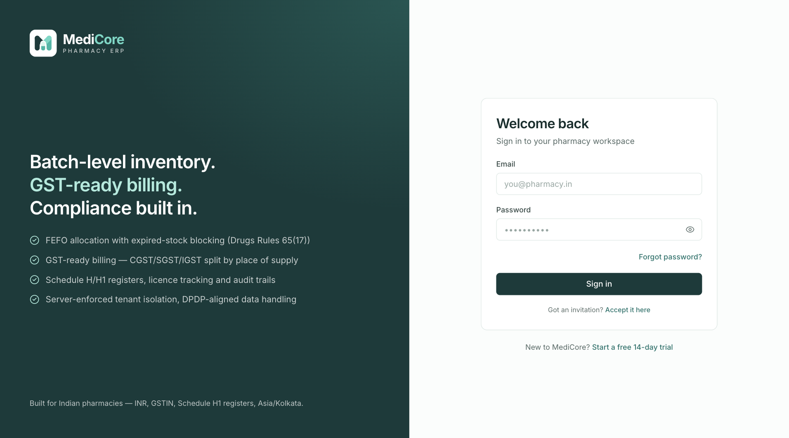

Screenshot 1: The sign-in screen with the links to start a free trial and to reset a forgotten password.

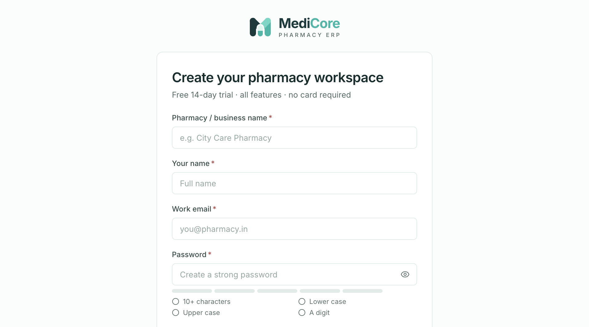

Screenshot 2: Registering a new pharmacy workspace (free 14-day trial).

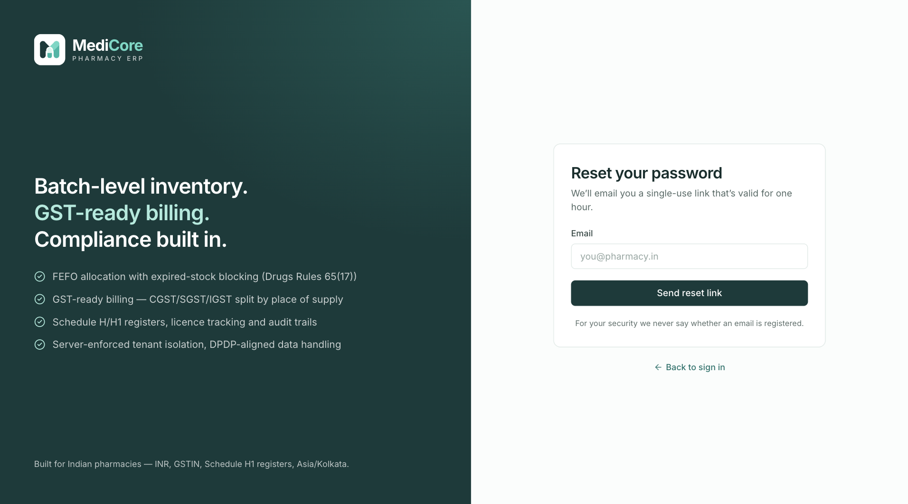

Screenshot 3: Requesting a password reset link.

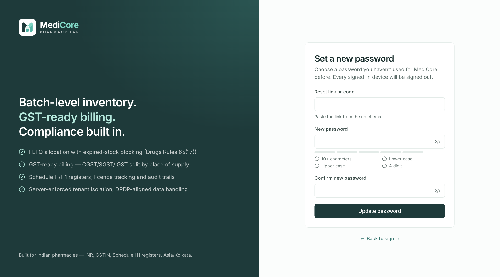

Screenshot 4: Setting a new password using the link or code from the email.

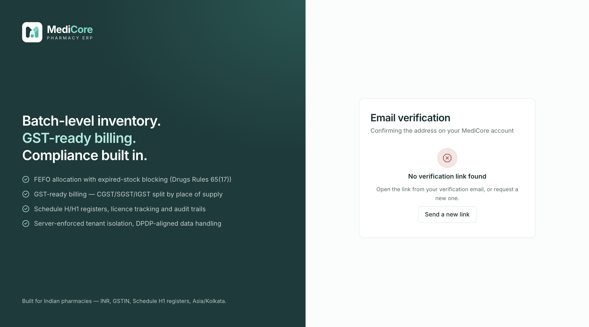

Screenshot 5: The email verification screen when a link is missing or expired.

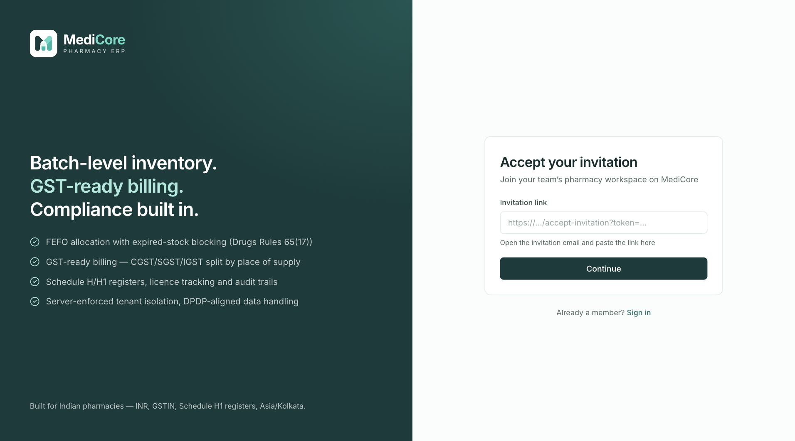

Screenshot 6: Accepting an invitation to join a pharmacy workspace.

**Why it exists.** Every action in MediCore is recorded against a named person, so shared logins are discouraged. Individual accounts also let you remove one person's access in a minute without disturbing anyone else.

**When to use it.**

- **Register** when you start a new pharmacy business. Do it once, as the owner.
- **Accept invitation** when the owner or admin invites you; the link arrives by email and is valid for seven days.
- **Forgot password** when you cannot sign in. The screen never says whether an email is registered, which protects you from strangers probing for accounts.
- **Verify email** after registering or being invited so that password resets and notices reach you.

**What you can do here:**

| Option | What it does | Why or when |
| --- | --- | --- |
| Start free trial (Register) | Creates a 14-day workspace with every module | Try the full product on real data before choosing a plan |
| Sign in with return path | After login, takes you back to the page you were on | Saves time when a session has expired mid-task |
| Accept invitation as a new user | Sets your name and password and joins the workspace with the role you were given | First-time staff |
| Accept invitation as an existing user | Confirms with your current password; your account joins a second workspace | A consultant or accountant who works for several pharmacies |
| Password reset link | Emails a single-use link valid for one hour | Forgotten or compromised password |
| Resend verification link | Sends a new email verification link | The first link expired |

**What the system expects.** A work email address, a password of at least 10 characters mixing upper and lower case with a digit, and a business name, state and basic details at registration.

**What the system blocks.** After repeated wrong passwords the account is locked for 15 minutes. Sign-in and similar actions are limited to 20 attempts per minute per address. A reset or invitation link can be used only once and expires.

**What you get.** A signed-in session of up to seven days that renews while you use it, and a main branch, main store and ten standard roles ready to use.

**Watch-outs:**

- Never share the owner login; invite people instead.
- Suspended or removed staff lose access immediately because their sessions are ended.
- Resending an invitation cancels the earlier link, so use the newest email.

### The application frame — sidebar, top bar, search and alerts

**At a glance:**

| Item | Detail |
| --- | --- |
| Where | Around every screen |
| Used by | Everyone |
| Plan needed | None |

**What it is.** The permanent frame: the left sidebar with menus, the top bar with branch and workspace switchers, the search palette, the notification bell and the account menu. Banners appear under the top bar when something needs attention.

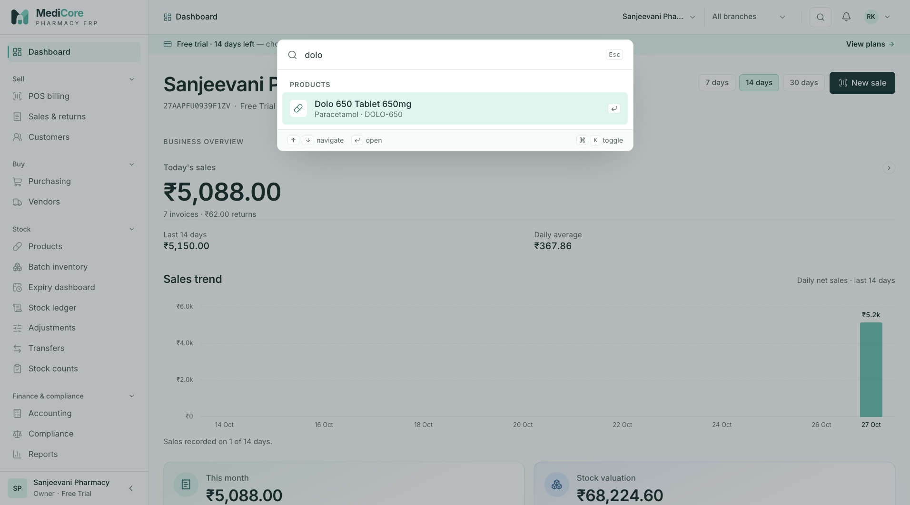

Screenshot 1: The command palette finding pages and records from a few typed letters.

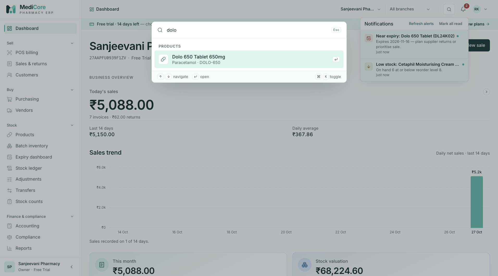

Screenshot 2: The notification bell listing low stock, near-expiry and licence alerts.

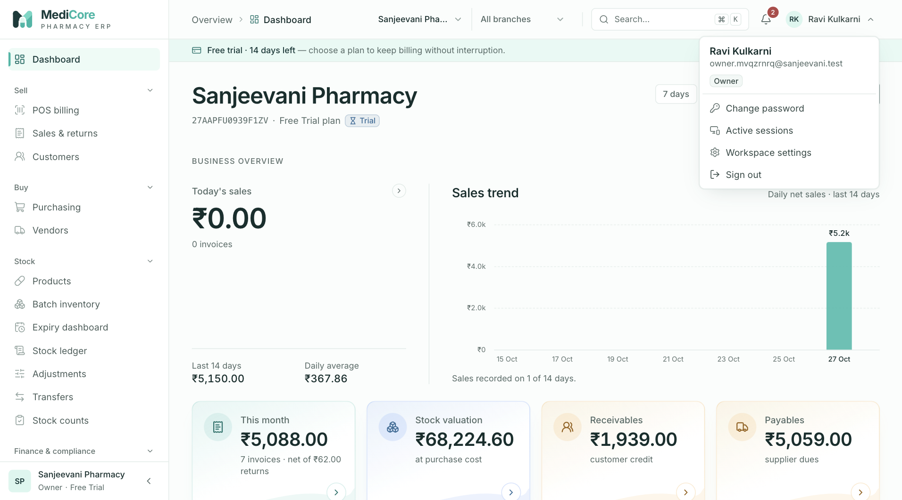

Screenshot 3: The account menu with password, sessions, settings and sign out.

**Why it exists.** A pharmacy runs on speed. The frame gives one-click access to any page, medicine, customer, supplier, invoice or batch, shows only the menus a person is allowed to use, and tells them the state of the subscription without needing a special page.

**When to use it.**

- **Sidebar** to move between jobs. Menus the plan does not include show a lock.
- **Branch switcher** whenever you work across shops: it decides where new transactions are recorded.
- **Search palette** (press Ctrl or Cmd with K) to jump straight to a medicine, customer, supplier, invoice number or batch number.
- **Notification bell** to see low stock, batches expiring within 30 days and licences expiring within 60 days.
- **Account menu** to change your password, see other devices signed in as you, or sign out.

**What you can do here:**

| Option | What it does | Why or when |
| --- | --- | --- |
| Workspace switcher | Moves between pharmacies you belong to | Accountants or owners with more than one business |
| Branch switcher | Sets the current shop for new documents | Multi-branch chains |
| Command palette | Finds pages and records by typing part of a name or number | Fastest way to open an invoice or a batch |
| Notification bell | Lists alerts and links to the screen that fixes each | Start-of-day check |
| Mark all as read | Clears the bell | After you have reviewed the alerts |
| Change password | Updates your password and signs out other devices | Routine hygiene or suspected exposure |
| Active sessions | Lists devices and lets you sign out others | A staff tablet was lost or left logged in |

**What the system expects.** Be in the right branch before billing, receiving or counting, because documents are recorded against the branch you are working in.

**What the system blocks.** Menus you do not have permission for are hidden. If your workspace is suspended or lapsed, banners explain it and, depending on the state, entry actions are blocked.

**What you get.** A consistent place to see who you are, where you are working and what needs attention.

**Watch-outs:**

- Billing from the wrong warehouse is the commonest cause of "out of stock" at the counter. Check the "Billing from" selector on POS.
- The bell is generated from live data: low stock, near-expiry batches and expiring licences. It is a prompt, not a substitute for the Expiry and Compliance screens.

### Dashboard

**At a glance:**

| Item | Detail |
| --- | --- |
| Menu path | Home |
| Used by | Owner, Admin, managers |
| Plan needed | Every plan |

**What it is.** A live summary of the business: today's and this month's sales and invoice counts, receivables, payables, stock value, recent invoices, a sales trend chart and a "Needs attention" panel. It refreshes every minute.

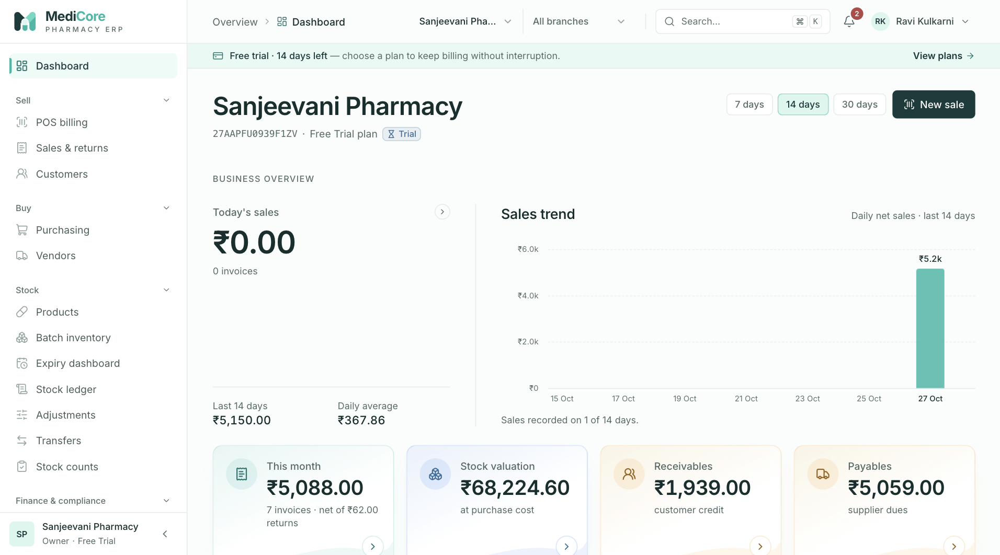

Screenshot 1: The dashboard with today and month figures, receivables, payables and the Needs attention list.

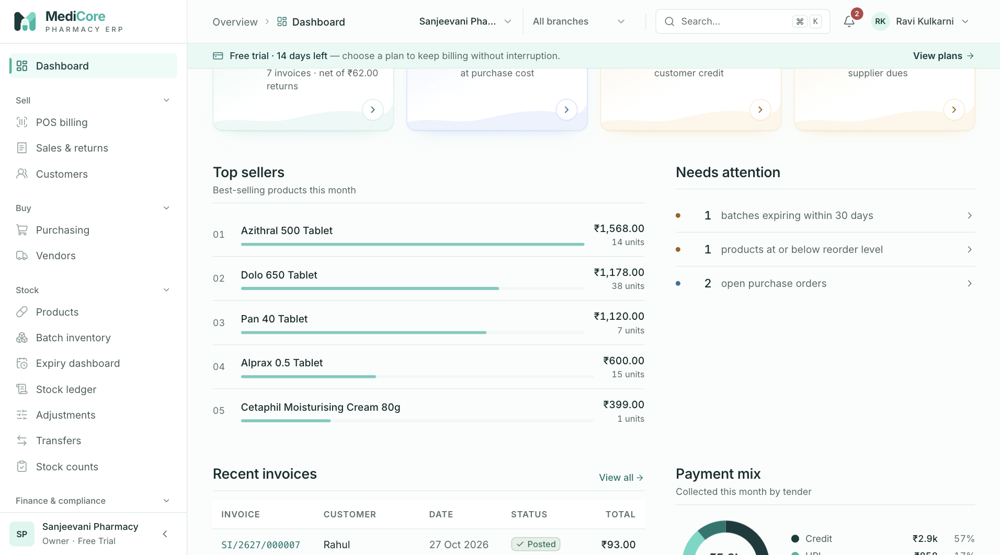

Screenshot 2: The sales trend chart switched to a 30 day range.

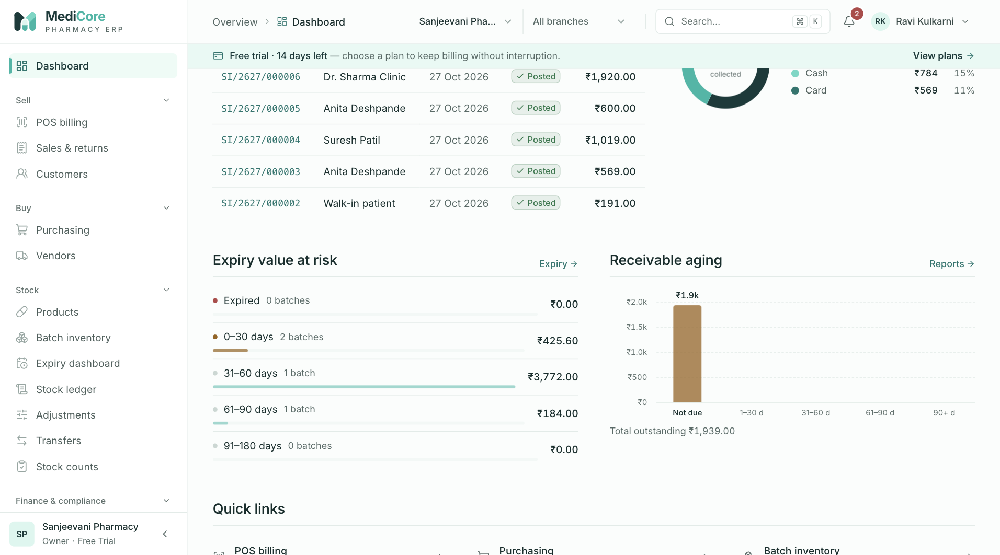

Screenshot 3: Recent invoices and the payment mix.

**Why it exists.** Owners should not need to run reports to know whether the day is on track. The dashboard shows the numbers that change decisions and the exceptions that need action.

**When to use it.**

- At the start of the day to see overdue dues, near-expiry stock, low stock and licence warnings.
- During the day to watch sales.
- During onboarding to follow the set-up checklist.

**What you can do here:**

| Option | What it does | Why or when |
| --- | --- | --- |
| Range chips (7, 14, 30 days) | Changes the sales trend window | Spot weekly patterns or a slow fortnight |
| New sale | Opens POS | Quick start for users who bill |
| Needs attention list | Links to expired stock, near-expiry, low stock, pending purchases, overdue dues, licence renewals and unfinished set-up | Turns warnings into a to-do list |
| Setup checklist | Shows which onboarding steps remain and lets the owner mark set-up complete | First days after registration |
| Recent invoices | Opens the latest bills | Quick look-up |
| Payment mix | Shows how customers are paying | Cash, UPI and card planning |

**What the system expects.** Complete the checklist items in order. Marking set-up complete only works when the mandatory steps are done.

**What you get.** Money figures that come from the same books as the Accounting screen, so the dashboard never contradicts the profit and loss.

**Watch-outs:**

- A sudden fall in "today's sales" may simply mean you are viewing a different branch.
- Stock value uses purchase cost, not selling price.

### POS billing

**At a glance:**

| Item | Detail |
| --- | --- |
| Menu path | Sell › POS billing |
| Used by | Cashier, Pharmacist, Owner, Admin |
| Plan needed | POS module (all plans include it) |

**What it is.** The counter billing screen. Staff find medicines by name, generic name, SKU or barcode, the system chooses the batches, checks price and stock, takes payment and issues a GST invoice.

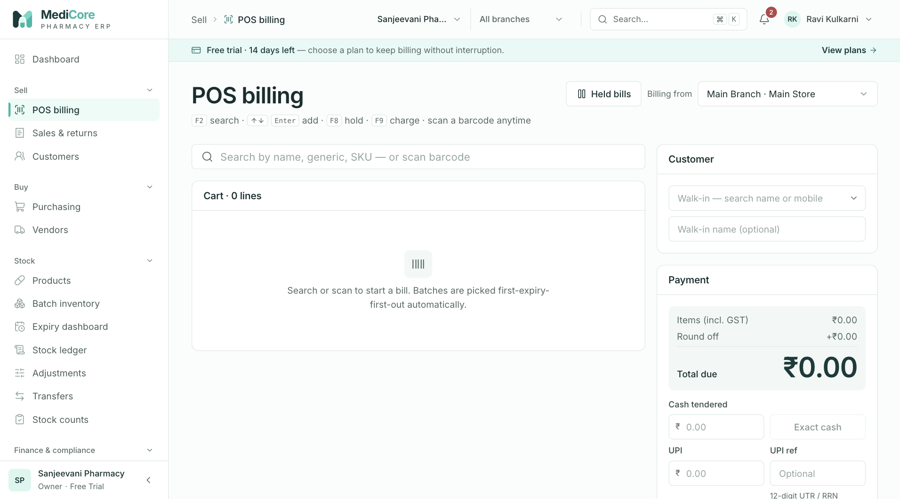

Screenshot 1: An empty POS screen ready for the first item, with the warehouse selector at the top.

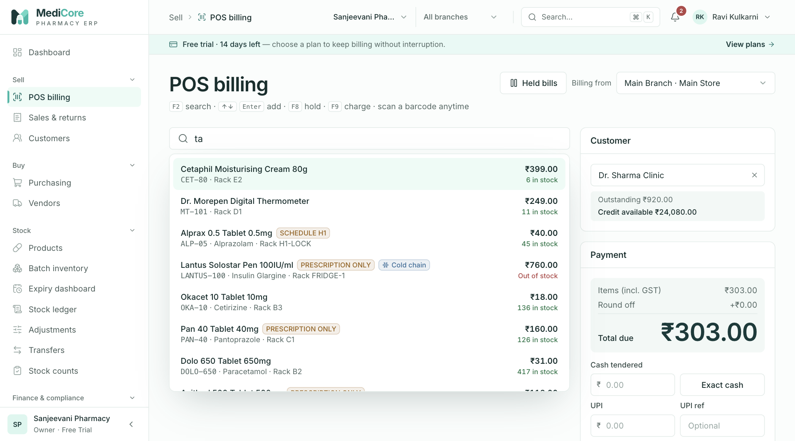

Screenshot 2: Search results showing price, stock, prescription class and cold-chain badges.

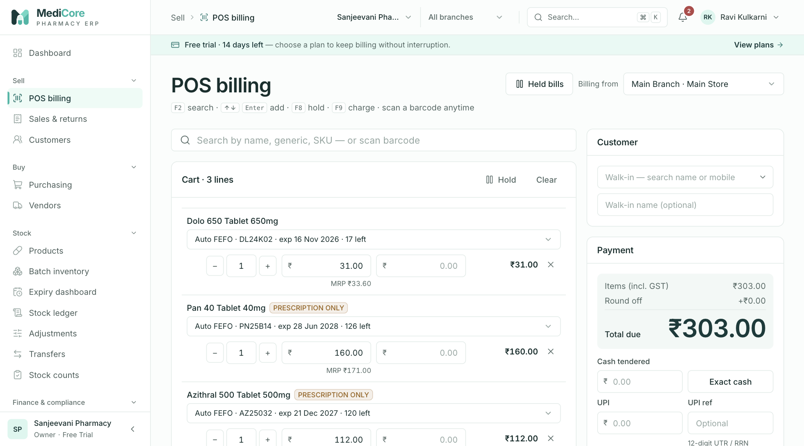

Screenshot 3: The cart with the batch selector, quantity, rate and discount for each line.

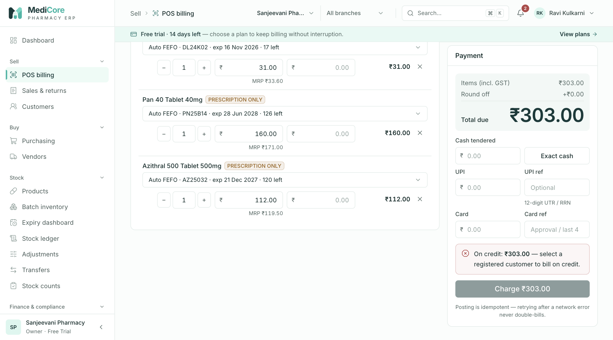

Screenshot 4: A bill paid with a mix of cash, UPI and card, showing change due.

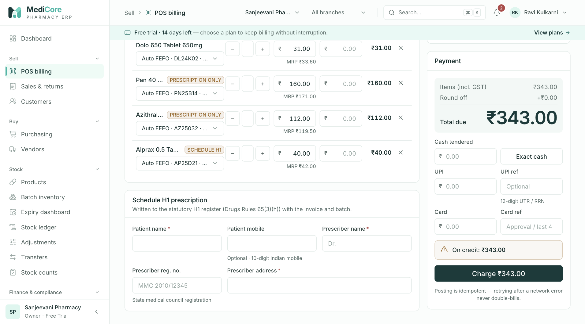

Screenshot 5: The Schedule H1 prescription card that appears for H1 medicines.

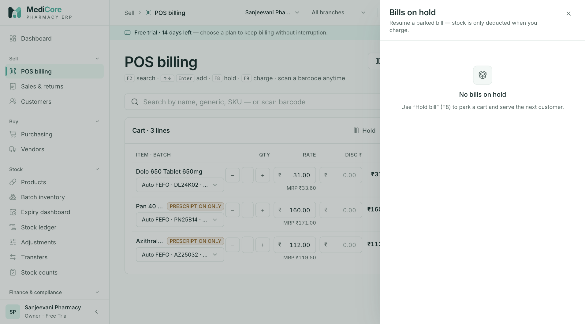

Screenshot 6: The Bills on hold drawer for parked bills.

**Why it exists.** At the counter, speed and correctness both matter. POS removes manual batch selection, GST arithmetic, round-off and register entries, so a cashier can serve a queue while the pharmacy stays compliant.

**When to use it.**

- Every retail or wholesale counter sale.
- When a customer wants to buy on credit (registered customers only).
- When a customer pays with several modes at once.
- When a customer leaves briefly or another customer is waiting: hold the bill.

Do not use POS to correct a past bill. Use a sales return for goods coming back, or cancel the bill if it was raised in error in the same month.

**Where it fits.** Before POS: products, batches (stock) and tax rates must exist. After POS: invoices appear in Sales & returns, stock changes show in Batches and Ledger, credit appears in Customers, H1 sales appear in Compliance.

**What you can do here:**

| Option | What it does | Why or when |
| --- | --- | --- |
| Billing from (warehouse) | Chooses which store's stock is sold | Shops with a shop floor and a back store, or several branches |
| Search (F2) | Finds active products by name, generic, SKU or brand | Medicine is on the counter without a barcode |
| Barcode scan | Adds the matching product directly | Packed goods with a barcode; fastest path |
| Auto FEFO batch | Sells from the batch expiring first | Default; reduces expiry loss |
| Choose a batch manually | Forces a specific batch (allowed if saleable and in stock) | Customer asks for a specific batch, or you must clear a particular lot; the override is audited |
| Quantity and rate | Sets units and the price per unit including GST | Rate defaults to the selling price (or MRP); you may lower it but never exceed MRP |
| Line discount (rupees) | Reduces the whole line by a rupee amount | Loyalty or negotiated discounts; it cannot exceed the line total |
| Show substitutes | Lists other active products with the same generic name | Item out of stock; the customer or pharmacist chooses, the system never substitutes by itself |
| Customer picker | Chooses a registered customer or leaves walk-in | Needed for credit, GST invoice to a business, or interstate sale |
| Walk-in name | Prints an optional name on a retail bill | Courtesy or home delivery bills |
| Quick-add customer | Creates a customer without leaving the bill | New regular customer or new credit account |
| Prescription card | Captures patient and prescriber details | Mandatory for Schedule H1 items |
| Cash, UPI, card tenders | Records how much came in each way, with references | Split payments are common |
| Exact cash | Fills the cash box with the exact amount due | Quick exact-change payments |
| Credit (on account) | Leaves the unpaid part as customer credit | Regular customers and wholesale buyers |
| Hold (F8) and Held bills | Parks the bill and lets you resume or discard it later | Serving the next customer; at most 20 held bills per branch |
| Clear | Empties the bill immediately | The customer walked away |
| Charge (F9) | Posts the invoice | The final step; retrying after a network error is safe |
| Print A4 or thermal | Prints the invoice | Customer copy |

**What the system expects:**

- Every product sold has a **GST rate** configured. If not, the line shows "No GST rate" and cannot be charged.
- The **rate does not exceed MRP.** Prices include GST.
- A **registered customer** is chosen for credit sales, and the customer is within their credit limit (a limit of zero means no limit).
- **Schedule H1** items have patient name, prescriber name and prescriber address; the prescriber registration number and patient phone are strongly recommended.
- Payments entered add up exactly to the rounded total. The system rounds the bill to the nearest rupee and shows the round-off.

**What the system blocks:**

- Expired, recalled, quarantined, damaged or empty batches cannot be picked.
- Selling more than a batch holds is refused; overselling is never allowed.
- Billing an inactive or blocked customer is refused.
- When your plan's monthly invoice quota is used up, new bills are blocked until the next month or an upgrade.
- If the accounting month is locked, bills dated in that month cannot be posted.

**What you get.** A numbered invoice (for example `SI/2627/000123`), reduced stock, booked sales and cost, a GST record, an H1 register line where applicable, and a printable bill. If cash exceeds the amount due, the screen shows the change to give back.

**Watch-outs:**

- Check "Billing from" at the start of every shift.
- The cashier should not repeatedly press Charge after a slow response; a retry is safe, but a second fresh bill is a second sale.
- Clear discards the whole bill without asking.
- A tax invoice is printed when the pharmacy has a GSTIN; otherwise the heading reads "Bill of supply".

### Sales & returns

**At a glance:**

| Item | Detail |
| --- | --- |
| Menu path | Sell › Sales & returns |
| Used by | Pharmacist, Cashier lead, Accountant, Owner |
| Plan needed | Sales history is part of POS; the return feature needs the Returns module (Professional and above, or trial) |

**What it is.** The register of every invoice and every sales return (credit note), with totals, payment split, open credit and status. Opening an invoice shows it exactly as it prints.

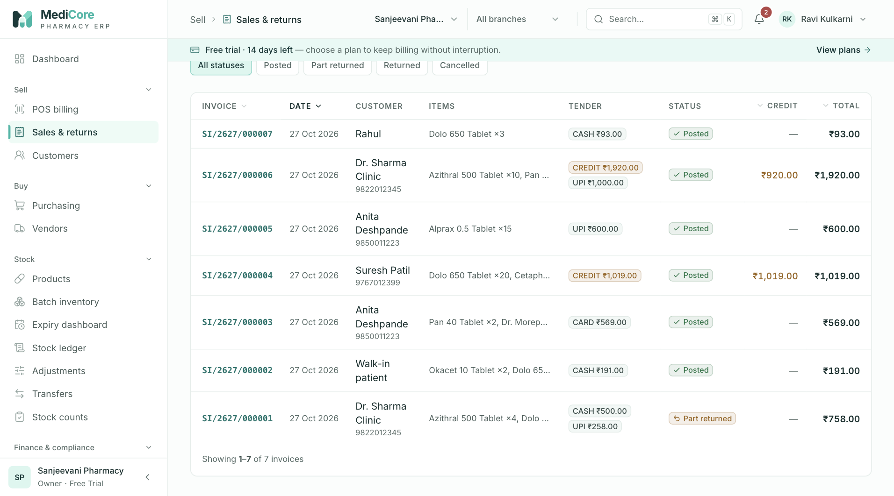

Screenshot 1: The invoice register with summary figures.

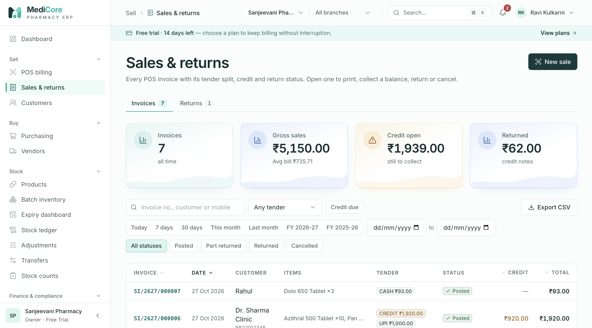

Screenshot 2: Filtering invoices by date, status and payment.

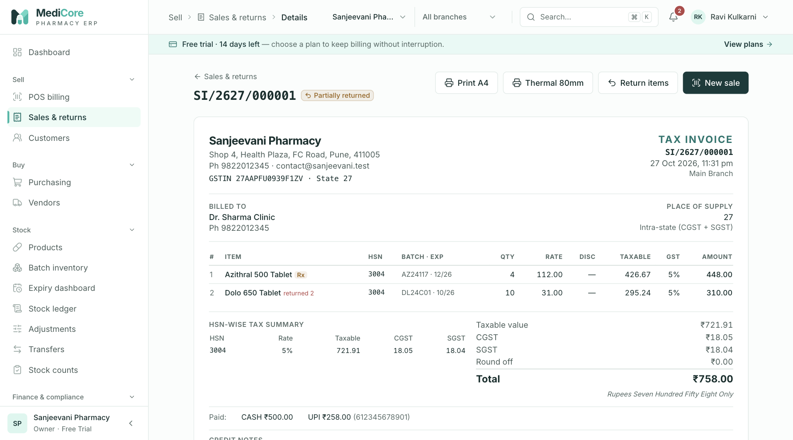

Screenshot 3: One invoice as it prints, with batches, HSN tax summary and payments.

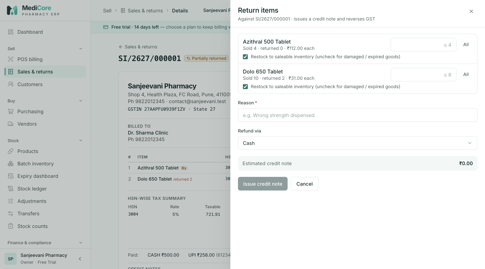

Screenshot 4: The return drawer where lines, quantities, restock and refund method are chosen.

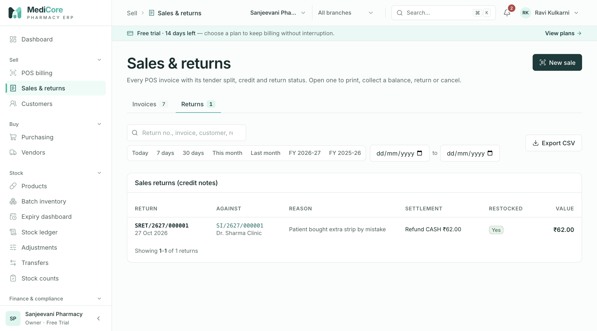

Screenshot 5: The Returns tab listing credit notes.

**Why it exists.** Customers lose bills, medicines come back, staff make mistakes and the accountant needs a clean list. This is the single place to find any bill and to deal with what happens after the sale.

**When to use it.**

- A customer comes back with a bill: find it by number, customer or date.
- To print or reprint an invoice in A4 or 80 mm thermal format.
- To take back medicine: raise a sales return.
- To cancel a bill raised in error: only within the same month.
- To export the month's invoices to a spreadsheet for the accountant.

**What you can do here:**

| Option | What it does | Why or when |
| --- | --- | --- |
| Invoices tab | Searchable, filterable list of bills with summary figures | Daily review, finding bills |
| Returns tab | List of credit notes | Reviewing what was taken back and why |
| Filters (date, status, payment, customer) | Narrow the list | End-of-day tally; dispute handling |
| CSV export | Downloads the filtered invoices | Accountant or analysis; recorded in the audit log |
| Print A4 | Full-page GST invoice | Business customers, record keeping |
| Print thermal 80 mm | Receipt-style bill | Counter customers |
| Collect payment | Records a customer payment against open credit on that invoice | Credit customer pays later |
| Return items | Creates a credit note for chosen lines and quantities | Medicine returned, wrong item, price disputes |
| Cancel invoice | Voids the bill and puts stock back | Bill raised in error, nothing has happened to it since |

**How to choose between Return and Cancel:**

| Question | Return (credit note) | Cancel |
| --- | --- | --- |
| Is the invoice from the current month? | Any month | Current month only |
| Has any part been returned already? | Allowed up to remaining quantity | Not allowed |
| Has the customer paid any receipt after billing? | Allowed | Not allowed |
| Part of the bill or the whole bill? | Either | Whole bill only |
| Effect on GST | Credit note reduces tax; shows in GSTR-1 as a credit note for registered buyers | Original invoice is voided before filing |
| Typical use | Customer changes mind, medicine returned | Cashier error, wrong customer, duplicate bill |

**What the system expects.** For a return: choose the lines and quantities, say whether the goods go back to saleable stock ("restock"), and how the customer is refunded. Any open credit on the invoice is cleared first; the rest is refunded in the chosen way (cash by default).

**What the system blocks:**

- Returning more than was sold, or more than remains after earlier returns.
- Cancelling a bill that has returns, later receipts, or that belongs to an earlier month (it may already be reported in GSTR-1; use a credit note instead).
- Posting into a locked accounting month.

**What you get.** A credit note numbered like `SRET/2627/000004`, tax reversed in proportion, stock returned to the original batch if restocked, cost of goods reversed, and an invoice status of Partially returned or Returned. A cancelled bill is marked Cancelled with its stock and books reversed.

**Watch-outs:**

- Do not restock medicines whose packaging is opened or whose storage conditions were not maintained. Leave "restock" off and handle them as a write-off.
- Many pharmacies do not accept returns of dispensed medicines for safety reasons; decide your policy and apply it consistently. MediCore supports the mechanics but does not enforce a return policy.

### Customers

**At a glance:**

| Item | Detail |
| --- | --- |
| Menu path | Sell › Customers |
| Used by | Cashier, Pharmacist, Store Manager, Accountant |
| Plan needed | Every plan |

**What it is.** The customer master and receivables desk. It holds regular patients, institutions, clinics and wholesale buyers, with GSTIN, address, credit terms and outstanding balance.

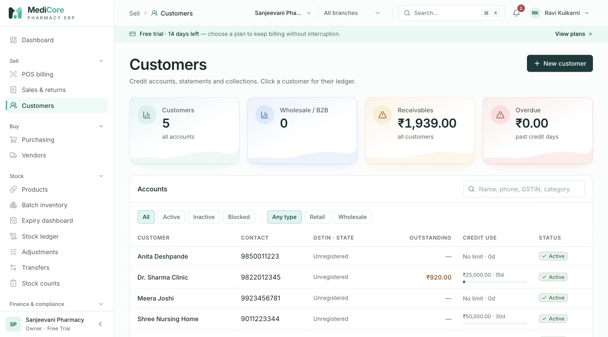

Screenshot 1: The customer list with outstanding balances and credit limits.

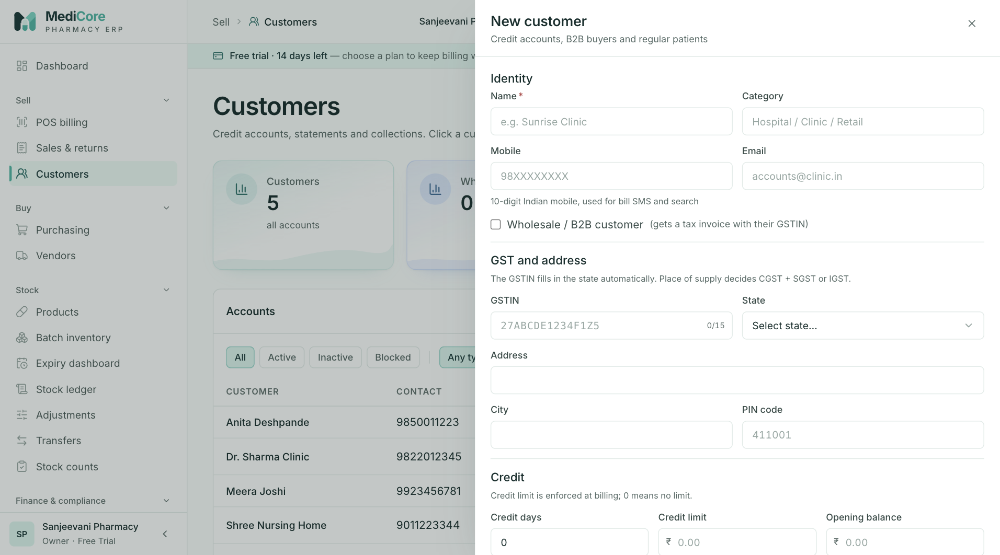

Screenshot 2: Creating a customer with GSTIN, state and credit terms.

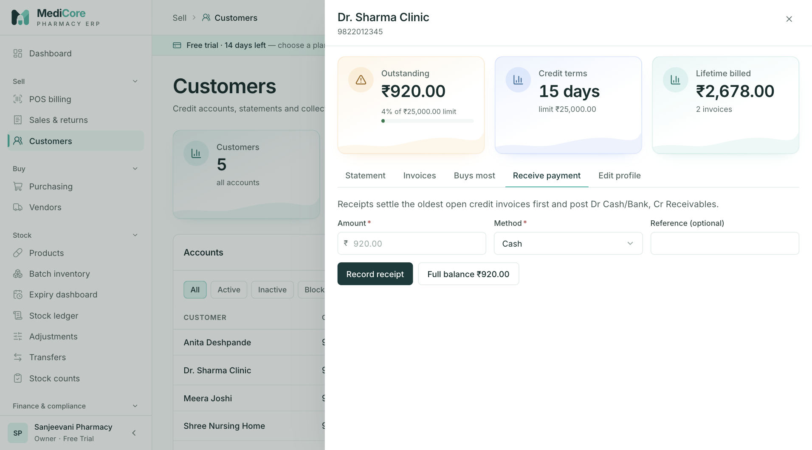

Screenshot 3: Recording a payment received against open credit.

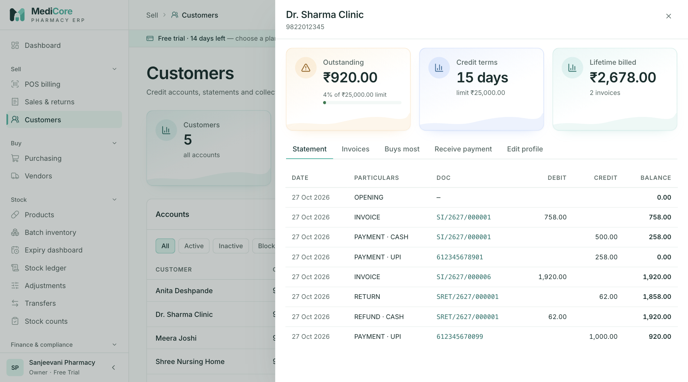

Screenshot 4: A customer statement of account.

**Why it exists.** Credit selling is common in Indian pharmacies and wholesale. The system must remember who owes how much, stop credit beyond a limit and make collection easy. Business buyers also need their GSTIN on the invoice so that you can show them correctly in GSTR-1.

**When to use it.**

- Before the first credit sale to a person or business.
- When a customer pays against what they owe.
- To send or print a statement of account.
- To see whom to chase: the aging report in Reports complements this screen.

**What you can do here:**

| Option | What it does | Why or when |
| --- | --- | --- |
| New customer | Adds a customer with contact details, GSTIN, state, credit days and credit limit | New credit account or business buyer |
| Wholesale flag | Marks the buyer as wholesale | Distributor or bulk buyers |
| Status Active, Inactive, Blocked | Controls whether they can be billed | Stop credit to a defaulter by blocking |
| Credit limit | Maximum outstanding allowed; zero means no limit | Risk control |
| Credit days | Agreed payment period | Used for reminders and aging |
| Opening balance | Amount already owed at the start | Migrating from an older system |
| Statement | Running account of invoices, returns and receipts | Reconciling with the customer |
| Receive payment | Records money received and applies it to open invoices | Credit collection |
| Top products | Shows what this customer buys | Offers and stock planning |
| Filters and search | Finds by name, phone, GSTIN, category, outstanding | Quick look-up |

**What the system expects.**

- For B2B customers, a valid GSTIN. The check digit, state code and PAN are verified when you save.
- A **state** on every customer. If the customer's state differs from your state, the sale is charged IGST instead of CGST plus SGST.
- A realistic credit limit for each credit customer.

**What the system blocks.** Bills to inactive or blocked customers; credit beyond the limit; invalid GSTINs.

**What you get.** An outstanding figure equal to the opening balance plus every unpaid credit amount, a printable statement, and receipts that reduce the dues.

**Watch-outs:**

- The opening balance is held on the customer record; it is not posted to the books. Treat it as an information figure and agree it with your accountant.
- Retail walk-ins do not need a customer record; create one only when credit, a GST invoice or a statement is needed.

### Purchasing — buying from suppliers

**At a glance:**

| Item | Detail |
| --- | --- |
| Menu path | Buy › Purchasing |
| Used by | Purchase Manager, Accountant (payments), Owner |
| Plan needed | Purchases module (Professional, Business, Enterprise, trial) |

**What it is.** The buying workspace, organised as five tabs that mirror the paperwork of a purchase: purchase orders, goods receipts, supplier invoices, payments and debit notes. Four summary cards at the top show what is open and what is due.

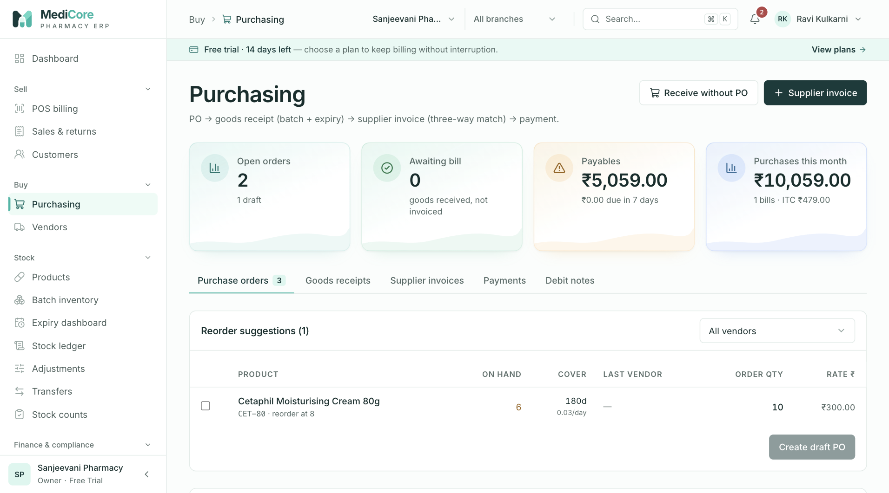

Screenshot 1: The purchasing workspace with summary cards and the five tabs.

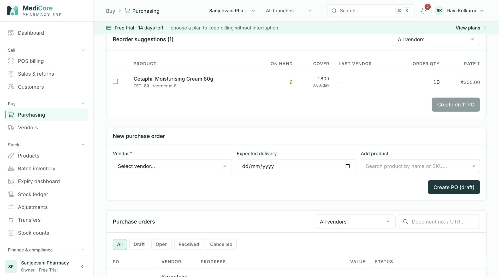

Screenshot 2: Reorder suggestions for items at or below their reorder level.

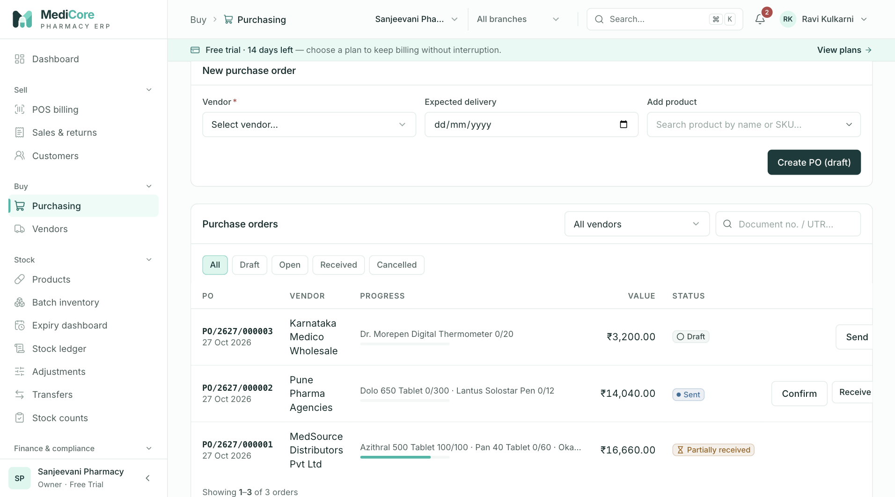

Screenshot 3: Building a new purchase order.

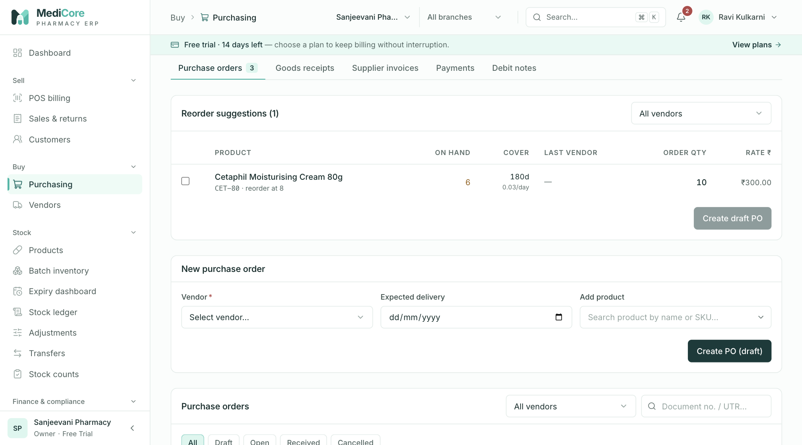

Screenshot 4: The purchase order list with Send, Confirm and Cancel actions.

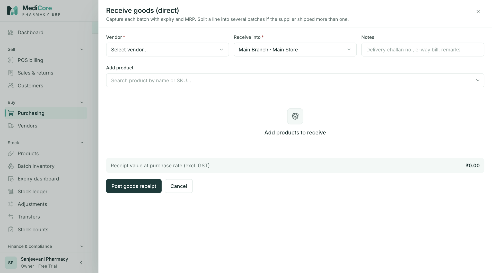

Screenshot 5: Receiving goods directly, one line per batch with expiry and cost.

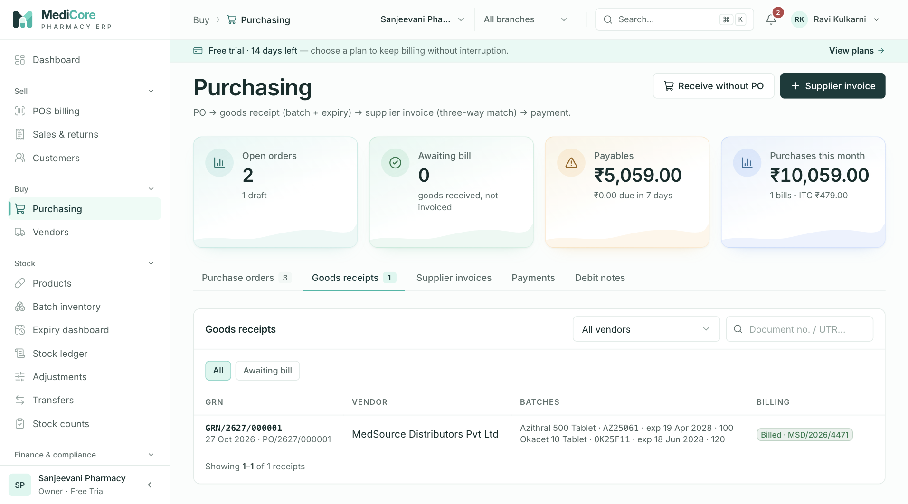

Screenshot 6: The Goods receipts tab.

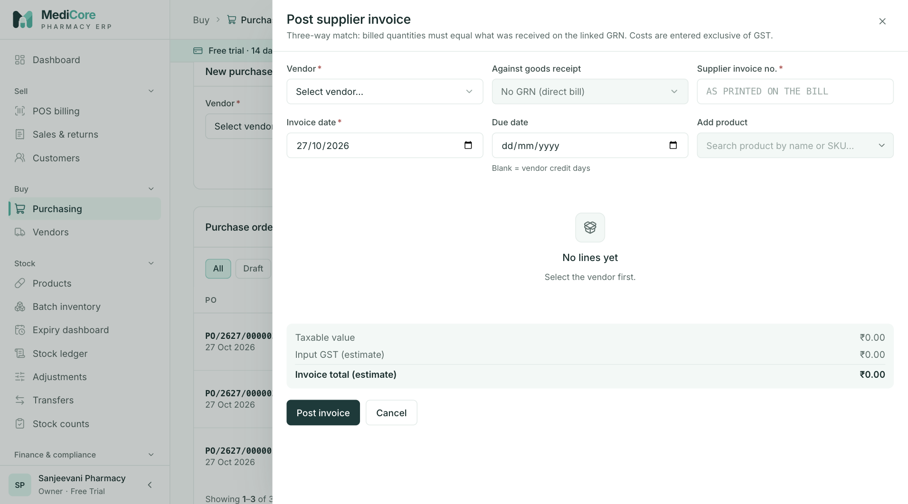

Screenshot 7: Booking a supplier invoice.

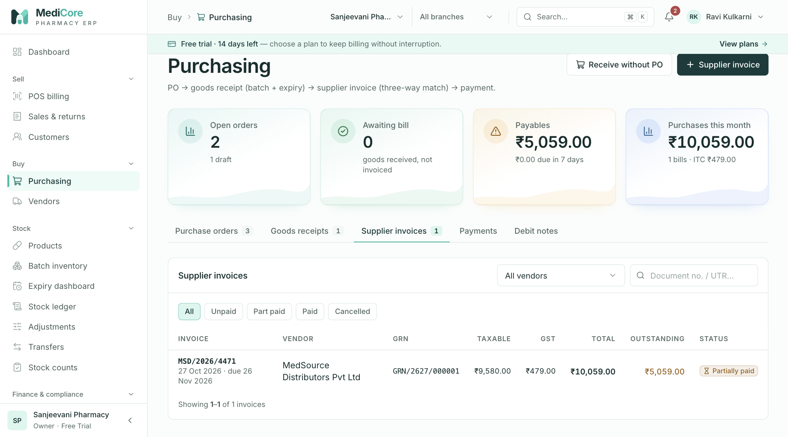

Screenshot 8: The Supplier invoices tab with due dates.

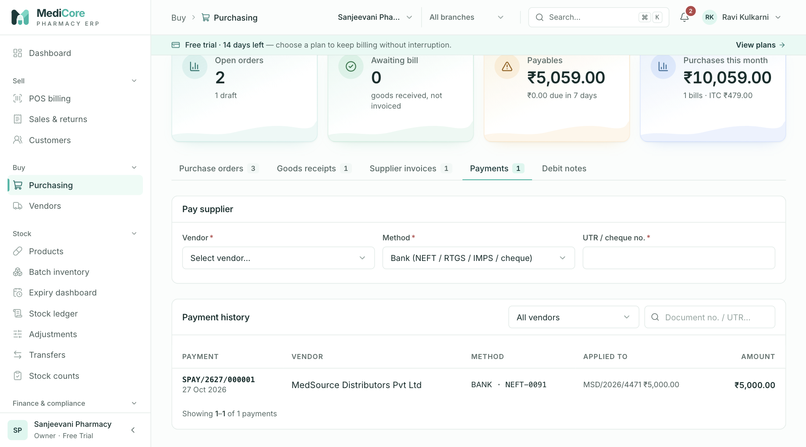

Screenshot 9: The Payments tab.

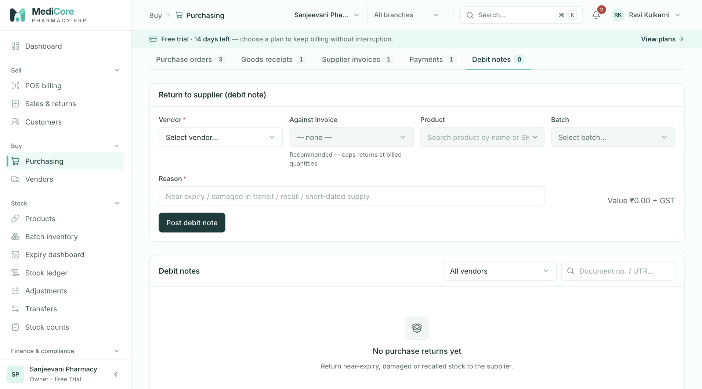

Screenshot 10: The Debit notes tab listing purchase returns.

**Why it exists.** Buying mistakes are expensive: paying for goods that never arrived, accepting short-dated stock, losing input tax credit, or paying the same bill twice. The five-step flow puts a check at each handover.

**When to use it.** Whenever stock is ordered, received, billed, paid for or returned to a supplier.

**Where it fits.** Needs vendors and products. Feeds batches (stock), the vendor ledger, accounting (inventory, input GST, payables) and the GST purchase summary.

**What you can do here — the five tabs:**

| Tab | What it is | Why or when |
| --- | --- | --- |
| Purchase orders | Your order to a vendor | Planned buying; create from reorder suggestions or manually |
| Goods receipts | Physical receipt, batch by batch | When the delivery arrives |
| Supplier invoices | The vendor's bill, matched to the receipt | When the vendor's invoice arrives |
| Payments | Money paid to vendors, allocated to invoices | On payment day |
| Debit notes | Returns to the vendor | Damaged, expired, wrong or recalled goods |

**Purchase orders tab.**

| Option | What it does | Why or when |
| --- | --- | --- |
| Reorder suggestions | Lists products at or below reorder level with suggested quantities | Start of the buying round |
| New purchase order | Builds an order for a vendor and a warehouse | Placing an order |
| Send | Moves a draft to Sent | Order has gone to the vendor |
| Confirm | Moves Sent to Confirmed | Vendor acknowledged; you can now receive against it |
| Cancel | Cancels Draft, Sent or Confirmed orders | Order withdrawn |
| Receive goods | Starts a goods receipt from this order | Delivery arrives |

**Goods receipts tab.**

| Option | What it does | Why or when |
| --- | --- | --- |
| Receive against a purchase order | Pre-fills lines from the order | Normal deliveries |
| Direct receipt (no order) | Receives goods that were not ordered through the system | Phone or walk-in purchases |
| Batch lines | Batch number, expiry, quantity, free quantity, cost, MRP per line | Every strip must be traceable to a batch |
| Partial receipt | Receives part of an order | Short or staggered deliveries; the order becomes Partially received |

**Supplier invoices tab.**

| Option | What it does | Why or when |
| --- | --- | --- |
| Book invoice against a receipt | Compares billed and received quantities | The standard three-way match |
| Direct invoice | Enters an invoice without a receipt | Services or exceptional cases |
| Duplicate check | Warns if the same vendor invoice number exists | Avoids double-booking |
| Due date | Defaults to invoice date plus the vendor's credit days (30 if none) | Payment planning |

**Payments tab.**

| Option | What it does | Why or when |
| --- | --- | --- |
| Pay supplier | Records a payment and allocates it across one or more invoices | Settling vendor dues |
| Cash, bank or UPI | The mode of payment | Chooses which asset account falls |
| Reference (UTR) | Bank or UPI transaction reference | Reconciliation with bank statement |

**Debit notes tab.**

| Option | What it does | Why or when |
| --- | --- | --- |
| New purchase return | Sends goods back against an invoice; stock falls, payable falls | Goods rejected or returned |

**What the system expects.**

- The vendor is **Active**.
- Each receipt line carries **batch number and expiry**. The same lot received twice merges into one batch; a different expiry creates a new batch.
- The **supplier's invoice quantity equals what you received**, product by product. If not, fix the receipt or the invoice first.
- Invoice dates are not in the future; line costs are entered **before tax**.
- A payment is not larger than the outstanding amount of any invoice it is allocated to.

**What the system blocks:**

- Receiving more than the open order quantity.
- Invoicing a receipt twice, or booking a duplicate supplier invoice number.
- Over-allocating a payment.
- Returning more than was invoiced.
- Moving an order through an invalid status step (for example confirming a draft).

**What you get.** Stock in the right batch and warehouse after the receipt; inventory and input GST on the books after the invoice; payables that fall when you pay; a vendor ledger with running balance and overdue days. Documents are numbered `PO`, `GRN`, `SPAY` and `PRET` per financial year.

**Watch-outs:**

- **Stock appears when you receive; value is booked when you book the supplier invoice.** If goods are received but not yet invoiced, stock valuation in Reports shows the difference as unbooked.
- Input GST credit is counted only for suppliers who have a GSTIN.
- The vendor's drug licence number and expiry are stored but not checked when posting. Review them yourself.

### Vendors

**At a glance:**

| Item | Detail |
| --- | --- |
| Menu path | Buy › Vendors |
| Used by | Purchase Manager, Accountant, Pharmacist (read) |
| Plan needed | Every plan |

**What it is.** The supplier and distributor master with a ledger for each vendor.

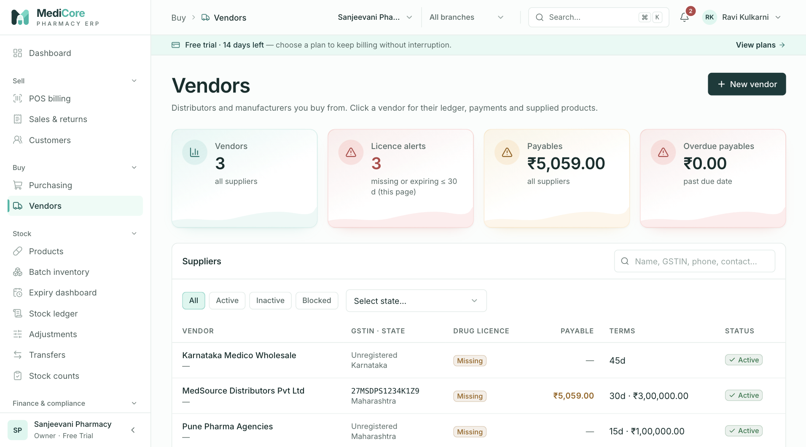

Screenshot 1: The vendor list with overdue badges.

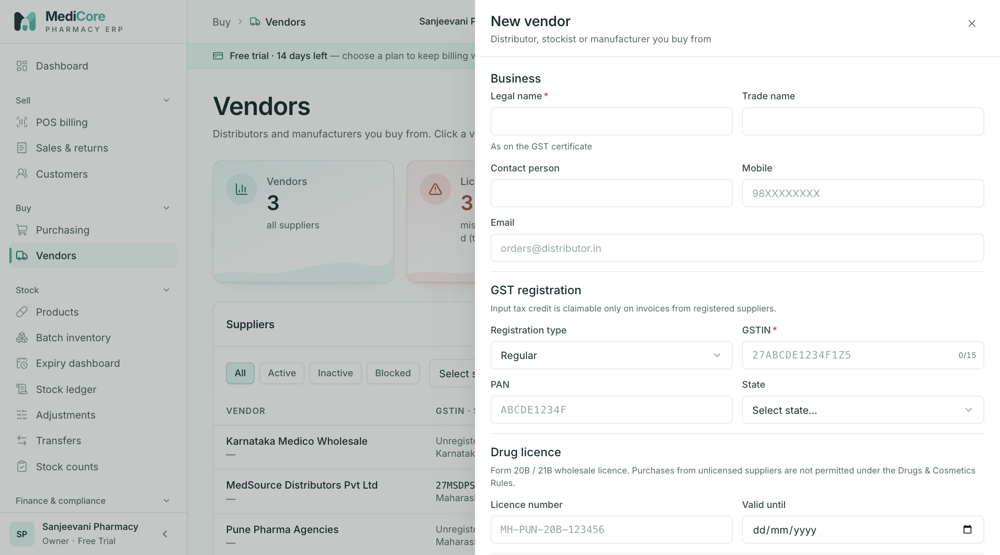

Screenshot 2: Creating a vendor with GST, licence and bank details.

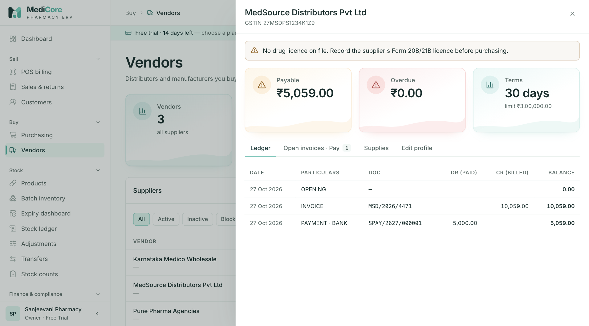

Screenshot 3: A vendor ledger with running balance.

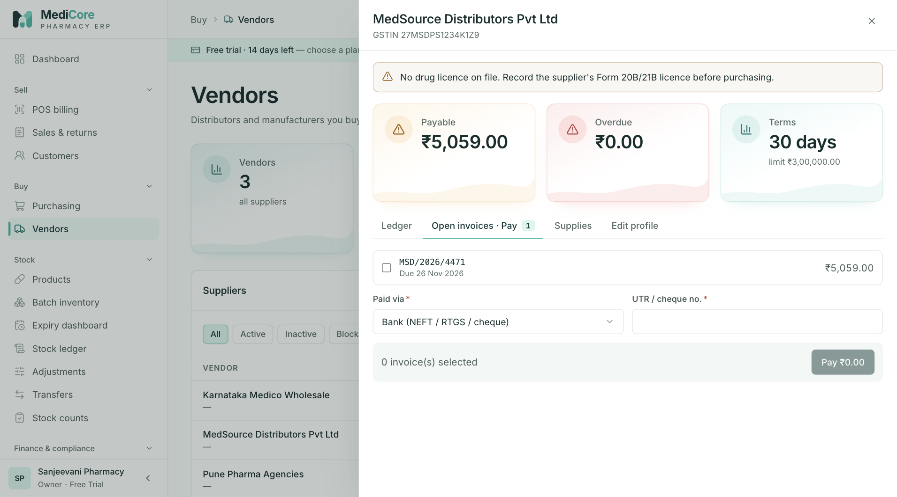

Screenshot 4: Paying a vendor from its open invoices.

**Why it exists.** To buy correctly you need each supplier's legal name, GSTIN, state, credit terms and licence details in one place, and to pay correctly you need to see what you owe each of them, which invoices are overdue and which payments are unallocated.

**When to use it.**

- Before the first order to a new supplier.
- When a supplier changes GSTIN, address or terms.
- When preparing a payment run: open the vendor to see open invoices and overdue days.
- When reconciling with the supplier's statement.

**What you can do here:**

| Option | What it does | Why or when |
| --- | --- | --- |
| New vendor | Creates a supplier with GST, PAN, address, contact, credit days and limit, licence number and expiry, bank details | Onboarding a supplier |
| GST registration type | Regular, Composition or Unregistered | Decides whether input tax credit is available |
| Status Active, Inactive, Blocked | Controls whether you can buy from them | Stop buying from a poor supplier |
| Ledger | Running balance of invoices, payments and debit notes | Reconciling with the vendor |
| Open invoices | What is outstanding and overdue | Planning payments |
| Pay from here | Opens the payment form for the vendor | Quick settlement |
| Supplies | Products bought from this vendor | Price comparison and reorder choices |
| Overdue badges | Highlights past-due bills | Protecting your credit relationship |

**What the system expects.** A valid GSTIN for registered suppliers (format, check digit, state and PAN are validated), a valid IFSC and a bank account number between 9 and 18 digits. A positive opening balance means you owe the supplier.

**What the system blocks.** Purchases from inactive or blocked vendors, and invalid tax or bank identifiers.

**What you get.** A trustworthy payable picture per supplier and the data needed for the input credit summary.

**Watch-outs:** keep the licence number and expiry current; the system displays them but does not stop a purchase from a supplier whose licence has lapsed.

### Products

**At a glance:**

| Item | Detail |
| --- | --- |
| Menu path | Stock › Products |
| Used by | Inventory Manager, Pharmacist, Store Manager, Purchase Manager (read) |
| Plan needed | Every plan |

**What it is.** The medicine and product catalogue: one record per sellable item (brand, strength, form, pack), with its prices, tax classification, prescription class and stocking rules.

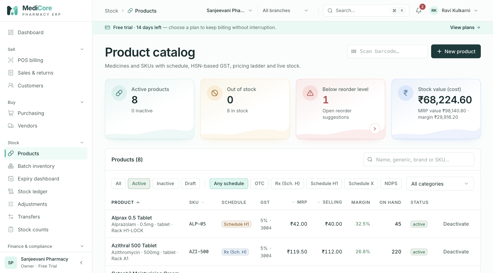

Screenshot 1: The product catalogue with the GST column and No rate badge.

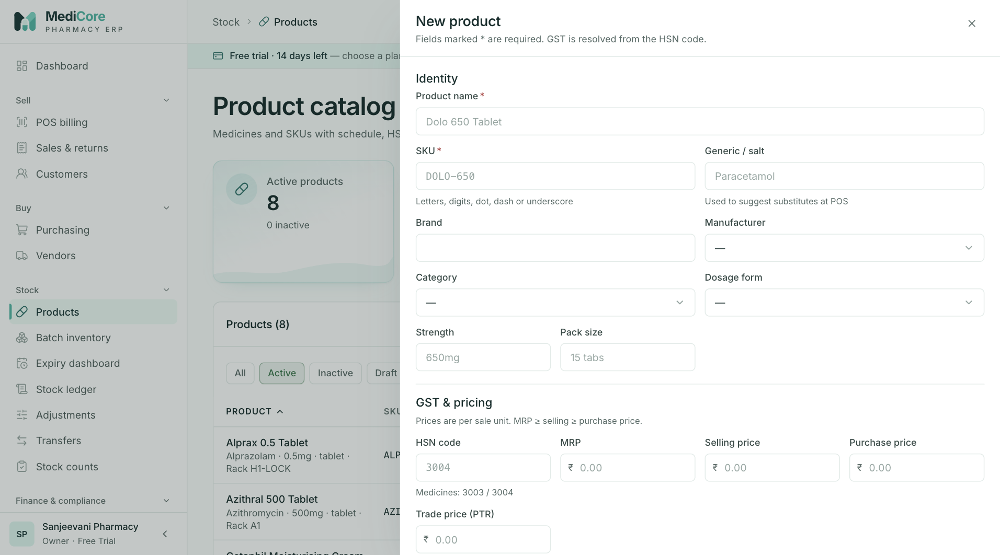

Screenshot 2: Creating a product with prices, HSN and prescription class.

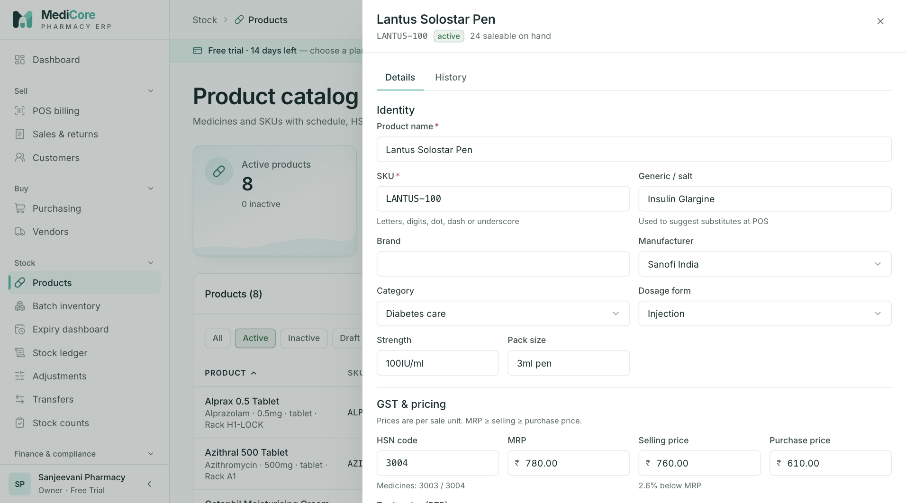

Screenshot 3: A product detail drawer.

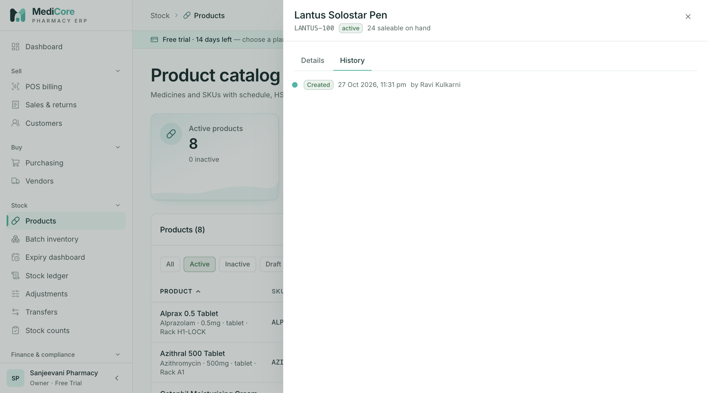

Screenshot 4: The change history of a product.

**Why it exists.** Everything else depends on the product record being right. It decides how the cashier finds the item, what GST applies, whether a prescription is needed, whether the price may exceed MRP, when to reorder and whether the item is refrigerated.

**When to use it.**

- Before the first purchase or sale of a new item.
- When the MRP, GST classification or reorder level changes.
- When a product is discontinued: deactivate it rather than delete it.
- To find a substitute, review change history, or check barcodes.

**What you can do here:**

| Option | What it does | Why or when |
| --- | --- | --- |
| New product | Creates an item with SKU, name, generic, brand, category, manufacturer, form, strength, pack | Adding a medicine to the catalogue |
| SKU | Your unique code for the item | Must be unique in your workspace |
| Generic name | The salt or composition | Enables substitute search at the counter |
| Prescription class | OTC, Prescription only (Schedule H), Schedule H1, Schedule X, Narcotic | H1 triggers the prescription card and register at billing |
| HSN code | 4, 6 or 8 digit classification | Finds the GST rate; most medicines fall in chapter 30 |
| Pinned tax rate | Optionally fixes a specific rate version | Rare; leave blank to use the latest effective rate |
| MRP, purchase, selling and trade price | Price points | Selling price may not exceed MRP; MRP may not be below cost |
| Purchase unit, sale unit, conversion | Buy in boxes, sell in strips | Wholesale packs versus loose units |
| Reorder level, maximum stock, minimum order quantity | Stocking rules | Drives low-stock alerts and reorder suggestions |
| Refrigerated flag | Marks cold-chain items | Shows a Cold chain badge at the counter and in stock screens |
| Rack location | Shelf position | Faster picking and counting |
| Barcodes | Several barcodes per product | Scanner lookup at POS |
| Duplicate check | Warns of similar products | Avoids two records for the same medicine; different strengths are never merged |
| Substitutes | Same-generic items | Out-of-stock handling |
| History | Shows who changed what and when | Price disputes and audits |
| Deactivate and reactivate | Hides from selling and buying without deleting | Discontinued or recalled brands |
| Status Draft, Active, Inactive | Controls availability | Only Active products can be sold |

**What the system expects.** Accurate MRP from the pack, a valid HSN, the correct prescription class, and a rate in Configuration for that HSN.

**What the system blocks.** Duplicate SKUs; selling price above MRP; MRP below cost; HSN codes of the wrong length; selling inactive products.

**What you get.** A catalogue that the cashier can search quickly, with a green GST column (or a red "No rate" badge that tells you to fix Configuration).

**Watch-outs:**

- Every strength and every pack size is a separate product. Do not reuse one record for 250 mg and 500 mg.
- Change MRP when new batches arrive with a new MRP, but remember the selling ceiling uses the product MRP.
- Never use SKU to carry batch or expiry information; that belongs on the batch.

### Batch inventory — Batches and opening stock

**At a glance:**

| Item | Detail |
| --- | --- |
| Menu path | Stock › Batches |
| Used by | Inventory Manager, Store Manager, Pharmacist |
| Plan needed | Every plan |

**What it is.** A batch is one manufacturer lot of one product in one warehouse, with its own batch number, expiry, cost and MRP. The Batches screen lists every batch with balance, status and expiry, and lets you load opening stock.

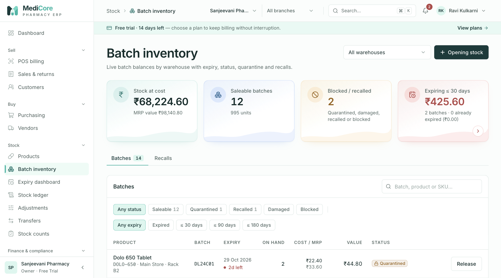

Screenshot 1: Batch inventory summary cards and filters.

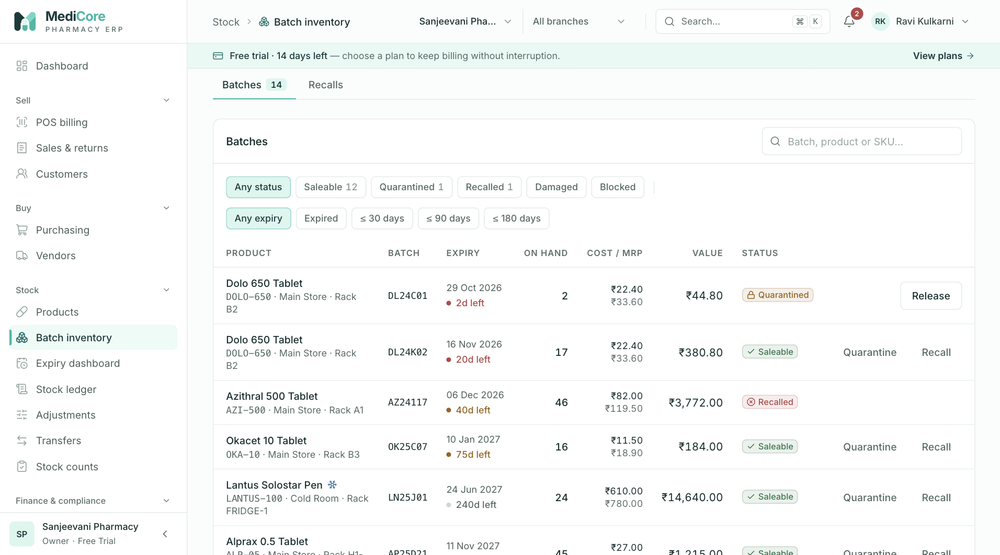

Screenshot 2: The batch list sorted by expiry.

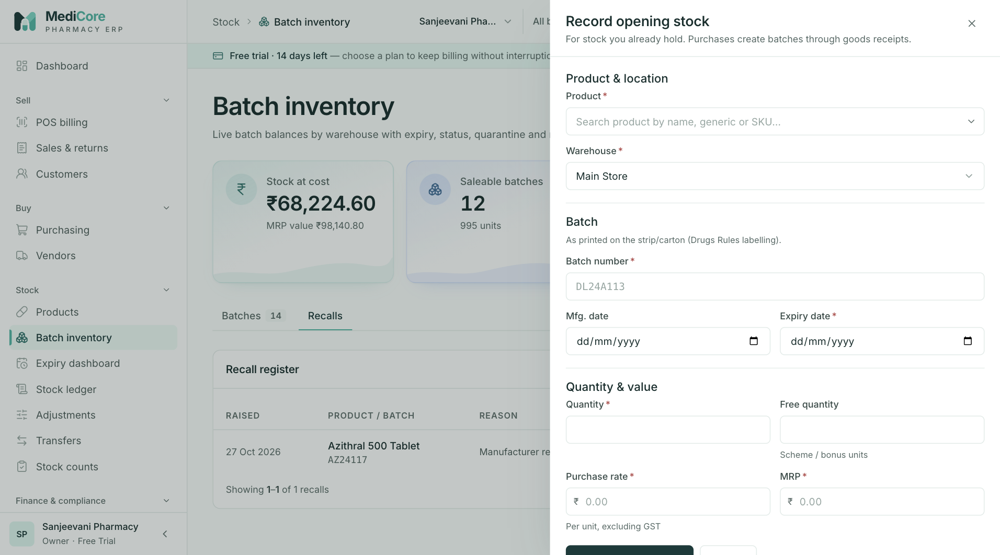

Screenshot 3: Recording opening stock for an existing batch.

**Why it exists.** Medicine is regulated by lot: recalls, expiry and returns all happen at batch level. Knowing exactly which lot is on which shelf lets you sell the oldest first, pull a recalled lot, and return near-expiry lots to suppliers.

**When to use it.**

- At go-live to enter opening stock.
- To check the stock of a product by lot and expiry.
- To quarantine a doubtful lot, mark it damaged, or release it.
- To start a recall (see the next section).

**What you can do here:**

| Option | What it does | Why or when |
| --- | --- | --- |
| Summary cards | Total stock, value at cost and at MRP, batch counts | Quick stock health check |
| Warehouse selector | Switches stock location | Multi-warehouse shops |
| Search | Finds by batch, product or SKU | Matching what is on the shelf |
| Status chips | Any, Saleable, Quarantined, Recalled, Damaged, Blocked | Review problem stock |
| Expiry chips | Any, Expired, 30, 90, 180 days | Focus on ageing stock |
| Opening stock | Creates or merges a batch with quantity, cost, MRP and expiry | Go-live or one-off stock found without paperwork |
| Batch detail | Shows the movement history of a lot | Tracing a discrepancy |
| Change status | Saleable, Quarantined, Damaged or Expired-blocked | Hold doubtful stock; release when cleared |

**Batch statuses in plain words:**

| Status | Meaning | Can it be sold? |
| --- | --- | --- |
| Saleable | Normal stock within expiry | Yes |
| Quarantined | Held back for checking or "not for sale" | No |
| Recalled | Under a manufacturer or regulator recall | No |
| Damaged | Physically unusable | No |
| Expired-blocked | Expired and written off or blocked | No |

**What the system expects.** Batch number and expiry exactly as printed, a manufacturing date that is not after expiry, and a warehouse chosen correctly.

**What the system blocks.** A batch can only become Recalled through a recall (see the next section), never by a plain status change. Stock cannot be driven below zero.

**What you get.** A lot-level stock position that reconciles to the movement ledger.

**Watch-outs:**

- Entering the same lot twice with the same expiry adds to the existing batch; entering it with a different expiry creates a second batch. That is correct behaviour, so check the expiry before saving.
- Opening stock is booked to the books as inventory against Opening Balance Equity. Agree the opening position with your accountant before go-live so the balance sheet starts correctly.

### Batch inventory — Recalls

**At a glance:**

| Item | Detail |
| --- | --- |
| Menu path | Stock › Batches, Recalls tab |
| Used by | Pharmacist, Inventory Manager |
| Plan needed | Every plan |

**What it is.** The record of manufacturer or regulator recalls. Creating a recall against a batch immediately marks it Recalled and blocks it from sale and transfer. Resolving it records what was done.

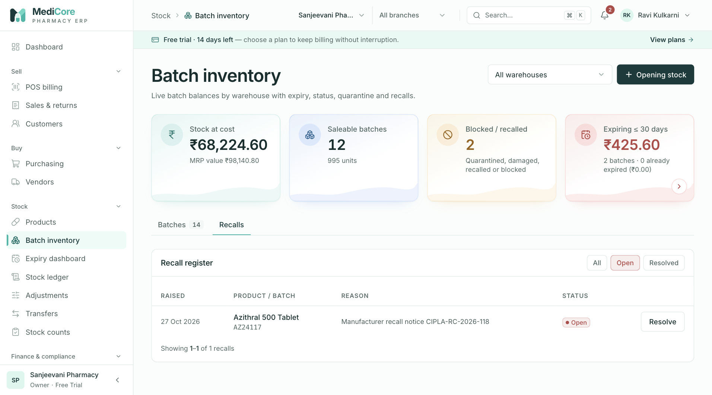

Screenshot 1: The Recalls tab with open and resolved recalls.

**Why it exists.** A recall is time-critical and legally important. The pharmacy must stop selling the lot, locate the stock, return or destroy it and keep a record of the action.

**When to use it.** The moment you receive a recall notice for a lot you stock, or when a regulator or supplier requires you to stop selling a lot.

**What you can do here:**

| Option | What it does | Why or when |
| --- | --- | --- |
| Create recall | Selects the batch and records the reason; the batch becomes Recalled | Start of a recall |
| Resolve recall | Records resolution notes and closes the recall | After stock is returned, destroyed or cleared |
| Recall list | Shows open and resolved recalls | Audit evidence |

**What the system expects.** A clear reason and, on resolution, notes saying what was done to the stock (returned to supplier, destroyed, and so on).

**What the system blocks.** Any attempt to sell or transfer a recalled batch.

**What you get.** Immediate protection at the counter and an evidence trail for inspectors.

**Watch-outs:** a recall stops the sale, but physical removal from the shelf still needs a person. Use the Batches filter for Recalled stock to find what to pull.

### Expiry

**At a glance:**

| Item | Detail |
| --- | --- |
| Menu path | Stock › Expiry |
| Used by | Store Manager, Inventory Manager, Pharmacist, Purchase Manager |
| Plan needed | Every plan |

**What it is.** A dashboard of expired and soon-to-expire stock grouped into buckets with the cost and MRP value at risk, and a tool to write off what cannot be sold.

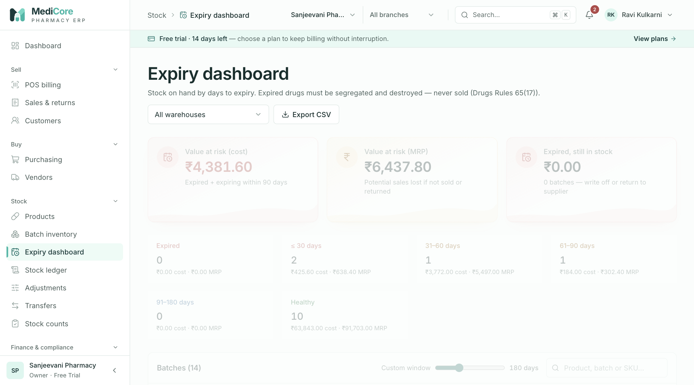

Screenshot 1: The expiry dashboard with value at risk by bucket.

Screenshot 2: Filtering the batch list to one expiry bucket.

**Why it exists.** Expiry is the largest avoidable loss in a pharmacy. Seeing the exposure early allows you to return goods to suppliers, move stock between branches, discount, or sell down before the date.

**When to use it.** Weekly as a routine, plus before placing large orders (so you do not buy what you already have too much of) and at month-end for write-offs.

**What you can do here:**

| Option | What it does | Why or when |
| --- | --- | --- |
| Bucket cards | Expired, within 30, 60 and 90 days, custom window | Prioritise action by urgency |
| Custom window slider | Extends the horizon up to 365 days | Planning returns well ahead |
| Value at risk | Shows cost value and MRP value | Understand financial exposure |
| Search | Finds a product, batch or SKU | Targeting a specific item |
| Select batches and bulk write-off | Posts an expiry write-off and blocks the batches | Month-end clean-up |

**What the system expects.** Review near-expiry lots in time to return them. Supplier return windows are often 60 to 90 days before expiry; the system cannot know your agreements, so check them.

**What the system blocks.** Writing off a batch that has no stock.

**What you get.** Expired batches blocked from sale, stock reduced, and an inventory loss booked at cost.

**Watch-outs:**

- Expiry in the system is by calendar date. A product expiring this month is saleable through its last date but is flagged earlier.
- A write-off is a loss. Prefer a supplier return (debit note) when the supplier accepts it.

### Stock ledger

**At a glance:**

| Item | Detail |
| --- | --- |
| Menu path | Stock › Ledger |
| Used by | Store Manager, Auditor, Accountant, Inventory Manager |
| Plan needed | Every plan |

**What it is.** The permanent history of every stock movement: receipts, sales, returns, transfers, adjustments, count corrections, recalls and quarantines. Quantities are plus for stock in and minus for stock out.

Screenshot 1: The stock ledger listing every movement with reason and source document.

**Why it exists.** When someone asks "why is the stock 37?" this is the answer. Because rows can never be edited or deleted, the ledger is the proof behind every balance.

**When to use it.**

- To trace a stock difference found during a count.
- To investigate a complaint ("I never received that batch").
- To support an audit or inspection.
- To export history for analysis.

**What you can do here:**

| Option | What it does | Why or when |
| --- | --- | --- |
| Filters (product, batch, warehouse, type, date) | Narrow movements | Investigation |
| Movement reasons and source documents | Show why stock changed and which document caused it | Trace to the invoice, GRN or adjustment |
| CSV export | Downloads the filtered movements | Evidence or analysis; recorded in the audit log |

**What the system expects.** Nothing is entered here; it is read-only. Use it to understand, then correct through Adjustments, Counts or a return.

**What you get.** Confidence that balances equal the sum of movements. A reconciliation check confirms it.

**Watch-outs:** corrections are new movements, not edits. Do not look for an "edit" button.

### Adjustments

**At a glance:**

| Item | Detail |
| --- | --- |
| Menu path | Stock › Adjustments |
| Used by | Store Manager, Inventory Manager, Pharmacist |
| Plan needed | Every plan |

**What it is.** A controlled way to correct stock for a stated reason: breakage, theft, damage, expiry write-off, temperature excursion, data entry mistakes and so on.

Screenshot 1: Posting a stock adjustment with a reason code.

Screenshot 2: Adjustment history and filters.

**Why it exists.** Real stores have losses and mistakes. Making each correction carry a reason, a quantity, a user and a financial effect stops quiet "fixes" and tells you where losses come from.

**When to use it.** When a specific batch quantity must change and the cause is known. For general differences found by counting the shelf, use a stock count instead.

**What you can do here:**

| Option | What it does | Why or when |
| --- | --- | --- |
| Direction In or Out | Increases or decreases stock | Found stock versus lost stock |
| Reason code | Damage, Breakage, Expiry write-off, Theft or loss, Count correction, Data entry correction, Temperature excursion, Contamination, Other | Explains the loss and groups reports |
| Notes | Free text | Mandatory when the reason is Other |
| Summary and history | Totals by reason and a list of past adjustments | Loss analysis |

**What the system expects.** A positive quantity, the right batch, and a truthful reason. Cost is taken from the batch.

**What the system blocks.** An adjustment that would take the batch below zero; an Other reason with no notes.

**What you get.** Stock changed immediately, and a book entry: an Out posts an inventory loss; an In posts an inventory gain.

**Watch-outs:**

- Frequent theft or breakage adjustments are a signal to investigate, which is why reasons matter.
- For a physical recount, use Stock counts rather than many individual adjustments.

### Transfers

**At a glance:**

| Item | Detail |
| --- | --- |
| Menu path | Stock › Transfers |
| Used by | Store Manager, Inventory Manager |
| Plan needed | Every plan (multiple warehouses depend on plan limits) |

**What it is.** The document that moves stock from one warehouse to another, within a branch or between branches.

Screenshot 1: Creating a transfer between warehouses.

Screenshot 2: The transfer list and statuses.

**Why it exists.** Stock in a van or on a shelf between shops is neither at the source nor at the destination. A transfer document keeps it visible as "in transit" so that nothing disappears.

**When to use it.** Replenishing a shop floor from the back store, moving cold-chain stock to or from the cold room, or rebalancing stock between branches.

**What you can do here:**

| Option | What it does | Why or when |
| --- | --- | --- |
| New transfer | Chooses source, destination and lines (product, batch, quantity) and dispatches | Starting a move; stock leaves the source immediately |
| Receive | Records quantities that arrived, in full or in part | The goods reach the destination |
| Cancel | Cancels an undelivered transfer and returns stock | The move did not happen |
| Status | Dispatched, In transit, Partially received, Received, Cancelled | Follow progress |

**What the system expects.** Receive what actually arrived. For partial arrivals, receive the part and follow up on the rest.

**What the system blocks.** Receiving more than was sent (the whole receipt is rejected); cancelling a completed transfer; moving recalled or blocked batches.

**What you get.** Stock reduced at source on dispatch and added at destination on receipt, with the same batch and expiry carried across.

**Watch-outs:** do not leave transfers open for weeks; stock in transit is not available to sell anywhere.

### Stock counts

**At a glance:**

| Item | Detail |
| --- | --- |
| Menu path | Stock › Counts |
| Used by | Store Manager, Inventory Manager, Auditor (read) |
| Plan needed | Every plan |

**What it is.** A physical or cycle count. The system prints a count sheet from its current balances, staff enter what they actually find, and the differences are posted as stock corrections.

Screenshot 1: The stock count list with statuses.

**Why it exists.** Shelf stock drifts because of breakage, theft, mis-picks and unrecorded returns. A count brings the system back to reality and highlights where the drift is.

**When to use it.** Regularly (monthly cycle counts of a section are better than one annual wipe), after suspected theft, before month-end close or when preparing for audit.

**What you can do here:**

| Option | What it does | Why or when |
| --- | --- | --- |
| New count | Chooses a warehouse and scope and takes a snapshot of system quantities | Starting a count |
| Enter counted quantity | Records what staff found for each batch | During the count |
| Review variance | Shows count minus system | Decide whether to recount before posting |
| Post | Converts variances into stock movements | When you are satisfied |
| Cancel | Abandons the count without changes | Count aborted |
| Statuses | Draft, In progress, Completed, Posted, Cancelled | Follow the process |

**What the system expects.** Do not sell or receive in the counted area during the count, or the snapshot will be out of date. Count by batch, not just by product.

**What the system blocks.** Posting a count that is not completed; more than one line for the same batch in one count.

**What you get.** Count-variance movements in the ledger, with stock corrected in one transaction.

**Watch-outs:** a large variance is a question to answer before you post. Recount the line, check recent receipts and returns, then post.

### Accounting

**At a glance:**

| Item | Detail |
| --- | --- |
| Menu path | Finance & compliance › Accounting |
| Used by | Accountant, Owner, Auditor (read) |
| Plan needed | Accounting module (Business, Enterprise, trial) |

**What it is.** The double-entry books of the pharmacy, produced automatically from sales, returns, receipts, purchases, payments, debit notes, expenses and stock movements. You read profit and loss, trial balance and balance sheet here, drill into any account, post manual journals, record expenses and lock months.

Screenshot 1: Profit and loss with the monthly trend.

Screenshot 2: The trial balance with the Balanced badge.

Screenshot 3: The balance sheet.

Screenshot 4: Journal entries and the manual journal form.

Screenshot 5: Recording and reviewing expenses.

**Why it exists.** A pharmacy owner needs to know real profit, not just sales. Because the books are built from the same transactions as billing and stock, there is no end-of-month re-keying and no gap between the shop's records and the accountant's.

**When to use it.**

- Weekly or monthly to review profit, gross margin and expenses.
- When recording a rent, salary, electricity or other expense.
- When the accountant needs an adjusting journal.
- At month-end, to confirm the books balance and then lock the period.

**What you can do here:**

| Option | What it does | Why or when |
| --- | --- | --- |
| Financial year selector | Shows the current or one of the three previous April–March years, or a custom range | Compare years or analyse a period |
| Metric cards | Net sales, gross profit and margin, operating expenses, net profit | Quick health check |
| Profit & loss tab | Income and expenses by account with a monthly trend and expense split | Understand profit and where money went |
| Trial balance tab | Every account with debit and credit totals and a Balanced badge | Confirm the books are in order |
| Balance sheet tab | Assets against liabilities plus equity | Financial position at a date |
| Click any account | Opens its general ledger with a running balance | Trace a figure to its entries |
| Journals tab | Lists entries and lets you post a manual journal voucher | Adjustments that no operation creates |
| Reverse a journal | Posts an equal and opposite entry, once only | Correcting a wrong manual or automatic entry |
| Expenses & periods tab | Records expenses by category and method and shows spending | Day-to-day cost recording |
| Lock or reopen a month | Stops any new posting dated in that month | After filing GST and finalising accounts |
| CSV export | Downloads profit and loss or balance sheet | Sharing with the chartered accountant |

**Expense categories you can choose:** Rent, Salaries and wages, Electricity, Internet and phone, Repairs and maintenance, Transport and delivery, Packaging, Licence and professional fees, Bank charges, Marketing, Stationery and printing, Miscellaneous. Pick the most specific one so your "where the money went" chart means something.

**What the system expects.**

- Manual journals must balance (total debit equals total credit) and have at least two lines.
- Expenses are recorded with the correct date, payee, category and mode (cash, bank or UPI).
- Months are locked only after all entries for that month are in.

**What the system blocks.**

- Unbalanced journals and negative amounts.
- Reversing an entry twice, or reversing a reversal.
- Any posting dated in a locked month, whether it is a sale, purchase, return, adjustment, expense or manual journal.

**What you get.** Always-balanced books, profit that agrees with the dashboard, and a locked history once you close a month.

**Watch-outs:**

- A warning appears if cash or bank is negative: it usually means a payment was recorded before the opening capital or the receipts. Record the owner's capital or the missing receipts.
- Locking a month also blocks billing dated in it. Lock only after the month is truly over.
- Inventory is booked at the supplier invoice, not at the goods receipt.
- Vendor and customer opening balances are not posted to the books.

### Compliance

**At a glance:**

| Item | Detail |
| --- | --- |
| Menu path | Finance & compliance › Compliance |
| Used by | Pharmacist, Accountant, Owner, Auditor |
| Plan needed | Every plan |

**What it is.** The statutory desk: GST return data (GSTR-1 and GSTR-3B), the Schedule H1 register, the licence register and the integration status list.

Screenshot 1: The GSTR-1 summary and export buttons.

Screenshot 2: The GSTR-3B computation.

Screenshot 3: The Schedule H1 register.

Screenshot 4: The licence register with expiry alerts.

Screenshot 5: The integrations list showing Not connected status.

**Why it exists.** Pharmacies must file GST returns on time, keep prescription registers for inspection, and hold valid drug licences. This screen turns your day-to-day transactions into the figures and records that those obligations need.

**When to use it.**

- Early each month to prepare the previous month's GST data.
- Whenever an inspector asks for the H1 register.
- When a licence is renewed or about to expire.
- To see which integrations (e-invoice, e-way bill, messaging, payments) are connected.

**What you can do here — the four tabs:**

| Tab | What it is | Why or when |
| --- | --- | --- |
| GST returns | GSTR-1, GSTR-3B and input credit by supplier for a chosen month | Monthly return preparation |
| Schedule H1 register | Every Schedule H1 dispensing with patient, prescriber, drug, quantity and date | Inspection and retention |
| Licences | Your drug and other licences with numbers, authority and dates | Renewal tracking |
| Integrations | Status of external connections | Know what is and is not live |

**GST returns tab.**

| Option | What it does | Why or when |
| --- | --- | --- |
| Return period | Chooses the month (defaults to last month) | Preparing a return |
| Due-date badges | Show the GSTR-1 date (11th) and GSTR-3B date (20th) of the next month | Reminders for monthly filers |
| GSTR-1 summary | Splits sales into business buyers (B2B), large interstate retail (B2CL), other retail (B2CS), credit notes (CDNR), HSN summary and document series | Checking before upload |
| GSTR-1 JSON | Downloads a file in the GST offline-tool format | Upload to the GST portal |
| HSN CSV | Downloads the HSN-wise summary | Cross-check or reporting |
| GSTR-3B | Shows outward supplies, interstate retail by state, input credit, reversals and tax payable after set-off | Preparing the payment |
| ITC by supplier | Input credit grouped by supplier | Matching with supplier filings |

**Schedule H1 register tab.** Choose a date range, review entries and export CSV. Keep these records for at least three years.

**Licences tab.**

| Option | What it does | Why or when |
| --- | --- | --- |
| Add licence | Records type (Form 20, 21, 20B, 21B, 20F, 20G, narcotic, FSSAI, GST, trade or other), number, authority, issue and expiry dates | Initial set-up and every renewal |
| Update licence | Edits dates and details | Renewal |
| Expiry banners | Red at 30 days or less, amber at 60 days or less | Prompt renewal early |
| Advisory checks | Reminds you that Forms 20 and 21 go together, as do 20B and 21B, and warns if no drug sale licence is on file | Avoid gaps |

**Integrations tab.** Lists e-invoice (IRP), e-way bill, WhatsApp, SMS, email and payment gateway. MediCore is honest about status: **none are connected**, and saving settings never marks them as live.

**What the system expects.**

- GST rates and HSN codes are correct on products.
- Customers have GSTINs where they are registered buyers, and the right state.
- Suppliers have GSTINs if you want to claim input credit.
- Licences are entered and kept current.

**What the system blocks.** Exports are limited to users with export permission and are written to the audit log.

**What you get.** Return-ready summaries and an H1 register that you can print or export. The summaries are **preparation aids, not filed returns**. You still file on the GST portal.

**Watch-outs:**

- Input credit counts only purchases from suppliers with a GSTIN.
- E-invoicing (for turnover above ₹5 crore) and e-way bills are not connected; businesses that need them must use the government tools.
- Schedule X, narcotics, and Schedule H prescription capture are not fully supported yet. See [What MediCore does not do yet](#what-medicore-does-not-do-yet).
- The GST rate loader and compliance notes are guidance, not legal advice. Have your chartered accountant confirm rates.

### Reports

**At a glance:**

| Item | Detail |
| --- | --- |
| Menu path | Finance & compliance › Reports |
| Used by | Owner, Store Manager, Analyst, Accountant, Auditor |
| Plan needed | Every plan |

**What it is.** Operational and financial analysis: what sold, how it was paid for, what stock is worth, what is not moving, and who owes whom.

Screenshot 1: The Sales report.

Screenshot 2: The Stock valuation report.

Screenshot 3: The Dead and slow stock report.

Screenshot 4: Receivables and payables aging.

**Why it exists.** Decisions about buying, pricing, credit and staffing need evidence. Reports turn your transactions into answers without spreadsheet work.

**When to use it.** Weekly management reviews, before purchase rounds, at month-end, and when chasing dues.

**What you can do here — the four tabs:**

| Tab | What it shows | Why or when |
| --- | --- | --- |
| Sales | Totals, daily sales chart, payment mix, products sold with revenue and margin | Find best sellers and low-margin items |
| Stock valuation | Stock quantity and value by product and category | Insurance, balance sheet cross-check, buying decisions |
| Dead and slow stock | Items with no or little movement | Decide to return, discount or stop buying |
| Receivables and payables | Aging of customer dues and supplier dues | Collections and cash planning |

**Options common to the tabs:** date range selection and CSV export. Exports are audited.

**What the system expects.** Pick a range that matches your question. Remember the sales figures are net of returns.

**What you get.** Margin reported on actual batch cost, tender mix showing how customers pay, and aging buckets that show what is overdue.

**Watch-outs:** credit sales collected later appear as receipts, not in the tender mix. Stock valuation can differ from the books by goods received but not yet invoiced; the report displays that difference.

### Configuration

**At a glance:**

| Item | Detail |
| --- | --- |
| Menu path | Finance & compliance › Configuration |
| Used by | Accountant, Admin, Inventory Manager (categories) |
| Plan needed | Every plan |

**What it is.** The tax and classification set-up: GST rate versions by HSN code, the product category tree and the manufacturer list.

Screenshot 1: GST rate versions with Active, Scheduled and Ended states.

Screenshot 2: The category tree.

**Why it exists.** Tax rates change by government notification. MediCore keeps rates as dated versions so old invoices keep the rate that applied when they were issued, and new invoices pick up the new rate on its effective date.

**When to use it.**

- At set-up, to load standard GST rates.
- When the government changes a rate: add a new version with a future date.
- When a product shows "No rate".
- To organise products into categories and keep a clean manufacturer list.

**What you can do here:**

| Option | What it does | Why or when |
| --- | --- | --- |
| Load standard GST rates | Adds 5 percent rates for the common medicine HSN codes, effective 22 September 2025, skipping any HSN that already has a rate | Fast start; review against the latest notification |
| Add rate version | Defines HSN, CGST, SGST, IGST and cess percentages with an effective start date | Special items or changed rates |
| Slab quick-picks | Fill common combinations | Fewer typing mistakes |
| End a rate | Sets an end date | A rate is replaced or withdrawn |
| Status Active, Scheduled, Ended | Shows what is in force now, later or previously | Planning changes |
| Categories | Parent and child tree | Reporting and product grouping |
| Manufacturers | List of makers | Product records and reporting |

**What the system expects.** CGST equal to SGST, and IGST equal to their sum. An explicit 0 percent version for nil-rated goods; a missing rate is not treated as zero.

**What the system blocks.** Deleting categories or manufacturers that products still use; saving slabs that break the CGST, SGST and IGST relation.

**What you get.** Invoices that carry the right tax on the day, and a rate history for audit.

**Watch-outs:** never edit history. Add a new version with a start date instead, so that returns of old sales use the rate that applied.

### Import

**At a glance:**

| Item | Detail |
| --- | --- |
| Menu path | Finance & compliance › Import |
| Used by | Inventory Manager, Admin, Purchase Manager |
| Plan needed | Every plan |

**What it is.** A bulk-loading tool for products, vendors and customers from CSV files.

Screenshot 1: The import start screen with type cards and template download.

**Why it exists.** Typing hundreds of products by hand is slow and error-prone. Import checks every row on the server before saving anything, so you can fix problems first.

**When to use it.** At go-live and whenever you receive a large list from a supplier or a previous system.

**What you can do here:**

| Option | What it does | Why or when |
| --- | --- | --- |
| Choose type | Products, vendors or customers | Pick what you are loading |
| Download template | Gives a CSV with the right columns and an example | Start from the correct format |
| Column guide | Explains each column and its rules | Prepare data |
| Upload or paste CSV | Reads up to 5,000 rows | Provide the data |
| Review results | Marks each row Valid, Error or Duplicate | Fix issues before import |
| Issue report | Lists problems | Share with whoever prepares the file |
| Import | Creates the valid rows | Final step; retry-safe, duplicates are skipped |

**What the system expects.** Required columns present, correct formats (GSTIN, HSN, state, dates), and unique SKUs.

**What the system blocks.** Rows with errors are never imported, and permission is checked per type.

**What you get.** A fast, clean start with a clear report of what was loaded and what was skipped.

**Watch-outs:** import does not create batches or stock. Load stock afterwards through Opening stock or goods receipts.

### Users

**At a glance:**

| Item | Detail |
| --- | --- |
| Menu path | Admin › Users |
| Used by | Owner, Admin |
| Plan needed | Every plan (seat limit depends on plan) |

**What it is.** The list of people who can use your workspace, with their role, branches and status.

Screenshot 1: The users list with roles, branches and the seat meter.

**Why it exists.** Access should follow responsibility. Inviting people individually gives each person a trail of what they did and lets you remove them cleanly.

**When to use it.** When a new person joins, changes job, goes on long leave or leaves.

**What you can do here:**

| Option | What it does | Why or when |
| --- | --- | --- |
| Invite user | Sends an email invitation with a role and branches | New hire |
| Resend invitation | Sends a fresh link and cancels the old one | Invitee lost the email |
| Revoke invitation | Cancels a pending invitation | Invited in error |
| Change role | Moves the person to another role | Promotion or change of duties |
| Change branches | Restricts or widens which branches they can work in | Transfer between shops |
| Suspend and reactivate | Blocks or restores access and ends their sessions | Leave, investigation, departure |
| Search and filters | By status, role and branch | Large teams |
| Seat meter | Shows users used against your plan limit | Plan planning |

**What the system expects.** The right role and the right branches before sending the invitation.

**What the system blocks.** Inviting beyond the plan's user limit; suspending the owner.

**What you get.** Individual accountability and quick access control.

**Watch-outs:** invitations expire after seven days. Email delivery depends on your set-up; in test environments the link appears in a log instead of being emailed.

### Roles

**At a glance:**

| Item | Detail |
| --- | --- |
| Menu path | Admin › Roles |
| Used by | Owner, Admin |
| Plan needed | Every plan |

**What it is.** The catalogue of roles and the permission matrix behind them. Ten system roles are provided and locked. You can create custom roles.

Screenshot 1: System and custom roles.

**Why it exists.** Different jobs need different access. A role is a bundle of permissions, so you set it once and apply it to many people.

**When to use it.** When a standard role is almost but not exactly right, for example a cashier who may also record supplier payments.

**What you can do here:**

| Option | What it does | Why or when |
| --- | --- | --- |
| View roles | Shows system and custom roles with member counts | Understand current access |
| Permission matrix | Lists the 50 tenant permissions grouped by area | See exactly what a role can do |
| New role from template | Starts from a ready-made role and edits permissions | Fast custom roles |
| Edit permissions | Changes a custom role | Adjust duties |
| Delete role | Removes an unused custom role | Clean up |

**What the system expects.** At least one permission and a unique name.

**What the system blocks.** Editing system roles; deleting a role that people still hold; adding platform-only permissions.

**What you get.** Tailored access without sharing the owner login.

**Watch-outs:** a role grants exactly the permissions ticked and nothing implied by its name.

### Branches

**At a glance:**

| Item | Detail |
| --- | --- |
| Menu path | Admin › Branches |
| Used by | Owner, Admin |
| Plan needed | Every plan (counts limited by plan) |

**What it is.** Your shops (branches), their warehouses (stock locations) and billing counters.

Screenshot 1: Branches, warehouses and plan meters.

**Why it exists.** Stock, invoices and staff are tied to a place. A chain needs separate numbers per shop; a single shop still needs at least one warehouse to hold stock.

**When to use it.** At set-up, when opening a new shop, adding a cold room or back store, or changing a branch's GSTIN.

**What you can do here:**

| Option | What it does | Why or when |
| --- | --- | --- |
| New branch | Creates a shop with code, address, state, PIN, phone and its own GSTIN if it has one | Expansion |
| Edit branch | Updates details, default flag, billing enabled, active | Changes |
| Add warehouse | Creates a stock location within a branch | Separate cold room or back store |
| Add billing counter | Records a counter | Documentation; not yet used by the POS |
| Plan meters | Show branches, warehouses and counters used against limits | Know when to upgrade |

**What the system expects.** A unique branch code, a state that matches the branch GSTIN, and a GSTIN built on your PAN.

**What the system blocks.** Duplicate codes; adding beyond plan limits; GSTINs that do not match the state or PAN.

**What you get.** A clear structure for stock and staff. The sign-up creates a Main Branch and a Main Store for you.

**Watch-outs:** when a branch has its own GSTIN, the state and the GSTIN must agree, or GST reports will mislead you.

### Settings

**At a glance:**

| Item | Detail |
| --- | --- |
| Menu path | Admin › Settings |
| Used by | Owner, Admin |
| Plan needed | Every plan |

**What it is.** The business profile and print preferences: legal name, GST registration type, GSTIN, PAN, address, financial-year start, invoice footer and terms, licence printing, default print format, UPI ID and alert thresholds.

Screenshot 1: Business profile and GST identity.

Screenshot 2: Invoice and print settings.

**Why it exists.** These are the facts printed on every document and the settings that drive tax treatment and alerts.

**When to use it.** At set-up, when the business details change, or when you want invoices or alerts to behave differently.

**What you can do here:**

| Option | What it does | Why or when |
| --- | --- | --- |
| GST registration type | Regular, Composition, Unregistered or Consumer | Chooses tax invoice or bill of supply wording and GSTIN rules |
| GSTIN and PAN | Validated identifiers | Appear on invoices and returns |
| Financial year start | April by default | Document numbering and reports |
| Receipt footer and invoice terms | Free text printed on bills | Return policy, thank-you notes |
| Print licence on invoice | Adds drug licence numbers | Required practice for many pharmacies |
| Default print format | A4 or 80 mm thermal | Match your printer |
| UPI ID | Your payment address | Shown to customers who pay by UPI |
| Low-stock alert days and expiry alert days | Thresholds for warnings | Tune how early you are warned |

**What the system expects.** A GSTIN is mandatory for Regular and Composition dealers, and its state code and PAN must match the address and PAN fields.

**What the system blocks.** Invalid identifiers; leaving the page with unsaved changes is guarded.

**What you get.** Correct, professional documents and tailored alerts.

**Watch-outs:** a composition dealer is shown "Bill of supply" wording, but the system does not stop tax from being charged. Set up product rates accordingly with your accountant.

### Plan & billing

**At a glance:**

| Item | Detail |
| --- | --- |
| Menu path | Admin › Plan & billing |
| Used by | Owner |
| Plan needed | Always available, even when suspended |

**What it is.** Your subscription view: current plan, status, trial or renewal date, usage against limits, a plan comparison and a history of subscription events.

Screenshot 1: Plan, usage meters and plan comparison.

**Why it exists.** You should always know what you are paying for, how close you are to limits and when the trial or plan ends.

**When to use it.** When a banner warns about the trial or renewal, when a limit message appears, or when considering an upgrade.

**What you can do here:**

| Option | What it does | Why or when |
| --- | --- | --- |
| Current plan card | Shows plan, status and dates | Check coverage |
| Usage meters | Invoices this month, users, branches, warehouses; amber at 80 percent, red at 100 percent | Plan ahead before blocking occurs |
| Compare plans | Lists limits and modules for Trial, Starter, Professional, Business, Enterprise | Choose an upgrade |
| Request a plan | Contacts support (where configured) | Upgrade |
| History | Plan changes, renewals and status changes | Audit of the subscription |

**What the system expects.** Upgrades are arranged with the platform administrator. Online payment is not connected, so the plan is assigned by the platform team after you pay.

**What the system blocks.** When a limit is reached, new invoices, users, branches or warehouses are refused until you upgrade. A lapsed subscription turns the workspace read-only; a suspended workspace blocks everything except viewing the plan.

**What you get.** Predictability about limits and renewal.

**Watch-outs:** your data stays readable after a lapse, but you cannot post new bills until the plan is active again.

### Audit log

**At a glance:**

| Item | Detail |
| --- | --- |
| Menu path | Admin › Audit log |
| Used by | Owner, Auditor, Admin |
| Plan needed | Every plan |

**What it is.** A tamper-proof record of sensitive actions: sign-ins, postings, cancellations, manual batch overrides, exports, period locks, plan changes and more. Each row shows who did it, when, from where and what changed.

Screenshot 1: The audit log with filters.

**Why it exists.** When something goes wrong, or when you need to demonstrate control, you can answer "who did this and when?" without guesswork.

**When to use it.** To investigate a discrepancy, review exports and overrides, check who locked a month, or satisfy an audit.

**What you can do here:**

| Option | What it does | Why or when |
| --- | --- | --- |
| Filters (event, person, record, date) | Narrow the list | Targeted investigation |
| Detail drawer | Shows full detail including IP address and device | Evidence |
| CSV export | Downloads the filtered log | Provide to an auditor; the export itself is recorded |

**What the system expects.** Nothing is entered here. Review it regularly, particularly exports, overrides and cancellations.

**What the system blocks.** Editing or deleting any row.

**What you get.** Accountability. Details are redacted so that passwords and sensitive health data are never stored in the log.

**Watch-outs:** entries are written just after an action completes. In the rare case that the write fails, the business action still succeeds, so absence of a row is a reason to ask questions, not proof that nothing happened.

### Platform console

**At a glance:**

| Item | Detail |
| --- | --- |
| Menu path | Platform (visible only to platform administrators) |
| Used by | MediCore platform staff |
| Plan needed | Not applicable |

**What it is.** The operator's console for the SaaS business: all tenant workspaces, their plans, status and usage.

Screenshot 1: What a non-platform user sees when opening the Platform page.

**Why it exists.** Someone has to assign plans, suspend non-paying tenants, adjust limits and watch usage. This is separate from any pharmacy's own login so a pharmacy can never see another's data.

**When to use it.** Only by platform staff. Pharmacy users never see it.

**What you can do here:**

| Option | What it does | Why or when |
| --- | --- | --- |
| Overview | Plan mix and status charts | Business health of the platform |
| Tenant search and filters | Finds workspaces by name, status, plan or suspension | Support |
| Assign plan and period | Sets plan, status and dates, with a payment note | After a customer pays |
| Suspend and reactivate | Blocks or restores a workspace and ends its sessions | Non-payment or abuse |
| Usage history | Shows usage over time | Capacity and billing review |
| Edit plan limits | Changes limits such as invoices, users, branches, warehouses | Tune plans |

**What the system expects.** A payment reference note on subscription changes.

**What the system blocks.** Any non-platform user. Platform staff do not gain access to pharmacy business data through this console.

**What you get.** Safe, audited tenant administration.

**Watch-outs:** a suspended workspace keeps its data and settings, but its users see only the plan page until it is reactivated.

## Part 4 — Real-life scenarios

Each scenario states the situation, the right menu and steps, what to expect, and what to avoid.

### Scenario 1 — A walk-in customer buys two OTC medicines and pays by UPI

1. In POS, confirm **Billing from** shows your shop floor store.
2. Scan or search both items. FEFO picks the batches.
3. Leave the customer as walk-in.
4. Enter the full amount in **UPI** and the transaction reference.
5. Press **Charge**.

**Expect:** an invoice number, the bill printed, stock reduced and the money booked to bank. **Avoid:** typing a rate above MRP.

### Scenario 2 — A customer needs a Schedule H1 antibiotic

1. Add the product. The **Schedule H1 prescription** card appears.
2. Enter patient name, mobile, prescriber name, registration number and address from the prescription.
3. Collect payment and charge.

**Expect:** the sale is posted and a line is added to the H1 register in Compliance. **Avoid:** charging without prescription details (the system will refuse) or dispensing without seeing a valid prescription. The system records the details but cannot judge whether the prescription is genuine; that remains the pharmacist's duty.

### Scenario 3 — A regular customer buys on credit

1. Make sure the customer exists with a credit limit and credit days (create in **Customers** or use **Quick-add** in POS).
2. Select the customer in POS. The strip shows outstanding and available credit.
3. Enter whatever is paid now; the rest becomes **On credit**.
4. Charge.

**Expect:** the unpaid amount adds to the customer's outstanding and to receivables. **Avoid:** selecting no customer (credit needs a registered customer) and exceeding the credit limit (the bill will be refused).

### Scenario 4 — The credit customer comes to pay

1. Open **Customers** and find the customer.
2. Choose **Receive payment**, enter the amount, mode and reference.
3. Apply it to the open invoices as prompted.

**Expect:** outstanding falls, cash or bank rises, receivables fall. Share the **statement** if the customer wants to reconcile.

### Scenario 5 — The wrong customer was selected on a bill raised today

1. Open the invoice in **Sales & returns**.
2. If no part has been returned or paid after billing and it is the same month, choose **Cancel**.
3. Raise a new bill with the correct customer.

**Expect:** the original bill is voided, stock goes back to the original batches, and books reverse. If the bill is from an earlier month, issue a **return** (credit note) and re-bill instead, because that month may already be reported to the GST authorities.

### Scenario 6 — A customer returns two strips of a medicine

1. Open the invoice and choose **Return items**.
2. Select the line and quantity.
3. Decide on **restock**: yes only if the pack is sealed and stored properly.
4. Choose the refund method.

**Expect:** a credit note, tax reversed in proportion, and either a cash refund or a reduction of the customer's open credit.

### Scenario 7 — A medicine is out of stock

1. In POS, the line shows the stock problem and **Show substitutes**.
2. The pharmacist and customer choose a substitute with the same generic name, noting any **Different strength** badge.
3. Remove the original line and add the substitute.

**Expect:** the system never substitutes by itself. Afterwards, check **Reorder suggestions** in Purchasing.

### Scenario 8 — Placing and receiving a supplier order

1. In **Purchasing**, open **Reorder suggestions** and create a purchase order for the vendor. Send it, then confirm when the vendor accepts.
2. When the delivery arrives, open **Receive goods** from the order. Enter batch number, expiry, quantity and free quantity from the delivery challan.
3. When the vendor's invoice arrives, book it against the receipt. Check that the quantities match.
4. Pay on the due date from **Payments**, entering the UTR.

**Expect:** stock is available after step 2; the payable and input GST appear after step 3; cash or bank falls after step 4.

### Scenario 9 — The supplier delivered less than ordered

1. Receive only what arrived. The order shows **Partially received**.
2. Book the supplier invoice for the received quantity only (the system requires billed quantity to equal received quantity).
3. When the balance arrives, receive it against the same order.

**Expect:** the order closes as **Received** when everything has arrived. **Avoid:** receiving the full order quantity "to be safe": you would show stock you do not have.

### Scenario 10 — The supplier's bill does not match what you received

1. Do not force the invoice through. The system will show per-product differences.
2. Check the delivery challan and the physical goods.
3. Correct the receipt if you entered it wrongly, or ask the supplier for a corrected bill.
4. Book the invoice when the quantities agree.

**Expect:** a clean payable that you can defend.

### Scenario 11 — Stock is about to expire

1. Open **Expiry** and look at the 30 and 60 day buckets.
2. Move slow lots to a busier branch with a **Transfer**, or ask the supplier to take them back through a **Debit note**.
3. Discount or push the rest at the counter, by reducing the rate (never above MRP).
4. Write off what is left after the date with **Bulk write-off**.

**Expect:** expired stock blocked from sale and a loss booked at cost.

### Scenario 12 — A supplier recalls a batch

1. Open **Batches**, find the lot and start a **Recall**.
2. The batch stops being saleable immediately. Pull the physical stock.
3. Return or destroy as the notice instructs.
4. **Resolve** the recall with notes.

**Expect:** a record you can show an inspector. If some of the batch was already sold, use the invoice search to find affected customers (search by batch number in the command palette).

### Scenario 13 — The shelf count does not match the system

1. Use **Stock counts** to start a count for the section.
2. Enter the counted quantity per batch.
3. Review variances. Recount large ones.
4. **Post** the count.

**Expect:** movements that bring the system to the shelf, with a trail. If you know the cause of a specific difference (for example breakage), an **Adjustment** with the right reason is more informative.

### Scenario 14 — Month-end close

1. Make sure all supplier invoices, expenses, payments and receipts for the month are entered.
2. In **Reports**, review sales, dead stock, receivables and payables.
3. In **Accounting**, confirm the trial balance shows Balanced and the balance sheet shows Assets equal to Liabilities plus Equity.
4. In **Compliance**, review GSTR-1 and GSTR-3B for the month, download the GSTR-1 file, and file on the portal.
5. Back in **Accounting**, lock the month.

**Expect:** nothing can be posted into that month afterwards. To correct something later, reopen the month deliberately and record who did it (the audit log shows).

### Scenario 15 — A new staff member joins

1. In **Users**, invite them with the right role and branch.
2. They accept the invitation, set a password and verify their email.
3. Confirm in **Users** that their status is Active.

**Expect:** their menus match their role. If they need one extra permission, create a custom role instead of upgrading them to a bigger role.

### Scenario 16 — A staff member leaves

1. In **Users**, suspend them.
2. Review the **Audit log** for their recent activity if you suspect misuse.

**Expect:** their sessions end immediately and their history remains attributed to them.

### Scenario 17 — Opening a second shop

1. In **Branches**, add the branch with its state, PIN and GSTIN if it has one. If you hit a limit, see **Plan & billing**.
2. Add at least one warehouse to the branch.
3. Invite or reassign staff to the new branch in **Users**.
4. Load stock with **Transfers** from the main store or with opening stock or a goods receipt.

**Expect:** each shop has separate stock, while reports can cover the business.

### Scenario 18 — The plan limit is reached

1. A message says the plan allows only N invoices, users, branches or warehouses.
2. Open **Plan & billing** to see usage and compare plans.
3. Ask the platform team for the upgrade.

**Expect:** after the plan changes, the blocked action works immediately. Existing data is untouched.

### Scenario 19 — A new GST rate comes into force

1. In **Configuration**, add a new rate version for the HSN with the effective date.
2. Do not edit or delete the old version.

**Expect:** bills before the date use the old rate; bills on or after use the new one. Returns of old bills use the old rate.

### Scenario 20 — An inspector asks for records

1. Schedule H1 register: **Compliance › Schedule H1 register**, set the date range and export.
2. Licences: **Compliance › Licences**, with numbers and expiry dates.
3. Purchase and sales invoices: **Sales & returns** and **Purchasing**, with exports if requested.
4. Stock history: **Ledger** with batch filters.
5. Who did what: **Audit log**.

**Expect:** evidence that is complete, time-stamped and not editable.

## Part 5 — Decision guides and reference

### Which option should I use?

#### Choosing a way to correct stock

| Situation | Use | Why |
| --- | --- | --- |
| I know a batch lost units for a reason (breakage, theft, damage) | Adjustments | Records the reason and books the loss |
| Medicine expired and must be written off | Expiry bulk write-off or Adjustments with Expiry write-off | Blocks the batch and books the loss |
| I counted the shelf and it is different | Stock counts | Posts all differences together with a trail |
| Stock must go to another store or branch | Transfers | Keeps stock visible in transit |
| Stock came from a supplier | Purchasing goods receipt | Keeps cost, GST and payable right |
| Customer brought stock back | Sales return | Keeps tax and revenue right |
| Stock going back to supplier | Purchasing debit note | Reverses the payable and input GST |
| Stock found that was never entered | Opening stock in Batches | Adds a batch with cost and expiry |
| Doubtful stock that must not be sold yet | Quarantine in Batches | Blocks sale without writing off |
| Manufacturer or regulator recall | Recall | Blocks sale and keeps the evidence |

#### Choosing a payment type at the counter

| Tender | Use when | Books to |
| --- | --- | --- |
| Cash | Customer hands over notes or coins | Cash in hand |
| UPI | Customer pays by UPI app | Bank |
| Card | Customer pays by debit or credit card | Bank |
| Credit | Customer will pay later and is registered | Accounts receivable |
| Mixed | Customer splits payment | Each part goes to its own account |

#### Choosing between Return and Cancel on a sales invoice

See the comparison table under [Sales & returns](#sales--returns). In short: **cancel** only for same-month mistakes with nothing else attached; **return** for everything else.

#### Choosing the right invoice screen for a customer

| Customer type | Set up | What the invoice shows |
| --- | --- | --- |
| Retail walk-in | No record needed | Tax invoice with optional name, CGST and SGST |
| Regular patient with credit | Customer record, credit limit | Same, plus balance tracking |
| GST-registered business in your state | Customer with GSTIN and state | B2B invoice with CGST and SGST |
| GST-registered business in another state | Customer with GSTIN and state | B2B invoice with IGST |
| Unregistered customer in another state | Customer with state | IGST invoice; very large invoices are reported separately in GSTR-1 |

#### Choosing the right role

| If the person needs to | Give them |
| --- | --- |
| Only bill and collect | Cashier |
| Bill and handle prescriptions and returns | Pharmacist |
| Control stock only | Store Manager or Inventory Manager |
| Buy and pay suppliers | Purchase Manager |
| Handle books and GST | Accountant |
| Review without changing anything | Auditor or Analyst |
| Run the whole workspace | Admin (owner remains separate) |

### What each plan gives you

| Plan | For | Branches | Users | Warehouses | Invoices per month | Modules |
| --- | --- | --- | --- | --- | --- | --- |
| Free Trial (14 days) | Trying everything | 1 | 3 | 3 | 300 | All |
| Starter | Single-shop pharmacy | 1 | 5 | 1 | 2,000 | Catalogue, inventory, POS |
| Professional | Growing retail | 2 | 15 | 3 | 20,000 | Adds purchasing and returns |
| Business | Multi-branch and distribution | 10 | 50 | 20 | 200,000 | Adds wholesale and accounting |
| Enterprise | Large scale | Unlimited | Unlimited | Unlimited | Unlimited | All |

Plans also set data-retention and storage allowances, which are recorded but not yet enforced. Purchasing, returns and accounting are enforced by plan; locked menus show a lock icon.

### Messages you may see, in plain language

| What you see (meaning) | What it means for the business | What to do |
| --- | --- | --- |
| No rate for HSN | The product has no GST rate in force on the bill date | Open Configuration and load or add a rate |
| Batch not eligible | The chosen batch is expired, recalled, quarantined, damaged or empty | Pick another batch or leave on Auto FEFO |
| Insufficient stock | Not enough saleable stock, or a write-off exceeds the balance | Check the warehouse, batches and recent movements |
| Oversell blocked | The batch you forced does not have enough quantity | Choose another batch or reduce the quantity |
| Exceeds MRP | The rate is above the pack's maximum price | Lower the rate |
| Credit limit exceeded | The customer would owe more than their limit | Collect payment first or raise the limit if appropriate |
| Plan limit reached | You used up invoices, users, branches or warehouses for the plan | See Plan & billing |
| Feature not in your plan | The module is not part of your subscription | Upgrade the plan |
| Subscription inactive | The workspace is lapsed (read-only) or suspended | Renew or contact support |
| Period locked | The accounting month is closed | Reopen the month deliberately or date the entry in an open month |
| Receipt quantity mismatch | Billed and received quantities differ | Fix the receipt or the invoice |
| Duplicate entity | The same vendor invoice number or SKU already exists | Check and reuse the existing record |
| Allocation exceeds balance | A payment is larger than what is owed on an invoice | Reduce the allocation |
| Return quantity exceeds original | More returned than sold or invoiced | Reduce the quantity |
| Invalid state change | The document is not in a status that allows the step | Check its current status |
| Account locked | Too many wrong passwords | Wait 15 minutes or reset the password |

### Habits that keep your data trustworthy

- Enter batch number and expiry **exactly as printed**.
- Receive goods **when they arrive**, not days later.
- Use the **right warehouse** when billing and receiving.
- Record **every return, breakage and write-off** with a reason.
- Review **Expiry** weekly and **Compliance** monthly.
- Run **stock counts** on a rolling schedule.
- Give each person **their own login** and the smallest role that works.
- **Lock months** only after filing and review.
- Treat the **Audit log** as your friend: check exports and overrides regularly.

### What MediCore does not do yet

Being clear about limits avoids surprises. These are known gaps at the time of writing:

| Area | Current position | What to do meanwhile |
| --- | --- | --- |
| E-invoice (IRP), e-way bill | Not connected | Use the government tools if your turnover or consignments require it |
| WhatsApp, SMS, email delivery, payment gateway | Not connected (status shows Not connected) | Share documents manually; collect payments outside the system and record them |
| Online subscription payment | Not available | Plans are assigned by the platform team after payment |
| GST filing | Data prepared, not filed | File on the GST portal using the GSTR-1 file and the GSTR-3B figures |
| Schedule X and narcotic workflows | Classes and licence types exist; no dedicated register or duplicate-prescription handling | Maintain the statutory register separately |
| Schedule H prescription capture | Not mandatory at billing | Follow your pharmacist's process |
| Supplier licence checks | Stored, not enforced at purchase | Verify licences yourself |
| Discount approval workflow | Not built | Control discounts by role and policy |
| Billing counters | Recorded, not used by POS | Use branches and warehouses for separation |
| Stock reservations | Not used | Hold bills do not reserve stock |
| Opening balances for customers and vendors | Held on the record, not posted to the books | Agree with your accountant |
| Composition dealers | Wording changes to Bill of supply, but tax is not suppressed | Configure with your accountant |
| Two-step sign-in (MFA) | Planned | Use strong passwords and manage sessions |
| Large imports | Capped at 5,000 rows per file | Split files |
| Retention alerts, storage and API limits | Recorded, not enforced | None |

### Frequently asked questions

**Why can't I edit an invoice after charging?** Posted documents are permanent so that tax records and books stay reliable. Use a return for goods coming back or a cancellation for a same-month mistake.

**Why does the total differ by a few paise from the sum of items?** The bill is rounded to the nearest rupee. The round-off line shows the difference.

**Why can't I sell a product that is in stock?** Check the batch status and expiry, the warehouse selected under "Billing from", and whether the product is Active and has a GST rate.

**Why does stock value in Reports differ from Accounting?** Goods received but not yet invoiced are in stock but not yet in the books. The report shows that unbooked difference.

**Can two people bill at once?** Yes. Stock is protected so two sales cannot take the same units.

**What happens if the internet drops while charging?** Press Charge again. The system recognises the retry and returns the original bill.

**How long are records kept?** Data stays in the system; there is no automatic deletion. The H1 register must be kept for three years and other registers for two years under the Drugs Rules, so keep exports according to your policy.

**What if my plan ends?** Data stays readable. New bills and other postings stop until the plan is active again.

**Does MediCore give legal or tax advice?** No. The GST rates loader and compliance notes are guidance. Confirm rates and obligations with your chartered accountant and the current government notifications.

### Glossary

| Term | Meaning |
| --- | --- |
| Batch | One manufacturer lot of a product, with its own number, expiry, cost and MRP |
| Bill of supply | Document used instead of a tax invoice by composition dealers or for exempt supplies |
| CGST, SGST, IGST | Central, State and Integrated GST; CGST and SGST split an in-state sale, IGST applies to interstate sales |
| Credit note | Document that reduces a sale; created by a sales return |
| Debit note | Document sent to a supplier for goods returned; created by a purchase return |
| DPCO | Drugs (Prices Control) Order; limits sales to MRP |
| FEFO | First-expiry-first-out; sell the soonest-expiring batch first |
| Financial year | April to March in India; used in document numbers such as 2627 |
| GRN | Goods receipt note; records physical receipt of goods |
| GSTIN | 15-character GST identification number |
| GSTR-1 | Return of sales; due on the 11th for monthly filers |
| GSTR-3B | Summary return with tax payment; due on the 20th |
| H1 register | Record of Schedule H1 drug sales, kept for three years |
| HSN | Classification code that decides the GST rate |
| Input tax credit | GST paid on purchases that can be set off against GST on sales |
| MRP | Maximum retail price printed on the pack, including tax |
| Period lock | Closing an accounting month so nothing more can be posted in it |
| PO | Purchase order |
| SKU | Your own unique product code |
| Three-way match | Checking order, receipt and supplier invoice quantities agree before booking a payable |
| UTR | Unique transaction reference of a bank or UPI payment |
| Walk-in customer | An unregistered retail buyer billed without a customer record |
| Warehouse | A stock location inside a branch |
