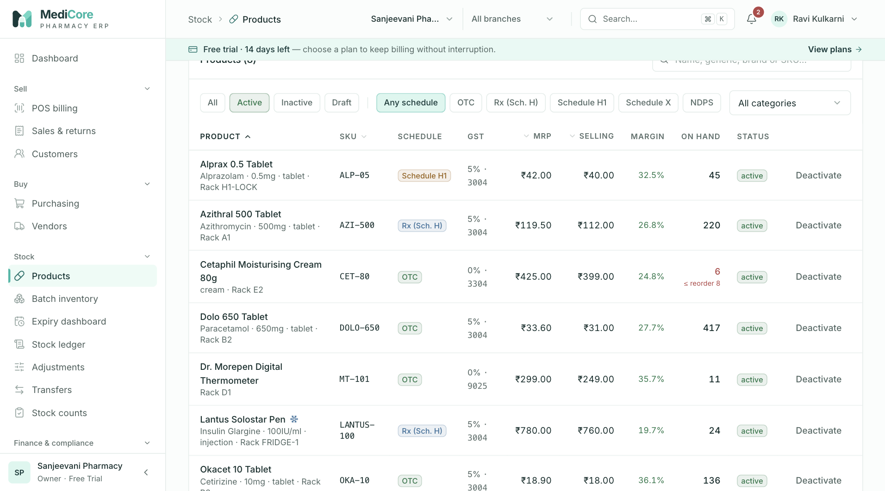

# MediCore Pharmacy ERP — User Guide

Version 1.0 · 27 Oct 2026 · Covers every menu of the MediCore web app (Next.js front end, NestJS API v1).

## How to use this guide

- The guide follows the left-hand sidebar: **Sell**, **Buy**, **Stock**, **Finance & compliance**, **Admin**, then **Platform**. Part 1 covers sign-in, the application shell (sidebar, top bar, search, notifications, account menu) and the Dashboard.
- Every screen section has the same layout: route and menu path, who can use it (permission keys and default roles), purpose, a walk-through of every field, button and option, statuses, business rules and calculations, messages and empty states, the API endpoints it calls, and the **Screens** with numbered figures.
- **Bold** text is an exact label on screen. `code` is a route, permission key, field name or API path.
- Where a state could not be photographed from the demo data (for example error messages, confirmation dialogs or superadmin-only screens), the **Other states** list under the figures says exactly how to reach it.
- The full functional and technical specification is in [`docs/product/MediCore-Product-Specification.md`](../product/MediCore-Product-Specification.md).

## Demo workspace used for the screenshots

All screenshots come from a local workspace seeded with realistic demo data by `apps/api/scripts/demo-data.ts` (run `pnpm --filter @medicore/api exec tsx scripts/demo-data.ts` against a running API). The demo pharmacy is **Sanjeevani Pharmacy**, Pune (GSTIN 27AAPFU0939F1ZV), owner **Ravi Kulkarni**, on the 14-day Free Trial, with:

- Branch **Main Branch** with warehouses **Main Store** and **Cold Room**, and billing counter **Counter 1**.
- 8 products (e.g. Azithral 500, Dolo 650, Pan 40, Lantus Solostar Pen (cold chain), Alprax 0.5 (Schedule H1)), 14 batches including near-expiry and expired stock.
- 3 vendors, 5 customers (two on credit), purchase orders in Draft / Sent / Confirmed, a goods receipt, a supplier invoice and payment.
- 7 POS invoices (one Schedule H1 sale with a prescription, two credit sales), a sales return, a customer receipt, adjustments, transfers, a posted stock count, a recall and a quarantined batch.

Screens were captured at a 1280 × 711 desktop viewport.

## Contents

- [How to use this guide](#how-to-use-this-guide)
- [Demo workspace used for the screenshots](#demo-workspace-used-for-the-screenshots)
- [Part 1 — Sign-in & account screens, application shell, dashboard](#part-1--sign-in--account-screens-application-shell-dashboard)
  - [Conventions used in this guide](#conventions-used-in-this-guide)
  - [Standard system roles (created automatically for every new pharmacy)](#standard-system-roles-created-automatically-for-every-new-pharmacy)
  - [Sign in](#sign-in)
  - [Create your pharmacy workspace (Register / free trial)](#create-your-pharmacy-workspace-register--free-trial)
  - [Reset your password (Forgot password)](#reset-your-password-forgot-password)
  - [Set a new password (Reset password)](#set-a-new-password-reset-password)
  - [Email verification](#email-verification)
  - [Accept your invitation](#accept-your-invitation)
  - [Application shell — layout & sidebar navigation](#application-shell--layout--sidebar-navigation)
  - [Application shell — top bar, breadcrumbs, organization & branch switchers](#application-shell--top-bar-breadcrumbs-organization--branch-switchers)
  - [Command palette (global search, Ctrl/Cmd + K)](#command-palette-global-search-ctrlcmd--k)
  - [Notifications panel (bell)](#notifications-panel-bell)
  - [Account menu, Change password & Active sessions](#account-menu-change-password--active-sessions)
  - [Shell banners, session handling & global messages](#shell-banners-session-handling--global-messages)
  - [Dashboard](#dashboard)
- [Part 2 — Sell: POS billing, Sales & returns, Customers](#part-2--sell-pos-billing-sales--returns-customers)
  - [POS billing](#pos-billing)
  - [Sales & returns](#sales--returns)
  - [Sales invoice](#sales-invoice)
  - [Customers](#customers)
- [Part 3 — Buy & Stock: purchasing, vendors, products and inventory](#part-3--buy--stock-purchasing-vendors-products-and-inventory)
  - [Purchasing — workspace & Purchase orders tab](#purchasing--workspace--purchase-orders-tab)
  - [Purchasing — Goods receipts (GRN)](#purchasing--goods-receipts-grn)
  - [Purchasing — Supplier invoices](#purchasing--supplier-invoices)
  - [Purchasing — Payments (Pay supplier)](#purchasing--payments-pay-supplier)
  - [Purchasing — Debit notes (purchase returns)](#purchasing--debit-notes-purchase-returns)
  - [Vendors — list](#vendors--list)
  - [Vendors — vendor detail drawer (ledger, open invoices, supplies, profile)](#vendors--vendor-detail-drawer-ledger-open-invoices-supplies-profile)
  - [Products](#products)
  - [Batch inventory — Batches tab](#batch-inventory--batches-tab)
  - [Batch inventory — Recalls tab](#batch-inventory--recalls-tab)
  - [Expiry dashboard](#expiry-dashboard)
  - [Stock ledger](#stock-ledger)
  - [Adjustments](#adjustments)
  - [Transfers](#transfers)
  - [Stock counts](#stock-counts)
- [Part 4 — Finance, compliance & administration](#part-4--finance-compliance--administration)
  - [Accounting](#accounting)
  - [Compliance](#compliance)
  - [Reports](#reports)
  - [Configuration](#configuration)
  - [Import](#import)
  - [Users](#users)
  - [Roles](#roles)
  - [Branches](#branches)
  - [Settings](#settings)
  - [Plan & billing](#plan--billing)
  - [Audit log](#audit-log)
  - [Platform](#platform)
- [Product specification (separate document)](#product-specification-separate-document)

---

# Part 1 — Sign-in & account screens, application shell, dashboard

> Written from the source code (`apps/web/src/app/login`, `apps/web/src/app/register`, `apps/web/src/app/(auth)/*`, `apps/web/src/components/{shell,shell-parts,nav,auth,ui,kit}.tsx`, `apps/web/src/lib/{session,api,toast}.ts*`, `apps/web/src/app/(app)/page.tsx`; API `apps/api/src/auth/*`, `apps/api/src/reports/*`, `apps/api/src/organizations/*`, `apps/api/src/rbac/*`, `apps/api/src/common/{subscription-policy,rate-limit.middleware}.ts`; validation `packages/validation/src/{auth,common}.ts`). Where the code and older docs disagree, the code is what is described here. Points where the UI text and the code behaviour differ are flagged as **⚠ Note**.

### Conventions used in this guide

- **Bold** text is an exact button, link or label as it appears on screen.
- "Permission key" means the internal permission (for example `reports.read`). Administrators grant permissions through roles (**Admin › Roles**). The **organization owner** always holds every organization permission; platform-only permissions (`platform.*`) are never part of an organization role.
- All money is shown in Indian Rupees with Indian digit grouping and two decimals (e.g. `₹1,23,456.50`). Negative amounts show a true minus sign (`−₹…`). Chart axes use short forms: `₹450`, `₹1.2k`, `₹3.4L` (lakh), `₹1.1Cr` (crore). Hover tooltips always show the full amount.
- Dates display as `27 Oct 2026` (day, short month, year, Asia/Kolkata time zone). Business "days" (today, this month) are calculated in Indian Standard Time.
- Toast messages appear bottom-right, at most 4 at a time. Success/info/warning toasts close after 4 seconds, error toasts after 7 seconds; each has a **Dismiss** (×) button. Identical toasts fired in quick succession are merged into one.

### Standard system roles (created automatically for every new pharmacy)

When a pharmacy registers, these roles are created. Their names are shown in the account menu, the sidebar footer and invitation screens.

| Role name (as displayed) | Internal key | Typical person |
|---|---|---|
| Owner | `ORGANIZATION_OWNER` | The person who registered the pharmacy. Holds every organization permission. |
| Admin | `ORGANIZATION_ADMIN` | Office administrator; all organization permissions. |
| Pharmacist | `PHARMACIST` | Dispensing pharmacist: sales, returns, compliance registers, products, stock. |
| Purchase Manager | `PURCHASE_MANAGER` | Buying, vendors, goods receipts, supplier payments. |
| Store Manager | `STORE_MANAGER` | Stock operations, customers, reports and exports. |
| Cashier | `CASHIER` | Counter billing and customer receipts. |
| Inventory Manager | `INVENTORY_MANAGER` | Products, batches, adjustments, counts, transfers, recalls, product import. |
| Accountant | `ACCOUNTANT` | Accounting, supplier payments, tax configuration, reports. |
| Auditor | `AUDITOR` | Read-only access across modules plus the audit log. |
| Analyst | `ANALYST` | Read-only products/stock/parties plus reports. |

---

### Sign in

- **Route:** `/login`  - **Menu:** none (public page; also reached from **Sign in** links on every other account screen)  - **Who can use it:** anyone with a MediCore account (no permission needed). Users whose account is *Invited* (invitation not yet accepted), *Suspended* or *Disabled* cannot sign in.

#### Purpose

This is the front door of MediCore. Staff enter their work email and password to open their pharmacy workspace. From here you can also start a free trial, recover a forgotten password, or accept an invitation from your pharmacy.

#### Screen layout

All account screens (sign in, register, forgot/reset password, verify email, accept invitation) share the same layout:

1. **Brand panel (left, large screens only — 1024 px and wider):** MediCore logo; headline "Batch-level inventory. **GST-ready billing.** Compliance built in."; four ticked highlights:
   - "FEFO allocation with expired-stock blocking (Drugs Rules 65(17))"
   - "GST-ready billing — CGST/SGST/IGST split by place of supply"
   - "Schedule H/H1 registers, licence tracking and audit trails"
   - "Server-enforced tenant isolation, DPDP-aligned data handling"
   - Footer line: "Built for Indian pharmacies — INR, GSTIN, Schedule H1 registers, Asia/Kolkata."
2. **Form card (right; centred on smaller screens, with the logo shown above it):**
   - Title **Welcome back**; subtitle "Sign in to your pharmacy workspace".
   - Green success notice (only after a password reset, i.e. URL contains `?reset=1`): "Password updated. Sign in with your new password — other devices were signed out."
   - **Email** field (placeholder `you@pharmacy.in`, focused automatically).
   - **Password** field (placeholder `••••••••••`) with an eye icon to **Show password / Hide password**, and a "Caps Lock is on" warning that appears while Caps Lock is active.
   - **Forgot password?** link (right-aligned, under the password) → `/forgot-password`.
   - Red error box (after a failed attempt — see Messages).
   - **Sign in** button (full width; shows **Signing in…** while working).
   - Line "Got an invitation? **Accept it here**" → `/accept-invitation`.
3. **Below the card:** "New to MediCore? **Start a free 14-day trial**" → `/register`.

#### How to …

**How to sign in**
1. Open MediCore (any page). If you are not signed in you are sent to **Sign in** automatically.
2. Type your **Email** and **Password**. Use the eye icon if you want to check what you typed.
3. Click **Sign in** (or press Enter).
4. On success a toast "Signed in — Welcome back to MediCore" appears and you are taken to the page you originally tried to open, or to the Dashboard.

**How to return to the page you were on after your session expired**
1. When a session ends while you are working, MediCore shows "Your session has ended — Please sign in again to continue." and opens **Sign in** with the page remembered (`/login?next=/that/page`).
2. Sign in normally; you land back on that page.

**How to get to password recovery / registration / invitation**
- Click **Forgot password?**, **Start a free 14-day trial** or **Accept it here** respectively.

#### Form fields

| Field | Type | Required | Rules / validation | Notes |
|---|---|---|---|---|
| Email | Email input | Yes | Trimmed, converted to lower case, must be a valid email address (`z.string().trim().toLowerCase().email()`); error "Invalid email" | Case does not matter. |
| Password | Password input with show/hide | Yes | 1–128 characters; empty → "Password is required" | Not checked against the password policy at sign-in (old passwords still work). |

#### Statuses & lifecycle

User account statuses that affect sign-in:

| Account status | Can sign in? | What the user sees |
|---|---|---|
| Active | Yes | — |
| Invited (has not accepted invitation, no password yet) | No | "That email and password don't match…" |
| Suspended / Disabled | No | "Account is suspended — contact your organization administrator" |
| Temporarily locked | No, until lock time passes | Lock message (see below) |

#### Business rules & calculations

- **Lockout:** after **5** consecutive wrong passwords the account is locked for **15 minutes**. The 5th wrong attempt still shows the normal "don't match" message; the *next* attempt returns `ACCOUNT_LOCKED` ("Account temporarily locked due to failed sign-in attempts until <date-time>"). A successful sign-in or a password reset clears the counter and the lock.
- **Rate limit:** at most **20 requests per minute per IP address** to the sign-in endpoint (the same limit applies separately to register, forgot password, reset password, verify email, resend verification and accept invitation). Exceeding it returns `RATE_LIMITED` (HTTP 429).
- **Session:** a successful sign-in creates a server session and stores it in an HTTP-only cookie named `medicore_session` (7-day lifetime, sliding — see *Session handling* in the shell section). Every attempt (success or failure) is recorded for security analysis and in the audit log (`USER_LOGIN_SUCCESS` / `USER_LOGIN_FAILURE`).
- **Redirect safety:** the `next` destination is only honoured when it is a same-site path beginning with `/` (not `//`, not `/\`, not `/login…`); otherwise you go to the Dashboard.
- **Already signed in:** opening `/login` while signed in immediately redirects to `next` (or the Dashboard).
- **After a deliberate Sign out**, the next sign-in always goes to the Dashboard (the previous page is not remembered).

#### Messages & empty states

| When | Message |
|---|---|
| Wrong email or password (`INVALID_CREDENTIALS`) | Red box + toast "Sign-in failed": "That email and password don't match. Check for typos or reset your password." |
| Account locked (`ACCOUNT_LOCKED`) | Server message ("Account temporarily locked due to failed sign-in attempts until …"), or fallback "Too many failed attempts — your account is locked for a few minutes." |
| Too many requests (`RATE_LIMITED`) | "Too many sign-in attempts from this device. Wait a minute and try again." |
| Suspended account | "Account is suspended — contact your organization administrator" |
| Server unreachable | "Cannot reach the MediCore server. Check your connection and try again." |
| Any other failure | Server message, or "Sign-in failed. Please try again." |
| Success | Toast "Signed in" — "Welcome back to MediCore" |
| After password reset | Green notice "Password updated. Sign in with your new password — other devices were signed out." |

#### API endpoints used

- `POST /api/v1/auth/login` — body `{ email, password }`; sets the session cookie; returns `{ userId }`.
- `GET /api/v1/auth/me` — loads the signed-in user, memberships, roles, permissions and branches after sign-in.

#### Screens

*Figure 1 — Sign in (`/login`): brand panel on the left, work email and password, **Forgot password?**, free-trial and invitation links.*

**Other states of this screen (not pictured — how to reach them):**

- Enter a valid email with a wrong password, click **Sign in** (red error box + toast visible).
- Open `/login?reset=1` (green "Password updated" notice).
- Click in **Password**, turn Caps Lock on and type a character ("Caps Lock is on" warning).
- Open `/login` at phone width (≈390 px): logo above card, no brand panel.

---

### Create your pharmacy workspace (Register / free trial)

- **Route:** `/register`  - **Menu:** none (public; link **Start a free 14-day trial** on Sign in; **Create an organization** on the Dashboard for users with no workspace)  - **Who can use it:** anyone; no permission needed. The person who registers becomes the **Owner** of the new pharmacy.

#### Purpose

Creates a brand-new pharmacy workspace (organization) on a free 14-day trial and signs the founder in as its Owner. Everything needed to start setup is created automatically: a main branch, a main store (warehouse), the standard staff roles and default settings.

#### Screen layout

- Shared account-screen layout (brand panel on large screens) with a wider card.
- Title **Create your pharmacy workspace**; subtitle "Free 14-day trial · all features · no card required".
- Fields (top to bottom): **Pharmacy / business name** (placeholder "e.g. City Care Pharmacy", focused), **Your name** (placeholder "Full name"), **Work email** (placeholder `you@pharmacy.in`), **Password** (placeholder "Create a strong password", with show/hide and Caps Lock warning).
- Under the password: a 5-segment **strength bar** with label **Weak / Fair / Good / Strong**, and a live checklist: **10+ characters**, **Lower case**, **Upper case**, **A digit** (each turns green with a tick when satisfied).
- Consent checkbox: "I agree to the Terms of Service and consent to MediCore processing my business data as described in the Privacy Notice (Digital Personal Data Protection Act, 2023)."
- Red error box (on failure).
- **Create workspace** button (shows **Creating your workspace…** while working).
- Below card: "Already have an account? **Sign in**".

#### How to …

**How to start a free trial and create your pharmacy**
1. Go to `/register` (or click **Start a free 14-day trial** on the Sign in page).
2. Enter **Pharmacy / business name** (the trading name shown on the dashboard and later on invoices; you can refine legal details in Settings).
3. Enter **Your name** and **Work email**.
4. Create a **Password** — watch the checklist until all four items are ticked.
5. Tick the Terms / Privacy consent checkbox.
6. Click **Create workspace**.
7. A toast "Workspace created — Your 14-day trial has started — let's set up your pharmacy." appears and the Dashboard opens with the **Setup checklist**.

**If the email is already registered**
1. The **Work email** field shows "An account with this email already exists — sign in instead" and a toast "Email already registered — Sign in, or use "Forgot password" to recover access."
2. Click **Sign in** at the bottom, or use **Forgot password?** on the sign-in page.

#### Form fields

| Field | Type | Required | Rules / validation | Notes |
|---|---|---|---|---|
| Pharmacy / business name | Text | Yes | Trimmed; 2–160 characters. Errors: "Enter your pharmacy's name" (< 2), "Keep it under 160 characters" (> 160) | Becomes the organization name. A URL "slug" is derived automatically (lower-case letters/digits/hyphens, max 40 chars, random suffix if taken). |
| Your name | Text | Yes | Trimmed; 2–120 characters. Errors: "Enter your full name", "Keep it under 120 characters" | |
| Work email | Email | Yes | Trimmed, lower-cased, valid email; must not already belong to any MediCore user | |
| Password | Password | Yes | 10–128 characters; must contain at least one lower-case letter, one upper-case letter and one digit. Errors: "Minimum 10 characters", "Must include lower case, upper case, and a digit" | Strength bar: 1 point per checklist rule passed + 1 bonus point if ≥ 14 characters **and** contains a symbol. 0–2 = Weak (red), 3 = Fair (amber), 4 = Good, 5 = Strong (green). Symbols are not required. |
| Terms / Privacy consent | Checkbox | Yes | Must be ticked: "Please accept the terms to continue" | Not sent to the server. |

#### Statuses & lifecycle

The new organization starts with subscription status **Trial** (`TRIALING`) on the **Free Trial** plan; it ends 14 days after registration (see *Plan & billing* for later states: Active, Payment due, Grace period, Cancelled, Expired).

#### Business rules & calculations

On **Create workspace** the server, in one transaction:
- Creates the user (status Active, **email already marked verified**), hashed with Argon2id.
- Creates the organization and the **Owner** role, plus the system roles **Admin, Pharmacist, Purchase Manager, Store Manager, Cashier, Inventory Manager, Accountant, Auditor, Analyst** with their standard permission sets.
- Makes the founder an active member with the owner flag.
- Starts a **Free Trial** subscription: status `TRIALING`, trial end = now + 14 days. Free Trial plan limits: 1 branch, 3 users, 3 warehouses, 300 invoices per month, all modules.
- Creates branch **Main Branch** (default) and warehouse **Main Store** (code `MAIN`, default), and empty organization settings.
- Records audit event `ORGANIZATION_CREATED`, then signs the founder in (session cookie set).
- Duplicate email → `DUPLICATE_ENTITY` (409). Rate limit 20 requests/min/IP.
- ⚠ Note: the founder is not assigned to any branch explicitly; as Owner they can work in all branches, and the header branch selector initially shows **All branches**.

#### Messages & empty states

| When | Message |
|---|---|
| Success | Toast "Workspace created" — "Your 14-day trial has started — let's set up your pharmacy." |
| Email already used | Field error "An account with this email already exists — sign in instead" + toast "Email already registered" — "Sign in, or use "Forgot password" to recover access." |
| Server-side field errors | Shown under the matching field; red box + toast "Couldn't create your workspace" with the server message |
| Unknown failure | "Registration failed. Please try again." |

#### API endpoints used

- `POST /api/v1/auth/register` — body `{ email, password, fullName, organizationName }`; returns `{ userId, organizationId, slug }` and sets the session cookie.
- `GET /api/v1/auth/me` — reloads the session afterwards.

#### Screens

*Figure 2 — Create your pharmacy workspace (`/register`): the empty free-trial form.*

**Other states of this screen (not pictured — how to reach them):**

- Type a partial password such as `Pharma1` in **Password** (checklist half ticked, "Weak"/"Fair" label).
- Click **Create workspace** with all fields empty (field errors + consent error).
- Fill the form with an email that already exists and submit.

---

### Reset your password (Forgot password)

- **Route:** `/forgot-password` (optional `?email=` pre-fills the field)  - **Menu:** none (link **Forgot password?** on Sign in and on Accept invitation)  - **Who can use it:** anyone; no permission.

#### Purpose

Lets a user who forgot their password request a single-use reset link by email. For security the screen never reveals whether an email address is registered.

#### Screen layout

**Request view**
- Title **Reset your password**; subtitle "We'll email you a single-use link that's valid for one hour."
- **Email** field (placeholder `you@pharmacy.in`).
- **Send reset link** button (**Sending…** while working).
- Small print: "For your security we never say whether an email is registered."
- Footer link **← Back to sign in**.

**Sent view** (after submitting)
- Mail icon, heading **Check your inbox**.
- "If an account exists for **<email>**, a reset link is on its way. It expires in one hour and works once."
- "Didn't get it? Check spam, or make sure you used the email you sign in with."
- (Non-production installations only) amber notice: "Development: email uses the console transport — the reset link is printed in the API log, not delivered."
- **Resend link** button — disabled for 60 seconds, showing **Resend in Ns** countdown.
- **Use another email** button — returns to the request view.

#### How to …

**How to request a password reset link**
1. On Sign in, click **Forgot password?**.
2. Enter the **Email** you sign in with and click **Send reset link**.
3. Toast "Check your inbox — If an account exists, a reset link is on its way." and the Sent view appears.
4. Open the email "MediCore password reset" and click the link within one hour (it opens **Set a new password**).

**How to resend the link**
1. Wait for the countdown to finish (60 s).
2. Click **Resend link** → toast "Reset link sent again".

**How to try a different email** — click **Use another email**, correct the address and click **Send reset link**.

#### Form fields

| Field | Type | Required | Rules / validation | Notes |
|---|---|---|---|---|
| Email | Email | Yes | Trimmed, lower-cased, valid email | Pre-filled from `?email=` if present. |

#### Statuses & lifecycle

Reset link (token): **Issued** → **Used** (after a successful reset) or **Expired** (1 hour after issue). Requesting again issues an additional link; earlier unexpired links are not cancelled.

#### Business rules & calculations

- The server always answers "accepted" (HTTP 202) whether or not the account exists. If it exists, a random 32-byte token is created (only its SHA-256 hash is stored), valid **60 minutes**, single-use; audit event `PASSWORD_RESET_REQUESTED`.
- Email subject "MediCore password reset"; body contains the link `<web app>/reset-password?token=…`.
- Client-side resend cooldown: 60 seconds. Server rate limit: 20 requests/min/IP.

#### Messages & empty states

| When | Message |
|---|---|
| Submitted | Toast "Check your inbox" — "If an account exists, a reset link is on its way." |
| Resent | Toast "Reset link sent again" |
| Failure (network, rate limit) | Toast "Couldn't send the reset link" + server message or "Please try again." |

#### API endpoints used

- `POST /api/v1/auth/password/forgot` — body `{ email }` → `{ accepted: true }` (202).

#### Screens

*Figure 3 — Reset your password (`/forgot-password`): enter the work email to receive a reset link.*

**Other states of this screen (not pictured — how to reach them):**

- Enter any email and click **Send reset link** (Sent view with **Resend in 60s** countdown).

---

### Set a new password (Reset password)

- **Route:** `/reset-password?token=…` (also works without a token — the user pastes the link)  - **Menu:** none (opened from the reset email)  - **Who can use it:** anyone holding a valid reset link; no permission.

#### Purpose

Completes password recovery: the user chooses a new password using the link from the reset email. For safety every device signed in to that account is signed out.

#### Screen layout

- Title **Set a new password**; subtitle "Choose a password you haven't used for MediCore before. Every signed-in device will be signed out."
- While reading the URL: two grey loading bars.
- If the link came in the URL: blue notice "Reset link detected — just choose your new password."
- Otherwise: **Reset link or code** field with hint "Paste the link from the reset email".
- **New password** (show/hide, Caps Lock warning, strength bar and checklist **10+ characters / Lower case / Upper case / A digit**).
- **Confirm new password** (show/hide).
- **Update password** button (**Updating…** while working).
- Footer **← Back to sign in**.
- **Expired view** (replaces the form): red icon, heading **This reset link has expired or was already used**, text "Reset links work once and last one hour. Request a fresh one — it only takes a moment.", link **Send me a new link** → `/forgot-password`.

#### How to …

**How to set a new password from the email link**
1. Click the link in the "MediCore password reset" email.
2. Type a **New password** that meets all four checklist rules; re-type it in **Confirm new password**.
3. Click **Update password**.
4. Toast "Password updated — Sign in with your new password." You are taken to Sign in, which shows "Password updated…".

**How to reset by pasting the link**
1. Open `/reset-password` directly.
2. Paste the whole link (or just the code) into **Reset link or code** — MediCore extracts the `token` part automatically.
3. Continue from step 2 above.

**If the link has expired** — click **Send me a new link** and repeat *Forgot password*.

#### Form fields

| Field | Type | Required | Rules / validation | Notes |
|---|---|---|---|---|
| Reset link or code | Text (hidden when token in URL) | Yes | Trimmed, 32–600 characters: "Paste the full link or code from the email" (< 32), "That doesn't look like a reset link — paste it again" (> 600). If it is a URL, the `token` query value is used. Server accepts tokens of 32–128 characters. | Autocomplete and spell-check off. |
| New password | Password | Yes | 10–128 chars, ≥ 1 lower, ≥ 1 upper, ≥ 1 digit ("Minimum 10 characters", "Must include lower case, upper case, and a digit") | Strength bar as on Register. |
| Confirm new password | Password | Yes | Must equal New password: "Passwords don't match" | |

#### Statuses & lifecycle

Reset token: Issued → Used / Expired (1 hour). A used or expired token shows the Expired view.

#### Business rules & calculations

- Server checks the token exists, is a password-reset token, unused and unexpired; otherwise `VALIDATION_ERROR` "Reset link is invalid or has expired".
- On success (single transaction): new Argon2id hash saved, failed-login counter and lock cleared, password recorded in password history, token marked used, **all active sessions of the user revoked** (every device signed out). Audit `PASSWORD_RESET_COMPLETED`.
- ⚠ Note: the subtitle asks for a password "you haven't used before", but the server currently records history without rejecting a re-used password.
- Rate limit 20 requests/min/IP.

#### Messages & empty states

| When | Message |
|---|---|
| Success | Toast "Password updated" — "Sign in with your new password." then Sign in shows the green notice |
| Expired / used link | Expired view + toast "Reset link expired" — "Request a new link to continue." |
| Other failure | Toast "Password not updated" + server message or "Please try again." |

#### API endpoints used

- `POST /api/v1/auth/password/reset` — body `{ token, password }` → 204.

#### Screens

*Figure 4 — Set a new password (`/reset-password`) opened without a token: paste the reset link or code, then choose the new password.*

**Other states of this screen (not pictured — how to reach them):**

- Open a valid reset link (`/reset-password?token=…`), type a new password (blue "Reset link detected" notice, checklist).
- Open `/reset-password?token=<used-or-random-40-char-string>`, enter a valid password twice, click **Update password**.

---

### Email verification

- **Route:** `/verify-email?token=…`  - **Menu:** none (opened from the verification email or from the shell banner flow)  - **Who can use it:** anyone holding a verification link; the **Send a new link** action requires being signed in.

#### Purpose

Confirms that the email address on a MediCore account belongs to the user, so password resets, invitations and invoice copies reach them. The page verifies automatically as soon as it opens.

#### Screen layout

- Title **Email verification**; subtitle "Confirming the address on your MediCore account".
- One of four states:
  1. **Verifying** — spinner, heading **Verifying your email**, animated progress bar.
  2. **Verified** — green icon, **Your email is verified**, text "Password resets, invitations and invoice copies will reach you here.", button **Go to dashboard** (signed in) or **Sign in** (signed out).
  3. **Invalid / used** — red icon, **This link has expired or was already used**, text "Verification links last 24 hours and work once."
  4. **Missing token** — red icon, **No verification link found**, text "Open the link from your verification email, or request a new one."
  - In states 3–4: if signed in, button **Send a new link** (**Sending…**); if signed out, "**Sign in** to request a new link."

#### How to …

**How to verify your email**
1. Click the link in the email "Verify your MediCore email address" (valid 24 hours).
2. Wait for **Your email is verified**; toast "Email verified — Thanks — your address is confirmed."
3. Click **Go to dashboard** (or **Sign in**).

**How to get a new verification link**
- From any app page: click **Send verification link** in the blue banner at the top (see *Shell banners*).
- From this page (when the link failed and you are signed in): click **Send a new link** → toast "New link sent — Check <your email>."
- If signed out: click **Sign in**, then use the banner.

#### Form fields

No input fields; the token is read from the URL.

#### Statuses & lifecycle

Verification token: Issued (24 h) → Used, or Expired, or **Burned** (every unused verification token is cancelled when a new one is requested). User email: Unverified → Verified (one-way).

#### Business rules & calculations

- The token is attempted once per page load.
- Server: token must exist, be an email-verification token, unused and unexpired; otherwise `VALIDATION_ERROR` "Verification link is invalid or has expired". Success sets the verified date and marks the token used; audit `EMAIL_VERIFIED`.
- Resend: if already verified → `STATE_TRANSITION_INVALID` "Your email address is already verified" (the page then switches to the Verified state with toast "Already verified").
- Self-registered owners and users who joined by invitation are marked verified automatically, so this flow mainly concerns accounts created by other means (e.g. imported/seeded users).
- Rate limit 20 requests/min/IP on both verify and resend.

#### Messages & empty states

| When | Message |
|---|---|
| Verified | Toast "Email verified" — "Thanks — your address is confirmed." |
| New link sent | Toast "New link sent" — "Check <email>." |
| Already verified | Toast "Already verified" — "Your email address is already confirmed." |
| Non-validation failure | Toast "Couldn't verify your email" / "Couldn't send a new link" + message |

#### API endpoints used

- `POST /api/v1/auth/email/verify` — body `{ token }` → 204.
- `POST /api/v1/auth/email/verify/resend` — signed-in only → `{ queued: true }`.
- `GET /api/v1/auth/me` — refreshed after success.

#### Screens

*Figure 5 — Email verification (`/verify-email`) opened without a token: "No verification link" state.*

**Other states of this screen (not pictured — how to reach them):**

- Open a valid verification link while signed in.
- Open `/verify-email?token=<random 40 characters>` while signed in (shows **Send a new link**).

---

### Accept your invitation

- **Route:** `/accept-invitation?token=…` (or without a token to paste the link)  - **Menu:** none (link **Accept it here** on Sign in; invitation email)  - **Who can use it:** the person the invitation was sent to; no permission. Invitations are sent by users holding `users.manage` from **Admin › Users**.

#### Purpose

Lets a staff member join a pharmacy workspace they were invited to. New users create their password here; people who already have a MediCore account (for another pharmacy) simply confirm with their existing password.

#### Screen layout

- Title **Accept your invitation** / subtitle "Join your team's pharmacy workspace on MediCore" (before the invitation is loaded); after loading: title **Join <Pharmacy name>**, subtitle "You've been invited as <Role>".
- Loading: grey skeleton bars ("Checking invitation").
- **Link entry view** (no token yet): **Invitation link** field (placeholder `https://…/accept-invitation?token=…`, hint "Open the invitation email and paste the link here") and **Continue** button.
- **Invitation form**:
  - Summary box: invitee email, role badge, "Invitation valid until <d MMM, hh:mm>".
  - *New user:* **Your name** (pre-filled from the invitation), **Create a password** (show/hide, strength bar, checklist), **Confirm password**.
  - *Existing account:* text "You already have a MediCore account. Confirm with your current password to add this workspace — your password won't change.", **Current password**, link **Forgot password?** (opens Forgot password with the email pre-filled).
  - Button **Join <Pharmacy name>** (**Joining…**).
- **Invalid view**: red icon, **This invitation is no longer valid**, "It may have expired (invitations last 7 days), been revoked, or already been accepted.", "Ask your pharmacy administrator to resend it from Users → Resend invite.", links **Try another link** and **Sign in**.
- Footer "Already a member? **Sign in**".

#### How to …

**How to accept an invitation as a new user**
1. Click the link in the email "You've been invited to MediCore".
2. Check the email, role and pharmacy name shown.
3. Confirm or correct **Your name**.
4. Enter **Create a password** (all checklist rules ticked) and **Confirm password**.
5. Click **Join <Pharmacy name>**.
6. You are signed in automatically, the joined pharmacy becomes the active workspace, a toast "Welcome to <Pharmacy> — You've joined as <Role>." appears and the Dashboard opens.

**How to accept an invitation when you already have a MediCore account**
1. Open the link. The screen recognises your account.
2. Enter your **Current password** (the one you already use) and click **Join <Pharmacy name>**.
3. The new pharmacy is added to your organization switcher; your password is unchanged.

**How to accept by pasting the link** — open `/accept-invitation`, paste the full link into **Invitation link**, click **Continue**.

**If the invitation is no longer valid** — ask your administrator to use **Resend invite** on the Users screen, then click **Try another link** and paste the new link.

#### Form fields

**Invitation link (link entry view)**

| Field | Type | Required | Rules / validation | Notes |
|---|---|---|---|---|
| Invitation link | Text | Yes | Token extracted from the URL's `token` value (or the raw text) must be 32–128 characters, else "Paste the full invitation link from your email" | |

**New user form**

| Field | Type | Required | Rules / validation | Notes |
|---|---|---|---|---|
| Your name | Text | Yes | Trimmed 2–120 characters ("Enter your full name", "Keep it under 120 characters") | Pre-filled from the invitation. |
| Create a password | Password | Yes | 10–128 chars, lower + upper + digit | Strength bar/checklist. |
| Confirm password | Password | Yes | Must match: "Passwords don't match" | |

**Existing account form**

| Field | Type | Required | Rules / validation | Notes |
|---|---|---|---|---|
| Current password | Password | Yes | Not empty: "Enter your current MediCore password"; server-side the password is also checked against the policy (10+ chars, mixed case, digit) | Wrong password → "That's not your current password". |

#### Statuses & lifecycle

| Object | States | Transitions |
|---|---|---|
| Invitation link | Live (7 days) → Used / Expired / Burned | Resending an invite burns older links; revoking the invite or accepting it makes the link invalid. |
| Membership | Invited → Active | On accept. (Admins can later set Suspended/Active from Users.) |
| User | Invited → Active | New users become Active with email verified on accept. |

#### Business rules & calculations

- Token lookup: 32–128 chars, must be a live INVITATION token whose membership is still *Invited*; otherwise `VALIDATION_ERROR` "Invitation is invalid or has expired".
- New account: password hashed and stored, name saved, user Active, email marked verified.
- Existing account (has a password): the supplied password must match (`INVALID_CREDENTIALS` otherwise); the invitation never changes existing credentials or name.
- On success: membership Active with join date, token used; audit `USER_REACTIVATED`. The client then signs in with the invited email + password and stores the joined organization as the active workspace (branch not preset). If that automatic sign-in fails, toast "Invitation accepted — Sign in to continue." and Sign in opens.
- Rate limit 20 requests/min/IP on accept.

#### Messages & empty states

| When | Message |
|---|---|
| Joined | Toast "Welcome to <Pharmacy>" — "You've joined as <Role>." |
| Wrong current password | Field error "That's not your current password" + toast "Wrong password" — "Use the password you already sign in to MediCore with." |
| Expired during submit | Invalid view + toast "Invitation expired" — "Ask your administrator to resend it." |
| Lookup failure (non-validation) | Toast "Couldn't check the invitation" |
| Other submit failure | Toast "Couldn't accept the invitation" + message |
| Accepted but auto sign-in failed | Toast "Invitation accepted" — "Sign in to continue." |

#### API endpoints used

- `GET /api/v1/auth/invitations/:token` → `{ email, fullName, organizationName, roleName, expiresAt, accountExists }`.
- `POST /api/v1/auth/invitations/accept` — body `{ token, password, fullName }` → `{ organizationId, userId }`.
- `POST /api/v1/auth/login`, `GET /api/v1/auth/me`.

#### Screens

*Figure 6 — Accept your invitation (`/accept-invitation`) opened without a token: paste the invitation link.*

**Other states of this screen (not pictured — how to reach them):**

- Invite a new email from **Users**, open the link from the API log/email.
- Invite an email that already has a MediCore account, open its link.
- Open `/accept-invitation?token=<random 40 characters>`.

---

### Application shell — layout & sidebar navigation

- **Route:** every signed-in page (route group `(app)`: `/`, `/pos`, `/products`, …)  - **Menu:** —  - **Who can use it:** any signed-in user. Each menu item is shown only to users holding its permission (table below).

#### Purpose

The shell is the frame around every working screen: the left sidebar menu, the top bar (location, workspace switchers, search, notifications, account menu) and status banners. It only shows the menu items a user is allowed to use, and marks modules that are not part of the current plan.

#### Screen layout

**Desktop (768 px and wider)**
1. **Sidebar (left, 240 px wide; 60 px when collapsed)**
   - Top: MediCore logo (click → Dashboard).
   - Menu groups (below). Each group except *Overview* has a small heading that can be clicked to fold/unfold the group (chevron rotates).
   - Footer (only when you belong to a pharmacy): square badge with the pharmacy's initials, pharmacy name, your role name, "·", and the plan name (link to **Plan & billing**; shown in red if the subscription has lapsed); button **Collapse sidebar** (‹). When collapsed, only the **Expand sidebar** (›) button is shown.
2. **Top bar** (see next section).
3. **Banners** (email verification, subscription — see *Shell banners*).
4. **Main content** (max 1320 px wide, scrolls independently).

**Menu groups and items**

| Group | Item | Route | Shown only with permission | Plan module (shows **Upgrade** lock if not in plan) | Extra search keywords |
|---|---|---|---|---|---|
| Overview | Dashboard | `/` | — (always) | — | home kpi overview |
| Sell | POS billing | `/pos` | `sales.create` | `pos` | bill invoice counter sale |
| Sell | Sales & returns | `/sales-history` | `sales.read` | — | invoices returns credit note |
| Sell | Customers | `/customers` | `customers.read` | — | patients receivable |
| Buy | Purchasing | `/purchasing` | `purchases.read` | `purchases` | po grn purchase order invoice |
| Buy | Vendors | `/vendors` | `vendors.read` | — | suppliers distributors payable |
| Stock | Products | `/products` | `products.read` | — | medicines catalog sku hsn |
| Stock | Batch inventory | `/batches` | `inventory.read` | — | stock lots |
| Stock | Expiry dashboard | `/expiry` | `inventory.read` | — | near expiry expired |
| Stock | Stock ledger | `/ledger` | `inventory.read` | — | movements history |
| Stock | Adjustments | `/adjustments` | `inventory.adjust` | — | damage breakage write off |
| Stock | Transfers | `/transfers` | `inventory.transfer` | — | warehouse move |
| Stock | Stock counts | `/counts` | `inventory.count` | — | physical audit stocktake |
| Finance & compliance | Accounting | `/accounting` | `accounting.read` | `accounting` | journal ledger trial balance p&l expenses |
| Finance & compliance | Compliance | `/compliance` | `compliance.read` | — | gst gstr schedule h1 drug licence |
| Finance & compliance | Reports | `/reports` | `reports.read` | — | analytics export aging valuation |
| Admin | Configuration | `/configuration` | `tax.read` | — | tax rates categories manufacturers |
| Admin | Import | `/import` | `products.import` | — | csv bulk upload |
| Admin | Users | `/users` | `users.read` | — | staff team invite |
| Admin | Roles | `/roles` | `roles.read` | — | permissions access |
| Admin | Branches | `/branches` | `branches.read` | — | stores warehouses locations |
| Admin | Settings | `/settings` | `organization.read` | — | profile gstin invoice print |
| Admin | Plan & billing | `/billing` | `organization.read` | — | subscription plan upgrade |
| Admin | Audit log | `/audit` | `audit.read` | — | activity history events |
| Platform | Platform console | `/platform` | Platform super-administrator only | — | tenants saas admin |

- A group with no visible items is hidden entirely.
- The **current page** is highlighted (tinted background, bold text, teal bar on the left). Sub-pages (e.g. `/purchasing/…`) highlight their parent item. The active item is scrolled into view automatically.
- **Upgrade** badge (lock icon, tooltip "Not included in your plan") appears next to POS billing, Purchasing or Accounting when the current plan's module list does not include `pos`, `purchases` or `accounting` respectively. Plans with module `*` (Free Trial, Enterprise) never show it. The badge is not shown when the sidebar is collapsed.

**Mobile / tablet (below 768 px)**
- Sidebar is hidden; a **menu** button (**Open menu**) appears at the left of the top bar.
- It opens a slide-in drawer (288 px, max 85 % of screen) with the logo, a **Close menu** (×) button, the same menu (always expanded) and the footer (without the collapse button).
- The drawer closes on **Close menu**, Esc, a tap on the dimmed background, or after choosing an item.

#### How to …

**How to collapse or expand the sidebar** (desktop)
1. Click **Collapse sidebar** (‹) in the sidebar footer. Only icons remain; hover or focus an icon to see its name in a tooltip.
2. Click **Expand sidebar** (›) to restore. The choice is remembered on this browser.

**How to fold a menu group**
1. Click the group heading (e.g. **Stock**). The group folds; click again to unfold.
2. Folded groups are remembered on this browser. A group that contains the page you are on always stays open.

**How to open the menu on a phone**
1. Tap the **Open menu** (☰) button.
2. Tap the item you need; the drawer closes and the page opens.

**How to see your plan from the sidebar** — click the plan name in the sidebar footer (opens **Plan & billing**).

#### Form fields

None.

#### Statuses & lifecycle

Not applicable.

#### Business rules & calculations

- Menu visibility: item shown if it has no permission, or the user is the organization **Owner**, or the user's role contains the permission. *Platform console* requires the user flag "platform super-administrator". Users without any pharmacy membership see only **Dashboard** (and **Platform console** if super-admin).
- Hiding a menu item is a convenience only — the server checks permissions on every request (`403 FORBIDDEN` "Missing required permission(s): …"), so typing a URL directly does not bypass security.
- Plan lock: modules come from `GET /organizations/subscription` → `subscription.modules`. An item is "locked" if modules exist, do not contain `*`, and do not contain the item's module. Clicking a locked item still opens the page, but plan-gated server actions return `FEATURE_NOT_ENTITLED` ("<Module> is not included in the <Plan> plan. Upgrade to enable it."). Seeded plans: Free Trial = all; Starter = catalog, inventory, pos; Professional = + purchases, returns; Business = + wholesale, accounting; Enterprise = all.
- Preferences stored in the browser (`localStorage`): `medicore.sidebar.collapsed` ("1"/"0") and `medicore.sidebar.closedGroups` (list of group names).

#### Messages & empty states

- Tooltip on **Upgrade** badge: "Not included in your plan".
- Collapsed-mode tooltips show the item label.

#### API endpoints used

- `GET /api/v1/auth/me` — memberships, permissions, branches (decides visible items).
- `GET /api/v1/organizations/subscription` — plan name, lapsed flag and modules (refreshed every 5 minutes).

#### Screens

**Other states of this screen (not pictured — how to reach them):**

- Sign in as Owner on desktop; Dashboard open, sidebar expanded.
- Click **Collapse sidebar**, then hover the **Products** icon (tooltip visible).
- Click the **Admin** group heading to fold it.
- Sign in to a pharmacy on the Starter plan (Purchasing and Accounting show **Upgrade**).
- Sign in as a user with the Cashier role (reduced menu).
- Phone width (≈390 px), tap **Open menu**.

---

### Application shell — top bar, breadcrumbs, organization & branch switchers

- **Route:** every signed-in page  - **Menu:** —  - **Who can use it:** any signed-in user; the notifications bell requires `reports.read`.

#### Purpose

The top bar tells you where you are and in which pharmacy/branch you are working, and gives one-click access to search, alerts and your account. Switching the pharmacy or branch here changes the data every screen shows and where new transactions are recorded.

#### Screen layout

Left to right:
1. **Open menu** button (mobile only).
2. **Breadcrumbs** (768 px and wider): menu group name (1024 px and wider only) › page icon + page name. On a sub-page (e.g. an invoice detail) it shows group › **page link** › **Details**. Pages not in the menu show no breadcrumb.
3. **Organization** selector (640 px and wider): lists every pharmacy you are an active member of.
4. **Branch** selector (640 px and wider): first option **All branches**, then each branch you are assigned to in the current pharmacy.
5. **Search** button: magnifier icon; on 1024 px+ also "Search…" and the shortcut keys ⌘ K. Tooltip/label "Search (Ctrl or Cmd + K)". Opens the command palette.
6. **Notifications** bell (only if you have `reports.read` and a pharmacy is selected) — see *Notifications panel*.
7. **Account menu** button: round initials badge, your full name (1024 px+), chevron — see *Account menu*.

#### How to …

**How to switch to another pharmacy (organization)**
1. Open the **Organization** drop-down in the top bar.
2. Choose the pharmacy. A toast "Workspace switched — <pharmacy name>" appears.
3. All data reloads for that pharmacy; the branch is set to your first assigned branch there (or **All branches** if none).

**How to switch branch**
1. Open the **Branch** drop-down.
2. Choose a branch, or **All branches** to work without a branch context.
3. All data reloads. The selection is remembered on this browser.

**How to go back to the list page from a detail page** — click the page name in the breadcrumb (e.g. **Sales & returns**).

#### Form fields

| Field | Type | Required | Rules / validation | Notes |
|---|---|---|---|---|
| Organization | Drop-down | — | Options = your active memberships | Hidden below 640 px wide. |
| Branch | Drop-down | — | "All branches" + branches assigned to you in this pharmacy | Hidden below 640 px wide. Owners/admins not assigned to specific branches see only "All branches". |

#### Statuses & lifecycle

Not applicable.

#### Business rules & calculations

- The selection is stored in the browser as `medicore.tenant` = `{ organizationId, branchId }` and sent with every API call as headers `x-organization-id` and `x-branch-id` (branch header omitted for **All branches**). Auth and platform calls never send them.
- On every app load, the stored pharmacy is re-validated against your memberships; if you are no longer a member, the first membership is used; a stored branch you are no longer assigned to falls back to the first assigned branch.
- Any change of pharmacy or branch clears all cached screen data and reloads it.
- Server enforcement (`TenantContextGuard`): you must have an **Active** membership in the pharmacy (otherwise "Organization not found", 404); a non-owner membership without a role is rejected ("Membership has no role assigned"); a branch must be active and belong to the pharmacy ("Branch not found"); and unless you are the Owner or hold `branches.manage`, you must be assigned to that branch ("You are not assigned to this branch", 403).
- ⚠ Note: dashboard and report figures are organization-wide; choosing a branch does not filter the Dashboard numbers.

#### Messages & empty states

- Toast on organization switch: "Workspace switched" — pharmacy name.

#### API endpoints used

- No dedicated endpoint; the choice is applied as request headers on all subsequent calls (`GET /api/v1/auth/me` supplies the lists).

#### Screens

**Other states of this screen (not pictured — how to reach them):**

- Desktop ≥ 1280 px on the Dashboard, crop the top bar.
- Sign in as a user who belongs to two pharmacies, open the **Organization** drop-down.
- Sign in as a user assigned to 2+ branches, open the **Branch** drop-down.
- Open **Sales & returns**, click any invoice (breadcrumb shows **Details**).

---

### Command palette (global search, Ctrl/Cmd + K)

- **Route:** overlay on every signed-in page  - **Menu:** top bar **Search…** button, or keyboard **Ctrl + K** (Windows/Linux) / **⌘ + K** (Mac)  - **Who can use it:** any member of a pharmacy. Each result type is searched only if you have its read permission: products `products.read`, customers `customers.read`, vendors `vendors.read`, sales invoices `sales.read`, purchase invoices `purchases.read`, batches `inventory.read`.

#### Purpose

A fast way to jump anywhere: type part of a page name, a medicine, a customer or supplier, an invoice number or a batch number and press Enter. It also remembers your last five destinations.

#### Screen layout

- Dimmed background with a centred panel.
- Search box (placeholder "Search pages, medicines, customers, invoices, batches…") with an **Esc** key hint (replaced by a spinner while searching).
- Results list, grouped under headings in this order:
  - **Recent** — your last 5 choices (only when the box is empty).
  - **Go to** — menu pages you can access (8 shown when empty; up to 6 matches when typing).
  - **Products**, **Customers**, **Vendors**, **Sales invoices**, **Purchase invoices**, **Batches** — record matches (after 2+ characters), up to 5 per group.
  - Each row: icon, title, optional grey subtitle; the highlighted row shows an ↵ hint.
- Footer hints: ↑ ↓ **navigate**, ↵ **open**, ⌘ K **toggle**.

**What each result shows and opens**

| Group | Matches on | Title | Subtitle | Opens |
|---|---|---|---|---|
| Products | name, generic name, SKU (partial, case-insensitive) or exact barcode | Name + strength | Generic name · SKU | `/products?focus=<id>` |
| Customers | name, GSTIN (partial, case-insensitive), phone (partial) | Name | Phone · City | `/customers?focus=<id>` |
| Vendors | legal name, trade name, GSTIN | Legal name | GSTIN · City | `/vendors?focus=<id>` |
| Sales invoices | invoice number, walk-in name, customer name | Invoice number | Customer (or walk-in name, or "Walk-in") · ₹total · date | `/sales-history/<id>` |
| Purchase invoices | supplier invoice number, vendor legal name | Invoice number | Vendor · ₹total · date | `/purchasing?tab=invoices&focus=<id>` |
| Batches | batch number | Product — Batch | "Expires YYYY-MM-DD" | `/batches?focus=<id>` |

Ordering inside groups: products/customers by name, vendors by legal name, invoices newest first, batches by earliest expiry.

#### How to …

**How to find and open a record**
1. Press **Ctrl + K** / **⌘ + K** (or click **Search…**).
2. Type at least 2 characters (e.g. part of a medicine name, a phone number or an invoice number).
3. Use ↑/↓ to highlight a result (or hover with the mouse) and press **Enter** (or click it).
4. The palette closes and the record or page opens.

**How to jump to a page** — type part of its name or a keyword (e.g. "grn" finds **Purchasing**, "stocktake" finds **Stock counts**) and press Enter.

**How to close** — press **Esc**, press Ctrl/⌘ + K again, or click the dimmed background.

#### Form fields

| Field | Type | Required | Rules / validation | Notes |
|---|---|---|---|---|
| Search | Text | — | Record search starts at 2 characters (after a 220 ms pause in typing); server accepts 2–80 characters (trimmed) | Page matching works from the first character on label + keywords. |

#### Statuses & lifecycle

Not applicable.

#### Business rules & calculations

- Server returns at most 5 results per group (`limit` default 5, max 10). Results are scoped to the active pharmacy. Results are cached for 30 seconds per search text.
- **Recent** list: last 5 chosen items, stored in the browser (`medicore.palette.recent`), duplicates removed.
- Pages listed under **Go to** are only those visible in your sidebar.

#### Messages & empty states

- Empty box with nothing to show: "Type at least 2 characters to search records."
- No results: "No matches for "<text>"."

#### API endpoints used

- `GET /api/v1/search?q=<text>` (optional `limit`, 1–10, default 5) → `{ query, items: [{ type, id, title, subtitle, href }] }`.

#### Screens

*Figure 7 — Command palette (**Ctrl/⌘ + K**) with grouped search results (tablet layout).*

**Other states of this screen (not pictured — how to reach them):**

- Press **Ctrl + K** with nothing typed (Recent + Go to).
- Type `zzzz`.

---

### Notifications panel (bell)

- **Route:** drop-down on every signed-in page  - **Menu:** top bar bell icon  - **Who can use it:** users with `reports.read` (bell is hidden otherwise). Typical roles: Owner, Admin, Pharmacist, Purchase Manager, Store Manager, Inventory Manager, Accountant, Auditor, Analyst (not Cashier).

#### Purpose

Shows operational alerts for the pharmacy — low stock, batches near expiry, and expiring pharmacy licences — and lets you jump straight to the screen that deals with each one.

#### Screen layout

- **Bell button** with a red badge showing the number of unread alerts (among the latest 15; shows **9+** above 9). Label "Notifications, N unread".
- **Panel** (opens below the bell):
  - Header **Notifications** with buttons **Refresh alerts** (**Scanning…** while working) and **Mark all read** (disabled when nothing is unread).
  - List of the 15 most recent notifications, newest first. Each row: coloured icon by type, title (bold if unread, with a teal dot), body (max 2 lines), relative time ("just now", "5m ago", "3h ago", "2d ago", or the date if 7+ days). Unread rows have a light-mint background.
  - Loading: spinner "Loading". Empty: "You're all caught up" — "Low-stock, near-expiry and licence alerts appear here."

**Notification types**

| Type | Icon / colour | Title | Body | Click opens |
|---|---|---|---|---|
| LOW_STOCK | down arrow, amber | "Low stock: <Product>" | "On hand <qty> at or below reorder level <level>." | `/products?focus=<product id>` |
| NEAR_EXPIRY | expiry, red | "Near expiry: <Product> (<Batch>)" | "Expires YYYY-MM-DD — plan supplier returns or prioritise sale." | `/expiry` |
| LICENCE_EXPIRY | compliance, blue | "Licence <TYPE> expiring" or "… expired" | "<Licence no.> — expires on / expired on YYYY-MM-DD." | `/compliance` |
| any other | info, mint | as stored | as stored | `/reports` |

#### How to …

**How to check alerts**
1. Click the bell. Unread items are highlighted.
2. Click an item: it is marked read, the panel closes and the related screen opens.

**How to scan for new alerts now**
1. Open the bell and click **Refresh alerts**.
2. Toast "Alerts refreshed — N new alert(s) for stock, expiry and licences." or "Alerts refreshed — No new low-stock, expiry or licence alerts."

**How to clear the unread badge** — click **Mark all read** → toast "All caught up — N notification(s) marked as read." (or "Nothing unread.").

**How to close the panel** — click the bell again, click anywhere outside, or press Esc.

#### Form fields

None.

#### Statuses & lifecycle

Notification: **Unread** → **Read** (by clicking it or **Mark all read**). There is no "unread" again and no delete.

#### Business rules & calculations

- **Alerts are generated only when someone clicks Refresh alerts** (there is no background scheduler in the current code). The scan creates:
  - LOW_STOCK for every *Active* product that has a reorder level and whose total on-hand quantity (all batches, all warehouses) is ≤ reorder level (products with no stock at all count as 0).
  - NEAR_EXPIRY for every *Saleable* batch with stock > 0 expiring between today and today + 30 days.
  - LICENCE_EXPIRY for every pharmacy licence expiring within 60 days, including already-expired ones.
- De-duplication: the same type + record is not created twice on the same (UTC) day. The toast reports `generated` (new) out of `scanned`.
- Notifications belong to the **pharmacy, not to the individual user**: when one user marks an alert read (or **Mark all read**), it is read for everyone in that pharmacy.
- The list refreshes automatically every 2 minutes.

#### Messages & empty states

- "You're all caught up" / "Low-stock, near-expiry and licence alerts appear here."
- Toasts listed above (Refresh / Mark all read). Marking a single item read is silent.

#### API endpoints used

- `GET /api/v1/reports/notifications?pageSize=15` (also supports `page`, `unreadOnly=true`).
- `POST /api/v1/reports/notifications/:id/read`
- `POST /api/v1/reports/notifications/read-all` → `{ updated }`
- `POST /api/v1/reports/notifications/generate` → `{ generated, scanned }`
- All require `reports.read`.

#### Screens

*Figure 8 — Notifications panel opened from the bell, with unread alerts and **Refresh alerts** (tablet layout).*

**Other states of this screen (not pictured — how to reach them):**

- New pharmacy, click the bell.
- The toast right after **Refresh alerts**.

---

### Account menu, Change password & Active sessions

- **Route:** drop-down and side drawers on every signed-in page  - **Menu:** top bar account button (initials + name)  - **Who can use it:** every signed-in user (no permission required). **Workspace settings** opens `/settings`, which needs `organization.read`.

#### Purpose

Personal account controls: see who you are signed in as and with what role, change your password, review and sign out other devices, open workspace settings, and sign out.

#### Screen layout

**Account menu** (opens under the account button)
- Header: full name (bold), email, role badge (e.g. **Pharmacist**).
- **Change password** (key icon) → opens the *Change password* drawer.
- **Active sessions** → opens the *Active sessions* drawer.
- **Workspace settings** → `/settings`.
- **Sign out** (red).

**Change password drawer** (right side panel)
- Title **Change password**; subtitle "Other signed-in devices stay signed in until you revoke them."
- **Current password**, **New password** (hint "At least 10 characters with upper case, lower case and a digit."), a 4-segment strength bar, **Confirm new password**.
- Buttons **Cancel** and **Change password** (**Saving…**).

**Active sessions drawer**
- Title **Active sessions**; subtitle "Sign out devices you don't recognise."
- List of signed-in sessions, most recently active first. Each: device icon, "<Browser> on <OS>" (Edge/Chrome/Firefox/Safari/Browser on macOS/Windows/Android/iOS/Linux/device; "Unknown device" if unknown), green badge **Most recent** on the first one, line "<IP or Unknown IP> · active <time ago> · signed in <date>", and a red **Sign out** button on every session except the first.

#### How to …

**How to change your password**
1. Click your name/initials (top right) → **Change password**.
2. Enter **Current password**, **New password** and **Confirm new password**.
3. Click **Change password**. Toast "Password changed"; the drawer closes.

**How to sign out another device**
1. Account menu → **Active sessions**.
2. Find the unknown device and click **Sign out**. Toast "Session signed out"; the list refreshes.

**How to sign out**
1. Account menu → **Sign out**.
2. You are returned to the Sign in page; all screen data held by the browser is discarded.

#### Form fields

**Change password**

| Field | Type | Required | Rules / validation | Notes |
|---|---|---|---|---|
| Current password | Password | Yes | Not empty; must match your current password (server) | Wrong → error under this field ("Invalid email or password") + toast "Password not changed". |
| New password | Password | Yes | 10–128 characters, ≥ 1 lower, ≥ 1 upper, ≥ 1 digit ("Minimum 10 characters", "Must include lower case, upper case, and a digit") | Strength bar: +1 for ≥ 10 chars, +1 for mixed case, +1 for a digit, +1 for a symbol or ≥ 14 chars; 1 = red, 2 = amber, 3–4 = green. |
| Confirm new password | Password | Yes | Must equal New password: "Passwords do not match" | |

#### Statuses & lifecycle

Session: **Active** → **Revoked** (sign out / other-device sign-out / password reset) or **Expired** (7 days without activity; see below).

#### Business rules & calculations

- Change password: server verifies the current password (`INVALID_CREDENTIALS` otherwise), saves the new hash and password history; audit `PASSWORD_CHANGED`. **Other sessions are not signed out** (unlike a password *reset*).
- Session list: only sessions that are not revoked and not expired, ordered by last activity. ⚠ Note: the badge **Most recent** marks the most recently active session, which is normally — but not guaranteed to be — the device you are using; it cannot be signed out from this list.
- Revoking a session that is not yours → "Session not found" (404). Audit `SESSION_REVOKED`.
- Sign out: revokes the current session on the server, clears the cookie, and fully reloads to `/login` (even if the server call fails). The next sign-in goes to the Dashboard.

#### Messages & empty states

| When | Message |
|---|---|
| Password changed | Toast "Password changed" |
| Wrong current password / failure | Field error + toast "Password not changed" — server message or "Could not change password" |
| Session revoked | Toast "Session signed out" |
| Sessions loading | Spinner "Loading sessions" |

#### API endpoints used

- `POST /api/v1/auth/password/change` — body `{ currentPassword, newPassword }` → 204.
- `GET /api/v1/auth/sessions` → list of `{ id, createdAt, lastSeenAt, expiresAt, ipAddress, userAgent }`.
- `DELETE /api/v1/auth/sessions/:id` → 204.
- `POST /api/v1/auth/logout` → 204.

#### Screens

*Figure 9 — Account menu: name, role, **Change password**, **Active sessions** and **Sign out**.*

**Other states of this screen (not pictured — how to reach them):**

- Account menu → **Change password**, type a new password so the strength bar shows.
- Sign in from two browsers, then account menu → **Active sessions**.

---

### Shell banners, session handling & global messages

- **Route:** every signed-in page  - **Menu:** —  - **Who can use it:** all signed-in users; banner content depends on account and subscription state.

#### Purpose

Explains how MediCore keeps you signed in, what happens when a session ends, and the thin coloured banners that appear under the top bar to warn about an unverified email, a trial ending, a renewal due, a lapsed subscription or a suspended workspace.

#### Screen layout

Banners appear between the top bar and the page, full width, one line (text truncated on narrow screens):

1. **Verify-email banner** (blue, mail icon) — shown when your email is not verified: "Please verify **<email>** so password resets and invoices reach you." Action: **Send verification link** → **Sending…** → **Link sent ✓**.
2. **Subscription banner** — shown only in these states (checked in this order; only one shows), always with action **View plans →** (opens `/billing`):

| Condition | Tone | Text |
|---|---|---|
| Workspace suspended by platform admin | Red | "This workspace is suspended by the platform administrator. Contact MediCore support to restore access." |
| Subscription lapsed (status Expired/Cancelled, or end date passed) | Red | "Your <Plan> subscription has ended. Records stay readable, but billing and postings are paused until renewal." |
| Trial with ≤ 14 days left | Blue (amber when ≤ 3 days) | "**Free trial · N day(s) left** — choose a plan to keep billing without interruption." (the second part hidden on small screens) |
| Any other plan with ≤ 7 days to period end | Amber | "Your <Plan> plan renews in N day(s)." |

**Session-loading screen**: while the app checks your session, a blank page shows "Loading session…".

#### How to …

**How to verify your email from the banner**
1. Click **Send verification link**. Toast "Verification email sent — Open the link we sent to <email>."
2. Open the email and click the link (see *Email verification*).

**How to act on a trial / renewal / lapsed banner** — click **View plans** to open **Plan & billing**.

#### Form fields

None.

#### Statuses & lifecycle

Subscription statuses (labels as displayed on the Dashboard badge): **Trial** (`TRIALING`), **Active**, **Payment due** (`PAST_DUE`), **Grace period** (`GRACE`), **Cancelled**, **Expired**.

#### Business rules & calculations

- **Session:** opaque random token in HTTP-only cookie `medicore_session` (secure in production, SameSite=Lax, path `/api/v1`); only a SHA-256 hash is stored. Lifetime 7 days. **Sliding refresh:** on any request more than 24 hours after the session was last refreshed, its expiry is reset to 7 days from now. Sessions are rejected if revoked, expired, or if the user is no longer *Active*.
- **Session ended mid-work:** any API call (other than `/auth/*`) returning 401 triggers the toast "Your session has ended — Please sign in again to continue.", clears cached data and redirects to `/login?next=<current page>` (no `next` for the Dashboard or after a deliberate sign-out).
- **Data refresh:** screens do not auto-refresh when you return to the browser tab; failed loads are retried once unless the error is a 4xx.
- **Subscription access (server):**
  - Days left = days until trial end (trial) or until the later of period end / grace end (other statuses), rounded up; 0 when lapsed.
  - **Lapsed** = status Expired or Cancelled, or the end date has passed. In that state all *read* requests work, but every create/update/post request is rejected with `SUBSCRIPTION_INACTIVE` (HTTP 402) "Your <Plan> subscription has ended. Records remain readable; renew to resume billing and postings."
  - **Suspended** workspace: every request is rejected (`SUBSCRIPTION_INACTIVE`, 403, "This workspace has been suspended by the platform administrator. Contact MediCore support.") except viewing the organization profile and subscription.
  - **Plan module** not included → `FEATURE_NOT_ENTITLED` (403).
- Subscription data refreshes every 5 minutes.
- **Setup gating:** see Dashboard › Setup checklist. ⚠ Note: in the current code no server check blocks transactions before setup is marked complete; the checklist is advisory, though missing GST rates will cause sales to fail at posting.

#### Messages & empty states

**Global error toast titles** (used by every screen; the toast body shows the server message, prefixed by the field name for field errors):

| Error code | Toast title |
|---|---|
| VALIDATION_ERROR / INVALID_INPUT | Please check the form |
| FORBIDDEN | You don't have permission for this |
| NOT_FOUND | Not found |
| DUPLICATE_ENTITY | Already exists |
| CONFLICT | Conflicting change |
| STATE_TRANSITION_INVALID | Action not allowed in the current state |
| PERIOD_LOCKED | Accounting period is locked |
| TAX_RATE_MISSING | GST rate missing |
| INSUFFICIENT_STOCK / OVERSELL_BLOCKED / NEGATIVE_STOCK_BLOCKED | Not enough stock |
| BATCH_INELIGIBLE | Batch cannot be used |
| CREDIT_LIMIT_EXCEEDED | Credit limit exceeded |
| PLAN_LIMIT_REACHED | Plan limit reached |
| ALLOCATION_EXCEEDS_BALANCE | Amount exceeds the balance |
| RETURN_QUANTITY_EXCEEDS_ORIGINAL | Return exceeds the sold quantity |
| RECEIPT_QUANTITY_MISMATCH | Quantities don't match the receipt |
| BRANCH_ACCESS_DENIED | No access to this branch |
| TRANSFER_QUANTITY_INVALID | Invalid transfer quantity |
| SUBSCRIPTION_INACTIVE | Subscription inactive |
| FEATURE_NOT_ENTITLED | Not included in your plan |
| IDEMPOTENCY_CONFLICT | Duplicate submission |
| SERVICE_UNAVAILABLE | Service unavailable |
| RATE_LIMITED | Too many attempts |
| NETWORK_ERROR | Connection problem ("Cannot reach the MediCore server. Check your connection and try again.") |
| other 5xx | Server error |

- Generic success toast for saves without a custom message: "Saved successfully".
- Background page loads only raise a toast for network errors and 5xx errors; 4xx errors are shown inside the page.
- Verify banner failure: toast "Couldn't send the email" + message.

#### API endpoints used

- `GET /api/v1/auth/me`, `GET /api/v1/organizations/subscription`, `POST /api/v1/auth/email/verify/resend`.

#### Screens

**Other states of this screen (not pictured — how to reach them):**

- Sign in as a user whose email is not verified (e.g. a seeded user).
- A pharmacy on the Free Trial with ≤ 14 days left (blue) — any newly registered pharmacy shows "14 days left".
- Trial with ≤ 3 days left (amber; set trial end date via Platform console).
- Pharmacy whose subscription has expired (red).
- Pharmacy suspended from the Platform console (red).
- Revoke the current browser's session from another browser (**Active sessions › Sign out**), then click any menu item in the first browser.

---

### Dashboard

- **Route:** `/`  - **Menu:** Overview › Dashboard  - **Who can use it:** every signed-in user with a pharmacy. The page itself and its core KPIs need `organization.read` (all standard roles have it). Charts *Payment mix*, *Expiry value at risk*, *Receivable aging* and the overdue alerts need `reports.read`. The **New sale** button needs `sales.create`. The **Setup checklist** is shown to users with `organization.settings.manage`, and finishing setup needs `organization.settings.onboard`. Quick links are filtered by each module's permission.

#### Purpose

The Dashboard is the home screen: a live picture of today's and this month's sales, stock value, money owed to and by the pharmacy, and a "Needs attention" list of things to act on (expired stock, near-expiry batches, low stock, pending purchases, overdue dues, licence renewals, unfinished setup). New pharmacies also see their setup checklist here.

#### Screen layout

**A. No workspace** (signed-in user with no pharmacy membership)
- Empty state "Welcome, <first name>".
  - Platform super-admin: "You are signed in as a platform administrator without a pharmacy workspace. Manage tenants, plans and subscriptions from the platform console." Button **Open platform console** → `/platform`.
  - Others: "You are not a member of any pharmacy workspace yet. Ask an owner to invite you, or create a new organization." Button **Create an organization** → `/register`.

**B. Normal dashboard** (top to bottom)

1. **Page header**
   - Title: the pharmacy name (fallback "Dashboard").
   - Subtitle: GSTIN (or "GSTIN not set") · "<Plan name> plan" + status badge (**Trial**, **Active**, **Payment due**, **Grace period**, **Cancelled**, **Expired**) or "No subscription" · (amber) "Setup X/Y" while setup is not completed.
   - Actions: range chips **7 days / 14 days / 30 days** (default 14) and button **New sale** (→ `/pos`, only with `sales.create`).

2. **Business overview** (section label)
   - **Today's sales** (large featured figure, click → **Sales & returns**): value = today's net sales; hint "N invoice(s)" plus " · ₹X returns" when there were returns today; a small sparkline of the selected range appears when at least 2 days in the range had sales. Under it: **Last N days** (total of the trend) and **Daily average** (that total ÷ N).
   - **Sales trend** chart (right): heading "Sales trend", caption "Daily net sales · last N days"; one bar per day (label e.g. "27 Oct"); hover/arrow keys show the full amount and "date · N invoice(s)". If only 1–2 days have sales: caption "Sales recorded on n of N days." If none: "No sales in the last N days."
   - Four metric tiles:

| Tile | Shows | Hint | Colour | Click opens |
|---|---|---|---|---|
| This month | Net sales month-to-date | "N invoices" + " · net of ₹X returns" when returns exist | neutral | Reports |
| Stock valuation | Value of all stock on hand at purchase cost | "at purchase cost" | neutral | Batch inventory |
| Receivables | Customer credit outstanding | "customer credit" | amber if > 0 | Customers |
| Payables | Supplier dues outstanding | "supplier dues" | amber if > 0 | Vendors |

3. **Top sellers** card ("Best-selling products this month"): ranked list 01–05: product name, relative bar, amount and "N units". Empty: "No sales this month yet."

4. **Needs attention** card: list of alert rows (coloured dot, number, description, chevron; whole row is a link). Empty: ✓ "All clear — no expiry, stock, purchasing or payment alerts." Rows in display order:

| # | Row text (after the number) | Number shown | Dot | Link | Shown when |
|---|---|---|---|---|---|
| 1 | "days left on licence <TYPE> <number> (<expiry date>)" or "days since licence expired — <TYPE> <number> (<date>)" | days | red if ≤ 30 days left (or expired), else amber | Compliance | Always, for every licence expiring within 60 days or already expired (one row per licence) |
| 2 | "expired batches still on hand" | count | red | Expiry dashboard | count > 0 |
| 3 | "batches expiring within 30 days" | count | amber | Expiry dashboard | count > 0 |
| 4 | "products at or below reorder level" | count | amber | Batch inventory | count > 0 |
| 5 | "goods receipts awaiting supplier invoice" | count | blue | Purchasing | count > 0 |
| 6 | "open purchase orders" | count | blue | Purchasing | count > 0 |
| 7 | "customer dues past due date" | ₹ amount | amber | Customers | amount > 0 (needs `reports.read`) |
| 8 | "supplier dues past due date" | ₹ amount | amber | Vendors | amount > 0 (needs `reports.read`) |
| 9 | "setup step(s) still to complete" | count | amber | Settings | setup not yet completed and steps remain |

5. **Setup checklist** card (only until setup is completed, and only for users with `organization.settings.manage`): description "Real transactions are blocked until essential setup is complete."; progress bar and "X of Y" at top right; two-column list of steps — each with a circle/tick, label (struck through when done), tag **Required** (amber) or **Recommended** (grey) when not done, and a link to the screen where it is done. Button **Complete setup** (**Completing…**) appears when all required steps are done.

| Step label | Required? | Complete when | Link |
|---|---|---|---|
| Business profile | Required | Organization has address line 1, city and state code | Settings |
| GST registration | Required | GST status does not require a GSTIN, or a GSTIN is entered (regular/composition taxpayers need one) | Settings |
| At least one branch | Required | ≥ 1 branch exists | Branches |
| At least one warehouse | Required | ≥ 1 warehouse exists | Branches |
| Users configured | Required | ≥ 1 active member (always true after registration) | Users |
| GST tax rates configured | Recommended | ≥ 1 tax rate version currently effective (no end date, or end date in the future) | Configuration |

6. **Recent invoices** card (link **View all →** → Sales & returns): table of the 6 most recently created sales invoices. Columns: **Invoice** (number), **Customer** (customer name, walk-in name, or "Walk-in"), **Date** (invoice date), **Status** (badge: **Posted**, **Partially returned**, **Returned**, **Cancelled**), **Total** (₹). Clicking a row opens the invoice detail (`/sales-history/<id>`). Empty: "No sales yet. Your first POS invoice will appear here."

7. **Payment mix** card (needs `reports.read`; "Collected this month by tender"): donut with the month's total collected in the centre ("collected") and a legend per method — **Cash**, **UPI**, **Card**, **Bank**, **Credit** — with amount and % share. Empty: "Nothing recorded yet."

8. **Expiry value at risk** card (needs `reports.read`; link **Expiry →**): rows **Expired** (red dot), **0–30 days** (amber), **31–60 days**, **61–90 days**, **91–180 days**, each with "N batch(es)", a relative bar and the stock value at cost.

9. **Receivable aging** card (needs `reports.read`; link **Reports →**): amber bar chart with buckets **Not due**, **1–30 d**, **31–60 d**, **61–90 d**, **90+ d** and "Total outstanding ₹X". Empty: "No customer credit outstanding."

10. **Quick links** card: up to six shortcuts (icon, name, description), shown only with the listed permission:

| Link | Description | Opens | Permission |
|---|---|---|---|
| POS billing | Scan, FEFO batches, split tenders, GST invoice | `/pos` | `sales.create` |
| Purchasing | PO → GRN → supplier invoice → payment | `/purchasing` | `purchases.read` |
| Batch inventory | Batch, expiry, recall and stock ledger | `/batches` | `inventory.read` |
| Accounting | Journals, trial balance, P&L, balance sheet | `/accounting` | `accounting.read` |
| Compliance | Schedule H1 register, GST summaries, licences | `/compliance` | `compliance.read` |
| Reports | Sales, valuation, aging — CSV export | `/reports` | `reports.read` |

There are no filters other than the range chips, no tabs, no pagination and no export buttons on this screen.

#### How to …

**How to read today's performance**
1. Open **Dashboard** (logo or Overview › Dashboard).
2. Read **Today's sales** (net of today's refunds) and the invoice count; hover bars in **Sales trend** for daily detail.

**How to change the trend period**
1. Click **7 days**, **14 days** or **30 days** in the header.
2. The **Sales trend** chart, **Last N days**, **Daily average** and the sparkline update. Other cards are not affected.

**How to act on an alert**
1. In **Needs attention**, click the row (e.g. "batches expiring within 30 days").
2. The relevant screen opens (Expiry dashboard, Batch inventory, Purchasing, Customers, Vendors, Compliance or Settings).

**How to complete onboarding**
1. In **Setup checklist**, click each step marked **Required** and fill in the linked screen (e.g. **Business profile** → Settings: address line 1, city, state).
2. Return to the Dashboard; completed steps are ticked and struck through.
3. When all required steps are ticked, click **Complete setup**. Toast "Setup complete — you can start billing"; the checklist and "Setup X/Y" disappear.

**How to start a sale** — click **New sale** (header) or **POS billing** in Quick links.

**How to open a recent invoice** — click its row in **Recent invoices**, or **View all** for the full list.

#### Form fields

| Field | Type | Required | Rules / validation | Notes |
|---|---|---|---|---|
| Trend range chips | Single-choice chips (7 / 14 / 30 days) | — | Server accepts 7–90 days, default 14 | Not remembered between visits (resets to 14). |

#### Statuses & lifecycle

- **Organization setup:** *In progress* (no completion date) → *Completed* (`setupCompletedAt` set by **Complete setup**). One-way; there is no "reopen".
- **Subscription badge:** Trial, Active, Payment due, Grace period, Cancelled, Expired.
- **Sales invoice badge** (Recent invoices): Posted, Partially returned, Returned, Cancelled.

#### Business rules & calculations

All figures are for the **whole pharmacy** (all branches/warehouses), regardless of the branch selected in the top bar. "Today" and "this month" are Indian Standard Time calendar days. Money is computed in integer paise on the server.

| Figure | Exact definition (server) |
|---|---|
| Today's sales | Σ `total` (GST-inclusive bill total) of sales invoices with invoice date today, status ≠ Cancelled, **minus** Σ refund totals of sales returns created today. |
| Today's invoice count | Number of non-cancelled sales invoices dated today. |
| Today's returns (hint) | Σ refund totals of sales returns created today. |
| This month | Same as today's sales for the 1st of the month → today; count = non-cancelled invoices in that period; returns = refunds of returns created in that period. |
| Stock valuation | Σ over every inventory balance with quantity > 0 of (batch purchase rate × quantity), all warehouses, all batch statuses (includes expired/blocked stock). |
| Receivables | Σ `creditAmount` (outstanding credit) across all sales invoices of the pharmacy. |
| Payables | Σ (total − paid amount) of purchase invoices with status *Posted* or *Partially paid*. |
| Sales trend (per day) | For each of the last N IST days (zero-filled): count and Σ `total` of non-cancelled invoices dated that day. ⚠ Note: although captioned "Daily net sales", bars are bill totals and are **not** reduced by returns. |
| Last N days / Daily average | Sum of the trend bars; that sum ÷ N (days with no sales count as zero). |
| Top sellers | Top 5 products by Σ line total of non-cancelled invoices dated since the 1st of this month; units = Σ quantity. Returns not deducted. |
| Expired batches still on hand | Batches (any status) with expiry date before now and any warehouse balance > 0. |
| Batches expiring within 30 days | *Saleable* batches with expiry between now and now + 30 days and any balance > 0. |
| Products at or below reorder level | *Active* products that have a reorder level set and whose total on-hand quantity across all batches is ≤ that level (no stock = 0). |
| Open purchase orders | Purchase orders with status Sent, Confirmed or Partially received. |
| Goods receipts awaiting supplier invoice | Goods receipts with no supplier invoice linked. |
| Licence rows | Pharmacy licences with expiry date ≤ today + 60 days (including expired). Days left = ⌈(expiry − now) ÷ 1 day⌉; negative = expired (shown as positive "days since licence expired"). Red when days left ≤ 30. Licence type has its first underscore replaced by a space (e.g. `DRUG_LICENCE` → "DRUG LICENCE"). |
| Customer dues past due date | Receivable aging total minus the "Not due" bucket. A credit invoice's due date = invoice date + customer's credit days (0 for walk-ins). |
| Supplier dues past due date | Payable aging total minus "Not due". Due date = purchase invoice due date; only Posted / Partially paid invoices with an outstanding balance. |
| Aging buckets | Days overdue ≤ 0 → Not due; 1–30; 31–60; 61–90; > 90 → 90+. |
| Payment mix | For non-cancelled invoices dated from the 1st of the current month: the tenders recorded at billing, in order, until they reach the invoice total (later collections against credit are excluded). Grouped by method; share % to 2 decimals (donut legend rounds to whole %). The "Credit" slice is credit extended at the counter. ⚠ Note: the month start is taken from the browser's UTC date, so between 00:00 and 05:30 IST on the 1st it still shows the previous month. |
| Expiry value at risk | Every balance with quantity > 0 bucketed by days to expiry (⌈(expiry − now) ÷ 1 day⌉): < 0 Expired; 0–30; 31–60; 61–90; 91–180. Stock expiring after 180 days is not shown. Value = purchase rate × quantity (cost); batch count = distinct batches. |
| Setup "X/Y" and progress | X = completed steps (including the recommended one), Y = total steps (6). "Setup steps still to complete" alert = Y − X. |

Other rules:
- KPIs (`/reports/dashboard`) auto-refresh every 60 seconds; other cards load once per visit.
- **Complete setup** is only accepted when every *required* step is complete; otherwise `STATE_TRANSITION_INVALID` "Complete all setup steps before finishing onboarding". Audit `SETTINGS_UPDATED` (entity OrganizationSetup).
- ⚠ Note: the checklist is shown to holders of `organization.settings.manage`, but the **Complete setup** endpoint requires `organization.settings.onboard`. Owner and Admin hold both; a custom role with only the former would receive "Missing required permission(s): organization.settings.onboard".
- ⚠ Note: the checklist description says real transactions are blocked until setup is complete, but the current server code does not check setup completion before posting.

#### Messages & empty states

| Where | Text |
|---|---|
| Loading | Skeleton bars (title, header block, rows) |
| Checklist load 403 | "You do not have permission to view organization data." + **Try again** |
| Checklist load other error | "Failed to load dashboard data." + **Try again** |
| Organization load error | "Failed to load organization profile." + **Try again** |
| KPI error | "Live KPIs could not be loaded." + **Try again** |
| Trend error | "Trend unavailable." + **Try again** |
| Payment mix error | "Payment mix unavailable." + **Try again** |
| Expiry error | "Expiry values unavailable." + **Try again** |
| Aging error | "Aging unavailable." + **Try again** |
| All error boxes also say | "Check your connection and try again. If it keeps happening, contact support." |
| Trend empty / sparse | "No sales in the last N days." / "Sales recorded on n of N days." |
| Top sellers empty | "No sales this month yet." |
| Needs attention empty | "All clear — no expiry, stock, purchasing or payment alerts." |
| Recent invoices empty | "No sales yet. Your first POS invoice will appear here." |
| Payment mix empty | "Nothing recorded yet." |
| Receivable aging empty | "No customer credit outstanding." |
| Setup completed | Toast "Setup complete — you can start billing" |
| No workspace | "Welcome, <name>" + text and button as described in Screen layout A |

#### API endpoints used

| Method & path | Permission | Used for |
|---|---|---|
| `GET /api/v1/organizations/setup-checklist` | `organization.read` | Checklist, "Setup X/Y", setup alert |
| `GET /api/v1/organizations` | `organization.read` | Pharmacy name, GSTIN, plan & status |
| `POST /api/v1/organizations/setup-complete` | `organization.settings.onboard` | **Complete setup** |
| `GET /api/v1/reports/dashboard` | `organization.read` | Today, month, stock value, receivables, payables, alert counts, licences, recent invoices |
| `GET /api/v1/reports/dashboard/trend?days=7\|14\|30` | `organization.read` | Sales trend, top sellers |
| `GET /api/v1/reports/payment-mix?from=YYYY-MM-01` | `reports.read` | Payment mix |
| `GET /api/v1/reports/expiry-value` | `reports.read` | Expiry value at risk |
| `GET /api/v1/reports/aging` | `reports.read` | Receivable aging; overdue customer/supplier alerts |

#### Screens

*Figure 10 — Dashboard, top of page: greeting, **New sale**, today's sales, sales trend and the metric tiles.*

*Figure 11 — Dashboard, middle: sales trend, needs-attention list and expiry / receivable widgets.*

*Figure 12 — Dashboard, lower section: **Recent invoices**, **Payment mix** and quick links.*

**Other states of this screen (not pictured — how to reach them):**

- Register a new pharmacy; the Dashboard opens (Setup checklist, empty charts, "No sales…" states, Trial badge).
- Pharmacy with expired/near-expiry batches, low stock, an open PO and a licence expiring within 60 days; crop the **Needs attention** card.
- Pharmacy with no alerts (Needs attention shows "All clear…").
- New pharmacy, crop the **Setup checklist** card with some steps done.
- After completing Business profile and GST registration, the **Complete setup** button visible.
- Scroll to **Expiry value at risk** and **Receivable aging** with data.
- Scroll to the bottom (**Quick links**).
- Sign in as a Cashier (no Payment mix / Expiry / Aging cards, no checklist, reduced Quick links, no bell).
- Sign in as a platform super-admin with no pharmacy membership ("Welcome…" + **Open platform console**).

---

# Part 2 — Sell: POS billing, Sales & returns, Customers

> Derived from the source code (web: `apps/web/src/app/(app)/{pos,sales-history,customers}`, API: `apps/api/src/sales`, `apps/api/src/partners`, validation: `packages/validation/src/{sales,master-data,common}.ts`). Where the code and older docs disagree, this guide follows the code.

**Conventions used in this chapter**

- Amounts are shown as the app shows them: `₹1,234.50` (Indian digit grouping, 2 decimals). Negative amounts use a true minus sign `−`.
- Dates in lists use the format `27 Oct 2026` (IST). Invoice date/time on the printed invoice uses `27 Oct 2026, 11:30 pm` (IST).
- "Owner" means the organization owner; owners implicitly hold every permission.
- System-role names below (Pharmacist, Cashier, Accountant …) refer to the default roles seeded from `apps/api/src/rbac/permission-catalog.ts`. Custom roles get exactly the permissions ticked for them.
- Document numbers are generated by the server per organization and Indian financial year (April–March, IST) in the format `SCOPE/YYYY/NNNNNN`, where `YYYY` is the two 2-digit years of the FY. Examples: sales invoice `SI/2627/000001`, sales return / credit note `SRET/2627/000001`.
- Unless stated otherwise, when an action fails the app shows a red toast whose **title** depends on the server error code and whose **body** is the server message (or the first field-level message as `field: message`). Error-code titles used in this module:

| Error code | Toast title |
|---|---|
| `VALIDATION_ERROR` | Please check the form |
| `NOT_FOUND` | Not found |
| `STATE_TRANSITION_INVALID` | Action not allowed in the current state |
| `TAX_RATE_MISSING` | GST rate missing |
| `INSUFFICIENT_STOCK` | Not enough stock |
| `OVERSELL_BLOCKED` | Not enough stock |
| `BATCH_INELIGIBLE` | Batch cannot be used |
| `CREDIT_LIMIT_EXCEEDED` | Credit limit exceeded |
| `PLAN_LIMIT_REACHED` | Plan limit reached |
| `ALLOCATION_EXCEEDS_BALANCE` | Amount exceeds the balance |
| `RETURN_QUANTITY_EXCEEDS_ORIGINAL` | Return exceeds the sold quantity |
| `FEATURE_NOT_ENTITLED` | Not included in your plan |
| `FORBIDDEN` | You don’t have permission for this |
| `NETWORK_ERROR` | Connection problem — "Cannot reach the MediCore server. Check your connection and try again." |
| any 5xx | Server error |

---

### POS billing

- **Route:** `/pos`  - **Menu:** Sell › POS billing  - **Who can use it:** `sales.create` (menu item and every `/sales/invoices` + `/sales/held-bills` call). The screen also relies on `products.read` (product search, barcode, substitutes), `inventory.read` (batch list), `branches.read` (warehouse list), `customers.read` (customer search, outstanding) and `customers.manage` (Quick-add customer). The plan must include the **pos** module (the menu item shows a lock otherwise and the API answers `FEATURE_NOT_ENTITLED`). Default roles with access: Owner, Organization admin, Pharmacist, Cashier. Store manager, Inventory manager, Accountant, Auditor, Analyst and Purchase manager cannot bill.

#### Purpose

The counter billing screen. Staff search or scan medicines, the system picks batches first-expiry-first-out (FEFO), checks MRP and stock, captures Schedule H1 prescription details when required, takes payment in cash / UPI / card / customer credit (or any mix), rounds the bill to the nearest rupee and posts a GST tax invoice. A bill can be parked ("held") to serve the next customer and resumed later.

#### Screen layout

**Page header**

- Title: **POS billing**.
- Subtitle (desktop): keyboard hints — `F2` search · `↑` `↓` `Enter` add · `F8` hold · `F9` charge · scan a barcode anytime. On phones the subtitle reads "Scan a barcode or search to add items."
- Header buttons (right):
  - **Held bills** (pause icon) — opens the *Bills on hold* drawer. When at least one bill is held for the current branch, an amber number badge shows the count.
  - "Billing from" label + **Warehouse** dropdown — options are every warehouse of every branch, labelled `Branch name · Warehouse name`. The choice is remembered on this computer (browser storage key `medicore.pos.warehouse`); on first visit the first warehouse in the list is selected. Stock, batches and substitutes are always for this warehouse.

The body is two columns on desktop: left (8/12) search + cart + prescription; right (4/12) Customer + Payment.

**Left column**

1. **Product search box** (large, autofocused on page load). Placeholder: "Search by name, generic, SKU — or scan barcode". Typing opens a results panel under the box (debounced 200 ms).
   - While loading: three grey skeleton rows.
   - No match: "No matching active products".
   - Up to **12** results, ACTIVE products only, matching product name, generic name, SKU or brand (case-insensitive "contains"). Each result shows:
     - Name + strength (e.g. "Dolo 650mg").
     - Badges: prescription class when not OTC (amber, e.g. `SCHEDULE H1`, `SCHEDULE H`, `NARCOTIC`); **Cold chain** (blue) when the product needs refrigeration; **No GST rate** (red) when no GST rate version resolves for the product.
     - Second line: SKU (monospace) · generic name · `Rack <location>`.
     - Right side: price (selling price, or MRP when there is no selling price) and stock in the selected warehouse — green "`N in stock`" or red "Out of stock". (If stock is not available, "MRP ₹X" is shown instead.)
   - The highlighted row follows the mouse or the arrow keys.
2. **Cart card** — title "Cart · N line" / "Cart · N lines". When the cart has lines, two header buttons appear: **Hold** (pause icon; opens the Hold dialog) and **Clear** (empties the whole sale immediately — cart, customer, walk-in name, payment fields, prescription; *no confirmation*).
   - Empty cart: barcode icon and "Search or scan to start a bill. Batches are picked first-expiry-first-out automatically."
   - Column headings (desktop): **Item · batch** | **Qty** | **Rate** | **Disc ₹** | **Amount**.
   - Each cart line:
     - **Item**: name + strength; amber prescription-class badge when not OTC.
     - **Batch** dropdown (under the name):
       - First option **Auto FEFO** — when a saleable batch exists it reads `Auto FEFO · <batch no> · exp <date> · <n> left` (the earliest-expiring saleable batch).
       - Then every batch of this product in the selected warehouse (up to 50, earliest expiry first): `<batch no> · exp <date> · <n> on hand`. Batches that cannot be sold are shown greyed out and cannot be picked, with a suffix: `· empty` (0 on hand), `· expired` (status Saleable but past expiry) or `· <status>` in lower case (e.g. `· quarantine`, `· recalled`).
     - **Qty**: **−** button (never below 1), whole-number box (digits only, up to 9 digits; red border when 0/blank), **+** button.
     - **Rate**: ₹ box (per-unit price incl. GST). Red border when above MRP. Under it: "MRP ₹X" when the product has an MRP.
     - **Disc ₹**: ₹ box — a rupee discount for the **whole line** (not per unit, not a percentage).
     - **Amount**: `max(0, Rate × Qty − Disc)` and an **✕** button ("Remove line").
     - When the line has a problem, the line turns light red and the problem is shown under it (see *Business rules*). For stock problems a **Show substitutes** button appears next to the message (click again to hide).
     - **Substitutes panel** (opens under the line): header "Substitutes · <generic name>" with a close ✕. Lists other ACTIVE products with the same generic name: name + strength, amber **Different strength** badge if the strength differs, manufacturer · dosage form (or SKU), price and stock ("N in stock" / "Out of stock"). Out-of-stock substitutes are greyed and cannot be picked.
3. **Schedule H1 prescription card** — appears only when at least one cart line is Schedule H1, Schedule X or Narcotic. Title "Schedule H1 prescription", description "Written to the statutory H1 register (Drugs Rules 65(3)(h)) with the invoice and batch." Fields: Patient name, Patient mobile, Prescriber name, Prescriber reg. no., Prescriber address (see *Form fields*).

**Right column**

4. **Customer card**
   - Customer picker (searchable). Placeholder "Walk-in — search name or mobile". Shows up to 20 ACTIVE customers matching the typed name/phone/GSTIN/category (debounced 250 ms). Each option: name, and under it the phone and "Credit limit ₹X" (only when a limit is set). While searching: "Searching…"; nothing found: "No customer found". The bottom of the list always has **+ Add new customer** (followed by the typed text in quotes, e.g. `Add new customer “Ramesh”`) which opens *Quick-add customer*. A ✕ inside the box clears the selection (back to walk-in).
   - When a customer is selected: a grey strip shows "Outstanding ₹X" and either "Credit available ₹Y" or "No credit limit set".
   - When no customer is selected: a **Walk-in name (optional)** text box (max 120 characters).
5. **Payment card**
   - Summary box:
     - **Items (incl. GST)** — sum of all line amounts.
     - **Round off** — `+₹0.xx` or `−₹0.xx` to reach the nearest whole rupee.
     - **Total due** — large figure; the amount the customer pays.
   - Tender fields (2-column grid): **Cash tendered** (₹), **Exact cash** button, **UPI** (₹), **UPI ref**, **Card** (₹), **Card ref**.
   - **Change due** green strip — when cash tendered exceeds what cash needs to cover.
   - **On credit** alert — amber (allowed) or red (blocked) when the tenders do not cover the total; text "On credit: ₹X" plus "— select a registered customer to bill on credit." or "— exceeds available credit."
   - Red warning "UPI + card exceed the total due." when UPI + card > total.
   - **Charge ₹X** primary button (shows "Posting…" while saving).
   - Footnote: "Posting is idempotent — retrying after a network error never double-bills."

#### How to …

**Bill a walk-in customer paying cash**

1. Check the **Billing from** warehouse in the header.
2. Press **F2** (or click the search box) and type part of the name, generic or SKU — or scan the barcode.
3. Use **↑ / ↓** to highlight the product and press **Enter** (or click it). The line is added with Qty 1, Rate = selling price (or MRP), batch **Auto FEFO**. Focus returns to the search box for the next item.
4. Adjust **Qty** with **−** / **+** or type it. Change **Rate** or enter **Disc ₹** if needed.
5. Optional: type the customer's name in **Walk-in name (optional)**.
6. Type the note value received in **Cash tendered** (or click **Exact cash**).
7. Read **Change due** and press **F9** (or **Ctrl+Enter** / **⌘+Enter**, or click **Charge ₹X**).
8. The invoice opens (Sales & returns › invoice detail) with a green "Give change ₹X" banner. Click **Print A4** or **Thermal 80mm** to print.

**Scan a barcode**

1. Make sure the cursor is in the product search box (press **F2** if not).
2. Scan. Scanners type the code and press Enter. If the code is 6 or more digits only, the system looks up the barcode; a match is added to the cart directly.
3. If no product has that barcode and the text search also found nothing, the toast "Barcode not found — No product has barcode <code>." appears. If the text search did find something, the highlighted result is added instead.

**Sell from a specific batch (override FEFO)**

1. In the cart line, open the **Batch** dropdown.
2. Choose a batch that is not greyed out. The line now sells only from that batch; if that batch does not have enough stock the line shows "Only N saleable".
3. To go back to automatic picking choose **Auto FEFO**. The server records every manual batch choice in the audit log.

**Replace an out-of-stock item with a substitute**

1. On a line showing "No saleable stock" or "Only N saleable", click **Show substitutes**.
2. Pick an in-stock product in the panel. It replaces the line (same quantity, batch back to Auto FEFO, rate = substitute's selling price or MRP). Toast: "Substitute added — <name strength> replaces the out-of-stock item."
3. Close the panel with ✕ or by clicking **Show substitutes** again.

**Sell a Schedule H1 / Schedule X / Narcotic medicine**

1. Add the item. The **Schedule H1 prescription** card appears under the cart.
2. Fill **Patient name**, **Prescriber name**, **Prescriber address** (required) and, if available, **Patient mobile** and **Prescriber reg. no.**
3. Charge as usual. If anything is missing/invalid, the field turns red and the toast "Complete the prescription — Schedule H1 items need patient and prescriber details for the statutory register." appears; the bill is not posted.
4. The printed invoice shows a "Schedule H1 — prescription record" section.

**Bill a registered customer**

1. Click the **Customer** box and type part of the name or mobile number.
2. Choose the customer (↑ / ↓ + **Enter**, or click). Their **Outstanding** and **Credit available** appear.
3. Continue billing. The invoice is addressed to this customer (with GSTIN for B2B customers).

**Add a new customer from the counter**

1. Type the name in the **Customer** box, then click **+ Add new customer “…”** at the bottom of the list.
2. In **Quick-add customer**, check **Name**, enter **Mobile number** (10 digits, no spaces) and click **Add customer**.
3. Toast "Customer added"; the new customer is selected for this bill. Add address, GSTIN and credit terms later on the Customers screen.

**Split payment (cash + UPI + card)**

1. Enter the **UPI** amount and the 12-digit UTR/RRN in **UPI ref** (optional).
2. Enter the **Card** amount and the approval code / last 4 digits in **Card ref** (optional).
3. Click **Exact cash** to fill the remaining balance as cash, or type the cash tendered.
4. Charge. The invoice records one payment per tender used.

**Sell on credit (part or full)**

1. Select a registered customer (credit is not allowed for walk-ins).
2. Enter whatever is paid now in Cash / UPI / Card (or leave all blank for full credit).
3. The amber alert "On credit: ₹X" shows the unpaid part. If it turns red with "exceeds available credit.", reduce the credit (take more payment) or raise the customer's limit on the Customers screen.
4. Charge. The invoice shows "Balance due ₹X" and the amount is added to the customer's outstanding.

**Hold (park) a bill and serve the next customer**

1. Press **F8** or click **Hold** in the cart header.
2. In **Hold this bill?** optionally type a **Label** (e.g. token number) and click **Hold bill**.
3. Toast "Bill on hold"; the screen is cleared for the next sale. Stock is **not** deducted.

**Resume a held bill**

1. Make sure the cart is empty (finish, hold or **Clear** the current bill).
2. Click **Held bills** in the header.
3. Click **Resume** on the bill. Cart, customer, walk-in name and prescription details are restored (payment fields are not saved — enter them again). Toast "Bill resumed — <label> · ₹X". The held copy is removed.

**Discard a held bill**

1. Click **Held bills**, then **Discard** on the bill. Toast "Held bill discarded". There is no confirmation.

**Remove a line / clear the bill**

1. Click **✕** at the end of the line to remove it.
2. Click **Clear** in the cart header to discard the whole sale (no confirmation).

#### Form fields

**Cart line**

| Field | Type | Required | Rules / validation (exact limits, formats, regexes from code) | Notes |
|---|---|---|---|---|
| Batch | Dropdown | No (default **Auto FEFO**) | Only batches with status `SALEABLE`, expiry date ≥ today and on-hand > 0 can be picked. Server re-checks: explicit batch must be SALEABLE and not expired, else `BATCH_INELIGIBLE` "Selected batch is not eligible for sale (wrong status or expired)"; quantity must fit in that batch, else `OVERSELL_BLOCKED` "Requested N exceeds available M in the selected batch". | Picking a batch is an audited FEFO override (`INVENTORY_LEDGER_OVERRIDE`). The `inventory.override.batch` permission exists in the catalog but is **not** checked by the current code. |
| Qty | Whole number | Yes | Client: digits only, max 9 digits, must be ≥ 1 ("Quantity must be at least 1"). Server: `^\d{1,12}(\.\d{1,3})?$` and > 0 ("Quantity must be a number like 1 or 2.5" / "Quantity must be greater than zero"). | − button never goes below 1. Max 100 lines per invoice. |
| Rate | ₹ amount | Yes | Input accepts up to 13 digits + 2 decimals. Line check: `^\d{1,12}(\.\d{1,2})?$` and > 0, else "Enter a rate like 45 or 45.50". Must be ≤ MRP: "Rate is above MRP ₹X (DPCO para 26)". | Tax-inclusive per-unit price. Defaults to selling price, else MRP, else 0.00. |
| Disc ₹ | ₹ amount | No | `^\d{1,12}(\.\d{1,2})?$` else "Discount must be an amount like 5 or 5.50"; must not exceed Rate × Qty: "Discount exceeds line amount". Server: `^\d{1,13}(\.\d{1,2})?$` ("Discount must be an amount like 120 or 120.50"). | Rupee amount off the whole line. Sent only when > 0. |

**Schedule H1 prescription card** (schema `prescriptionSchema`)

| Field | Type | Required | Rules / validation | Notes |
|---|---|---|---|---|
| Patient name | Text | Yes | Trimmed, 2–160 chars — "Patient name is required". | |
| Patient mobile | Phone | No | Hint "Optional · 10-digit Indian mobile". Regex `^(\+91[\s-]?)?[0]?[6-9]\d{9}$` — "Must be a valid Indian mobile number". Blank is sent as empty. | |
| Prescriber name | Text | Yes | Trimmed, 2–160 chars — "Prescriber name is required". Placeholder "Dr." | |
| Prescriber reg. no. | Text | No | Hint "State medical council registration", placeholder "MMC 2010/12345". Regex `^[A-Za-z0-9][A-Za-z0-9/.\- ]{2,29}$` — "Registration number must be 3–30 letters, digits, / . or -". | |
| Prescriber address | Text | Yes | Trimmed, 3–300 chars — "Prescriber address is required". | Spans two columns. |

**Customer card**

| Field | Type | Required | Rules / validation | Notes |
|---|---|---|---|---|
| Customer | Searchable picker | No | Lists ACTIVE customers only (20 per search). Server rejects non-active customers: "Customer <name> is inactive" / "… is blocked" (422). | Empty = walk-in. Required for any credit. |
| Walk-in name (optional) | Text | No | Max 120 chars. | Shown only when no customer is selected. Saved on the invoice; blank becomes "Walk-in customer". |

**Payment card**

| Field | Type | Required | Rules / validation | Notes |
|---|---|---|---|---|
| Cash tendered | ₹ amount | No | Digits and one dot, up to 13 digits + 2 decimals. | Only the part needed is recorded as CASH; the rest is change. |
| Exact cash | Button | — | Disabled when Total due is ₹0. | Sets Cash tendered = Total due − UPI − Card (min 0). |
| UPI | ₹ amount | No | As Cash. | |
| UPI ref | Text | No | Hint "12-digit UTR / RRN", placeholder "Optional". Auto upper-case; only A–Z and 0–9 kept; max 22 chars. Server max 120. | Saved as the payment reference. |
| Card | ₹ amount | No | As Cash. | |
| Card ref | Text | No | Placeholder "Approval / last 4"; max 40 chars. | |

**Hold this bill? dialog**

| Field | Type | Required | Rules / validation | Notes |
|---|---|---|---|---|
| Label | Text | No | Max 60 chars (server: 1–60, "Give the bill a name"). Hint "Customer name or token number — defaults to the customer or time". Placeholder = customer name, or walk-in name, or "e.g. Token 14". | Blank → customer name → walk-in name → `Bill HH:MM`. |

**Quick-add customer drawer** (subtitle "Add full address, GSTIN and credit terms later from Customers.")

| Field | Type | Required | Rules / validation | Notes |
|---|---|---|---|---|
| Name | Text | Yes | Trimmed, 2–200 chars — "Enter the customer name". | Pre-filled with the text typed in the customer search. |
| Mobile number | Phone | Yes | Hint "10-digit Indian mobile, e.g. 98220 12345", placeholder "98220 12345". Regex `^(\+91[\s-]?)?[0]?[6-9]\d{9}$` — "Must be a valid Indian mobile number". | Spaces inside the number are **not** stripped here — type `9822012345`, not `98220 12345`. Buttons: **Cancel**, **Add customer** ("Saving…"). New customer: Active, credit limit 0 (no limit), 0 credit days. |

#### Statuses & lifecycle

- **Cart (unsaved)** — exists only in this browser tab. Nothing is reserved or deducted.
- **Held bill** — saved on the server for the current branch (label, customer, item count, total and a snapshot of cart/customer/walk-in name/prescription). Stock is not deducted. Transitions: *Resume* (restores and deletes the held copy) or *Discard* (deletes). Anyone with `sales.create` in the branch can see, resume or discard any held bill.
- **Posted invoice** — created by **Charge**. Status `POSTED`. Later transitions happen on the invoice screen: partial/complete return → `PARTIALLY_RETURNED` / `RETURNED`; cancellation → `CANCELLED` (see *Sales invoice*).

#### Business rules & calculations

**Search & adding**

- Results are ACTIVE products only; stock figures are saleable on-hand in the selected warehouse.
- Adding an out-of-stock product (0 in stock) still adds it, with a yellow toast "<name> is out of stock here — Check substitutes on the cart line, or pick another warehouse." The line will then show a stock error and block charging.
- Adding the same product again increments the quantity of the existing **Auto FEFO** line by 1. If the existing line has a specific batch chosen, a new line is added instead.
- Barcode lookup triggers when **Enter** is pressed and the search text is only digits and at least 6 long (`^\d{6,}$`); it matches ACTIVE products whose barcode list contains the exact code.

**Line checks (shown under the line, first failing rule only, in this order)**

1. "Quantity must be at least 1"
2. "Enter a rate like 45 or 45.50"
3. "Discount must be an amount like 5 or 5.50"
4. "Rate is above MRP ₹X (DPCO para 26)"
5. "Discount exceeds line amount"
6. "No GST rate configured for this HSN" (product has no resolvable GST rate)
7. Stock: "No saleable stock" (0 available) or "Only N saleable". With **Auto FEFO** the available quantity is the sum of all saleable batches; with a chosen batch it is that batch only.

Any line issue disables **Charge**. Note: each line is checked on its own, so two lines of the same product can each look fine while together exceeding stock; the server then rejects with `INSUFFICIENT_STOCK`.

**FEFO (server, at posting)**

- Eligible batches: same product and warehouse, status `SALEABLE`, expiry date ≥ today. Expired stock can never be sold (Drugs Rules 65(17)).
- Allocation walks batches by earliest expiry first, taking what each holds until the quantity is met; one line can be split across several batches (the invoice then lists each batch with its quantity).
- If the quantity cannot be met: `INSUFFICIENT_STOCK` "Cannot allocate N: short by M after FEFO across eligible batches".
- Stock is deducted (movement type `SALE`, reason "Sale <invoice no>") inside the same transaction as the invoice.

**Pricing & GST (tax-inclusive)**

- Rate is tax-inclusive. Server rejects any line priced above the product's MRP: "Unit price X exceeds MRP Y for <product> (DPCO para 26)" (422).
- Line gross = Rate × Qty − Disc (in paise). Negative → "Discount exceeds line amount".
- The GST rate is the product's pinned tax-rate version if active on the sale date, otherwise the latest active version for its HSN code. None → `TAX_RATE_MISSING` "No GST rate configured for <product> (HSN xxxx). Add a tax rate version under Configuration." (or "(no HSN code)").
- Taxable value = gross × 10000 ÷ (10000 + GST bps + cess bps), rounded half-up to the paisa. Cess = taxable × cess %. GST = gross − taxable − cess.
- Intra-state (default, and always for walk-ins): GST split into CGST = half (rounded half-up) and SGST = remainder. Inter-state: whole GST as IGST. A sale is inter-state only when the selected customer has a state code and it differs from the organization's state code.
- Products whose GST rate is 0% (configured explicitly) are taxable = gross, no tax.

**Round-off**

- Total due = gross of all lines rounded to the nearest whole rupee, 50 paise rounding up (client: `floor((gross + 50) / 100) × 100` paise; server: half-up division by 100). Round off = Total − gross, shown as `+` or `−`.

**Payment / split tender**

- UPI and Card are applied first; cash covers what is left: *cash applied* = min(Cash tendered, Total − UPI − Card), never below 0.
- **Change due** = Cash tendered − cash applied.
- **On credit** = Total − UPI − Card − cash applied (never below 0).
- Payments sent to the server: CASH = cash applied (not the note tendered), UPI (+ ref), CARD (+ ref), CREDIT = the remainder; zero amounts are omitted.
- Server: every payment amount must be > 0 ("Payment amounts must be positive"); the sum must equal the rounded total exactly: "Payments (X) must equal the invoice total Y". Max 10 payment entries.
- **Charge** is disabled when: the cart is empty, no warehouse, any line issue, credit is blocked, UPI + Card > Total, or posting is in progress.

**Credit**

- Credit needs a registered customer (client message "— select a registered customer to bill on credit."; server "Credit sales require a registered customer").
- Customer outstanding = opening balance + sum of open credit on all their invoices. Credit available = credit limit − outstanding. A credit limit of 0 means **no limit** ("No credit limit set").
- Client blocks charging when credit > credit available. Server re-checks inside the transaction: `CREDIT_LIMIT_EXCEEDED` "Credit limit exceeded: outstanding X + Y > limit Z".
- The customer must be ACTIVE; Inactive or Blocked customers cannot be billed at all (not even for cash) — "Customer <name> is inactive" / "… is blocked".

**Schedule H1 / prescriptions**

- The prescription card appears and is validated in the browser when any line has prescription class `SCHEDULE_H1`, `SCHEDULE_X` or `NARCOTIC`.
- The server makes the prescription mandatory only for `SCHEDULE_H1` lines: "Schedule H1 medicines require prescriber and patient details for the statutory register" (422). One prescription-register record (patient, prescriber, reg. no., address, drug name, quantity, dispensed time) is written **per Schedule H1 line**. Schedule X / Narcotic details entered on the card are not written to the register by the current code.
- Server validation errors on `prescription.*` fields are shown inline on the matching field.

**Idempotency**

- On the first **Charge** attempt the browser creates a key `pos-<timestamp>-<random>` and reuses it for every retry of the same sale. If the server has already posted an invoice with that key (e.g. the network dropped after posting), it returns the original invoice instead of creating a second one, and the invoice screen shows "This sale was already posted — showing the original invoice (no duplicate created)." Simultaneous duplicates are caught by a unique index and also return the original.
- The key is discarded when the sale is cleared (after success, **Clear**, or **Hold**).

**Plan limit**

- If the subscription plan has a monthly invoice limit and it is reached for the current IST calendar month: `PLAN_LIMIT_REACHED` "Your <plan> plan allows N invoices per month. Upgrade to keep billing."

**Held bills**

- Up to **20** held bills per branch: "Up to 20 bills can be on hold per branch. Resume or discard one first."
- Item count stored = total units in the cart, rounded, minimum 1, and must be ≤ 100 (server schema) — a cart with more than 100 units in total cannot be held.
- Held-bill list shows the 50 newest for the current branch.
- Resuming restores the saved rates and batches as they were (prices are not refreshed). Payment fields are never saved.

**What posting does (one database transaction)**

1. Creates the invoice (number `SI/<FY>/<seq>`, status `POSTED`, warehouse, customer or walk-in name, totals, wholesale flag from customer).
2. Creates lines with tax split, batch allocations and cost of goods.
3. Deducts stock per batch.
4. Saves payments and Schedule H1 register records.
5. Posts the journal: Dr Cash (cash) / Dr Bank (UPI, card) / Dr Accounts receivable (credit); Cr Sales (taxable + round-off); Cr GST output (GST + cess); Dr COGS / Cr Inventory at batch purchase cost.
6. Writes audit event `SALES_INVOICE_POSTED` and increments the monthly invoice usage counter.

#### Messages & empty states

| When | Type | Exact text |
|---|---|---|
| Search has no match | Panel text | No matching active products |
| Empty cart | Empty state | Search or scan to start a bill. Batches are picked first-expiry-first-out automatically. |
| Added an out-of-stock product | Warning toast | *<name> is out of stock here* — Check substitutes on the cart line, or pick another warehouse. |
| Barcode not found | Warning toast | *Barcode not found* — No product has barcode <code>. |
| Substitutes loading / none | Panel text | Finding alternatives… / Add a generic name to this product to see substitutes. / No other products with this generic. |
| Substitute picked | Success toast | *Substitute added* — <name strength> replaces the out-of-stock item. |
| Missing prescription | Error toast | *Complete the prescription* — Schedule H1 items need patient and prescriber details for the statutory register. |
| Credit without customer | Alert | On credit: ₹X — select a registered customer to bill on credit. |
| Credit over limit | Alert (red) | On credit: ₹X — exceeds available credit. |
| UPI + card too high | Inline warning | UPI + card exceed the total due. |
| Invoice posted | Success toast | *Invoice <no> posted* — Give change ₹X (second line only when change > 0) |
| Hold dialog | Confirm dialog | Title "Hold this bill?"; message "N line(s) · ₹X. Stock is not deducted until you resume and charge."; buttons **Cancel**, **Hold bill** ("Working…") |
| Bill held | Success toast | Bill on hold |
| Resume while cart has items | Warning toast | *Finish the current bill first* — Hold or clear the cart before resuming another bill. |
| Bill resumed | Info toast | *Bill resumed* — <label> · ₹X |
| Held bill discarded | Success toast | Held bill discarded |
| Held bills drawer | Drawer | Title "Bills on hold", subtitle "Resume a parked bill — stock is only deducted when you charge."; loading "Loading held bills"; empty "No bills on hold" / "Use “Hold bill” (F8) to park a cart and serve the next customer."; row "<label>" / "N item(s) · ₹X · HH:MM" with **Discard** and **Resume** |
| Quick-add success | Success toast | Customer added |
| Quick-add failure (no field error) | Error toast | *Customer not added* — <server message> or "Please try again." |

**Keyboard shortcuts (complete list)**

| Key | Where | Action |
|---|---|---|
| `F2` | Anywhere on POS | Focus the product search box |
| `↑` / `↓` | Product search box | Move highlight in results |
| `Enter` | Product search box | Barcode lookup if 6+ digits, otherwise add the highlighted result |
| `Esc` | Product search box | Clear the search text |
| `F8` | Anywhere on POS | Open **Hold this bill?** (only when the cart has lines) |
| `F9` | Anywhere on POS | Charge (same as the **Charge** button; ignored if Charge is disabled) |
| `Ctrl+Enter` / `⌘+Enter` | Anywhere on POS | Charge |
| `↑` / `↓`, `Enter`, `Esc` | Customer picker | Move, select, close list |
| `Esc` | Hold dialog / drawers | Close (Cancel) |

#### API endpoints used

- `GET /api/v1/organizations/branches` — warehouses for the "Billing from" list
- `GET /api/v1/catalog/products?page=1&pageSize=12&status=ACTIVE&search=…&stockWarehouseId=…` — product search with stock
- `GET /api/v1/catalog/products/barcode/{code}` — barcode lookup
- `GET /api/v1/catalog/products/{productId}/substitutes?warehouseId=…` — substitutes
- `GET /api/v1/inventory/batches?page=1&pageSize=50&warehouseId=…&productId=…` — batches per cart product
- `GET /api/v1/partners/customers?page=1&pageSize=20&status=ACTIVE&search=…` — customer picker
- `POST /api/v1/partners/customers` — Quick-add customer (`customers.manage`)
- `GET /api/v1/sales/customers/{customerId}/outstanding` — outstanding & credit available (`customers.read`)
- `GET /api/v1/sales/held-bills` · `POST /api/v1/sales/held-bills` · `DELETE /api/v1/sales/held-bills/{id}` (`sales.create`)
- `POST /api/v1/sales/invoices` — post the sale (`sales.create`)

#### Screens

*Figure 13 — POS billing with an empty cart: keyboard hints (F2, ↑↓, Enter, F8, F9), **Held bills**, **Billing from** warehouse, Customer and Payment cards.*

*Figure 14 — POS product search: results panel with generic name, schedule badge, stock on hand and price; **Enter** adds the highlighted row.*

*Figure 15 — POS cart with three lines: auto-FEFO batch picker, quantity stepper, rate with MRP hint, line discount and amount; Payment summary on the right.*

*Figure 16 — POS with a Schedule H1 item in the cart: the **Schedule H1 prescription** card (patient, prescriber, registration number, address).*

*Figure 17 — POS Payment card: total due, cash / UPI / card tenders with references, the "On credit" notice and **Charge**.*

*Figure 18 — Held bills drawer: bills parked with **F8**, each with **Resume** and **Discard**.*

**Other states of this screen (not pictured — how to reach them):**

- On a cart line open the **Batch** dropdown showing Auto FEFO and greyed-out empty/expired batches.
- Set a Rate above MRP on one line and a Qty above stock on another; capture the red line messages and **Show substitutes**.
- Click **Show substitutes** on a stock-error line; capture the panel (with a "Different strength" badge if available).
- Click the Customer box and type a few letters; capture the list with **+ Add new customer “…”**.
- Click **+ Add new customer**; capture the Quick-add customer drawer.
- Select a customer with a credit limit, leave payment blank; capture the Outstanding/Credit available strip and the amber "On credit" alert.
- Same, with a bill larger than the available credit (red alert, Charge disabled).
- With items in the cart press **F8**; capture the Hold this bill? dialog.
- Click **Held bills** when nothing is held; capture the empty state.

---

### Sales & returns

- **Route:** `/sales-history`  - **Menu:** Sell › Sales & returns  - **Who can use it:** `sales.read` for the page, invoice list, summary cards. **Returns** tab needs `returns.read` (and the plan's **returns** module). **Export CSV** needs `reports.export` (server also requires `sales.read` for invoices or `returns.read` for returns). Invoice/summary APIs also require the plan's **pos** module. Default roles: Owner, Organization admin, Pharmacist, Cashier, Accountant, Auditor can open the page; Returns tab: Owner, Organization admin, Pharmacist, Accountant, Auditor; Export: Owner, Organization admin, Accountant, Auditor.

#### Purpose

The register of every POS invoice with its payment split, open credit and return status, plus the list of sales returns (credit notes). Use it to find a bill, see the day's or month's totals, export to CSV, and open an invoice to print, collect a balance, return items or cancel it.

#### Screen layout

**Page header**

- Title: **Sales & returns**.
- Subtitle: "Every POS invoice with its tender split, credit and return status. Open one to print, collect a balance, return or cancel."
- Header button: **New sale** (POS icon) → `/pos`.

**Tabs**

- **Invoices** (count badge = number of invoices matching the current filters).
- **Returns** (count badge = number of returns matching return filters) — only shown with `returns.read`.

**Invoices tab**

1. **Metric cards** (from the summary API, using the same filters as the list; cancelled invoices are excluded from every figure except the cancelled count):

| Card | Value | Hint (under the value) | How computed |
|---|---|---|---|
| **Invoices** | Count of non-cancelled invoices | "N cancelled (excluded)" when any matching invoice is cancelled; otherwise "matching filters" if any filter is set, else "all time" | `count(status ≠ CANCELLED)` |
| **Gross sales** | Sum of invoice totals | "Avg bill ₹X" | Sum of `total` (rounded totals, before returns). Avg bill = gross ÷ invoice count (paise, truncated). |
| **Credit open** | Sum of open credit | "still to collect" (card turns amber when > 0) | Sum of `creditAmount` (credit not yet received) |
| **Returned** | Sum of returned value | "Discounts ₹X" when discounts exist, else "credit notes" | Sum of `returnedAmount`; discounts = sum of `discountAmount` |

2. **Toolbar** (row 1)
   - Search box — placeholder "Invoice no., customer or mobile…"; matches invoice number, walk-in name or customer name (case-insensitive, contains) or customer phone; max 80 characters (debounced 300 ms). ✕ clears.
   - **Payment method** dropdown — "Any tender", "Cash", "UPI", "Card", "Bank", "Credit". Shows invoices that have *at least one* payment of that method (this includes later receipts, e.g. "Bank" finds invoices settled by a bank transfer receipt).
   - **Credit due** chip (amber) — only invoices with open credit > 0. Note: this chip has no "All" option and clicking it again does not switch it off; reload the page to clear it.
   - **Export CSV** button (right; only with `reports.export`).
3. **Filters** (row 2)
   - Date presets: **Today**, **7 days**, **30 days**, **This month**, **Last month**, **FY 2026-27** (current Indian FY to date), **FY 2025-26** (last full FY). The active preset is highlighted.
   - **From** / **To** date boxes (cannot be after today; From ≤ To). If From is after To, the message "“From” must be on or before “To”" appears and the date filter is ignored. Dates are inclusive IST calendar days on the invoice date.
   - Status chips: **All statuses**, **Posted**, **Part returned**, **Returned**, **Cancelled**. Clicking the active chip again returns to All statuses.
   - Changing any filter, search or sort returns to page 1.
4. **Invoice table** (25 per page)

| Column | Meaning |
|---|---|
| **Invoice** (sortable) | Invoice number, e.g. `SI/2627/000123` |
| **Date** (sortable, default newest first) | Invoice date |
| **Customer** | Customer name (phone underneath) or walk-in name or "Walk-in" |
| **Items** | `Product ×qty` list, comma-separated, truncated |
| **Tender** | One badge per payment: `METHOD ₹amount` (CREDIT badges in amber). Later receipts appear as extra badges. |
| **Status** | Posted (green), Part returned (amber), Returned (grey), Cancelled (grey) |
| **Credit** (sortable) | Open credit still due (amber) or "—" |
| **Total** (sortable) | Invoice total; struck through for cancelled invoices |

   - Sorting: click a sortable heading — first click sorts descending, clicking the active heading toggles ascending/descending.
   - Cancelled rows are faded.
   - Click any row to open the invoice (*Sales invoice* screen).
   - Pagination under the table: "Showing A–B of N invoices" with previous/next and page numbers (shown when more than one page).

**Returns tab**

1. **Toolbar**: search box — placeholder "Return no., invoice, customer, reason…" (matches return number, reason, invoice number, customer name); date presets + From/To (filter on return date); **Export CSV** (with `reports.export`).
2. **Card "Sales returns (credit notes)"** with table (25 per page, newest first):

| Column | Meaning |
|---|---|
| **Return** | Return / credit-note number (e.g. `SRET/2627/000004`) and its date |
| **Against** | Original invoice number and customer / walk-in name / "Walk-in" |
| **Reason** | Reason typed when returning |
| **Settlement** | "Credit adjusted ₹X" (part used to reduce the invoice's open credit) and/or "Refund METHOD ₹Y" (paid back to the customer) |
| **Restocked** | **Yes** (green) if any returned line went back to saleable stock, else **Damaged / no** |
| **Value** | Total value of the credit note (incl. GST) |

   Click a row to open the original invoice.

#### How to …

**Find an invoice**

1. Open Sell › Sales & returns (Invoices tab).
2. Type the invoice number, customer name or mobile number in the search box, and/or choose a date preset, status chip or tender.
3. Click the row to open it.

**See today's takings**

1. Click the **Today** preset. The cards show today's invoice count, gross sales, average bill, open credit and returns.
2. Use the **Payment method** dropdown (e.g. **Cash**) to list only invoices paid partly or fully in that tender.

**List bills with money still to collect**

1. Click the **Credit due** chip.
2. Optionally sort by **Credit** (click the heading) to see the largest dues first.

**Export invoices to CSV**

1. Set the filters you need (search, tender, credit due, dates, status).
2. Click **Export CSV**. Toast "Export ready — The CSV file has been downloaded." The file name is `sales-invoices-<from|all>-<to|today>.csv`.

**View and export returns**

1. Click the **Returns** tab.
2. Search or choose dates; click **Export CSV** for `sales-returns-<from|all>-<to|today>.csv`.

**Start a new sale**

1. Click **New sale** (header) or, when there are no invoices at all, **Start billing** in the empty state.

#### Form fields

This screen has filters only (no data-entry forms).

| Field | Type | Required | Rules / validation | Notes |
|---|---|---|---|---|
| Search (Invoices) | Text | No | Max 80 chars (server). Debounced 300 ms. | Invoice no., walk-in name, customer name, customer phone |
| Payment method | Dropdown | No | `CASH`, `UPI`, `CARD`, `BANK`, `CREDIT` | "Any tender" = no filter |
| Credit due | Chip | No | Sends `hasCredit=true` | Cannot be toggled off by clicking again |
| Date from / to | Dates | No | Real calendar dates; From ≤ To; not after today | IST, inclusive |
| Status | Chips | No | `POSTED`, `PARTIALLY_RETURNED`, `RETURNED`, `CANCELLED` | |
| Search (Returns) | Text | No | Max 80 chars | Return no., reason, invoice no., customer name |
| Date from / to (Returns) | Dates | No | As above | Filters on return creation date |

#### Statuses & lifecycle

| Status | Label in list | Meaning | Allowed next | Who |
|---|---|---|---|---|
| `POSTED` | Posted | Sale completed; stock deducted; journal posted | `PARTIALLY_RETURNED`, `RETURNED` (via Return items); `CANCELLED` (via Cancel invoice) | Return: `returns.create`; Cancel: `sales.void` |
| `PARTIALLY_RETURNED` | Part returned | Some quantity returned via credit note(s) | `RETURNED` (return the rest) | `returns.create` |
| `RETURNED` | Returned | Every line fully returned | none | — |
| `CANCELLED` | Cancelled | Voided as raised in error; stock restored and journal reversed | none | — |

Open credit (Credit column) is not a status — it falls to ₹0 when receipts or returns settle it.

#### Business rules & calculations

- Summary cards and list share the same filters; cancelled invoices are excluded from all card amounts.
- Default list order: invoice date, newest first (ties by creation time).
- CSV export (invoices) is limited to **10,000** rows, newest first, and is recorded in the audit log (`EXPORT_GENERATED`). Columns: Invoice, Date, Customer, GSTIN, Status, Taxable, CGST, SGST, IGST, Discount, Round off, Total, Paid, Credit open, Returned, Tenders (e.g. `CASH 200.00; UPI 150.00`).
- CSV export (returns) — up to 10,000 rows, audited. Columns: Return, Date, Invoice, Customer, Reason, Value, Tax, Credit adjusted, Refund method, Restocked (Yes/No).
- Returns "Settlement": refund paid = Value − Credit adjusted; refund method shown as stored, or CASH if missing.

#### Messages & empty states

| When | Type | Exact text |
|---|---|---|
| Loading | Skeleton rows | — |
| List failed (403) | Error state + Retry | You do not have permission to view sales. |
| List failed (other) | Error state + Retry | Failed to load invoices. |
| No invoices, no filter | Empty state | "No invoices yet" — "Posted POS invoices appear here with payment split and status." + **Start billing** button |
| No invoices for filters | Empty state | "No invoices match these filters" — "Try a wider date range or clear the filters." |
| Returns failed | Error state + Retry | Failed to load returns. |
| No returns | Empty state | "No returns yet" (or "No returns match" when filtered) — "Open an invoice and choose Return items to issue a credit note." |
| Bad date range | Inline | “From” must be on or before “To” |
| Export OK | Success toast | *Export ready* — The CSV file has been downloaded. |
| Export failed | Error toast | *Export failed* — <server message> or "Please try again." |

#### API endpoints used

- `GET /api/v1/sales/invoices?page&pageSize=25&sortBy&sortDirection&search&from&to&status&paymentMethod&hasCredit` (`sales.read`)
- `GET /api/v1/sales/invoices/summary?…same filters…` (`sales.read`)
- `GET /api/v1/sales/invoices/export?…filters…` (`sales.read` + `reports.export`)
- `GET /api/v1/sales/returns?page&pageSize=25&search&from&to` (`returns.read`)
- `GET /api/v1/sales/returns/export?search&from&to` (`returns.read` + `reports.export`)

#### Screens

*Figure 19 — Sales & returns › **Invoices** tab: invoice number, customer, tenders, credit and return status.*

*Figure 20 — Sales & returns: summary cards, date presets (Today … FY), tender and status filters, **Export CSV**.*

*Figure 21 — Sales & returns › **Returns** tab: credit notes with the original invoice, reason, settlement and restock flag.*

**Other states of this screen (not pictured — how to reach them):**

- Click the **Credit due** chip and sort by **Credit**.
- Search for a non-existent invoice number; capture "No invoices match these filters".

---

### Sales invoice

- **Route:** `/sales-history/[id]` (also opened automatically after posting as `/sales-history/[id]?posted=1&change=<amount>&replay=1`)  - **Menu:** Sell › Sales & returns › (click an invoice)  - **Who can use it:** view/print `sales.read`; **Receive balance** `sales.receipts`; **Return items** `returns.create` (+ plan module **returns**); **Cancel invoice** `sales.void`. Default roles: view — Owner, Organization admin, Pharmacist, Cashier, Accountant, Auditor; receive — Owner, Organization admin, Pharmacist, Cashier, Accountant; return & cancel — Owner, Organization admin, Pharmacist.

#### Purpose

Shows one sales invoice exactly as it prints (GST tax invoice or bill of supply), with batch, HSN-wise tax summary, payments, prescription record and credit notes. From here staff print the bill (A4 or 80 mm thermal), collect a credit balance, return items (credit note), or cancel a bill raised in error.

#### Screen layout

**Action bar (not printed)**

- Back link **← Sales & returns**.
- Invoice number (large, monospace) + status badge: **Posted** / **Partially returned** / **Returned** / **Cancelled**.
- Buttons (right):
  - **Print A4** — always.
  - **Thermal 80mm** — always.
  - **Receive balance** (₹ icon) — only with `sales.receipts`, invoice not cancelled, a registered customer, and open credit > 0.
  - **Return items** (undo icon) — only with `returns.create`, invoice not cancelled and not fully returned.
  - **Cancel invoice** (red text, ban icon) — only with `sales.void`, status Posted and no returns yet.
  - **New sale** → `/pos`.

**Banners (not printed)**

- Blue info (after an idempotent replay): "This sale was already posted — showing the original invoice (no duplicate created)."
- Green "Give change" with the amount (right after posting with change; hidden if cancelled).
- Amber cancelled banner: title "Cancelled on <date> — <reason>", text "Stock was returned to the original batches and the sale journal reversed."

**Invoice document (printed area)**

- A large diagonal **CANCELLED** watermark when cancelled.
- **Header left (seller)**: legal entity name (or organization name); address line 1, line 2, city, PIN; "Ph <phone> · <email>"; "GSTIN <gstin>" or "GSTIN Unregistered", "· State <code>"; licences valid on the invoice date, e.g. "RETAIL DRUG LICENCE: MH-…" (underscores shown as spaces).
- **Header right**: document title **TAX INVOICE** if the seller has a GSTIN, else **BILL OF SUPPLY**; invoice number; invoice date & time (IST); branch name (A4 only).
- **Billed to**: customer name / walk-in name / "Walk-in customer"; address + city; "Ph …"; "GSTIN …" when present.
- **Place of supply**: customer's state code, else seller's state code, else "—"; under it "Inter-state (IGST)" if any IGST was charged, else "Intra-state (CGST + SGST)".
- **Lines table**:

| Column | Meaning | Thermal |
|---|---|---|
| **#** | Line number | shown |
| **Item** | Product name; amber tag **H1** (Schedule H1) or **Rx** (other non-OTC classes); red "returned N" when part/all returned | shown |
| **HSN** | HSN code of the line (or product) | hidden |
| **Batch · Exp** | Each batch used with expiry MM/YY; if split across batches, quantity per batch in brackets | hidden |
| **Qty** | Quantity sold (up to 3 decimals) | shown |
| **Rate** | Unit price incl. GST | shown |
| **Disc** | Line discount or "—" | hidden |
| **Taxable** | Taxable value | hidden |
| **GST** | GST rate % (excluding cess) | hidden |
| **Amount** | Line total incl. GST | shown |

- **HSN-wise tax summary** (A4 only): one row per HSN + rate with Rate, Taxable and IGST — or CGST and SGST for intra-state.
- **Totals**: Discount (only if > 0, shown as −), Taxable value, IGST *or* CGST + SGST, Cess (only if > 0), Round off, **Total**, and the total in words ("Rupees … and … Paise Only").
- **Paid:** each payment as "METHOD ₹amount (reference)"; then amber "Balance due ₹X" if credit is open.
- **Schedule H1 — prescription record** (only when recorded): "Patient: name (phone) · Prescriber: name, Reg. no., address" and a bullet list "Drug × qty".
- **Credit notes** (only when returns exist): "SRET/… · date · reason" with "−₹value".
- **Footer**: "Computer-generated invoice. Prices inclusive of GST. Medicines sold on valid prescription where required." and (A4 only) "For <seller name>" with a "Registered pharmacist" signature line.

**Payment timeline card (not printed)** — chronological entries with coloured dots:

- **On credit** (amber) — the credit portion at billing.
- **Paid · METHOD** (green) — tenders taken at billing (within 60 seconds of the invoice time).
- **Received · METHOD** (green) — later receipts against the credit.
- **Credit note SRET/…** (red) — "−₹value", note = reason.
- **Cancelled** (grey) — "−₹total", note = cancel reason.
- Each shows date/time and the payment reference (system references starting "Receipt against" are hidden). Under the list: "Balance due ₹X" when credit is open and the invoice is not cancelled.

**Drawers / dialogs**: Return items, Receive balance, Cancel invoice (see *Form fields*).

#### How to …

**Print the bill**

1. Open the invoice (automatically after **Charge**, or from Sales & returns).
2. Click **Print A4** for a full A4 tax invoice (A4, 10 mm margins), or **Thermal 80mm** for a narrow receipt (80 mm wide, 3 mm margins; HSN, batch, discount, taxable, GST %, HSN summary, branch and signature block are hidden).
3. Choose the printer in the browser's print dialog and print. The page layout returns to normal after printing.

**Collect a credit balance from this invoice**

1. Click **Receive balance**.
2. Check **Amount** (pre-filled with this invoice's open credit), choose **Received via**, enter the **UTR / reference** or **Approval code** if not cash.
3. Click **Record ₹X**. Toast "Received ₹X — Applied to SI/…, SI/…".
4. Note: the money is applied to the customer's **oldest** open invoices first, which may not be this invoice.

**Return items (issue a credit note)**

1. Click **Return items**.
2. For each item being returned, type the quantity (or click **All** for the full remaining quantity).
3. Untick **Restock to saleable inventory** for damaged or expired goods (they will not go back into stock).
4. Enter the **Reason** (at least 3 characters) and choose **Refund via**.
5. Check **Estimated credit note** (and, for credit invoices, how much settles the open credit first).
6. Click **Issue credit note**. Toast "Credit note SRET/… issued — ₹X credited." (adds "— open credit settled first" on credit invoices). The invoice status changes to Partially returned or Returned.

**Cancel an invoice raised in error**

1. Click **Cancel invoice** (visible only for Posted invoices with no returns).
2. Read the warning, enter **Reason for cancellation** (at least 5 characters).
3. Click **Cancel invoice** in the dialog. Toast "Invoice cancelled — stock restored and journal reversed". The page shows the CANCELLED watermark and banner.
4. If the invoice is from an earlier month or has later receipts, the server refuses — use **Return items** instead.

#### Form fields

**Return items drawer** (title "Return items", subtitle "Against <invoice no> · issues a credit note and reverses GST")

Only lines with quantity still returnable are listed, each with "Sold X · returned Y · ₹Z each" (₹ each = line total ÷ quantity, i.e. after discount, incl. GST).

| Field | Type | Required | Rules / validation | Notes |
|---|---|---|---|---|
| Return quantity (per line) | Number (up to 3 decimals, 9 digits) | At least one line > 0 | Placeholder "≤ max". Over the remaining quantity → red row and "Only N can be returned." Server: `^\d+(\.\d{1,3})?$` ("Quantity must be a number"), > 0 ("Return quantities must be positive"), ≤ returnable ("Return X exceeds returnable Y on <product>"). | **All** fills the remaining quantity. |
| Restock to saleable inventory (uncheck for damaged / expired goods) | Checkbox (per line) | — | Default ticked. | Ticked → quantity goes back into the **original batch(es)** and cost is reversed. |
| Reason | Text | Yes | Trimmed, 3–500 chars — "Give a reason of at least 3 characters" (shown after leaving the field or on submit). Placeholder "e.g. Wrong strength dispensed". | |
| Refund via | Dropdown | Yes (default Cash) | Cash, UPI, Card reversal, Bank transfer (`CASH`/`UPI`/`CARD`/`BANK`). | Used only for the part not absorbed by open credit. |
| Estimated credit note | Read-only | — | Σ (line total ÷ qty × return qty). | For credit invoices: "₹X will first settle this invoice's open credit; the rest is refunded via <method>." |

Buttons: **Issue credit note** ("Posting…"; disabled if nothing selected, any over-quantity, or posting) and **Cancel**.

**Receive balance drawer** (title "Receive balance", subtitle "<customer> · ₹X due on <invoice no>")

| Field | Type | Required | Rules / validation | Notes |
|---|---|---|---|---|
| Amount | ₹ amount | Yes | Pre-filled with this invoice's open credit. Up to 13 digits + 2 decimals; > 0 ("Amount must be greater than zero"); format "Amount must be an amount like 120 or 120.50". Server: must not exceed the customer's total open invoice credit — `ALLOCATION_EXCEEDS_BALANCE` "Receipt X exceeds invoice dues Y". | Hint "Receipts settle the customer's oldest open invoices first." |
| Received via | Dropdown | Yes | Cash, UPI, Card, Bank transfer (NEFT/IMPS). | |
| UTR / reference (UPI, Bank) / Approval code (Card) | Text | No | Shown only when not Cash. Max 40 chars (server 120). For UPI and Bank, if entered it must match `^[A-Z0-9]{12,22}$` (case-insensitive) — "UTR must be 12–22 letters or digits". | Blank → server stores "Receipt against <invoice no>". |

Buttons: **Cancel**, **Record ₹X** ("Recording…").

**Cancel invoice dialog** (danger)

- Title: "Cancel <invoice no>?"
- Message: "Use this only for a bill raised in error this month. ₹X of stock goes back to its batches and the accounting entry is reversed. For goods returned by the customer, use Return items instead."

| Field | Type | Required | Rules / validation | Notes |
|---|---|---|---|---|
| Reason for cancellation | Text area | Yes | Min 5 chars (button disabled until then; "At least 5 characters" shown while typing). Server: 5–500 chars, "Explain the cancellation in at least 5 characters". Placeholder "e.g. Billed to the wrong patient". | |

Buttons: **Cancel** (closes), **Cancel invoice** ("Working…").

#### Statuses & lifecycle

| From | Action | To | Conditions (server) | Permission |
|---|---|---|---|---|
| Posted | Return some quantity | Partially returned | Invoice not Cancelled/Returned; quantities within remaining | `returns.create` |
| Posted / Partially returned | Return all remaining | Returned | Every line's returned qty ≥ sold qty | `returns.create` |
| Posted | Cancel invoice | Cancelled | Status Posted; no returns; no receipts recorded after billing; invoice date in the **current IST calendar month** | `sales.void` |
| Any non-cancelled with credit | Receive balance | (status unchanged) | Customer invoice dues ≥ amount | `sales.receipts` |

Cancelled and Returned are final.

#### Business rules & calculations

**Sales return / credit note**

- Credit note number: `SRET/<FY>/<seq>`.
- Rejected when the invoice is Cancelled or fully Returned: "Invoice <no> is already fully returned or cancelled".
- Returned quantity is spread over the line's original batch allocations in order, skipping quantity already returned from each batch.
- Amounts are reversed proportionally from the original line (keeping the same CGST/SGST or IGST treatment): value = line total × returned qty ÷ sold qty; taxable likewise; tax = value − taxable.
- Settlement: the credit-note value first reduces this invoice's open credit (*credit adjusted*); any remainder is refunded in the chosen method. Refund method is stored only when there is a refund.
- Restocked lines add stock back to the original batch (movement `SALES_RETURN_IN`, "Sales return <no> (condition-checked restock)"). Unticked lines are not restocked.
- Journal: Dr Sales returns (taxable), Dr GST output (tax), Cr Accounts receivable (credit adjusted), Cr Cash/Bank (refund — Cash for cash, Bank for UPI/card/bank), and for restocked goods Dr Inventory / Cr COGS at batch purchase cost.
- Invoice updates: returned amount += value; open credit −= credit adjusted; status Partially returned / Returned.
- No return time window is enforced by the current code.
- Audit event: `SALES_RETURN_POSTED`.

**Cancellation**

- Allowed only if: status Posted, no returns, no later receipts (non-credit payments on the invoice must equal what was paid at billing), and invoice month (IST) = current month. Messages:
  - "Invoice <no> has returns or is already cancelled; raise a sales return instead"
  - "Receipts were recorded against <no> after billing; refund them through a sales return"
  - "Only invoices from the current month can be cancelled; earlier months may already be filed in GSTR-1 — use a sales return (credit note)"
- Effect: stock returned to the exact original batches (movement `SALE_CANCELLED_IN`), the sale's journal entry reversed with a mirror entry, open credit set to ₹0, status Cancelled with time, user and reason. Audit event `SALES_INVOICE_CANCELLED`.
- Note: the **Cancel invoice** button is visible whenever status is Posted and there are no returns; the receipt and current-month checks are only applied when you confirm.

**Receipts (Receive balance)**

- Applied FIFO across all of the customer's invoices with open credit, oldest invoice date first; each invoice gets a payment entry with the chosen method and reference (or "Receipt against <invoice no>").
- Amount must be > 0 ("Receipt amount must be positive") and ≤ total open invoice credit.
- Journal: Dr Cash (cash) or Bank (UPI/card/bank), Cr Accounts receivable. Audit event `CUSTOMER_RECEIPT_RECORDED`.

**Document display rules**

- Title is "Tax invoice" when the organization has a GSTIN, otherwise "Bill of supply".
- Licences printed are those whose expiry date is on or after the invoice date.
- Timeline label "Paid" vs "Received" depends on whether the payment was recorded within 60 seconds of the invoice time.

#### Messages & empty states

| When | Type | Exact text |
|---|---|---|
| Loading | Skeleton | — |
| Invoice not found | Error state + Retry | Invoice not found. |
| Other load error | Error state + Retry | Failed to load invoice. |
| Idempotent replay | Info banner | This sale was already posted — showing the original invoice (no duplicate created). |
| After posting with change | Success banner | Give change ₹X |
| Cancelled invoice | Warning banner | "Cancelled on <date> — <reason>" / "Stock was returned to the original batches and the sale journal reversed." |
| Return posted | Success toast | *Credit note <SRET no> issued* — ₹X credited. (or "₹X credited — open credit settled first.") |
| Return over quantity | Inline | Only N can be returned. |
| Return reason missing | Inline | Give a reason of at least 3 characters |
| Receipt recorded | Success toast | *Received ₹X* — Applied to <invoice nos>. |
| Bad UTR | Inline | UTR must be 12–22 letters or digits |
| Cancel succeeded | Success toast | Invoice cancelled — stock restored and journal reversed |
| Cancel refused | Error toast | *Action not allowed in the current state* — <one of the cancellation messages above> |

#### API endpoints used

- `GET /api/v1/sales/invoices/{invoiceId}` (`sales.read`)
- `POST /api/v1/sales/returns` (`returns.create`)
- `POST /api/v1/sales/receipts` (`sales.receipts`)
- `POST /api/v1/sales/invoices/{invoiceId}/cancel` (`sales.void`)

#### Screens

*Figure 22 — Sales invoice detail: tax-invoice layout with batch and expiry per line, HSN-wise tax summary, tenders and linked credit notes; **Print A4**, **Thermal 80mm**, **Return items**.*

*Figure 23 — Return items drawer: quantity per line, **Restock** toggle, reason, refund method and estimated credit note.*

**Other states of this screen (not pictured — how to reach them):**

- In POS, bill a walk-in with Cash tendered above the total and press **F9**; capture the invoice page with the green "Give change" banner.
- Open an invoice containing a Schedule H1 item; capture the "Schedule H1 — prescription record" section.
- Click **Print A4**; capture the browser print preview.
- Click **Thermal 80mm**; capture the print preview.
- After issuing the credit note; capture the "returned N" tags, Credit notes section and timeline entry.
- On a credit invoice click **Receive balance**, choose UPI; capture the drawer.
- On a Posted invoice from this month click **Cancel invoice**; type a reason; capture the dialog.
- After cancelling; capture the CANCELLED watermark and the amber banner.

---

### Customers

- **Route:** `/customers` (deep link `/customers?focus=<customerId>` opens that customer's drawer)  - **Menu:** Sell › Customers  - **Who can use it:** `customers.read` (list, statement); `customers.manage` (**New customer**, **Edit profile** tab); `sales.read` (**Buys most** tab and the **Invoices** tab's data); `sales.receipts` (**Receive payment** tab); `reports.read` (Receivables and Overdue cards). Statement and receipts endpoints also need the plan's **pos** module. Default roles: view — Owner, Organization admin, Pharmacist, Store manager, Cashier, Accountant, Auditor, Analyst; create/edit — Owner, Organization admin, Pharmacist, Store manager, Cashier; receive payments — Owner, Organization admin, Pharmacist, Cashier, Accountant.

#### Purpose

The customer master and receivables desk: credit accounts, B2B (GST-registered) buyers and regular patients. Staff create and edit customers with GSTIN, address and credit terms, see who owes money and for how long, open a running statement, see invoices and favourite products, and record payments against outstanding credit.

#### Screen layout

**Page header**

- Title: **Customers**.
- Subtitle: "Credit accounts, statements and collections. Click a customer for their ledger."
- Header button: **+ New customer** (only with `customers.manage`).

**Metric cards**

| Card | Value | Hint | How computed |
|---|---|---|---|
| **Customers** | Number of customers matching current search/filters | "matching filters" when any filter/search is set, else "all accounts" | List total count |
| **Wholesale / B2B** | Number of customers marked wholesale (ignores filters) | — | Count with `isWholesale = true` |
| **Receivables** (needs `reports.read`) | Total open credit across all customers | "all customers"; amber when > 0 | Sum of open credit on all invoices (from the aging report; opening balances are **not** included) |
| **Overdue** (needs `reports.read`, red alert card) | Open credit past credit days | "past credit days"; red when > 0 | Receivables total − "current" bucket, where an invoice is overdue when today > invoice date + customer's credit days |

**Accounts card**

- Title **Accounts**, search box (right) — placeholder "Name, phone, GSTIN, category…" (matches name or category case-insensitive, phone contains, GSTIN contains upper-case text; debounced 300 ms; max 120 chars).
- Status chips: **All**, **Active** (green), **Inactive** (grey), **Blocked** (red). Clicking the active chip again returns to All.
- Type chips: **Any type**, **Retail**, **Wholesale**.
- Table (25 per page, sorted by name A–Z):

| Column | Meaning |
|---|---|
| **Customer** | Name, blue **B2B** badge if wholesale, category underneath |
| **Contact** | Mobile or "—" |
| **GSTIN · State** | GSTIN (monospace) or "Unregistered", plus "· <state name>" |
| **Outstanding** | Opening balance + open credit on non-cancelled invoices (amber) or "—"; red "Nd overdue" under it = days the oldest overdue invoice is past its credit days |
| **Credit use** | When a limit is set: a bar = outstanding ÷ limit (green ≤ 80 %, amber > 80 %, red > 100 %) labelled "₹limit · Nd" (N = credit days); else "No limit · Nd" |
| **Status** | Active (green) / Inactive (grey) / Blocked (red) |

- Click a row to open the **customer drawer**. Pagination: "Showing A–B of N customers".

**Customer drawer** (wide side panel)

- Title: customer name; subtitle: phone · "GSTIN …" · category · "Wholesale" (or "Customer").
- KPI cards:
  - **Outstanding** — closing balance of the statement (amber if > 0, green otherwise). When a limit exists, a bar "N% of ₹limit limit" (green / amber > 80 % / red > 100 %).
  - **Credit terms** — "N days"; hint "limit ₹X" or "no limit".
  - **Lifetime billed** — sum of all invoice totals for this customer; hint "N invoices".
- Tabs: **Statement**, **Invoices**, **Buys most** (`sales.read`), **Receive payment** (`sales.receipts`), **Edit profile** (`customers.manage`).
  - **Statement** — running ledger: **Date**, **Particulars**, **Doc** (invoice number links to the invoice), **Debit**, **Credit**, **Balance**. Particulars values: `OPENING` (opening balance on the customer's creation date), `INVOICE` (debit = invoice total), `PAYMENT · CASH|UPI|CARD|BANK` (credit; at-counter tenders and later receipts — Doc shows the payment reference or invoice number), `RETURN` (credit = credit-note value), `REFUND · METHOD` (debit = amount refunded to the customer). Credit-tender rows are not listed separately (they are what stays in the balance).
  - **Invoices** — up to 50 most recent invoices: **Invoice** (link), **Date**, **Status** (posted / partially returned / returned / cancelled, lower case), **Total**, **Due** (open credit or "—").
  - **Buys most** — top 15 products by value, net of returns, excluding cancelled invoices: product name, value, "N units · N bill(s) · last <date>" and a bar relative to the top product.
  - **Receive payment** — receipt form (see *Form fields*); when nothing is owed, "Nothing to collect".
  - **Edit profile** — the customer form with **Save changes**.

#### How to …

**Create a customer**

1. Click **+ New customer** (header, or in the empty state).
2. Fill **Name** (required) and any of Category, Mobile, Email; tick **Wholesale / B2B customer** for GST-registered buyers.
3. For B2B, type the **GSTIN** — the state fills in automatically from its first two digits; complete Address, City, PIN code.
4. Set **Credit days**, **Credit limit** (blank/0 = no limit) and **Opening balance** (what they already owe).
5. Click **Create customer**. Toast "Customer <name> created" (with "B2B · <state>" for GST customers). The drawer closes, the list refreshes and the new customer's drawer opens.

**Find a customer and view their ledger**

1. Type a name, mobile, GSTIN or category in the search box, or use the status/type chips.
2. Click the row. The **Statement** tab shows every invoice, payment, return and refund with the running balance.
3. Click an invoice number to open it.

**Record a payment from a customer**

1. Open the customer, click the **Receive payment** tab.
2. Enter **Amount** (or click **Full balance ₹X**), choose **Method**, enter the UTR / approval code / reference.
3. Click **Record receipt**. Toast "Received ₹X from <name> — Settled SI/…". The view returns to **Statement**.

**Edit a customer / change credit terms / block a customer**

1. Open the customer, click **Edit profile**.
2. Change fields. Use **Status** to set Active, Inactive or Blocked (no credit sales).
3. Click **Save changes**. Toast "<name> updated"; the drawer closes and the list refreshes.

**See what a customer usually buys**

1. Open the customer, click **Buys most**.

**Find overdue customers**

1. Look at the **Overdue** card for the total; in the list, rows with a red "Nd overdue" under Outstanding are past their credit days.

#### Form fields

**New customer drawer** (title "New customer", subtitle "Credit accounts, B2B buyers and regular patients") and **Edit profile** tab — same fields except where noted. Grouped in sections **Identity**, **GST and address** (hint "The GSTIN fills in the state automatically. Place of supply decides CGST + SGST or IGST."), **Credit** (hint "Credit limit is enforced at billing; 0 means no limit.").

| Field | Type | Required | Rules / validation (exact limits, formats, regexes from code) | Notes |
|---|---|---|---|---|
| Name | Text | Yes | Trimmed, 1–200 chars. Placeholder "e.g. Sunrise Clinic". | |
| Category | Text with suggestions | No | Max 80 chars. Suggestions: Retail, Hospital, Clinic, Nursing home, Pharmacy, Doctor, Corporate (free text allowed). Placeholder "Hospital / Clinic / Retail". | Searchable in the list |
| Mobile | Phone | No | Only digits, `+` and spaces accepted while typing; max 14 chars; spaces removed before saving. Regex `^(\+91[\s-]?)?[0]?[6-9]\d{9}$` — "Must be a valid Indian mobile number". Hint "10-digit Indian mobile, used for bill SMS and search". Placeholder "98XXXXXXXX". | |
| Email | Email | No | Max 160 chars; valid email; saved in lower case. Placeholder "accounts@clinic.in". | |
| Wholesale / B2B customer (gets a tax invoice with their GSTIN) | Checkbox | No | Default unticked. | Marks invoices as wholesale; shows **B2B** badge |
| GSTIN | Text (15) | No | Upper-cased, only A–Z/0–9, max 15, "n/15" counter. Regex `^\d{2}[A-Z]{5}\d{4}[A-Z][A-Z\d]Z[A-Z\d]$` — "Must be a valid 15-character GSTIN format (e.g. 27ABCDE1234F1Z5)". Live hints at 15 chars: green "<State> · PAN <PAN>" (valid), amber "Check digit doesn’t match — please re-check for a typo (<state>)" (warning only), red "Format looks wrong: 2-digit state + 10-char PAN + entity + Z + check". | A valid GSTIN fills **State** if State is empty. |
| State | Dropdown | Required when GSTIN is set | Options "Select state…" + `code · name` for all states/UTs. Must be a valid GST state code. GSTIN without state: "Select the state for a GST-registered customer". GSTIN prefix ≠ state: "GSTIN is registered in <State> (NN) but the state is <State> (MM)" (checked in browser and server). | Decides intra- vs inter-state GST on bills |
| Address | Text | No | Max 200 chars. | |
| City | Text | No | Max 100 chars. | |
| PIN code | Number | No | Digits only, max 6. Regex `^[1-9]\d{5}$` — "Must be a valid 6-digit PIN code". Placeholder "411001". | |
| Credit days | Number | No (default 0) | Digits only, max 3; 0–365 — "Credit days cannot exceed 365". | Used for overdue calculations |
| Credit limit | ₹ amount | No | Up to 13 digits + 2 decimals; saved with 2 decimals; blank = 0. | 0 = no limit. Enforced at POS for credit sales. |
| Opening balance (**New customer only**) | ₹ amount | No | Up to 13 digits + 2 decimals; blank = 0; cannot be negative in this form. Hint "Amount they already owe you". | Positive = customer owes you. Not editable afterwards. |
| Status (**Edit profile only**) | Dropdown | — | Active, Inactive, Blocked (no credit sales). | See *Statuses* — Blocked/Inactive customers cannot be billed at POS at all. |
| Notes | Text area | No | Max 1000 chars. Placeholder "Doctor, delivery instructions…". | |

Buttons: New — **Cancel**, **Create customer** ("Creating…"). Edit — **Save changes** ("Saving…"). On client validation failure the toast "Please fix the highlighted fields" appears and fields are marked; server field errors are shown on the matching fields.

**Receive payment tab** (intro: "Receipts settle the oldest open credit invoices first and post Dr Cash/Bank, Cr Receivables.")

| Field | Type | Required | Rules / validation | Notes |
|---|---|---|---|---|
| Amount | ₹ amount | Yes | Placeholder = outstanding. Format `^\d{1,13}(\.\d{1,2})?$` — "Amount must be an amount like 120 or 120.50"; > 0 — "Amount must be greater than zero"; ≤ outstanding — "Cannot exceed the outstanding ₹X". Server: ≤ total open invoice credit — "Receipt X exceeds invoice dues Y". | **Full balance ₹X** button fills the outstanding. |
| Method | Dropdown | Yes | Cash, UPI, Card, Bank transfer (NEFT/IMPS). | |
| Reference (optional) / Approval code / UTR | Text | No | Label: Cash → "Reference (optional)", Card → "Approval code", UPI/Bank → "UTR". Max 40 chars (server 120). For UPI/Bank, if entered: `^[A-Z0-9]{12,22}$` (case-insensitive) — "UTR must be 12–22 letters or digits". | Blank → "Receipt against <invoice no>" |

Buttons: **Record receipt** ("Recording…"), **Full balance ₹X**.

#### Statuses & lifecycle

| Status | Meaning in code | Effect | Who changes it |
|---|---|---|---|
| `ACTIVE` | Normal customer | Appears in the POS customer picker; can be billed (cash or credit within limit) | `customers.manage` via Edit profile |
| `INACTIVE` | No longer used | Hidden from POS picker; server rejects any invoice: "Customer <name> is inactive" | `customers.manage` |
| `BLOCKED` | Labelled "Blocked (no credit sales)" | Hidden from POS picker; server rejects **any** invoice (cash or credit): "Customer <name> is blocked". Receipts can still be recorded. | `customers.manage` |

New customers are always created Active. Any status can be changed to any other.

#### Business rules & calculations

- **Outstanding (list)** = opening balance + open credit on the customer's non-cancelled invoices.
- **Overdue (list)**: for each open-credit invoice, days overdue = whole days since invoice date − credit days; if > 0, it counts as overdue; "Nd overdue" shows the largest value.
- **Credit use bar**: outstanding ÷ limit; green up to 80 %, amber above 80 %, red above 100 %.
- **Receivables / Overdue cards** come from the aging report: only invoice open credit (opening balances excluded); buckets Current (not yet due), 1–30, 31–60, 61–90, 90+ days past due; Overdue = total − Current.
- **Credit check at POS**: outstanding (opening balance + all invoice open credit) + new credit must not exceed the credit limit when a limit (> 0) is set; error `CREDIT_LIMIT_EXCEEDED`.
- **Statement**: starts with the opening balance, then events by date: invoice (+total), payments (−), returns (−value), refunds (+refunded part). Closing balance = drawer **Outstanding**. Cancelled invoices are listed with their original total and no reversing row, so a cancelled credit invoice can leave the statement balance higher than the list's Outstanding — check the invoice status if they differ.
- **Lifetime billed** includes all invoices (including cancelled ones).
- **Receipts** are applied FIFO to the oldest open-credit invoices. They can only settle invoice credit, not the opening balance: the browser allows up to the full outstanding (incl. opening balance), but the server rejects amounts above invoice dues ("Receipt X exceeds invoice dues Y").
- **GSTIN checks** are format and consistency checks only (state prefix must match State); they are not a government verification.
- **Buys most**: value per line = line total × (sold − returned) ÷ sold; aggregated per product over the latest 5,000 lines; top 15 by value.
- Audit events: `CUSTOMER_CREATED`, `CUSTOMER_UPDATED`, `CUSTOMER_RECEIPT_RECORDED`.
- Without `sales.read`, the **Invoices** tab is still visible but shows "Failed to load invoices." (the API requires `sales.read`).

#### Messages & empty states

| When | Type | Exact text |
|---|---|---|
| List failed (403) | Error state + Retry | You do not have permission to view customers. |
| List failed (other) | Error state + Retry | Failed to load customers. |
| No customers at all | Empty state | "No customers yet" — "Walk-ins can be billed without an account; create customers for credit sales and B2B invoices." + **New customer** (with `customers.manage`) |
| No match | Empty state | "No customers match" — "Try a different search or clear the filters." |
| Statement failed | Error state + Retry | Failed to load statement. |
| Invoices tab empty / failed | Empty / Error | "No invoices yet" / "Failed to load invoices." |
| Buys most empty / failed | Empty / Error | "No purchases yet" — "Products appear here once this customer is billed." / "Failed to load products." |
| Nothing owed | Empty state | "Nothing to collect" — "<name> has no outstanding balance." |
| Form invalid | Error toast | Please fix the highlighted fields |
| Created | Success toast | *Customer <name> created* — B2B · <state name> (second line only with GSTIN) |
| Updated | Success toast | <name> updated |
| Receipt recorded | Success toast | *Received ₹X from <name>* — Settled <invoice nos> |
| GSTIN without state | Inline | Select the state for a GST-registered customer |
| Credit days > 365 | Inline | Credit days cannot exceed 365 |
| Receipt above outstanding | Inline | Cannot exceed the outstanding ₹X |

#### API endpoints used

- `GET /api/v1/partners/customers?page&pageSize=25&withBalances=true&search&status&isWholesale` (`customers.read`)
- `GET /api/v1/partners/customers?page=1&pageSize=1&isWholesale=true` — wholesale count
- `GET /api/v1/partners/customers/{customerId}` — deep link `?focus=` (`customers.read`)
- `POST /api/v1/partners/customers` · `PUT /api/v1/partners/customers/{customerId}` (`customers.manage`)
- `GET /api/v1/reports/aging` — Receivables/Overdue cards (`reports.read`)
- `GET /api/v1/sales/customers/{customerId}/statement` (`customers.read`)
- `GET /api/v1/sales/invoices?page=1&pageSize=50&customerId=…` (`sales.read`)
- `GET /api/v1/partners/customers/{customerId}/top-products?limit=15` (`customers.read` + `sales.read`)
- `POST /api/v1/sales/receipts` (`sales.receipts`)

#### Screens

*Figure 24 — Customers: KPI cards (customers, B2B, receivables, overdue), status and type filters, table with outstanding and credit use.*

*Figure 25 — New customer drawer: Identity, GST and address, and Credit sections.*

*Figure 26 — Customer drawer › **Statement**: KPI cards (outstanding, credit terms, lifetime billed) and the running-balance ledger.*

*Figure 27 — Customer drawer › **Receive payment**: amount, method, reference and **Full balance** shortcut.*

**Other states of this screen (not pictured — how to reach them):**

- Click **Active** and **Wholesale** chips and type part of a name; capture the filtered list.
- Search for a name that doesn't exist; capture "No customers match".
- In New customer, tick Wholesale, type a valid GSTIN (state auto-filled, green hint) — and a second capture with a mismatched State to show the red error.
- In the drawer click **Invoices**.
- In the drawer click **Buys most**.
- Open a customer with no outstanding and click **Receive payment**.
- In the drawer click **Edit profile**; open the Status dropdown.

---

# Part 3 — Buy & Stock: purchasing, vendors, products and inventory

> **Draft.** Generated from source code (web: `apps/web/src/app/(app)/**/page.tsx`, `src/lib/stock.tsx`, `src/components/kit.tsx`; API: `apps/api/src/{purchasing,partners,catalog,inventory}`; validation: `packages/validation`). Where the code and older docs disagree, the code wins.

## 3.0 Conventions used in this chapter

- **Permission keys** come from `apps/api/src/rbac/permission-catalog.ts`. The organisation **Owner** implicitly holds every permission; **Organization admin** holds every tenant permission. Default system-role grants relevant to this chapter:

| Permission | Granted by default to |
|---|---|
| `purchases.read` | Purchase manager, Pharmacist, Accountant, Auditor |
| `purchases.create` / `purchases.approve` / `purchases.receive` | Purchase manager |
| `purchases.pay` | Purchase manager, Accountant |
| `vendors.read` | Purchase manager, Pharmacist, Store manager, Inventory manager, Accountant, Auditor, Analyst |
| `vendors.manage` | Purchase manager |
| `products.read` | All operational roles (Pharmacist, Purchase manager, Store manager, Cashier, Inventory manager, Accountant, Auditor, Analyst) |
| `products.create` / `products.deactivate` | Pharmacist, Inventory manager |
| `products.update` | Pharmacist, Store manager, Inventory manager |
| `inventory.read` | Pharmacist, Purchase manager, Store manager, Cashier, Inventory manager, Accountant, Auditor, Analyst |
| `inventory.opening` / `inventory.adjust` / `inventory.count` / `inventory.transfer` | Pharmacist, Store manager, Inventory manager |
| `inventory.recall` | Pharmacist, Inventory manager |
| `reports.read` | Most roles except Cashier |
| `reports.export` | Store manager, Inventory manager, Accountant, Auditor |

- A menu item is hidden when the user lacks the item's permission. The **Purchasing** item also needs the **Purchasing** plan module; if the plan excludes it, the API answers `403 FEATURE_NOT_ENTITLED` — *"Purchasing is not included in the &lt;plan&gt; plan. Upgrade to enable it."*
- **Error toasts.** Unless a screen shows its own message, a failed action shows a toast whose title depends on the API error code: `VALIDATION_ERROR` → *Please check the form*; `FORBIDDEN` → *You don’t have permission for this*; `NOT_FOUND` → *Not found*; `DUPLICATE_ENTITY` → *Already exists*; `STATE_TRANSITION_INVALID` → *Action not allowed in the current state*; `PERIOD_LOCKED` → *Accounting period is locked*; `TAX_RATE_MISSING` → *GST rate missing*; `INSUFFICIENT_STOCK` / `OVERSELL_BLOCKED` → *Not enough stock*; `BATCH_INELIGIBLE` → *Batch cannot be used*; `ALLOCATION_EXCEEDS_BALANCE` → *Amount exceeds the balance*; `RETURN_QUANTITY_EXCEEDS_ORIGINAL` → *Return exceeds the sold quantity*; `RECEIPT_QUANTITY_MISMATCH` → *Quantities don’t match the receipt*; `TRANSFER_QUANTITY_INVALID` → *Invalid transfer quantity*. The toast body is the first field message (as `field: message`) or the server message.
- **Period locks.** Every action that posts a journal entry is refused with `PERIOD_LOCKED` — *"Accounting period YYYY-MM is locked"* — when its accounting month (IST) is locked in Accounting. In this chapter that covers: supplier invoices (month of the **invoice date**), supplier payments, debit notes, opening stock, stock adjustments, expiry write-offs and posting stock counts (all dated **today**). Goods receipts, transfers, batch status changes and recalls post no journal and are never period-locked.
- **Negative-stock prevention.** Every stock decrease locks the batch-and-warehouse balance row (`SELECT … FOR UPDATE`) and refuses to go below zero: `INSUFFICIENT_STOCK` — *"Insufficient stock: available &lt;n&gt;, attempted &lt;m&gt;"*.
- **Document numbers** (POs, GRNs, supplier payments, debit notes) are server-generated, gapless per financial year (April–March, IST): `<SCOPE>/<YYYY>/<NNNNNN>`, e.g. `PO/2627/000001`, `GRN/2627/000014`, `SPAY/2627/000003`, `PRET/2627/000002` (FY 2026-27 → `2627`). Supplier invoice numbers are the supplier's own numbers.
- **Common UI pieces.** Filter chips always include a leading chip (default label **All**, or the label noted) that clears the filter; clicking an active chip again clears it. Pagination shows *"Showing a–b of N &lt;items&gt;"* with previous/next and page-number buttons (hidden when there are no rows). Search boxes have a clear (×) button. Confirmation dialogs have **Cancel** plus a confirm button that shows **Working…** while busy; dialogs with a reason box mark it required (*) and keep the confirm button disabled until the minimum length is met (*"At least N characters"*). Money inputs accept up to 13 digits and 2 decimals (₹ prefix); quantity inputs accept whole numbers unless noted (up to 9 digits; "3 decimals" where noted). Expiry pills read *"Expired Nd ago"*, *"Expires today"* or *"Nd left"* (red ≤ 30 days, amber ≤ 90 days, grey otherwise).

---

## 3.1 BUY

### Purchasing — workspace & Purchase orders tab
- **Route:** `/purchasing` (also `/purchasing?tab=orders`)  - **Menu:** Buy › Purchasing  - **Who can use it:** `purchases.read` to open the page and see the KPIs and lists (plan module **Purchasing** required). `purchases.create` shows the **Reorder suggestions** and **New purchase order** cards. `purchases.approve` shows **Send**, **Confirm** and **Cancel** on orders. `purchases.receive` shows **Receive**, **Receive without PO** and **Supplier invoice**. Typically the Purchase manager; Pharmacists, Accountants and Auditors get a read-only view.

#### Purpose
The Purchasing workspace runs the full buying cycle: *PO → goods receipt (batch + expiry) → supplier invoice (three-way match) → payment*, with debit notes for returns. The Purchase orders tab is where you see what needs reordering, raise draft POs, send and confirm them with the supplier, and start receiving goods against them.

#### Screen layout
1. **Header** — title **Purchasing**; subtitle *"PO → goods receipt (batch + expiry) → supplier invoice (three-way match) → payment."*
2. **Header buttons** (each needs `purchases.receive`):
   - **Receive without PO** (secondary) — opens the *Receive goods (direct)* drawer (see *Goods receipts*).
   - **+ Supplier invoice** (primary) — opens the *Post supplier invoice* drawer with no GRN (see *Supplier invoices*).
3. **Metric cards** (need `purchases.read`; from `GET /purchasing/summary`; show "…" while loading):

| Card | Value | Hint | Computation |
|---|---|---|---|
| **Open orders** | count | *"N draft"* | POs in `SENT`, `CONFIRMED` or `PARTIALLY_RECEIVED`. Hint counts `DRAFT` POs. |
| **Awaiting bill** | count | *"goods received, not invoiced"* | Goods receipts with no supplier invoice linked. Amber when > 0, green when 0. |
| **Payables** | ₹ | red *"₹X overdue"* if any overdue, else *"₹Y due in 7 days"* | Σ (total − paid) over supplier invoices in `PENDING`, `POSTED`, `PARTIALLY_PAID`. *Overdue* = part with due date before now; *due in 7 days* = due date within the next 7 days. Vendor opening balances and debit notes are **not** included. Red if overdue > 0, amber if payable > 0. |
| **Purchases this month** | ₹ | *"N bills · ITC ₹Z"* | Σ invoice **total** (incl. GST) for non-cancelled supplier invoices dated from the 1st of the current month (IST). ITC = Σ invoice tax amount. N = number of such invoices. |

4. **Tabs** (badge = total rows matching current filters): **Purchase orders**, **Goods receipts**, **Supplier invoices**, **Payments**, **Debit notes**. The URL parameter `?tab=orders|receipts|invoices|payments|returns` pre-selects a tab.
5. **Reorder suggestions** card (Purchase orders tab, `purchases.create`) — described below.
6. **New purchase order** card (Purchase orders tab, `purchases.create`) — described below.
7. **List card** — title **Purchase orders**. Card actions (shared by all tabs; changing them resets every tab to page 1):
   - **Vendor filter** — *All vendors* + active vendors (first 100 active vendors, A–Z).
   - **Search** — placeholder *"Document no. / UTR…"*; on this tab it matches the PO number (contains, case-insensitive), debounced 300 ms.
   - **Status chips** — **All**, **Draft** (`DRAFT`), **Open** (`SENT,CONFIRMED,PARTIALLY_RECEIVED`), **Received** (`RECEIVED`), **Cancelled** (`CANCELLED`). Chip choice is remembered per tab.
8. **Purchase orders table** (newest first, 20 per page):

| Column | Meaning |
|---|---|
| **PO** | PO number (monospace); below it the creation date, *"· due &lt;expected date&gt;"* if set, and *"· late"* in red when the expected date has passed and the PO is still `SENT`, `CONFIRMED` or `PARTIALLY_RECEIVED`. |
| **Vendor** | Vendor legal name. |
| **Progress** | Each line as *"Product received/ordered"* separated by "·" (full text on hover), plus a progress bar = Σ received ÷ Σ ordered (rounded %). |
| **Value** | Σ (ordered qty × unit price), excluding GST. |
| **Status** | Badge: Draft (grey), Sent (blue), Confirmed (blue), Partially received (amber), Received (green), Cancelled (red). |
| **Actions** | **Send** — `DRAFT` + `purchases.approve`. **Confirm** — `SENT` + `purchases.approve`. **Receive** — `SENT`, `CONFIRMED` or `PARTIALLY_RECEIVED` + `purchases.receive`. **Cancel** (red, ghost) — `DRAFT`, `SENT` or `CONFIRMED` + `purchases.approve`. |

9. **Pagination** — label *"orders"*. No export on this screen.

**Reorder suggestions card**
- Title **Reorder suggestions (N)**. Card action: vendor select (aria *"Filter suggestions by vendor"*) — **All vendors** or one active vendor; changing it clears ticked rows.
- Table columns: (checkbox, *"Select &lt;product&gt;"*) · **Product** (name; SKU · *"reorder at L"* · *"N on order"* if any) · **On hand** (bold red when 0, amber otherwise) · **Cover** (*"Nd"*, red/bold when ≤ 7; *"no sales"* when no sales in 30 days; second line *"X/day"*) · **Last vendor** (or —) · **Order qty** (suggested qty; editable whole-number box when ticked) · **Rate ₹** (last rate or —; editable money box when ticked, red border if ≤ 0).
- Shows the first 8 rows; **Show all N** / **Show fewer** toggles when there are more than 8.
- Footer: *"N item(s) · ₹total + GST · &lt;vendor&gt;"* (total = Σ qty × rate) and **Create draft PO** (**Creating…** while saving; disabled when nothing is ticked).

**New purchase order card** — title **New purchase order**; fields in the form table below; each added product becomes a line row showing name, SKU, *"MRP ₹X"*, **Qty**, **Rate**, a rate hint *"last ₹X · &lt;date&gt;"* (red if your rate is higher than last time, green if lower), the line amount and a remove (×) button. Footer: *"Estimated ₹X + GST"* and **Create PO (draft)** (**Creating…**).

#### How to …
**Raise a PO from reorder suggestions**
1. On the **Purchase orders** tab, optionally choose a vendor in the **Reorder suggestions** card to see only products last bought from (or mapped to) that vendor.
2. Tick the products to order. Order qty and rate fill from the suggestion; edit them if needed.
3. Click **Create draft PO**. If the ticked items were last bought from different vendors and no vendor filter is set, you get *"Pick one vendor"* — filter by a vendor first.
4. The draft appears in the list below (*"Draft &lt;PO&gt; created — Review it below and send it to the vendor."*).

**Create a PO manually**
1. In **New purchase order**, select the **Vendor** (read the licence hint under it).
2. Optionally set **Expected delivery** (today or later).
3. In **Add product**, search by name or SKU and pick a product; repeat for each product (a product already added shows *added* and cannot be picked again).
4. Enter **Qty** and check **Rate** for each line (rate pre-fills from the last rate paid to this vendor, else the product's purchase price).
5. Click **Create PO (draft)**.

**Send, confirm, receive, cancel**
1. **Send** a `DRAFT` PO once it has been communicated to the vendor (status → Sent). The system does not email the vendor.
2. **Confirm** a `SENT` PO when the vendor accepts (status → Confirmed). Confirming is optional — goods can be received against a Sent PO.
3. **Receive** opens the goods-receipt drawer pre-filled with the open quantities (see *Goods receipts*).
4. **Cancel** a Draft, Sent or Confirmed PO → confirm **Cancel PO** in the dialog. Partially received POs cannot be cancelled.

#### Form fields
**New purchase order**

| Field | Type | Required | Rules / validation | Notes |
|---|---|---|---|---|
| Vendor | Select (*Select vendor…*) | Yes | *"Select the vendor"*. API: vendor must exist and be `ACTIVE`, else *"Vendor is inactive"* / *"Vendor is blocked"* (422). | Lists active vendors only. Hint shows the licence status (see Messages). |
| Expected delivery | Date | No | `min` = today; *"Expected delivery cannot be in the past"*. API: `YYYY-MM-DD`. | Stored as IST midnight. Drives the *late* flag. |
| Add product | Searchable picker (*"Search product by name or SKU…"*) | ≥ 1 line | *"Add at least one product"*. Active products only; 20 results; sublabel *SKU · MRP ₹ · GST %*; badge *No GST rate* when no tax rate resolves. | API: each product once per PO (*"Each product may appear once per PO"*); max 200 lines. |
| Qty (per line) | Decimal (3 dp) | Yes | > 0 — *"Enter a quantity"*. API regex `^\d+(\.\d{1,3})?$`; *"PO quantities must be positive"*. | |
| Rate (per line) | Money | Yes | > 0 — *"Enter a rate"*; must not exceed product MRP — *"Above MRP ₹X"* (client check). API regex `^\d+(\.\d{1,4})?$`. | Pre-filled from last rate to this vendor or product purchase price. Excludes GST. |

**Reorder suggestions (ticked rows)**

| Field | Type | Required | Rules / validation | Notes |
|---|---|---|---|---|
| Order qty | Whole number | Yes | > 0 — *"Enter quantity and rate for &lt;product&gt;"* | Default = suggested qty. |
| Rate ₹ | Money | Yes | > 0 — same message | Default = last rate (2 dp) or blank. |

**Cancel PO dialog** — no fields; confirm **Cancel PO**.

#### Statuses & lifecycle

| Status | Meaning | Allowed transitions | Who |
|---|---|---|---|
| `DRAFT` | Created, not yet sent. | → `SENT` (**Send**); → `CANCELLED` (**Cancel**) | `purchases.approve` |
| `SENT` | Communicated to vendor. | → `CONFIRMED` (**Confirm**); → `PARTIALLY_RECEIVED`/`RECEIVED` (goods receipt); → `CANCELLED` | approve / receive |
| `CONFIRMED` | Vendor accepted. | → `PARTIALLY_RECEIVED`/`RECEIVED` (goods receipt); → `CANCELLED` | receive / approve |
| `PARTIALLY_RECEIVED` | Some lines still open. | → `RECEIVED` (further receipts). Cannot be cancelled. | `purchases.receive` |
| `RECEIVED` | Every line fully received. | Terminal | — |
| `CANCELLED` | Closed; cannot be received against. | Terminal | — |

Invalid transitions return `409 STATE_TRANSITION_INVALID` — *"Cannot &lt;send|confirm|cancel&gt; a PO in status &lt;STATUS&gt;"*. Each transition is audited (`PURCHASE_ORDER_STATUS_CHANGED`, from → to).

#### Business rules & calculations
- **Reorder suggestion algorithm** (`GET /purchasing/reorder-suggestions`): considers up to 1,000 `ACTIVE` products with reorder level > 0. *On hand* = saleable, unexpired stock with quantity > 0 across all warehouses. A product is suggested when on hand ≤ reorder level. *On order* = Σ (ordered − received) on POs in `DRAFT`, `SENT`, `CONFIRMED`, `PARTIALLY_RECEIVED`. *Target* = max stock level if it is greater than the reorder level, else 2 × reorder level. *Suggested qty* = ⌈target − on hand − on order⌉, skipped when ≤ 0, then rounded **up** to a multiple of the minimum order quantity when MOQ > 1. *Avg daily sales* = (30-day sales qty − returned qty) ÷ 30 (2 dp); *days of cover* = ⌊on hand ÷ daily⌋, or "no sales". *Last vendor* = vendor on the most recent non-cancelled supplier invoice line, else the first product-supplier mapping. *Rate* = last invoice unit cost, else mapping's last purchase rate, else product purchase price. Vendor filter keeps products whose last vendor is that vendor or that are mapped to it. Sorted by days of cover ascending (no-sales last), then on hand ascending.
- PO value and the *"Estimated … + GST"* figures exclude GST; GST is computed only when the supplier invoice is posted.
- The *"Above MRP"* rate check is client-side only; the API does not block it on POs.
- Creating a PO is audited (`PURCHASE_ORDER_CREATED`).

#### Messages & empty states
- Toasts: *"Purchase order &lt;PO&gt; created"* — *"Saved as draft — send it to the vendor next."*; *"Draft &lt;PO&gt; created"* — *"Review it below and send it to the vendor."*; *"&lt;PO&gt; marked as sent"* — *"Confirm it once the vendor accepts."*; *"&lt;PO&gt; confirmed"* — *"Ready to receive goods."*; info *"&lt;PO&gt; cancelled"*; *"Please fix the highlighted fields"*; warning *"Pick one vendor"* — *"The selected items were last bought from different suppliers — filter by vendor first."*; warning *"Enter quantity and rate for &lt;product&gt;"*.
- Cancel dialog: title *"Cancel &lt;PO&gt;?"*; message *"The order to &lt;vendor&gt; will be closed and can no longer be received against. Inform the vendor if it was already sent."*
- Vendor licence hint under every Vendor select in Purchasing: *"No drug licence on file for this supplier — record Form 20B/21B in Vendors."* (amber); *"Supplier drug licence expired N days ago."* (red); *"Supplier drug licence expires in N days."* (amber, ≤ 30 days); *"✓ DL &lt;number&gt;"* (green). These are warnings only — purchasing is not blocked.
- Reorder card: loading skeleton; error *"Could not load reorder suggestions."* with retry; empty *"Stock levels look healthy"* — *"Products appear here when saleable stock falls to their reorder level. Set reorder levels on Products."*
- List: empty *"No purchase orders"* — *"Create a PO, send it to the vendor, then receive goods against it."*; filtered empty *"Nothing matches these filters"* — *"Clear the vendor, status or search filters."*; 403 *"You do not have permission to view this list."*; other errors *"Failed to load."* with retry.

#### API endpoints used
- `GET /api/v1/purchasing/summary`
- `GET /api/v1/purchasing/reorder-suggestions[?vendorId=]`
- `GET /api/v1/purchasing/purchase-orders?page&pageSize=20[&vendorId][&search][&status]`
- `POST /api/v1/purchasing/purchase-orders` (`purchases.create`)
- `POST /api/v1/purchasing/purchase-orders/:poId/action` body `{ action: "send"|"confirm"|"cancel" }` (`purchases.approve`)
- `GET /api/v1/partners/vendors?page=1&pageSize=100&status=ACTIVE`
- `GET /api/v1/partners/vendors/:vendorId/products?limit=50` (rate hints; only when the user has `vendors.read` + `purchases.read`)
- `GET /api/v1/catalog/products?page=1&pageSize=20&status=ACTIVE[&search=]`
- `GET /api/v1/organizations/branches`

#### Screens

*Figure 28 — Purchasing: KPI cards (open orders, awaiting bill, payables, purchases this month), header actions and tabs.*

*Figure 29 — **Reorder suggestions** card: products below reorder level with suggested quantities.*

*Figure 30 — **New purchase order** card: vendor, expected date and product lines; **Create PO (draft)**.*

*Figure 31 — Purchasing › **Purchase orders** tab: vendor filter, **Create draft PO** and the order list with status filters.*

**Other states of this screen (not pictured — how to reach them):**

- New purchase order; leave a Qty blank and enter a rate above MRP, click **Create PO (draft)** to show *"Enter a quantity"* / *"Above MRP ₹X"*.
- Click **Cancel** on a Draft PO to show the *"Cancel PO-…?"* dialog.

### Purchasing — Goods receipts (GRN)
- **Route:** `/purchasing?tab=receipts`  - **Menu:** Buy › Purchasing › Goods receipts tab  - **Who can use it:** `purchases.read` to view; `purchases.receive` to receive goods (**Receive**, **Receive without PO**) and to **Post bill**. Typically stores/purchase staff.

#### Purpose
A goods receipt (GRN) records what physically arrived: each product split into batches with batch number, expiry, quantity, free quantity, purchase rate and MRP. Posting a GRN creates or tops up batches and adds stock immediately; the payable and input GST are booked later by the supplier invoice.

#### Screen layout
1. Header, KPIs, tabs and shared vendor/search filters as on the Purchase orders tab. Search matches the **GRN number**.
2. List card **Goods receipts** with status chips **All** and **Awaiting bill** (GRNs with no supplier invoice).
3. **Goods receipts table** (newest first, 20 per page):

| Column | Meaning |
|---|---|
| **GRN** | GRN number; below it the received date and the PO number, or *"· direct"* for receipts without a PO. |
| **Vendor** | Vendor legal name. |
| **Batches** | One line per batch: *"Product · BATCH · exp &lt;date&gt; · qty"* plus *" + N free"* when free qty > 0. The expiry turns amber when fewer than 180 days remain. |
| **Billing** | Green *"Billed · &lt;invoice no.&gt;"* or amber *"Awaiting bill"*. |
| (actions) | **Post bill** — only when not yet billed and the user has `purchases.receive`; opens the supplier-invoice drawer pre-filled from this GRN. |

4. Pagination label *"receipts"*.

**Receive goods drawer** (opened from a PO's **Receive** or the header's **Receive without PO**)
- Title **Receive goods · &lt;PO&gt;** or **Receive goods (direct)**; subtitle *"Capture each batch with expiry and MRP. Split a line into several batches if the supplier shipped more than one."*
- Top row: **Vendor** (locked when receiving against a PO), **Receive into** (warehouse), **Notes**.
- **Add product** picker (direct receipts only).
- Column header row: **Batch no.** · **Expiry** · **Mfg date** · **Qty** · **Free** · **Rate ₹** · **MRP ₹**.
- One group per product (per PO line). Group header: product name and SKU; for PO receipts *"Ordered X · received Y · receiving Z of R open"* with *" (partial)"* when receiving less (amber) and red when receiving more; the last-rate hint; **+ Batch** to add another batch row for the same product.
- Each batch row: Batch no., Expiry, Mfg date, Qty, Free, Rate, MRP and a remove (×) button. Errors appear in red under the row; a short-expiry warning appears in amber.
- Footer: *"Receipt value at purchase rate (excl. GST)"* = Σ (qty × rate) (free qty not valued). Buttons **Post goods receipt** (**Posting…**) and **Cancel**.

#### How to …
**Receive against a PO**
1. On **Purchase orders**, click **Receive** on a Sent, Confirmed or Partially received PO.
2. Check **Receive into** (defaults to the first warehouse) and add **Notes** (challan / e-way bill) if useful.
3. Each open PO line is pre-filled with the remaining quantity, the PO rate and the product MRP. Enter the **Batch no.** and **Expiry** (and optionally **Mfg date**) printed on the pack.
4. If the supplier sent the line in more than one batch, click **+ Batch** and split the quantity. Receiving less than open is allowed (partial); receiving more is blocked.
5. Enter any scheme **Free** quantity.
6. Click **Post goods receipt**. The PO moves to *Partially received* or *Received*.

**Receive without a PO**
1. Click **Receive without PO** in the header.
2. Select the **Vendor** and **Receive into** warehouse.
3. Use **Add product** for each product (the same product can be added more than once, or use **+ Batch**). Rate pre-fills from the last rate to this vendor, else the product purchase price; MRP from the product.
4. Fill batch details and click **Post goods receipt**.

**Bill a receipt** — click **Post bill** on an *Awaiting bill* row (see *Supplier invoices*).

#### Form fields
**Receive goods drawer**

| Field | Type | Required | Rules / validation | Notes |
|---|---|---|---|---|
| Vendor | Select | Yes | *"Select the vendor"*. Locked for PO receipts. API: PO must belong to this vendor — *"PO belongs to a different vendor"* (422). | Active vendors only. Licence hint shown. |
| Receive into | Select (*Branch · Warehouse*) | Yes | *"Select the warehouse to receive into"*. API: warehouse must belong to the organisation — *"Warehouse not found"*. | Defaults to first warehouse. |
| Notes | Text | No | Max 500. | Placeholder *"Delivery challan no., e-way bill, remarks"*. |
| Add product | Product picker | Direct only, ≥ 1 row | *"Add at least one product"* | Active products. |
| Batch no. | Text (upper-cased, monospace) | Yes | *"Batch number required"*; regex `^[A-Z0-9][A-Z0-9/\-.]{0,63}$` — *"Letters, digits, "/", "-" or "." only"*; max 64. | Trimmed. |
| Expiry | Date | Yes | *"Expiry required"*; picker `min` = today; must be after today — *"This batch has already expired"*; after Mfg date — *"Expiry must be after the manufacturing date"*. API: refuses expiry before today — `BATCH_INELIGIBLE` *"Batch X of Y is already expired (date)"*. | Warning (non-blocking) when < 180 days left. |
| Mfg date | Date | No | `max` = today; *"Manufacturing date cannot be in the future"*. | Validated on screen; not stored by the GRN API. |
| Qty | Decimal (3 dp) | Yes | > 0 — *"Quantity required"*; Σ qty for a PO line ≤ open qty — *"Exceeds open PO qty (R)"*. API: *"GRN quantities must be positive"*; `RECEIPT_QUANTITY_MISMATCH` *"Receiving X of Y exceeds the open PO quantity R"*. | |
| Free | Decimal (3 dp) | No | API regex `^\d+(\.\d{1,3})?$`. | Added to stock; not counted against the PO quantity. |
| Rate ₹ | Money | Yes | > 0 — *"Rate required"*; ≤ MRP — *"Rate is above MRP"*. API regex up to 4 dp. | Excl. GST. Becomes the batch purchase (cost) rate. |
| MRP ₹ | Money | Yes | > 0 — *"MRP required"*. | Becomes the batch MRP. |

Field errors show once **Post goods receipt** has been tried or once the field has a value. Post-time toasts: *"Select the vendor"*, *"Select the warehouse to receive into"*, *"Add at least one product"*, *"Please fix the highlighted batches"*.

#### Statuses & lifecycle
A GRN has no status of its own. Its **Billing** state is *Awaiting bill* until one supplier invoice is linked, then *Billed*. Posting a GRN against a PO sets the PO to `RECEIVED` when every PO line is fully received, else `PARTIALLY_RECEIVED`. GRNs cannot be edited or cancelled from the UI.

#### Business rules & calculations
- PO receipts are allowed only when the PO is `SENT`, `CONFIRMED` or `PARTIALLY_RECEIVED`; otherwise `409 STATE_TRANSITION_INVALID` *"PO &lt;no&gt; is &lt;STATUS&gt;; send it before receiving goods"*. The PO row is locked during posting to prevent concurrent over-receipt.
- Every PO receipt line must reference its PO line (*"Line for &lt;product&gt; must reference its PO line"*) and match its product (*"Receipt product does not match PO line for &lt;product&gt;"*). Only lines with open quantity are offered; extra products cannot be added to a PO receipt.
- **Batch merge:** a batch is identified by product + warehouse + batch number + expiry. If it already exists, its purchase rate and MRP are overwritten with the new values and stock is added to it; otherwise a new `SALEABLE` batch is created with the vendor as supplier and source `GRN:<number>`.
- **Stock:** each row posts a `PURCHASE_RECEIPT` movement of **qty + free qty** into the chosen warehouse (source document `GOODS_RECEIPT`).
- **Accounting:** none at GRN time. Inventory value, input GST and the payable are booked when the supplier invoice is posted.
- The whole receipt is one transaction; any failing line rolls back all lines. Audited as `GOODS_RECEIPT_POSTED`. API limits: 1–500 lines.

#### Messages & empty states
- Success toast *"Goods receipt &lt;GRN&gt; posted"* — *"Stock is now available in batch inventory."*
- Short-expiry warning: *"Short expiry: only N days left. Many distributors accept returns only with > 6 months shelf life."*
- Drawer empty state: *"Everything on this PO has been received"* (PO) / *"Add products to receive"* (direct).
- List empty *"No goods received yet"* — *"Receive against a confirmed PO or directly from a vendor."*; filtered empty *"Nothing matches these filters"* — *"Clear the vendor, status or search filters."*

#### API endpoints used
- `GET /api/v1/purchasing/goods-receipts?page&pageSize=20[&vendorId][&search][&uninvoiced=true]`
- `POST /api/v1/purchasing/goods-receipts` (`purchases.receive`)
- `GET /api/v1/organizations/branches`, `GET /api/v1/catalog/products?…status=ACTIVE`, `GET /api/v1/partners/vendors/:id/products?limit=50`

#### Screens

*Figure 32 — Purchasing › **Goods receipts** tab: GRN with its PO, received batches with expiry and quantity, billing status.*

*Figure 33 — **Receive goods (direct)** dialog opened from **Receive without PO**: vendor, warehouse and batch lines.*

**Other states of this screen (not pictured — how to reach them):**

- Purchase orders tab › **Receive** on a Sent PO; drawer showing *"Ordered · received · receiving … open"* header and pre-filled rows.
- In the same drawer click **+ Batch** and split a line into two batches (show *"(partial)"* if less than open).
- Direct drawer; leave Batch no. blank, set a rate above MRP and an expiry < 180 days away, click **Post goods receipt** to show red errors and the amber short-expiry warning.

### Purchasing — Supplier invoices
- **Route:** `/purchasing?tab=invoices` (deep link `/purchasing?focus=<invoiceId>`)  - **Menu:** Buy › Purchasing › Supplier invoices tab  - **Who can use it:** `purchases.read` to view; `purchases.receive` to post invoices (header **Supplier invoice**, GRN **Post bill**). Typically purchase/accounts staff.

#### Purpose
Posting a supplier invoice (bill) books the liability to the supplier, the input tax credit and the inventory value. When linked to a goods receipt, billed quantities must equal received quantities (three-way match PO → GRN → invoice). Duplicate supplier invoice numbers per vendor are blocked.

#### Screen layout
1. Shared header, KPIs, tabs, vendor filter and search (matches the **supplier invoice number**).
2. When opened with `?focus=<invoice id>`: the tab switches to Supplier invoices, only that invoice is listed, and an info banner reads *"Showing the linked supplier invoice only."* with **Show all invoices** (returns to `/purchasing?tab=invoices`).
3. Status chips: **All**, **Unpaid** (`PENDING,POSTED,PARTIALLY_PAID`), **Part paid** (`PARTIALLY_PAID`), **Paid** (`PAID`), **Cancelled** (`CANCELLED`).
4. **Supplier invoices table** (newest first, 20 per page):

| Column | Meaning |
|---|---|
| **Invoice** | Supplier invoice no.; below it *"&lt;invoice date&gt; · due &lt;due date&gt;"* — red when outstanding > 0 and the due date has passed. |
| **Vendor** | Legal name. |
| **GRN** | Linked GRN number or —. |
| **Taxable** | Subtotal (Σ qty × unit cost). |
| **GST** | Total tax (CGST+SGST or IGST, plus cess). |
| **Total** | Taxable + GST. |
| **Outstanding** | Total − paid (amber), or — when fully paid. |
| **Status** | Pending (amber), Posted (blue), Partially paid (amber), Paid (green), Cancelled (red). |

5. Pagination label *"invoices"*.

**Post supplier invoice drawer**
- Title **Post supplier invoice**; subtitle *"Three-way match: billed quantities must equal what was received on the linked GRN. Costs are entered exclusive of GST."*
- Fields: **Vendor**, **Against goods receipt**, **Supplier invoice no.**, **Invoice date**, **Due date**, and **Add product** (only when no GRN is selected).
- Lines table: **Product** (name; *"GST N%"* or red *No GST rate*; red *"Received N"* when mismatched) · **Received** (only with a GRN) · **Billed qty** · **Free** · **Unit cost** (+ last-rate hint) · **Amount** · remove (×) (direct bills only). Mismatched rows are tinted red.
- Summary box: **Taxable value** · **Input GST (estimate)** · **Invoice total (estimate)**.
- Buttons **Post invoice** (**Posting…**) and **Cancel**.

#### How to …
**Bill a goods receipt (three-way match)**
1. On **Goods receipts**, click **Post bill** on an *Awaiting bill* row (or click **+ Supplier invoice**, pick the vendor, then pick the GRN in **Against goods receipt**).
2. Lines pre-fill one per product: billed qty = total received qty, free = total free qty, unit cost = weighted average GRN rate.
3. Type the **Supplier invoice no.** exactly as printed; wait for *"✓ Not posted before"*.
4. Set **Invoice date** (defaults to today) and optionally **Due date** (blank = invoice date + vendor credit days).
5. Adjust unit costs to the bill if needed. Billed qty must still equal received qty for every product.
6. Click **Post invoice**.

**Post a direct bill (no GRN)**
1. Click **+ Supplier invoice**, select the **Vendor**, keep *No GRN (direct bill)*.
2. Enter invoice number and dates.
3. Use **Add product** for each billed product; enter **Billed qty**, **Free** and **Unit cost**.
4. Click **Post invoice**. A direct bill does **not** add stock — receive goods separately if needed.

#### Form fields

| Field | Type | Required | Rules / validation | Notes |
|---|---|---|---|---|
| Vendor | Select | Yes | *"Select the vendor"*. Locked when opened from a GRN. Changing it clears the GRN and lines. | Active vendors. |
| Against goods receipt | Select | No | Options *"No GRN (direct bill)"* and *"&lt;GRN&gt; · &lt;date&gt;"* (up to 50 uninvoiced GRNs of the vendor). Disabled until a vendor is chosen. API: GRN must belong to the vendor (*"Goods receipt belongs to a different vendor"*) and be uninvoiced (`DUPLICATE_ENTITY` *"Goods receipt &lt;GRN&gt; is already invoiced (&lt;inv&gt;)"*). | Selecting replaces lines with the GRN prefill. |
| Supplier invoice no. | Text (upper-cased, max 16) | Yes | *"Enter the number printed on the bill"*; regex `^[A-Za-z0-9/-]{1,16}$` — *"GST invoice numbers are up to 16 letters, digits, "-" or "/""* (GST Rule 46); duplicate — *"Already posted on &lt;date&gt; for ₹X"*. API: 1–64 chars; duplicate → `409 DUPLICATE_ENTITY` *"Invoice &lt;no&gt; is already posted for &lt;vendor&gt;"*. | Live duplicate check (400 ms debounce): hint *"Checking for duplicates…"* then *"✓ Not posted before"*. |
| Invoice date | Date | Yes | *"Invoice date required"*; `max` today — *"Invoice date cannot be in the future"*. API allows up to now + 1 day. | Defaults to today. Determines the GST rate version and the accounting period. |
| Due date | Date | No | `min` = invoice date; *"Due date cannot be before the invoice date"*. | Hint *"Blank = vendor credit days"*. |
| Add product | Product picker | Direct bills | Disabled until a vendor is chosen; products already on the bill are excluded. | |
| Billed qty | Decimal (3 dp) | Yes | > 0 — *"Qty?"*; with a GRN must equal received per product. API: *"Invoice quantities must be positive"*. | |
| Free | Decimal (3 dp) | No | — | Stored on the invoice line; counts toward returnable quantity on debit notes. |
| Unit cost | Money | Yes | > 0 — *"Cost?"*. API up to 4 dp. | Exclusive of GST. |

Post-time toasts: *"Add at least one line"*; *"Billed quantities must match the goods receipt"*; *"Configure a GST rate for every product first"* — *"Configuration → Tax rates"*; *"Please fix the highlighted fields"*.

#### Statuses & lifecycle

| Status | Meaning | Transitions |
|---|---|---|
| `POSTED` | Created by **Post invoice**; nothing paid. | → `PARTIALLY_PAID` / `PAID` via supplier payments. |
| `PARTIALLY_PAID` | 0 < paid < total. | → `PAID`. |
| `PAID` | Paid ≥ total. | Terminal. |
| `PENDING`, `CANCELLED` | Defined in the data model and filterable, but no screen or endpoint creates or cancels invoices into these states today. | — |

#### Business rules & calculations
- **Three-way match** (zero tolerance): for a GRN-linked invoice, Σ billed qty per product must equal Σ received qty (paid qty, excluding free) per product on the GRN, and no product outside the GRN may be billed. Failure → `422 RECEIPT_QUANTITY_MISMATCH` *"Invoice does not match goods receipt &lt;GRN&gt;"* with per-product details *"&lt;product&gt;: received X, billed Y"* or *"Billed product was not received on this GRN"*. Unit costs may differ from GRN rates.
- **Duplicate check:** the live check is case-insensitive (same vendor + number). The server's posting check is an exact match on the trimmed number; the screen upper-cases input so both agree.
- **GST input:** for each line, taxable = qty × unit cost; the GST rate version effective on the invoice date is required — `TAX_RATE_MISSING` *"No GST rate configured for &lt;product&gt; (HSN …). Add a tax rate version under Configuration."* Intra-state (vendor state = organisation state, or either missing) → CGST + SGST (equal halves, half-up rounding in paise); inter-state → IGST; plus cess if configured. GST is computed for every vendor regardless of registration type.
- **Estimate vs posted:** the drawer's *Input GST (estimate)* uses each product's current IGST % × amount; the posted figure is computed by the server per line and may differ by rounding or rate date.
- **Due date default:** invoice date + vendor credit days.
- **Accounting (one transaction):** Dr Inventory (taxable), Dr GST Input (tax), Cr Accounts Payable (total), dated the invoice date (period lock applies). Audited `PURCHASE_INVOICE_POSTED`.
- API limits: 1–500 lines.

#### Messages & empty states
- Success toast *"Supplier invoice &lt;no&gt; posted"* — *"₹X — inventory, input GST and payable booked."*
- Inline: *"Billed quantities must match the goods receipt for every product."*; *"Configure a GST rate for every product before posting (Configuration → Tax rates)."*
- Drawer empty: *"No lines yet"* — *"Pick a goods receipt to prefill, or add products for a direct bill."* (or *"Select the vendor first."*).
- List empty *"No supplier invoices"* — *"Posted invoices book inventory, input GST credit and the payable."*; focus banner *"Showing the linked supplier invoice only."*

#### API endpoints used
- `GET /api/v1/purchasing/invoices?page&pageSize=20[&vendorId][&search][&status][&id]`
- `GET /api/v1/purchasing/invoices/check-duplicate?vendorId&invoiceNumber`
- `POST /api/v1/purchasing/invoices` (`purchases.receive`)
- `GET /api/v1/purchasing/goods-receipts?page=1&pageSize=50&uninvoiced=true&vendorId=`
- `GET /api/v1/catalog/products?page=1&pageSize=100&ids=…` (GST % for prefilled lines)

#### Screens

*Figure 34 — Purchasing › **Supplier invoices** tab: invoice number, vendor, due date, amount and paid status.*

*Figure 35 — **Post supplier invoice** dialog: vendor, linked GRN (or direct bill) and three-way match note.*

**Other states of this screen (not pictured — how to reach them):**

- Goods receipts tab › **Post bill**; drawer with Received column, *"✓ Not posted before"* hint and the estimate box.
- Same drawer; change a Billed qty so it differs from Received to show the red row and *"Billed quantities must match…"*.
- Type an invoice number already posted for the vendor to show *"Already posted on … for ₹…"*.
- Open `/purchasing?focus=<invoice id>` to show the *"Showing the linked supplier invoice only."* banner.

### Purchasing — Payments (Pay supplier)
- **Route:** `/purchasing?tab=payments`  - **Menu:** Buy › Purchasing › Payments tab  - **Who can use it:** `purchases.read` to view payment history; `purchases.pay` to see the **Pay supplier** card. Typically Accountant or Purchase manager.

#### Purpose
Record money paid to a supplier and allocate it across that supplier's open invoices. Each payment reduces the invoices' outstanding amounts and posts the bank/cash entry.

#### Screen layout
1. Shared header, KPIs, tabs, vendor filter and search (matches **payment number or reference/UTR**). No status chips.
2. **Pay supplier** card (`purchases.pay`): **Vendor**, **Method**, reference field; once a vendor is chosen, an open-invoices table: **Invoice** · **Due** (+ red *"Nd overdue"* badge) · **Total** · **Outstanding** · **Pay now** (money box + **Full** button that fills the full outstanding). Footer *"Paying ₹X across N invoice(s) · vendor outstanding ₹Y"* and **Record payment ₹X** (**Recording…**).
3. **Payment history** table (newest first, 20 per page): **Payment** (number; payment date) · **Vendor** · **Method** (*BANK/UPI/CASH* · reference) · **Applied to** (*"INV ₹X, INV ₹Y"*) · **Amount**.
4. Pagination label *"payments"*.

#### How to …
1. In **Pay supplier**, select the **Vendor**.
2. Choose **Method** and enter the **UTR / cheque no.** or **UPI transaction ID** (optional reference for cash).
3. Enter an amount in **Pay now** for each invoice you are settling, or click **Full**.
4. Check the footer total and click **Record payment ₹X**.

#### Form fields

| Field | Type | Required | Rules / validation | Notes |
|---|---|---|---|---|
| Vendor | Select | Yes | *"Select the vendor"* | Changing it clears amounts. |
| Method | Select | Yes | Options **Bank (NEFT / RTGS / IMPS / cheque)** (`BANK`, default), **UPI**, **Cash**. | Cash hint when total > ₹10,000: *"Cash above ₹10,000 a day to one supplier is not deductible as an expense (Income Tax s.40A(3))."* (warning only). |
| UTR / cheque no. (Bank) | Text, upper-cased, max 22 | Yes | `^[A-Z0-9]{12,22}$` or `^\d{6}$` — *"Enter a 12–22 character UTR or a 6-digit cheque number"* | Label changes with method. |
| UPI transaction ID (UPI) | Text, max 22 | Yes | `^[A-Z0-9]{12,22}$` — *"UPI transaction ID must be 12–22 letters or digits"* | |
| Reference (optional) (Cash) | Text, max 22 | No | — | API max 120. |
| Pay now (per invoice) | Money | ≥ 1 invoice | ≤ outstanding — *"Max ₹X"*; at least one > 0 — *"Enter an amount against at least one invoice"*. | **Full** fills the outstanding. |

#### Statuses & lifecycle
Payments have no status; they are final once recorded. Each allocation moves its invoice to `PARTIALLY_PAID` or, when paid ≥ total, `PAID`.

#### Business rules & calculations
- Payment amount = Σ allocations (2 dp); server rejects mismatch — *"Payment ₹A must equal allocations ₹B"*.
- Each invoice at most once per payment (*"Each invoice may be allocated once per payment"*); allocation > 0 (*"Allocation amounts must be positive"*) and ≤ outstanding — `422 ALLOCATION_EXCEEDS_BALANCE` *"Allocation X exceeds outstanding Y on invoice Z"*; cancelled invoices refused (*"Invoice Z is cancelled"*); invoice must belong to the vendor (*"Purchase invoice not found for this vendor"*). Invoice rows are locked during allocation.
- Accounting: Dr Accounts Payable, Cr Cash (method `CASH`) or Bank (`BANK`, `UPI`), dated today. Audited `SUPPLIER_PAYMENT_RECORDED`.
- *Vendor outstanding* in the footer is the vendor-ledger balance (opening balance + invoices − payments − debit notes). The open-invoice list itself is invoice total − paid and does **not** net off debit notes.
- API limits: 1–100 allocations.

#### Messages & empty states
- Success *"Payment &lt;SPAY&gt; recorded"* — *"₹X to &lt;vendor&gt;"*; error toast *"Please fix the highlighted fields"* (or the allocation message).
- No open invoices: *"No open invoices for this vendor."*; load failure *"Could not load open invoices."*
- History empty *"No supplier payments yet"*.

#### API endpoints used
- `GET /api/v1/purchasing/vendors/:vendorId/ledger`
- `POST /api/v1/purchasing/payments` (`purchases.pay`)
- `GET /api/v1/purchasing/payments?page&pageSize=20[&vendorId][&search]`

#### Screens

*Figure 36 — Purchasing › **Payments** tab: **Pay supplier** card and payment history.*

**Other states of this screen (not pictured — how to reach them):**

- Set Method **Cash** with a total above ₹10,000 to show the s.40A(3) hint.
- Scroll to **Payment history** table.

### Purchasing — Debit notes (purchase returns)
- **Route:** `/purchasing?tab=returns`  - **Menu:** Buy › Purchasing › Debit notes tab  - **Who can use it:** `purchases.read` to view; `purchases.pay` to see the **Return to supplier (debit note)** form. Typically Purchase manager or Accountant.

#### Purpose
Return near-expiry, damaged or recalled stock to the supplier. Posting a debit note removes the stock from the batch, reduces the payable by value + GST and reverses the input tax credit.

#### Screen layout
1. Shared header, KPIs, tabs, vendor filter and search (matches **debit note number or reason**). No status chips.
2. **Return to supplier (debit note)** card: **Vendor** · **Against invoice** · **Product** · **Batch**; added lines (label *"Product · BATCH · exp &lt;date&gt; (N on hand)"*, **Qty**, **Rate**, line value, remove ×); **Reason**; *"Value ₹X + GST"*; **Post debit note** (**Posting…**).
3. **Debit notes** table (newest first, 20 per page): **Debit note** (number; date) · **Vendor** · **Items** (*"Product (batch) ×qty"*) · **Reason** (truncated) · **GST** · **Total**.
4. Pagination label *"debit notes"*.

#### How to …
1. Select the **Vendor**.
2. Optionally pick **Against invoice** (recommended — caps quantities at what was billed).
3. Pick the **Product** (from the invoice's products, or by search when no invoice is chosen).
4. Pick each **Batch** to return (batches with no stock are disabled). Each batch becomes a line; rate defaults to the batch purchase rate.
5. Enter **Qty** (and adjust **Rate** if the supplier credits a different rate).
6. Enter a **Reason** and click **Post debit note**.

#### Form fields

| Field | Type | Required | Rules / validation | Notes |
|---|---|---|---|---|
| Vendor | Select | Yes | *"Select the vendor"* | Changing it clears invoice and lines. |
| Against invoice | Select (*— none —*) | No | Vendor's invoices in `POSTED`, `PARTIALLY_PAID`, `PAID` (up to 100), shown *"&lt;no&gt; · &lt;date&gt;"*. API: invoice must belong to vendor (*"Invoice belongs to a different vendor"*). | Hint *"Recommended — caps returns at billed quantities"*. Changing it clears lines. |
| Product | Select (*Select product…*) or product picker | To add lines | With an invoice: only products on it. | |
| Batch | Select (*Select batch…*) | ≥ 1 line | Options *"BATCH · exp &lt;date&gt; · N on hand [· status]"*; disabled when on hand ≤ 0; a batch can be added once. | All warehouses' batches of the product; on hand summed. Hint shows product name. |
| Qty (per line) | Decimal (3 dp) | Yes | > 0 — *"Enter a quantity"*; ≤ on hand — *"Only N on hand"*. API: *"Return quantities must be positive"*. | |
| Rate (per line) | Money | Yes | > 0 — *"Enter a rate"*. | Excl. GST. |
| Reason | Text, max 500 | Yes | ≥ 3 chars — *"Give a reason (at least 3 characters)"*. | Placeholder *"Near expiry / damaged in transit / recall / short-dated supply"*. |

Post-time toasts: *"Select the vendor"*, *"Add at least one batch to return"*, *"Please fix the highlighted fields"*.

#### Statuses & lifecycle
Debit notes are created directly as `DISPATCHED` (the stock has left). `DRAFT`, `ACKNOWLEDGED` and `CANCELLED` exist in the data model but no screen or endpoint uses them.

#### Business rules & calculations
- **Cap against invoice:** per product, returnable = billed qty + billed free qty − quantities on earlier debit notes against the same invoice. A product not on the invoice → *"&lt;product&gt; is not on the selected invoice"*; exceeding → `422 RETURN_QUANTITY_EXCEEDS_ORIGINAL` *"Return X of Y exceeds invoiced Z"*.
- **Stock:** `PURCHASE_RETURN_OUT` from the batch's own warehouse; negative stock blocked (`INSUFFICIENT_STOCK`). The on-screen *on hand* is summed across warehouses, but the deduction is only from the batch's warehouse.
- **GST:** computed at **today's** rate on qty × rate; intra-state CGST+SGST / inter-state IGST as for invoices; `TAX_RATE_MISSING` if no rate.
- **Accounting:** Dr Accounts Payable (value + GST); Cr GST Input (tax); Cr Inventory at batch carrying cost (qty × batch purchase rate); difference between return value and cost → Cr Inventory gain (if higher) or Dr Inventory loss (if lower). Dated today.
- Debit notes reduce the vendor-ledger balance but do not change any invoice's paid amount or status.
- API limits: 1–200 lines; audited `PURCHASE_RETURN_POSTED`.

#### Messages & empty states
- Success *"Debit note &lt;PRET&gt; posted"* — *"₹X — stock removed, payable and input GST reduced."*
- List empty *"No purchase returns yet"* — *"Return near-expiry, damaged or recalled stock to the supplier."*

#### API endpoints used
- `GET /api/v1/purchasing/invoices?page=1&pageSize=100&vendorId=&status=POSTED,PARTIALLY_PAID,PAID`
- `GET /api/v1/inventory/batches?page=1&pageSize=100&productId=`
- `POST /api/v1/purchasing/purchase-returns` (`purchases.pay`)
- `GET /api/v1/purchasing/purchase-returns?page&pageSize=20[&vendorId][&search]`

#### Screens

*Figure 37 — Purchasing › **Debit notes** tab: return-to-supplier form and debit note list.*

**Other states of this screen (not pictured — how to reach them):**

- Purchasing › **Debit notes** tab; vendor + invoice selected, one batch line with qty and a reason entered.
- Enter a qty above on hand and a 1-character reason, click **Post debit note** to show *"Only N on hand"* and the reason error.

### Vendors — list
- **Route:** `/vendors` (deep link `/vendors?focus=<vendorId>` opens that vendor's drawer)  - **Menu:** Buy › Vendors  - **Who can use it:** `vendors.read` to view; `vendors.manage` for **New vendor** and editing. Payables cards need `reports.read`. Typically Purchase manager (manage); most roles can view.

#### Purpose
The supplier master: distributors, stockists and manufacturers you buy from, with GST registration, drug licence (Form 20B/21B), credit terms and bank details. The list highlights payables and licence problems; clicking a vendor opens its ledger, open invoices, supplied products and profile.

#### Screen layout
1. **Header** — title **Vendors**; subtitle *"Distributors and manufacturers you buy from. Click a vendor for their ledger, payments and supplied products."*; button **+ New vendor** (`vendors.manage`).
2. **Metric cards:**

| Card | Value / hint | Computation |
|---|---|---|
| **Vendors** | total; hint *"matching filters"* when a filter/search is active, else *"all suppliers"* | Total rows for the current filters. |
| **Licence alerts** | count; hint *"missing or expiring ≤ 30 d (this page)"* | Vendors **on the current page** with no drug licence number, or licence expiry ≤ 30 days away (including expired). Red when > 0. |
| **Payables** | ₹; hint *"all suppliers"* (only with `reports.read`) | Total payables from the aging report. |
| **Overdue payables** | ₹; hint *"past due date"* (only with `reports.read`) | Aging total − the *CURRENT* bucket. |

3. **Suppliers card** — search (placeholder *"Name, GSTIN, phone, contact…"*; matches legal name, trade name, contact name (case-insensitive), GSTIN (upper-cased) or phone; 300 ms debounce); status chips **All**, **Active**, **Inactive**, **Blocked**; **state** select (*Select state…* / *"NN · State name"*). Any change returns to page 1.
4. **Table** (A–Z by legal name, 25 per page; whole row opens the drawer):

| Column | Meaning |
|---|---|
| **Vendor** | Legal name; below it trade name · contact · phone (or —). |
| **GSTIN · State** | GSTIN (or *Unregistered*); state name below. |
| **Drug licence** | Licence number + expiry pill, or amber *Missing*. |
| **Payable** | Opening balance + Σ unpaid amounts of non-cancelled invoices (amber), or —; red *"₹X overdue"* below when any invoice is past due. |
| **Terms** | *"Nd"* credit days, plus *" · ₹limit"* when a credit limit is set. |
| **Status** | Active (green), Inactive (grey), Blocked (red). |

5. Pagination label *"vendors"*. No export.

**New vendor drawer** — title **New vendor**; subtitle *"Distributor, stockist or manufacturer you buy from"*; sections **Business**, **GST registration**, **Drug licence**, **Address**, **Bank and credit**; buttons **Cancel** and **Create vendor** (**Creating…**).

#### How to …
**Find a vendor** — type in the search box, and/or click a status chip, and/or choose a state.

**Create a vendor**
1. Click **+ New vendor**.
2. **Business:** enter **Legal name** (as on the GST certificate) and optionally trade name, contact person, mobile and email.
3. **GST registration:** choose **Registration type**. For Regular/Composition enter the **GSTIN** — the State and PAN fill in automatically if blank, and a green tick shows the state and PAN when the check digit is valid.
4. **Drug licence:** enter the **Licence number** and **Valid until** date.
5. Fill **Address**, then **Bank and credit** (account + IFSC together, credit days, credit limit, **Opening balance** you already owe).
6. Click **Create vendor**. The vendor's drawer opens.

#### Form fields
**New vendor / Edit profile** (same fields; *Opening balance* only on create, *Status* only on edit)

| Field | Type | Required | Rules / validation | Notes |
|---|---|---|---|---|
| Legal name | Text, max 200 | Yes | 2–200 chars (trimmed). | Hint *"As on the GST certificate"*. |
| Trade name | Text, max 200 | No | ≤ 200. | |
| Contact person | Text, max 120 | No | ≤ 120. | |
| Mobile | Tel, max 14 | No | Only digits, "+" and spaces accepted; spaces removed on save; regex `^(\+91[\s-]?)?[0]?[6-9]\d{9}$` — *"Must be a valid Indian mobile number"*. | Placeholder *98XXXXXXXX*. |
| Email | Email, max 160 | No | Valid email; stored lower-case. | Placeholder *orders@distributor.in*. |
| Registration type | Select | Yes | **Regular** (default), **Composition (no ITC)**, **Unregistered**. *"A supplier with a GSTIN cannot be unregistered"*. | Unregistered hides GSTIN and saves it empty. |
| GSTIN | GSTIN box (15 chars, upper-case, counter *n/15*) | Yes for Regular/Composition | *"GSTIN is required for a registered supplier"*; regex `^\d{2}[A-Z]{5}\d{4}[A-Z][A-Z\d]Z[A-Z\d]$` — *"Must be a valid 15-character GSTIN format (e.g. 27ABCDE1234F1Z5)"*. Wrong check digit = amber warning only (*"Check digit doesn’t match — please re-check for a typo (state)"*). | Auto-fills State and PAN when they are blank. Format-only check, not government verification. |
| PAN | Text, 10, upper-case alphanumeric | No | `^[A-Z]{5}\d{4}[A-Z]$` — *"Must be a valid 10-character PAN"*; must equal GSTIN chars 3–12 — *"PAN must match characters 3–12 of the GSTIN (XXXXXXXXXX)"*. | Hint *"Must match characters 3–12 of the GSTIN"* when GSTIN is complete. |
| State | Select (*Select state…*) | Yes when GSTIN entered | *"Select the state of the GST registration"*; must match GSTIN prefix — *"GSTIN is registered in A (NN) but the state is B (MM)"*; valid code — *"Must be a valid 2-digit GST state code"*. | Drives intra/inter-state GST on bills. |
| Licence number | Text, max 60, upper-case | No | 4–60 chars — *"Licence number is too short"*; regex `^[A-Z0-9][A-Z0-9/\-. ]*$` — *"Use letters, digits, "/", "-" or "."*; must contain a digit — *"Licence number must contain digits"*. | Placeholder *MH-PUN-20B-123456*. |
| Valid until | Date | Yes when licence number entered | *"Enter the licence validity date"*; real calendar date. | Hint shows an expiry pill. |
| Address line 1 / 2 | Text, max 200 | No | ≤ 200. | |
| City | Text, max 100 | No | ≤ 100. | |
| PIN code | Digits, 6 | No | `^[1-9]\d{5}$` — *"Must be a valid 6-digit PIN code"*. | |
| Account number | Digits, max 18 | No (pair) | `^\d{9,18}$` — *"Account number must be 9–18 digits"*; needed with IFSC — *"Account number is required with an IFSC"*. | Shown masked (••••1234) when paying. |
| IFSC | Text, 11, upper-case | No (pair) | `^[A-Z]{4}0[A-Z0-9]{6}$` — *"Must be a valid 11-character IFSC (e.g. HDFC0001234)"*; needed with account — *"IFSC is required with a bank account"*. | |
| Credit days | Digits, max 3 | No | Integer 0–365 — *"Credit days cannot exceed 365"*. | Default 30. Sets default supplier-invoice due date. |
| Credit limit | Money | No | Decimal. | 0 = no limit (display only; not enforced on purchases). |
| Opening balance (create) | Money | No | Decimal. | Hint *"Amount you already owe this supplier"*. Starts the vendor ledger and payable. |
| Status (edit) | Select | Yes | **Active**, **Inactive**, **Blocked (no new purchases)**. | |
| Notes | Textarea, max 1000 | No | ≤ 1000. | |

Server-side the same GSTIN/PAN/state/registration/bank rules are re-checked (`400 VALIDATION_ERROR` with field details shown inline).

#### Statuses & lifecycle

| Status | Meaning | Who |
|---|---|---|
| `ACTIVE` | Default; appears in all Purchasing vendor pickers. | `vendors.manage` |
| `INACTIVE` | Hidden from Purchasing pickers; new POs refused (*"Vendor is inactive"*). | `vendors.manage` |
| `BLOCKED` | Same as inactive for purchasing (*"Vendor is blocked"*); signals a do-not-buy decision. | `vendors.manage` |

Any status can be changed to any other on **Edit profile**.

#### Business rules & calculations
- *Payable* in the list = opening balance + Σ (total − paid) of non-cancelled invoices with an amount due; *overdue* = part of that with due date before now. Debit notes are not netted here.
- *Licence alerts* counts only the vendors on the page being viewed.
- Drug-licence state is a warning across the app (Purchasing hints, drawer banners); no purchase is blocked by it.
- Creating/updating is audited (`VENDOR_CREATED`, `VENDOR_UPDATED`).

#### Messages & empty states
- Toast *"Vendor &lt;name&gt; created"* (+ *"Add the drug licence before the first purchase."* when none); *"Please fix the highlighted fields"*.
- Empty *"No vendors yet"* — *"Add the distributors you purchase from."* (with **+ New vendor**); filtered *"No vendors match"* — *"Try a different search or clear the filters."*; 403 *"You do not have permission to view vendors."*; other *"Failed to load vendors."*

#### API endpoints used
- `GET /api/v1/partners/vendors?page&pageSize=25&withBalances=true[&search][&status][&stateCode]`
- `GET /api/v1/reports/aging` (`reports.read`)
- `GET /api/v1/partners/vendors/:vendorId` (deep link)
- `POST /api/v1/partners/vendors` (`vendors.manage`)

#### Screens

*Figure 38 — Vendors: KPI cards (vendors, licence alerts, payables, overdue) and the supplier table.*

*Figure 39 — New vendor drawer: Business details and GST registration type.*

**Other states of this screen (not pictured — how to reach them):**

- Click **Blocked** chip and pick a state to show filtered results (or the *"No vendors match"* state).
- In New vendor, enter a GSTIN whose state differs from the chosen State and a licence number without Valid until; click **Create vendor**.

### Vendors — vendor detail drawer (ledger, open invoices, supplies, profile)
- **Route:** `/vendors` (click a row) or `/vendors?focus=<vendorId>`  - **Menu:** Buy › Vendors › (vendor)  - **Who can use it:** `vendors.read` to open; `purchases.read` for KPIs, **Ledger**, **Open invoices** and **Supplies** tabs; `purchases.pay` to pay from **Open invoices · Pay**; `vendors.manage` for **Edit profile**.

#### Purpose
A single view of one supplier: their running account (ledger), what is still owed and paying it, which products you buy from them and at what margin, and their master data.

#### Screen layout
1. **Drawer header** — vendor legal name; subtitle *"GSTIN … · phone · city"* (or *Vendor*).
2. **Banner** — amber *"No drug licence on file. Record the supplier's Form 20B/21B licence before purchasing."* or red *"Drug licence &lt;no&gt; expired N days ago. Do not purchase until it is renewed."*
3. **Metric cards** (`purchases.read`): **Payable** (ledger balance; amber if > 0 else green), **Overdue** (Σ outstanding on open invoices past due), **Terms** (*"N days"*; hint DL number, else *"limit ₹X"*, else *"no limit"*).
4. **Tabs:** **Ledger**, **Open invoices · Pay** (or **Open invoices** without `purchases.pay`; badge = open invoice count), **Supplies**, **Edit profile**. Default tab: Ledger (or Edit profile without `purchases.read`).
5. **Ledger** table: **Date** · **Particulars** (*OPENING*, *INVOICE*, *PAYMENT · BANK/UPI/CASH*, *DEBIT NOTE*) · **Doc** · **Dr (paid)** · **Cr (billed)** · **Balance**.
6. **Open invoices · Pay** — checklist of open invoices (number, *"Due &lt;date&gt; · Nd overdue"*, outstanding); ticking fills the full outstanding in an editable amount box. **Paid via** select, reference field, *"Pay to A/c ••••NNNN · IFSC …"* (Bank method with bank details on file), *"N invoice(s) selected"*, **Pay ₹X** (**Recording…**; disabled when total ≤ 0). Without `purchases.pay`: read-only table **Invoice** · **Due** (*"Nd overdue"* red / *current* green) · **Total** · **Paid** · **Outstanding**.
7. **Supplies** — top 25 products by spend: **Product** (name, SKU) · **Qty (+free)** · **Last rate** · **Margin vs MRP** (meter: red < 10 %, amber < 20 %, green otherwise) · **Spend** · **Last bought**.
8. **Edit profile** — the vendor form (see *Vendors — list*) with **Status** instead of *Opening balance*; button **Save changes** (**Saving…**).

#### How to …
**Read the ledger** — open the vendor; the Ledger tab lists opening balance, invoices (credit), payments and debit notes (debit) in date order with a running balance.

**Pay from the vendor drawer**
1. Open **Open invoices · Pay**.
2. Tick the invoices to pay (amount = full outstanding); edit amounts for part-payments.
3. Choose **Paid via** and enter the reference.
4. Click **Pay ₹X**. The drawer returns to the Ledger tab.

**Edit a vendor** — open **Edit profile**, change fields, click **Save changes**.

#### Form fields
**Pay panel**

| Field | Type | Required | Rules / validation | Notes |
|---|---|---|---|---|
| Invoice tick | Checkbox | ≥ 1 | *"Tick at least one invoice to pay"* (warning toast) | Ticking pre-fills full outstanding. |
| Amount (per ticked invoice) | Money | Yes | ≤ outstanding — *"Max ₹X"* | |
| Paid via | Select | Yes | **Bank (NEFT / RTGS / cheque)**, **UPI**, **Cash** | |
| UTR / cheque no. · UPI transaction ID · Reference (optional) | Text, max 22, upper-cased | Not for Cash | Empty: *"Enter the UTR or cheque number"* / *"Enter the UPI transaction ID"*; UPI `^[A-Z0-9]{12,22}$` — *"UPI reference must be 12–22 letters or digits"*; Bank `^([A-Z0-9]{12,22}|\d{6})$` — *"Enter a 12–22 character UTR or a 6-digit cheque number"*. | |

**Edit profile** — as in *Vendors — list* form table.

#### Statuses & lifecycle
See vendor statuses above; invoice statuses change to Partially paid / Paid after payment.

#### Business rules & calculations
- **Ledger:** opening row = vendor opening balance at vendor creation date; then invoices (+ total), payments (− amount) and debit notes (− total) sorted by date; balance = running sum. *Payable* = final balance.
- **Open invoices:** non-cancelled invoices with total > paid; *days overdue* = ⌊(now − due date) / 1 day⌋ when positive.
- **Supplies:** aggregates non-cancelled supplier-invoice lines by product (last 5,000 lines): Σ qty, Σ free, Σ line total (spend, incl. GST), invoice count, last unit cost and date; sorted by spend; *margin* = (MRP − last rate) ÷ MRP × 100.
- Payments follow the same rules as *Purchasing — Payments*.

#### Messages & empty states
- Toasts: *"Payment &lt;SPAY&gt; recorded"* — *"₹X to &lt;vendor&gt;"*; *"&lt;name&gt; updated"*; *"Please fix the highlighted fields"*.
- Ledger load error *"Failed to load ledger."*; open invoices empty *"Nothing outstanding"* — *"All supplier invoices are settled."*; Supplies empty *"No purchases yet"* — *"Products appear here after the first purchase invoice from this vendor."*; Supplies error *"Failed to load supplied products."*

#### API endpoints used
- `GET /api/v1/purchasing/vendors/:vendorId/ledger`
- `GET /api/v1/partners/vendors/:vendorId/products?limit=25` (`vendors.read` + `purchases.read`)
- `POST /api/v1/purchasing/payments`
- `PUT /api/v1/partners/vendors/:vendorId` (`vendors.manage`)

#### Screens

*Figure 40 — Vendor drawer › **Ledger**: missing-licence warning, payable / overdue / terms cards and the running ledger.*

*Figure 41 — Vendor drawer › **Open invoices · Pay**: select invoices, method and UTR, then **Pay**.*

**Other states of this screen (not pictured — how to reach them):**

- Open a vendor with no or expired drug licence to show the banner.
- **Supplies** tab with margin meters.
- **Edit profile** tab showing the Status select.

---

## 3.2 STOCK

### Products
- **Route:** `/products` (deep link `/products?focus=<productId>` opens the product drawer)  - **Menu:** Stock › Products  - **Who can use it:** `products.read` to view; `products.create` for **New product** and for creating from an unknown barcode; `products.update` to save edits (enforced by the API); `products.deactivate` for **Deactivate** / **Reactivate**. Stock KPIs and on-hand need `inventory.read`. Typically Pharmacist or Inventory manager maintain the catalogue; everyone else views.

#### Purpose
The product catalogue: every medicine/SKU with schedule (prescription class), HSN-based GST, the MRP ≥ selling ≥ purchase price ladder, reorder settings, barcodes and live saleable stock. It is the master used by POS, purchasing, reorder suggestions and stock screens.

#### Screen layout
1. **Header** — title **Product catalog**; subtitle *"Medicines and SKUs with schedule, HSN-based GST, pricing ladder and live stock."*
2. **Header actions:** barcode box (placeholder *"Scan barcode…"*, aria *"Scan or type a barcode"*; press Enter or scan to look up) and **+ New product** (`products.create`).
3. **Metric cards** (`inventory.read`, from `GET /inventory/stock-summary`):

| Card | Value / hint | Computation |
|---|---|---|
| **Active products** | count; *"N inactive"* | Products with status `ACTIVE`; hint = all others (inactive + draft). |
| **Out of stock** | count (red if > 0); *"N in stock"* | Active products with no saleable, unexpired stock. |
| **Below reorder level** | count (amber if > 0); *"Open reorder suggestions"* | Active products with reorder level > 0 and saleable stock ≤ reorder level. Clicking the card opens `/purchasing`. |
| **Stock value (cost)** | ₹; *"MRP value ₹X · margin ₹Y"* | Σ positive batch balances × batch purchase rate (all statuses); MRP value at batch MRP; margin = MRP value − cost. |

4. **Products card** — title **Products (N)**. Filters (any change → page 1): search (*"Name, generic, brand or SKU…"*, 300 ms debounce, matches name, generic name, SKU, brand); status chips **All**, **Active** (default), **Inactive**, **Draft**; schedule chips **Any schedule**, **OTC**, **Rx (Sch. H)**, **Schedule H1**, **Schedule X**, **NDPS**; **All categories** select (shown only when categories exist).
5. **Table** (25 per page; default sort Product A–Z; clicking a sortable header sorts it descending, clicking again toggles):

| Column | Sortable | Meaning |
|---|---|---|
| **Product** | ✓ | Name (+ snowflake icon *"Cold chain (2–8 °C)"*); below: generic · strength · dosage form · *"Rack X"*. |
| **SKU** | ✓ | SKU. |
| **Schedule** | | Badge: OTC (green), Rx (Sch. H) (blue), Schedule H1 (amber), Schedule X (red), NDPS (red), or —. |
| **GST** | | *"N% · HSN"*, or red *No rate* · HSN when no active GST rate resolves. |
| **MRP** | ✓ | MRP or —. |
| **Selling** | ✓ | Selling price or —. |
| **Margin** | | (selling − purchase) ÷ selling, 1 dp; red < 0 %, amber < 10 %. |
| **On hand** | | Saleable unexpired units (all warehouses); red bold with *"≤ reorder N"* when at/below reorder level. Hidden values without `inventory.read`. |
| **Status** | | Active / Inactive / Draft. |
| (actions) | | **Deactivate** (status Active) or **Reactivate** (Inactive/Draft) — `products.deactivate`. |

Clicking a row opens the product drawer. Pagination label *"products"*. No export.

**New product drawer** — title **New product**; subtitle *"Fields marked * are required. GST is resolved from the HSN code."*

**Product drawer** (row click) — title product name; subtitle SKU · status badge · *"N saleable on hand"*. Tabs **Details** (the product form) and **History**.

Product form sections: **Identity**, **GST & pricing** (hint *"Prices are per sale unit. MRP ≥ selling ≥ purchase price."*), **Regulatory & storage**, **Stock levels & barcodes**; footer **Cancel** and **Create product** / **Save changes** (**Saving…**).

#### How to …
**Create a product**
1. Click **+ New product**.
2. Enter **Product name** — if a product with the same name and strength exists, an amber warning lists it; check before continuing.
3. Enter **SKU** and optional generic, brand, manufacturer, category, dosage form, strength and pack size.
4. Enter **HSN code** (GST is resolved from it), **MRP**, **Selling price**, **Purchase price** and optional **Trade price (PTR)**. Check the gross margin box.
5. Choose **Schedule / class**, rack, cold chain and storage instructions.
6. Set **Reorder level**, **Max stock**, **Min order qty** and **Barcodes**.
7. Click **Create product**. New products are created **Active**.

**Look up or create by barcode**
1. Click the **Scan barcode…** box, scan (or type ≥ 4 characters) and press Enter.
2. If an active product has the barcode, its drawer opens (*"Product found"*).
3. If not and you can create products, the **New product** drawer opens with the barcode filled in.

**Edit a product** — click the row, change fields on **Details**, click **Save changes**. Fields left blank are cleared.

**See change history** — open the product › **History**.

**Deactivate / reactivate** — click **Deactivate** on the row, read the stock warning, confirm **Deactivate**; click **Reactivate** to restore.

#### Form fields
**Product form** (create and edit)

| Field | Type | Required | Rules / validation | Notes |
|---|---|---|---|---|
| Product name | Text | Yes | 2–200 chars. | Placeholder *Dolo 650 Tablet*. Duplicate warning (create only, name ≥ 3 chars). |
| SKU | Text, upper-cased | Yes | 2–64; regex `^[A-Za-z0-9._-]+$` — *"SKU: letters, digits, dot, dash, underscore"*; unique — `409 DUPLICATE_ENTITY` *"SKU "X" already exists"*. | Hint *"Letters, digits, dot, dash or underscore"*; placeholder *DOLO-650*. |
| Generic / salt | Text | No | ≤ 200. | Hint *"Used to suggest substitutes at POS"*; placeholder *Paracetamol*. |
| Brand | Text | No | ≤ 160. | |
| Manufacturer | Select (*—*) | No | Existing manufacturers. | |
| Category | Select (*—*) | No | Existing categories. | |
| Dosage form | Select (*—*) | No | Tablet, Capsule, Syrup, Suspension, Injection, Drops, Ointment, Cream, Gel, Lotion, Inhaler, Spray, Powder, Suppository, Patch, Other. | |
| Strength | Text | No | ≤ 80. | Placeholder *650mg*. Used in duplicate check. |
| Pack size | Text | No | ≤ 80. | Placeholder *15 tabs*. |
| HSN code | Digits, max 8 | No | `^\d{4}(\d{2})?(\d{2})?$` — *"Must be a 4, 6, or 8 digit HSN code"*. | Hint *"Medicines: 3003 / 3004"*. Drives GST rate. |
| MRP | Money | No* | ≥ 0 — *"Price cannot be negative"*; required if selling price entered — *"Enter the MRP printed on the pack (Legal Metrology rules)"*. | |
| Selling price | Money | No | ≤ MRP — *"Selling price cannot exceed MRP (₹X)"*. | Hint *"N% below MRP"*. |
| Purchase price | Money | No | ≤ MRP — *"Purchase price cannot exceed MRP (₹X)"*; ≤ selling — *"Purchase price is above the selling price — every sale would be a loss"*. | Default PO rate. |
| Trade price (PTR) | Money | No | ≥ 0. | Hint *"Price to retailer, for wholesale"*. |
| Schedule / class | Select (*—*) | No | OTC, Rx (Sch. H), Schedule H1, Schedule X, NDPS. | Hint = class description (see Business rules) or *"Drugs & Cosmetics Rules schedule"*. |
| Rack location | Text, upper-cased | No | ≤ 60. | Hint *"Printed on count sheets and picking lists"*; placeholder *A-03*. |
| Cold chain — store at 2–8 °C | Checkbox | No | — | Shows snowflake in lists. |
| Storage instructions | Text | No | ≤ 300. | Placeholder *"Store below 25 °C, protect from light"*. |
| Reorder level | Whole number | No | 0–1,000,000. | Hint *"Shows in reorder suggestions"*. |
| Max stock | Whole number | No | 0–10,000,000; ≥ reorder level — *"Max stock must be at least the reorder level"*. | Reorder target. |
| Min order qty | Whole number | No | 1–100,000. | Rounds reorder suggestions up. |
| Barcodes | Text | No | Split on commas/spaces; ≤ 10; each 4–64 chars; *"Duplicate barcode in the list"*. | Hint *"Up to 10, separated by commas"*; placeholder *8901234567890*. |

Not on the form (API-only): status (new products are `ACTIVE`), units per pack, purchase/sale unit, unit conversion factor, pinned tax-rate version.

**Deactivate dialog** — no fields; confirm **Deactivate**.

#### Statuses & lifecycle

| Status | Meaning | Transitions |
|---|---|---|
| `ACTIVE` | Sellable/purchasable; shown in POS, purchasing pickers and reorder suggestions. | → `INACTIVE` (**Deactivate**) |
| `INACTIVE` | Hidden from POS, purchasing and reorder; stock and history kept. | → `ACTIVE` (**Reactivate**) |
| `DRAFT` | API-only status (e.g. imports); treated as not active. | → `ACTIVE` (**Reactivate**) |

Reactivating an active product → `409 STATE_TRANSITION_INVALID` *"Product is already active"*.

#### Business rules & calculations
- **MRP rules / price ladder:** MRP ≥ selling price ≥ purchase price, no negatives, selling price requires MRP. Checked in the form and again by the API (on edit, against the merged old + new values).
- **GST resolution:** pinned tax-rate version if active, else the active rate version for the product's HSN today; list shows the IGST %. Without a rate the product shows *No rate* and POS refuses to bill it.
- **Schedule hints:** OTC — *"Sold without prescription."*; Rx (Sch. H) — *"Schedule H — sell only against a prescription."*; Schedule H1 — *"Schedule H1 — prescription details are recorded in the H1 register (kept 3 years)."*; Schedule X — *"Schedule X — retain a copy of the prescription; separate stock register."*; NDPS — *"NDPS Act — narcotic/psychotropic, strict register and licence required."*
- **Duplicate warning:** same name (case-insensitive) **and** same strength among existing products; advisory only. SKU uniqueness is enforced.
- **Gross margin box** = (selling − purchase) ÷ selling × 100.
- **Substitutes** (not on this screen; used at POS *Show substitutes*): other active products with the same generic name (case-insensitive), same strength first, then in stock, then cheapest.
- **History** records create, update (field-level old → new), deactivate and reactivate (last 100 entries).

#### Messages & empty states
- Update alert when GST is unresolved: *"No active GST rate matches HSN X — POS will refuse to bill this product until you fix the HSN or add a rate in Configuration."* (*(blank)* when no HSN).
- Duplicate: *"Similar product exists: A, B. Check before creating a duplicate."*
- Toasts: *"Product created"* / *"Product updated"* — *"&lt;name&gt; (&lt;SKU&gt;)"*; errors *"Could not create product"* / *"Could not save product"*; *"Product deactivated"* — *"&lt;name&gt; is hidden from POS and purchasing."*; *"Product reactivated"*; barcode: warning *"Scan or type a barcode (at least 4 characters)"*, info *"Product found"*, info *"New barcode"* — *"No active product has this barcode — create it now."*, warning *"No product with this barcode"*, error *"Barcode lookup failed"*; deep-link error *"Product not found"*.
- Deactivate dialog: title *"Deactivate &lt;name&gt;?"*; message *"It will be hidden from POS, purchasing and reorder suggestions. Existing stock and history stay; you can reactivate it any time."* plus *" N units are still on hand."* when stocked.
- History: badges *Created*, *Updated*, *Deactivated*, *Reactivated*; each entry *"&lt;date time&gt; · by &lt;user|system&gt;"* and lines *"&lt;Field&gt;: old → new"* (field names: MRP, Selling price, Purchase price, Trade price, HSN, Schedule, Reorder level, Max stock, Min order qty, Rack, Cold chain, Generic, Category, Manufacturer, others as stored). Empty *"No changes recorded"*; error *"Could not load history"*.
- List empty *"No products yet"* — *"Create your first product, or bulk-load your catalogue from Import."*; filtered *"No products match these filters"* — *"Clear the search or filters to see more."*; 403 *"You do not have permission to view the catalog."*; other *"Failed to load products."*

#### API endpoints used
- `GET /api/v1/catalog/products?page&pageSize=25&sortBy&sortDirection[&search][&status][&prescriptionClass][&categoryId]`
- `GET /api/v1/catalog/products/:id`, `GET /api/v1/catalog/products/:id/history`
- `GET /api/v1/catalog/products/barcode/:barcode`
- `POST /api/v1/catalog/products/duplicates-check`
- `POST /api/v1/catalog/products` (`products.create`); `PUT /api/v1/catalog/products/:id` (`products.update`)
- `PUT /api/v1/catalog/products/:id/deactivate` and `/reactivate` (`products.deactivate`)
- `GET /api/v1/catalog/categories`, `GET /api/v1/catalog/manufacturers`
- `GET /api/v1/inventory/stock-summary`

#### Screens

*Figure 42 — Product catalog: KPI cards (active, out of stock, below reorder level, open recalls) and **New product**.*

*Figure 43 — Product catalog table: search and filters, schedule badges, HSN / GST, MRP and live stock.*

*Figure 44 — New product drawer: Identity (name, SKU, generic, brand, manufacturer, category, form) and pricing sections.*

*Figure 45 — Product drawer › **Details** for a cold-chain product (Lantus Solostar Pen) with saleable stock on hand.*

*Figure 46 — Product drawer › **History**: who created or changed the product and when.*

**Other states of this screen (not pictured — how to reach them):**

- Click **Inactive** and **Schedule H1** chips, choose a category.
- New product; type the name and strength of an existing product to show *"Similar product exists…"*.
- Enter selling price above MRP and purchase above selling, click **Create product**.
- Click **Deactivate** on a stocked product.
- Type an unknown barcode in **Scan barcode…** and press Enter; New product drawer opens with Barcodes pre-filled.

### Batch inventory — Batches tab
- **Route:** `/batches` (deep link `/batches?focus=<batchId>` opens the batch drawer)  - **Menu:** Stock › Batch inventory  - **Who can use it:** `inventory.read` to view; `inventory.opening` for **Opening stock**; `inventory.recall` for **Quarantine**, **Mark damaged**, **Recall** and **Release**. Typically Pharmacist / Inventory manager act; others view.

#### Purpose
Live balances per batch and warehouse with expiry, cost, MRP and status. Use it to find stock, quarantine or recall a batch, release it back to sale, and record opening stock you already hold.

#### Screen layout
1. **Header** — title **Batch inventory**; subtitle *"Live batch balances by warehouse with expiry, status, quarantine and recalls."*; **warehouse** select (*All warehouses* or *"Branch · Warehouse"*) which filters KPIs and list; **+ Opening stock** (`inventory.opening`).
2. **Metric cards** (stock summary for the selected warehouse):

| Card | Value / hint | Computation |
|---|---|---|
| **Stock at cost** | ₹; *"MRP value ₹X"* | Σ positive balances × purchase rate, all statuses. |
| **Saleable batches** | count; *"N units"* | Batches in `SALEABLE` with stock. |
| **Blocked / recalled** | count (red if > 0); *"Quarantined, damaged, recalled or blocked"* | Stocked batches in `QUARANTINED` + `DAMAGED` + `RECALLED` + `EXPIRED_BLOCKED`. |
| **Expiring ≤ 30 days** | ₹ cost (amber if > 0); *"N batches · M already expired (₹X)"* | Stocked batches expiring today to +30 days; second part = already-expired stock. Click → `/expiry`. |

3. **Tabs:** **Batches** (badge = matching rows) and **Recalls**.
4. **Batches card** filters (any change → page 1): search (*"Batch, product or SKU…"*, 300 ms); status chips **Any status**, **Saleable**, **Quarantined**, **Recalled**, **Damaged**, **Blocked** (each with a count of stocked batches); expiry chips **Any expiry**, **Expired** (expiry before today), **≤ 30 days**, **≤ 90 days**, **≤ 180 days** (today up to +N days).
5. **Table** (sorted by expiry ascending, 25 per page; row click opens the drawer; expired saleable rows with stock are tinted red):

| Column | Meaning |
|---|---|
| **Product** | Name (+ cold-chain icon); SKU · warehouse (when *All warehouses*) · *"Rack X"*. |
| **Batch** | Batch number. |
| **Expiry** | Date + expiry pill. |
| **On hand** | Units in the selected warehouse (or all). |
| **Cost / MRP** | Purchase rate / MRP. |
| **Value** | On hand × purchase rate. |
| **Status** | Saleable (green), Quarantined (amber), Recalled (red), Damaged (red), Blocked (`EXPIRED_BLOCKED`, red). |
| (actions) | `inventory.recall`: **Quarantine** and **Recall** (Saleable); **Release** (Quarantined/Damaged and not expired). |

6. Pagination label *"batches"*. No export.

**Batch drawer** — title *"Product · BATCH"*; subtitle status, expiry pill, warehouse. Stats **On hand**, **Cost value** (*"@ ₹rate"*), **MRP value**, **Expiry** (*"Mfg &lt;date&gt;"*). Actions (`inventory.recall`): **Quarantine**, **Mark damaged**, **Recall** (Saleable); **Release to saleable** (Quarantined/Damaged; disabled when expired). Card **Movements** (last 50): **When** · **Movement** (label + reason) · **Qty** (+/−) · **By**.

**Opening stock drawer** — title **Record opening stock**; subtitle *"For stock you already hold. Purchases create batches through goods receipts."*; sections **Product & location**, **Batch** (hint *"As printed on the strip/carton (Drugs Rules labelling)."*), **Quantity & value**; value line *"Stock value at cost: ₹X — posted to Inventory / Opening balance."*; buttons **Cancel** and **Record opening stock** (**Saving…**).

#### How to …
**Find a batch** — choose a warehouse, type in search, use status/expiry chips; click the row for details and movements.

**Quarantine / mark damaged / recall / release**
1. Click **Quarantine** or **Recall** on the row (or open the drawer for **Mark damaged** / **Release to saleable**).
2. Enter the reason (min 3 characters) and confirm.
3. Recalls are also added to the **Recalls** tab.

**Record opening stock**
1. Click **+ Opening stock**.
2. Search and pick the **Product** (MRP pre-fills) and the **Warehouse**.
3. Enter **Batch number**, optional **Mfg. date**, and **Expiry date**.
4. Enter **Quantity**, optional **Free quantity**, **Purchase rate** (excl. GST) and **MRP**.
5. Check the stock value line and click **Record opening stock**.

#### Form fields
**Status / recall dialog**

| Field | Type | Required | Rules / validation | Notes |
|---|---|---|---|---|
| Reason (kept in the audit trail) / Recall notice / reason | Textarea | Yes | ≥ 3 chars (*"At least 3 characters"*); API *"Give a reason (min 3 characters)"*; recall reason 3–500. | Placeholders *"Customer complaint — pending QC"* / *"Manufacturer recall notice MFR-2026-0412"*. |

**Record opening stock**

| Field | Type | Required | Rules / validation | Notes |
|---|---|---|---|---|
| Product | Product search (*"Search product by name, generic or SKU…"*) | Yes | *"Select the product"* | Pre-fills MRP if blank. |
| Warehouse | Select (*Select…*) | Yes | *"Select the warehouse"* | Defaults to default warehouse. |
| Batch number | Text, upper-cased, spaces removed | Yes | `^[A-Z0-9][A-Z0-9/.-]{0,31}$` — *"Use the batch number printed on the pack (A–Z, 0–9, / . -)"* (max 32 here; API max 64). | Placeholder *DL24A113*. |
| Mfg. date | Date | No | `max` today — *"Manufacturing date cannot be in the future"*. | |
| Expiry date | Date | Yes | *"Expiry date is required"*; `min` tomorrow; *"This batch has already expired"*; after Mfg — *"Expiry must be after the manufacturing date"*. | Hint *"Short expiry — N days left"* (< 180 days) or *"N days left"*. |
| Quantity | Whole number | Yes | > 0 — *"Quantity must be greater than zero"*. | |
| Free quantity | Whole number | No | ≥ 0. | Hint *"Scheme / bonus units"*. Added to stock and valued at purchase rate. |
| Purchase rate | Money | Yes | > 0 — *"Enter the purchase rate"*; ≤ MRP — *"Purchase price cannot exceed MRP (₹X)"*. | Hint *"Per unit, excluding GST"*. |
| MRP | Money | Yes | > 0 — *"Enter the MRP printed on the pack"*. | |

#### Statuses & lifecycle

| Status | Meaning | Changed by |
|---|---|---|
| `SALEABLE` | Available for FEFO billing (if not expired). | Default on creation; **Release** / **Release to saleable**. |
| `QUARANTINED` | Blocked pending QC/complaint. | **Quarantine** (from Saleable). |
| `DAMAGED` | Blocked; write off via Adjustments when disposed. | **Mark damaged** (from Saleable). |
| `RECALLED` | Blocked and in the recall register. | **Recall** (from Saleable). Not released from the UI; resolving the recall leaves the batch Recalled. Direct status API refuses `RECALLED` — *"Status RECALLED is managed via dedicated workflows"*. |
| `EXPIRED_BLOCKED` (shown *Blocked*) | Expired stock flagged for segregation. | **Block** on the Expiry dashboard, or expiry write-off. No release button. |

Status changes apply to the batch in one warehouse, move no stock and post no journal; they are audited (`BATCH_STATUS_CHANGED`, `RECALL_CREATED`).

#### Business rules & calculations
- **Batch identity:** product + warehouse + batch number + expiry. Opening stock or a GRN with the same identity adds to the existing batch and overwrites its purchase rate and MRP.
- **FEFO** (used by POS billing, `POST /inventory/allocate`): only `SALEABLE` batches with expiry ≥ today are eligible, consumed earliest-expiry first. A manually chosen batch must be eligible (`BATCH_INELIGIBLE` *"Selected batch is not eligible for sale (wrong status or expired)"*) and have enough stock (`OVERSELL_BLOCKED` *"Requested X exceeds available Y in the selected batch"*; the override is audited). If FEFO cannot cover the quantity: `INSUFFICIENT_STOCK` *"Cannot allocate X: short by Y after FEFO across eligible batches"*.
- **Opening stock:** total = quantity + free; `OPENING_STOCK` movement; journal Dr Inventory / Cr Opening balance at total × purchase rate (period lock applies). The API does not require a future expiry; the screen does.
- **Release** is disabled for expired batches (expired stock must stay segregated).

#### Messages & empty states
- Status dialog titles/messages/confirm labels:
  - Quarantine — *"Quarantine batch BATCH"* / *"The batch is blocked from billing until released (e.g. pending quality check or complaint)."* / **Quarantine**.
  - Mark damaged — *"Mark batch damaged BATCH"* / *"Blocked from billing. Write the stock off from Adjustments once disposed."* / **Mark damaged**.
  - Release — *"Release to saleable BATCH"* / *"The batch becomes available for FEFO billing again."* / **Release**.
  - Recall — *"Recall batch BATCH"* / *"The batch is blocked immediately and added to the recall register. Notify customers who bought it if required by the notice."* / **Recall batch**.
- Toasts: *"Batch quarantined"*, *"Batch marked damaged"*, *"Batch released"*, *"Batch recalled"* (body *"Product · batch"*); *"Opening stock recorded"* — *"&lt;product&gt; · batch &lt;no&gt;"*; *"Could not record opening stock"*; *"Batch not found"* (deep link).
- Drawer movements empty *"No movements"*.
- List empty *"No batches yet"* — *"Record opening stock or receive a purchase to create batches."*; filtered *"No batches match these filters"* — *"Clear a filter to see more."*; 403 *"You do not have permission to view inventory."*; other *"Failed to load batches."*

#### API endpoints used
- `GET /api/v1/inventory/batches?page&pageSize=25[&warehouseId][&search][&status][&expiryAfter][&expiryBefore][&batchId]`
- `GET /api/v1/inventory/stock-summary[?warehouseId=]`
- `GET /api/v1/inventory/ledger?batchId=&pageSize=50`
- `PUT /api/v1/inventory/batches/:batchId/status` (`inventory.recall`)
- `POST /api/v1/inventory/recalls` (`inventory.recall`)
- `POST /api/v1/inventory/batches` (`inventory.opening`)
- `GET /api/v1/organizations/branches`, `GET /api/v1/catalog/products?…`

#### Screens

*Figure 47 — Batch inventory: KPI cards, warehouse filter, **Opening stock** and the **Batches** / **Recalls** tabs.*

*Figure 48 — Batch inventory › **Batches** tab: status filters and batch table with expiry, on-hand and status.*

*Figure 49 — Record opening stock drawer: product, warehouse, batch number, dates, quantity and cost.*

**Other states of this screen (not pictured — how to reach them):**

- Click **Quarantined** status chip and **≤ 90 days** expiry chip.
- Click a Saleable batch row; drawer with stats, action buttons and **Movements**.
- Row **Quarantine** with a reason typed.
- Row **Recall** showing *"Recall notice / reason"*.
- On a Quarantined batch click **Release**.
- Opening stock; enter batch *"ab 12#"*, purchase rate above MRP, click **Record opening stock**.

### Batch inventory — Recalls tab
- **Route:** `/batches` › **Recalls** tab  - **Menu:** Stock › Batch inventory › Recalls  - **Who can use it:** `inventory.read` to view the register; `inventory.recall` to **Resolve**. Typically Pharmacist / Inventory manager.

#### Purpose
The recall register lists every batch recalled on manufacturer or regulator (CDSCO/State FDA) notice, and records how each recall was closed (returned, destroyed, cleared).

#### Screen layout
1. Header, warehouse select and KPIs as on the Batches tab.
2. Card **Recall register** with chips **All**, **Open** (default), **Resolved**.
3. Table (newest first, 20 per page): **Raised** (date) · **Product / batch** (name; batch · exp date) · **Reason** (+ green resolution notes when resolved) · **Status** (*Open* red, or *"Resolved &lt;date&gt;"* green) · action **Resolve** (open recalls, `inventory.recall`).
4. Pagination label *"recalls"*.

#### How to …
1. Open the **Recalls** tab (Open recalls show by default).
2. Click **Resolve** on the recall.
3. Enter **Resolution notes** (e.g. returned quantity and debit note number).
4. Click **Resolve recall**.

#### Form fields

| Field | Type | Required | Rules / validation | Notes |
|---|---|---|---|---|
| Resolution notes | Textarea | Yes | ≥ 3 chars; API 3–1000. | Placeholder *"Returned 40 units to manufacturer, debit note DN/26/0012"*. |

#### Statuses & lifecycle
Recall: **Open** (on **Recall**) → **Resolved** (on **Resolve recall**; stores resolver and time). Resolving twice → `409 STATE_TRANSITION_INVALID` *"Recall already resolved"*. The batch stays `RECALLED` after resolution; remove its stock with a debit note or adjustment.

#### Business rules & calculations
- Creating a recall sets the batch to `RECALLED` in the same transaction (blocks billing immediately).
- No stock or journal effect from recall/resolve.

#### Messages & empty states
- Resolve dialog: title *"Resolve recall of BATCH"*; message *"Record how the stock was dealt with — returned to the manufacturer, destroyed, or cleared by the regulator."*; confirm **Resolve recall**.
- Toast *"Recall resolved"* — *"Closed in the recall register."*
- Empty *"No open recalls"* (Open chip) / *"No recalls"* — *"Recall a batch from the Batches tab when a manufacturer or CDSCO/State FDA issues a notice."*; error *"Failed to load recalls"*.

#### API endpoints used
- `GET /api/v1/inventory/recalls?page&pageSize=20[&status=OPEN|RESOLVED]`
- `POST /api/v1/inventory/recalls/:recallId/resolve` (`inventory.recall`)

#### Screens

*Figure 50 — Batch inventory › **Recalls** tab: recall register with status and **Resolve**.*

**Other states of this screen (not pictured — how to reach them):**

- Click **Resolve** on an open recall with notes typed.

### Expiry dashboard
- **Route:** `/expiry`  - **Menu:** Stock › Expiry dashboard  - **Who can use it:** `inventory.read` to view and export CSV; `inventory.adjust` for **Write off** / **Write off selected**; `inventory.recall` for **Block**. Typically Pharmacist / Inventory manager.

#### Purpose
Stock on hand grouped by days to expiry, valued at cost and MRP, so near-expiry stock can be sold, returned or written off and expired stock segregated and destroyed — never sold (Drugs Rules 65(17)).

#### Screen layout
1. **Header** — title **Expiry dashboard**; subtitle *"Stock on hand by days to expiry. Expired drugs must be segregated and destroyed — never sold (Drugs Rules 65(17))."*; **warehouse** select (*All warehouses*); **Export CSV**.
2. **Metric cards:**

| Card | Value / hint | Computation |
|---|---|---|
| **Value at risk (cost)** | ₹; *"Expired + expiring within 90 days"* | Σ cost of buckets Expired, ≤ 30, 31–60, 61–90. |
| **Value at risk (MRP)** | ₹; *"Potential sales lost if not sold or returned"* | Same buckets at MRP. |
| **Expired, still in stock** | ₹ cost (red if > 0); *"N batches — write off or return to supplier"* | Expired bucket. |

3. **Bucket tiles** (click to filter; click again to clear): **Expired**, **≤ 30 days**, **31–60 days**, **61–90 days**, **91–N days** (custom), **Healthy**. Each shows batch count and *"₹cost cost · ₹mrp MRP"*.
4. **Batches card** — title *"Batches · &lt;bucket or All&gt; (N)"*. Actions: **Custom window** slider (91–365 days, step 1, default 180; shows *"N days"*; 300 ms debounce) and search (*"Product, batch or SKU…"*, client-side).
5. **Selection bar** (when rows are ticked): *"N selected · Q units · ₹X at cost"*, **Clear**, **Write off selected** (`inventory.adjust`).
6. **Table** (sorted by expiry):

| Column | Meaning |
|---|---|
| (checkbox) | Header *"Select all eligible"*. Disabled for ineligible rows (tooltip *"Saleable stock more than 30 days from expiry cannot be written off"*). Shown with `inventory.adjust`. |
| **Product / batch** | Name; SKU · batch · warehouse. |
| **Expiry** | Date + expiry pill. |
| **Qty** | Units on hand. |
| **Cost value** | Qty × purchase rate. |
| **MRP value** | Qty × MRP. |
| **Status** | Batch status badge. |
| (actions) | **Block** — Saleable & expired, `inventory.recall`. **Write off** — eligible, `inventory.adjust`. |

7. **Export** — **Export CSV** downloads the rows currently shown (bucket + search) as `expiry-<bucket|all>-<YYYY-MM-DD>.csv`, columns *Product, SKU, Batch, Warehouse, Expiry, Days, Quantity, Cost value, MRP value, Status*. Generated in the browser (no `reports.export` needed).

#### How to …
**Review near-expiry stock** — pick a warehouse, click a bucket tile (e.g. **≤ 30 days**); adjust **Custom window** to define the custom bucket.

**Write off expired / damaged stock**
1. Tick eligible rows (or **Select all eligible**), or click **Write off** on one row.
2. Click **Write off selected**.
3. Enter the **Destruction / disposal note** (e.g. BMW agency challan).
4. Confirm **Write off**. Keep the destruction record.

**Block an expired batch** — click **Block** on an expired Saleable row, enter a reason, confirm **Block batch**.

**Export** — click **Export CSV**.

#### Form fields

| Field | Type | Required | Rules / validation | Notes |
|---|---|---|---|---|
| Custom window | Range slider | — | 91–365 days (API accepts 1–730). | Defines the custom bucket. |
| Destruction / disposal note (write-off) | Textarea | Yes | ≥ 3 chars; API 3–500 — *"Add a note for the destruction register (min 3 characters)"*. | Placeholder *"Handed to authorised bio-medical waste agency, challan BMW/0412"*. |
| Reason (block) | Textarea | Yes | ≥ 3 chars. | Placeholder *"Expired — moved to the segregated expiry shelf"*. |

#### Statuses & lifecycle
Write-off sets `SALEABLE` and `QUARANTINED` batches to `EXPIRED_BLOCKED` (others keep their status) and brings their balance to zero. **Block** sets `SALEABLE` → `EXPIRED_BLOCKED` without moving stock.

#### Business rules & calculations
- **Days to expiry** = ⌈(expiry − today) / 1 day⌉. Buckets: < 0 Expired; ≤ 30; ≤ 60; ≤ 90; ≤ custom window → custom; otherwise Healthy. Only rows with stock > 0 are listed.
- **Write-off eligibility:** ≤ 30 days to expiry (including expired) **or** status not Saleable. The API rejects others — *"Batch X is saleable and more than 30 days from expiry; block or return it instead"*. API: 1–200 distinct batches (*"Select at least one batch"*, *"Duplicate batches selected"*).
- **Write-off posting:** every positive balance of each selected batch (limited to the chosen warehouse, if any) becomes an `ADJUSTMENT_OUT` with reason *Expiry write-off*; journal Dr Inventory loss / Cr Inventory at cost (period lock applies). Batches with no stock are skipped; if all are empty — `INSUFFICIENT_STOCK` *"The selected batches have no stock to write off"*. Audited `EXPIRY_WRITTEN_OFF`. Write-offs then appear in **Adjustments** and the **Stock ledger**.
- Expired stock is already excluded from FEFO billing whatever its status.

#### Messages & empty states
- Write-off dialog: title *"Write off N batch(es)?"*; message *"Q units worth ₹X at cost will be removed[ from this warehouse] as Expiry write-off and the batches blocked from sale. This posts to Inventory loss and cannot be undone."*; confirm **Write off**.
- Block dialog: title *"Block BATCH from sale?"*; message *"Expired stock is already excluded from FEFO billing; blocking also flags it for segregation until it is written off or returned."*; confirm **Block batch**.
- Toasts: *"Stock written off"* — *"N batch(es) · Q units · ₹X at cost. Keep the destruction record for the Drug Inspector."*; info *"Some batches had no stock"*; *"Batch blocked from sale"*; *"Export ready"* — *"N rows"*; warning *"Nothing to export"*.
- Empty *"No stock on hand"*; filtered *"No batches in this view"* — *"Pick another bucket or clear the filter."*; error (403 message or) *"Failed to load expiry dashboard."*

#### API endpoints used
- `GET /api/v1/inventory/expiry-dashboard?customDays=N[&warehouseId=]`
- `POST /api/v1/inventory/expiry/bulk-writeoff` (`inventory.adjust`)
- `PUT /api/v1/inventory/batches/:batchId/status` (block; `inventory.recall`)
- `GET /api/v1/organizations/branches`

#### Screens

*Figure 51 — Expiry dashboard: KPI cards and expiry bucket tiles (expired, ≤ 30, ≤ 60, ≤ 90 days …).*

*Figure 52 — Expiry dashboard table: batches by days to expiry with **Write off** and **Block** actions.*

**Other states of this screen (not pictured — how to reach them):**

- Drag **Custom window** to e.g. 240 and click the **91–240 days** tile.
- Click **Expired** tile, tick several rows to show the selection bar.
- Click **Write off selected** with a disposal note typed.
- Click **Block** on an expired Saleable row.

### Stock ledger
- **Route:** `/ledger`  - **Menu:** Stock › Stock ledger  - **Who can use it:** `inventory.read` to view and **Reconcile**; `reports.export` (plus `inventory.read`) for **Export CSV**. Typically Inventory manager, Accountant, Auditor.

#### Purpose
The append-only record of every stock movement — never edited — traceable to its source document and user. Use it to trace a batch, investigate variances and check that balances agree with movements.

#### Screen layout
1. **Header** — title **Stock ledger**; subtitle *"Every stock movement — append-only, never edited, traceable to its source document and user."*; buttons **Reconcile** (**Checking…**) and **Export CSV** (`reports.export`).
2. **Reconcile result banner** (after Reconcile; dismiss with ×): green *"Balances and ledger agree — N batch balances checked[ in &lt;warehouse&gt;]."* or red *"M balance(s) differ from the ledger — …"* with up to 10 lines *"Batch XXXXXXXX in &lt;warehouse&gt;: balance A vs ledger B"* (links to the batch).
3. **Movements card** — title **Movements (N)**. Filters (any change → page 1): search (*"Batch, product or SKU…"*); direction chips **All**, **In**, **Out**; movement-type select (*All movement types* + 17 labels below); warehouse select (*All warehouses*); **Clear filters** (when any filter is set); date range (presets *Today*, *7 days*, *30 days*, *This month*, *Last month*, *FY 2026-27*, previous FY; *From date* / *To date*; error *"“From” must be on or before “To”"*, invalid range not applied). Line *"This page: +X in · −Y out"*.
4. **Table** (newest first, 50 per page):

| Column | Meaning |
|---|---|
| **When** | Date and time. |
| **Product / batch** | Product name (link to `/batches?focus=<batch>`); *"Batch · exp &lt;date&gt;"*. |
| **Movement** | Type badge (+ reason text). |
| **Qty** | Signed quantity (green +, red −). |
| **Warehouse** | Warehouse name. |
| **Document** | Link to source: *Sales invoice*, *Sales return*, *Goods receipt* (or GRN number), *Debit note*, *Transfer*, *Stock count*, *Adjustment*, *Opening stock*; — when none. |
| **By** | User name. |

Movement type labels: Opening stock, Purchase receipt, Sale, Sales return, Purchase return, Expiry return, Damage out, Adjustment in, Adjustment out, Transfer out, Transfer in, Count gain, Count loss, Recall out, Quarantine in, Quarantine release, Sale cancelled.

5. Pagination label *"movements"*.
6. **Export** — server CSV of all movements matching the filters (max 10,000 rows), file `stock-ledger-<from|all>-<to|today>.csv`, columns *Date, Product, SKU, Batch, Expiry, Warehouse, Movement, Quantity, Reason, Document, Document ID, User*; audited `EXPORT_GENERATED`.

#### How to …
**Trace a batch** — type the batch number in search (or click a product link from another screen); optionally narrow by date.

**See only losses** — click **Out**, choose a type such as *Adjustment out* or *Count loss*.

**Reconcile** — choose a warehouse (optional) and click **Reconcile**; review mismatches and click a batch link to investigate.

**Export** — set filters and click **Export CSV**.

#### Form fields

| Field | Type | Required | Rules / validation | Notes |
|---|---|---|---|---|
| Search | Text | No | — | Batch number, product name, SKU. |
| Direction | Chips | No | In = qty > 0; Out = qty < 0. | |
| Movement type | Select | No | One of the types above. | |
| Warehouse | Select | No | — | Also scopes Reconcile. |
| From date / To date | Dates | No | From ≤ To; *To* is inclusive (to end of day). | |

#### Statuses & lifecycle
Movements have no status; they are immutable once written.

#### Business rules & calculations
- Which actions create which movements: Opening stock → *Opening stock*; GRN → *Purchase receipt* (qty + free); debit note → *Purchase return*; adjustment / expiry write-off → *Adjustment in/out*; transfer dispatch → *Transfer out*; transfer receipt and cancellation return → *Transfer in*; count posting → *Count gain/loss*; POS → *Sale*, *Sale cancelled*, *Sales return*. *Expiry return*, *Damage out*, *Recall out*, *Quarantine in* and *Quarantine release* exist as types but no current workflow creates them (batch status changes move no stock).
- **Reconcile:** for each batch balance (optionally in one warehouse), compares the balance with Σ movement quantities; differences above 0.0001 are reported.
- **This page** totals are for the visible page only.

#### Messages & empty states
- Toasts: *"Ledger reconciled"* — *"N balances match their movements."*; warning *"Mismatches found"* — *"M balance(s) differ from the ledger."*; error *"Reconciliation failed"*; *"Export ready"* — *"Up to 10,000 movements matching the filters."*; error *"Export failed"*.
- Empty *"No stock movements yet"*; filtered *"No movements match these filters"*; 403 *"You do not have permission to view the stock ledger."*; other *"Failed to load ledger."*

#### API endpoints used
- `GET /api/v1/inventory/ledger?page&pageSize=50[&search][&direction][&movementType][&warehouseId][&from][&to]`
- `GET /api/v1/inventory/ledger/export?…` (`inventory.read` + `reports.export`)
- `GET /api/v1/inventory/reconcile[?warehouseId=]`
- `GET /api/v1/organizations/branches`

#### Screens

*Figure 53 — Stock ledger: every stock movement with type, document, quantity in / out and running balance.*

**Other states of this screen (not pictured — how to reach them):**

- Choose **Out**, movement type *Adjustment out*, a warehouse and preset **30 days** (shows **Clear filters** and *This page* totals).
- Click **Reconcile**; green *"Balances and ledger agree…"* banner.
- (test data with a manual balance edit) click **Reconcile** to show the red mismatch list.

### Adjustments
- **Route:** `/adjustments`  - **Menu:** Stock › Adjustments  - **Who can use it:** menu needs `inventory.adjust`; the history and summary need `inventory.read`; the **New adjustment** form needs `inventory.adjust`. Typically Pharmacist, Store manager, Inventory manager.

#### Purpose
Record stock lost (damage, breakage, theft, cold-chain loss, contamination, expiry) or found/corrected. Every change is valued at batch cost, posted to Inventory gain/loss in the books and audited.

#### Screen layout
1. **Header** — title **Stock adjustments**; subtitle *"Damage, breakage, theft, cold-chain loss and corrections — every change is valued at cost, posted to the books and audited."*
2. **New adjustment** card (`inventory.adjust`) — fields **Warehouse**, **Product**, **Batch**, direction toggle (**Stock out** / **Stock in**), **Quantity**, **Reason**, **Notes**; preview line *"Balance A → B · loss/gain of ₹X at cost"* (red if B < 0); buttons **Reset** and **Review adjustment**.
3. **Metric cards** (summary for the history's direction, warehouse and date filters — not the reason filter):

| Card | Value / hint | Computation |
|---|---|---|
| **Stock lost** | ₹ (red); *"Mostly &lt;reason&gt;"* or *"No losses"* | Σ out quantities × batch purchase rate; top reason by value. |
| **Stock gained** | ₹ (green); *"Corrections and finds"* | Σ in quantities × cost. |
| **Net impact** | ± ₹ (red if negative); *"N adjustment(s)"* | Gained − lost. |

4. **Loss by reason (at cost)** bar chart (one bar per reason by value).
5. **Adjustment history** card — title *"Adjustment history (N)"*; filters: direction chips **All**, **Out**, **In**; *All reasons* select; *All warehouses* select; date range picker.
6. **Table** (newest first, 25 per page): **When** · **Product / batch** (name; *"Batch · exp"*) · **Reason** (badge + notes) · **Qty** (signed) · **Value** (qty × batch purchase rate) · **Warehouse** · **By**. Pagination label *"adjustments"*.

#### How to …
1. In **New adjustment**, choose **Warehouse**, **Product** and **Batch** (shows on-hand, expiry, MRP and cost).
2. Choose **Stock out** (default) or **Stock in**.
3. Enter **Quantity** (whole units) and pick the **Reason**.
4. Add **Notes** (required for *Other*).
5. Check the preview and click **Review adjustment**.
6. Confirm **Post adjustment**. To undo a mistake, post the reverse adjustment.

#### Form fields

| Field | Type | Required | Rules / validation | Notes |
|---|---|---|---|---|
| Warehouse | Select | Yes | *"Select the warehouse"* | Hint *"No warehouse yet — add one under Branches"* when none. Default warehouse pre-selected. |
| Product | Product search | Yes | *"Select the product"* | Changing resets batch. |
| Batch | Searchable combobox (*Pick a batch…* / *Select a product first*) | Yes | *"Select the batch"*. Out: batch must have stock (expired/blocked allowed). In: expired batches disabled — *"Cannot add stock to an expired batch"*. | Item *"BATCH · N on hand"*, sub *"Exp Mon YYYY · MRP ₹ · cost ₹"*. Empty *"No batches of this product in this warehouse"*. |
| Direction | Toggle | Yes | **Stock out** / **Stock in**. | Switching to In with an out-only reason resets reason to *Count correction*. |
| Quantity | Whole number | Yes | > 0 — *"Quantity must be greater than zero"*; Out ≤ on hand — *"Only N on hand in this batch"*. API regex `^\d{1,12}(\.\d{1,3})?$`. | Hint *"N on hand"* or *"Whole units"*. |
| Reason | Select | Yes | Out: all reasons. In: *Count correction*, *Data-entry correction*, *Other* only — *"This reason only applies to stock going out"*. | Default *Damaged*. |
| Notes / Notes (required) | Text | For *Other* | ≤ 500; *Other* needs ≥ 3 chars — *"Describe the reason when choosing "Other""*. | Placeholder *"Fridge logged 12 °C for 6 h on 14 Oct"* (cold-chain) or *"What happened?"*. |

Reasons: *Damaged* (out), *Breakage* (out), *Expiry write-off* (out), *Theft / loss* (out), *Count correction* (in/out), *Data-entry correction* (in/out), *Cold-chain excursion* (out), *Contamination* (out), *Other* (in/out).

#### Statuses & lifecycle
Adjustments are posted immediately and are permanent; there is no draft, edit or delete.

#### Business rules & calculations
- **Negative-stock prevention:** Out adjustments cannot exceed the balance (form check, then `INSUFFICIENT_STOCK` from the server).
- **Valuation:** qty × batch purchase rate. Journal: In = Dr Inventory / Cr Inventory gain; Out = Dr Inventory loss / Cr Inventory (dated today, period lock applies). Audited `STOCK_ADJUSTED`.
- Direction-only reasons and the expired-batch rule for Stock in are enforced on screen; the API accepts any reason in either direction.
- Expiry write-offs from the Expiry dashboard appear here as *Expiry write-off*.

#### Messages & empty states
- Confirm dialog: title *"Post stock-out adjustment?"* / *"Post stock-in adjustment?"*; message *"±Q units of &lt;product&gt; batch &lt;BATCH&gt; for &lt;reason&gt;. Value ₹X posts to Inventory loss|gain. Adjustments are permanent; correct mistakes with a reverse adjustment."*; confirm **Post adjustment**.
- Toasts: *"Stock adjusted"* — *"±Q of &lt;product&gt; · &lt;batch&gt; (&lt;reason&gt;)"*; error *"Adjustment failed"*.
- Chart empty *"No stock losses in this period."*; history empty *"No adjustments in this view"* — *"Adjustments appear here once posted."*; error *"Failed to load adjustments."*

#### API endpoints used
- `POST /api/v1/inventory/adjustments` (`inventory.adjust`)
- `GET /api/v1/inventory/adjustments?page&pageSize=25[&direction][&reason][&warehouseId][&from][&to]`
- `GET /api/v1/inventory/adjustments/summary?[direction][&warehouseId][&from][&to]`
- `GET /api/v1/inventory/batches?productId&warehouseId…`, `GET /api/v1/catalog/products?…`, `GET /api/v1/organizations/branches`

#### Screens

*Figure 54 — Stock adjustments: warehouse, direction (Stock out / Stock in), reason and **Review adjustment**.*

*Figure 55 — Adjustment history with direction filters.*

**Other states of this screen (not pictured — how to reach them):**

- New adjustment with Stock out, *Cold-chain excursion*, quantity and preview line.
- Toggle **Stock in** to show the reduced reason list and expired batches disabled in the batch picker.
- Click **Review adjustment** to show *"Post stock-out adjustment?"*.

### Transfers
- **Route:** `/transfers` (deep link `/transfers?focus=<transferId>` opens the transfer drawer)  - **Menu:** Stock › Transfers  - **Who can use it:** menu needs `inventory.transfer`; the list needs `inventory.read`; **New transfer**, receiving and **Cancel transfer** need `inventory.transfer`. Typically Store manager / Inventory manager.

#### Purpose
Move stock between warehouses and branches. Stock leaves the source on dispatch, is *in transit* until received (fully or in parts), and any undelivered quantity can be returned to the source by cancelling.

#### Screen layout
1. **Header** — title **Stock transfers**; subtitle *"Move stock between branches and warehouses with dispatch, part-receipt and full audit trail."*; **+ New transfer** (`inventory.transfer`; toggles the new-transfer card).
2. **Metric cards:**

| Card | Value / hint | Computation |
|---|---|---|
| **In transit** | count; *"Dispatched, awaiting receipt"* | Transfers in `DISPATCHED`. |
| **Part received** | count (amber); *"Short or pending lines"* | Transfers in `PARTIALLY_RECEIVED`. |
| **Value in transit** | ₹; *"At purchase cost"* | Σ (dispatched − received) × batch cost over the first 50 Dispatched and first 50 Part-received transfers. |

3. **New stock transfer** card (header **Close**): section **Route** (hint *"Stock leaves the source on dispatch and is in transit until received."*) with **From**, **To**, **Notes**; section *"Lines (N)"* with line editors (**Line i · product**, **Batch**, **Qty**, remove) and **+ Add line**; footer *"Q units · ₹X at cost"* and **Review & dispatch**.
4. **Transfers list** card: tabs **In transit** (badge), **Part received** (badge), **Received**, **Cancelled**, **All**; warehouse select (*All warehouses*; matches source or destination).
5. **List rows** (newest first, 20 per page; click opens drawer): *"Source → Destination"* + status badge; *"XXXXXXXX · &lt;date&gt; · N lines · Q units · ₹X"*; *"Product (batch), …"*; progress meter received/sent (not for cancelled). Status labels: Draft, In transit (Dispatched/In transit), Part received, Received, Cancelled. Pagination label *"transfers"*.
6. **Transfer drawer** — title *"Transfer XXXXXXXX"*; subtitle *"Source → Destination"*; status badge and *"Dispatched &lt;date time&gt; by &lt;user&gt;"*; notes; meter *"X of Y units received"*; table **Product / batch** · **Sent** · **Received** · **Arrived now** (open transfers, `inventory.transfer`; input placeholder = remaining; *done* on completed lines); buttons **Cancel transfer**, **Receive entered**, **Receive all** (**Receiving…**); section **Stock movements** (timeline of *"Transfer out/in · Q units at &lt;warehouse&gt;"* with time).

#### How to …
**Dispatch a transfer**
1. Click **+ New transfer**.
2. Choose **From** (defaults to the default warehouse) and **To**; add **Notes** (vehicle, courier, challan).
3. For each line pick the product, a stocked batch and the quantity; **+ Add line** for more (up to 50).
4. Click **Review & dispatch**, then **Dispatch**. Stock leaves the source immediately.

**Receive at the destination**
1. Open the transfer (In transit tab).
2. Click **Receive all**, or type quantities in **Arrived now** and click **Receive entered** for a part-receipt.

**Cancel** — open the transfer, click **Cancel transfer**, enter a reason, confirm. Undelivered quantities return to the source.

#### Form fields
**New stock transfer**

| Field | Type | Required | Rules / validation | Notes |
|---|---|---|---|---|
| From | Select | Yes | *"Select the source warehouse"* | Changing it resets all lines. |
| To | Select | Yes | *"Select the destination warehouse"*; excludes source. API *"Source and destination warehouses must differ"*. | Warning *"Only one warehouse exists. Add another under Branches to transfer stock."* |
| Notes | Text | No | ≤ 500. | Placeholder *"Vehicle no., courier, delivery challan…"*. |
| Line i · product | Product search | Yes | *"Select a product"*; disabled until From chosen. | |
| Batch | Combobox | Yes | *"Select a batch"* / *"Pick the product first"*; must have stock; expired — *"Expired stock must stay segregated for destruction"*; once per transfer — *"This batch is already on another line"*. Blocked statuses allowed. | Empty *"No stocked batches in the source warehouse"*. |
| Qty | Whole number | Yes | > 0; ≤ on hand — *"Only N on hand"*. | Hint *"max N"*. |

**Receive (drawer)**

| Field | Type | Required | Rules / validation | Notes |
|---|---|---|---|---|
| Arrived now (per line) | Whole number | ≥ 1 line for *Receive entered* | ≤ remaining — *"Max N"*; toasts *"Cannot receive more than was dispatched"*, *"Enter the quantities that arrived"*. API: `TRANSFER_QUANTITY_INVALID` *"Line X: received A exceeds dispatched B"*. | Placeholder = remaining. |

**Cancel transfer dialog** — Reason, textarea, required, ≥ 3 chars (API 3–500), placeholder *"Wrong destination, vehicle breakdown…"*.

#### Statuses & lifecycle

| Status | Label | Transitions |
|---|---|---|
| `DISPATCHED` | In transit | Created directly on **Dispatch** (no draft stage). → `PARTIALLY_RECEIVED` / `RECEIVED` / `CANCELLED`. |
| `PARTIALLY_RECEIVED` | Part received | → `RECEIVED` / `CANCELLED`. |
| `RECEIVED` | Received | Terminal (receivedAt set). |
| `CANCELLED` | Cancelled | Terminal. |
| `DRAFT`, `IN_TRANSIT` | Draft / In transit | Defined but not created by any workflow. |

Receiving outside Dispatched/Part received → `409` *"Transfer cannot be received in status X"*; cancelling Received or Cancelled → `409`.

#### Business rules & calculations
- **Dispatch:** each line must be a batch in the source warehouse (`BATCH_INELIGIBLE` *"Batch not found in source warehouse"*) and not expired (`BATCH_INELIGIBLE` *"Batch X has expired; expired stock must stay segregated for destruction (Drugs Rules 65(17))"*); `TRANSFER_OUT` deducted at once with negative-stock prevention. API: 1–500 lines, each batch once (*"Each batch can appear only once per transfer"*).
- **Receive:** the destination batch is matched/created with the same batch number, expiry, rates and **status** as the source; `TRANSFER_IN` at the destination. Status → Received when all lines are complete, else Part received.
- **Cancel:** remaining (sent − received) quantities go back to the source batch as `TRANSFER_IN` with reason *"Transfer &lt;id&gt; cancellation return: &lt;reason&gt;"*; received stock stays at the destination.
- No journal entries (inventory value unchanged); not period-locked. All steps audited.

#### Messages & empty states
- Dispatch confirm: title *"Dispatch this transfer?"*; message *"N line(s) · Q units (₹X) will leave &lt;source&gt; now and arrive at &lt;destination&gt; once received."*; confirm **Dispatch**.
- Cancel dialog: title *"Cancel this transfer?"*; message *"Quantities not yet received go back to the source warehouse. Received stock stays at the destination."*; confirm **Cancel transfer**.
- Toasts: *"Transfer dispatched"* — *"Q units on their way to &lt;destination&gt;"*; *"Transfer failed"*; *"Stock received"* — *"Q units added to &lt;destination&gt;"*; *"Receipt failed"*; *"Give a reason (min 3 characters)"*; *"Transfer cancelled"* — *"Undelivered stock was returned to the source warehouse"*; *"Cancel failed"*.
- List empty *"No transfers here"* — *"Nothing is in transit right now."* (In transit tab) or *"Transfers appear here once dispatched."*; error *"Failed to load transfers."*; drawer *"Transfer not found."*

#### API endpoints used
- `GET /api/v1/inventory/transfers?page&pageSize=20[&status][&warehouseId]`; `GET /api/v1/inventory/transfers/:id`
- `POST /api/v1/inventory/transfers` (`inventory.transfer`)
- `POST /api/v1/inventory/transfers/:id/receive` (`inventory.transfer`)
- `POST /api/v1/inventory/transfers/:id/cancel` (`inventory.transfer`)
- `GET /api/v1/inventory/ledger?…` (movement timeline), `GET /api/v1/inventory/batches?…`, `GET /api/v1/organizations/branches`

#### Screens

*Figure 56 — Stock transfers: KPI cards, status tabs (In transit, Part received, Received, Cancelled) and the transfer list.*

*Figure 57 — **New stock transfer** card: route (From / To), notes and lines; **Review & dispatch**.*

**Other states of this screen (not pictured — how to reach them):**

- Add two lines with the same batch and a qty above on hand, click **Review & dispatch**.
- The *"Dispatch this transfer?"* dialog.
- Open an In-transit transfer; drawer with **Arrived now** inputs and receive buttons.
- After **Receive entered** with a partial quantity; Part received badge and timeline.
- Click **Cancel transfer** with a reason typed.

### Stock counts
- **Route:** `/counts`  - **Menu:** Stock › Stock counts  - **Who can use it:** menu and count sheet need `inventory.count`; the list needs `inventory.read`; **New count**, **Post variances** and **Cancel** need `inventory.count`. Typically Pharmacist, Store manager, Inventory manager.

#### Purpose
Physical stock verification by rack. Counted quantities are saved against a system snapshot; variances are reviewed and then posted as compensating stock movements and Inventory gain/loss entries — keep counts regular for Drugs & Cosmetics Rules inspections.

#### Screen layout
1. **Header** — title **Stock counts**; subtitle *"Physical verification by rack. Variances post as compensating movements and to the books — keep counts regular for Drugs & Cosmetics Rules inspections."*; **+ New count** (`inventory.count`; toggles the count sheet).
2. **Metric cards:**

| Card | Value / hint | Computation |
|---|---|---|
| **Awaiting post** | count (amber); *"Net ₹X pending"* | Counts in `COMPLETED`; net variance value. |
| **Count accuracy** | % (green ≥ 95, amber ≥ 85, else red) or —; *"Exact lines in last N posted counts"* / *"No posted counts yet"* | Lines with zero variance ÷ all lines over the last 20 posted counts. |
| **Shrinkage (recent)** | ₹ loss (red); *"Gains ₹X"* | Σ negative / positive variance values over the same counts. |

3. **New stock count** sheet (header **Close**): **Warehouse**; **Find batch or product** (*"Name, SKU or batch no."*); checkboxes **Include zero-stock batches** and **Show counted rows only**; stats **Counted** (*"x / y"*), **Exact matches**, **Gain (cost)**, **Loss (cost)**; table **Rack** · **Product / batch** (status badge if not Saleable) · **Expiry** · **System** · **Counted** (input, placeholder *—*) · **Variance** (✓, +N green, −N red); **Notes**; buttons **Fill blanks with system** and **Save count (N)**.
4. **Counts list**: tabs **Awaiting post** (badge), **Posted**, **Cancelled**, **All**; rows (newest first, 10 per page) expandable: *"Count XXXXXXXX · &lt;warehouse&gt;"*, *"&lt;date time&gt; · N batches · M with variance"*, net (*No variance* or ±₹), status badge, **CSV**, and for Awaiting post with `inventory.count`: **Cancel** and **Post variances**; accuracy meter *"Accuracy N%"*; notes. Expanded table: **Product / batch** · **System** · **Counted** · **Variance** · **Value**. Pagination label *"counts"*.
5. **Export** — **CSV** per count: `stock-count-<id8>.csv`, columns *Product, SKU, Batch, System qty, Counted qty, Variance, Variance value* (browser-generated).

#### How to …
**Count stock**
1. Click **+ New count** and choose the **Warehouse** (switching later discards entered quantities after a confirm).
2. Walk the racks in order (sheet sorted by rack, then product). Enter the shelf quantity in **Counted**; use search to jump to a product/batch (entries are kept when you change the search).
3. Optionally tick **Include zero-stock batches** to count items found on the shelf that the system shows as zero.
4. Use **Fill blanks with system** to copy system quantities into rows you did not count (then overwrite only those that differ).
5. Add **Notes** and click **Save count (N)** → **Save count**. Stock does not change yet.

**Post or cancel a count**
1. In **Awaiting post**, expand the count to review variances (download **CSV** if needed).
2. Click **Post variances** → confirm **Post variances**; or **Cancel** → enter a reason → **Cancel count**.

#### Form fields
**Count sheet**

| Field | Type | Required | Rules / validation | Notes |
|---|---|---|---|---|
| Warehouse | Select | Yes | Switching prompts *"Switching warehouse discards the quantities entered so far. Continue?"* | Default warehouse pre-selected. |
| Find batch or product | Search | No | — | Name, SKU or batch. |
| Include zero-stock batches | Checkbox | No | — | |
| Show counted rows only | Checkbox | No | — | |
| Counted (per batch) | Whole number | ≥ 1 row | Blank rows skipped; invalid → *"Check the counted quantities"*. API: 1–2,000 lines, each batch once (*"Each batch can be counted only once per count"*). | Variance = counted − system. |
| Notes | Text | No | ≤ 500. | Placeholder *"Counted by, rack range, observations…"*. |

**Cancel count dialog** — Reason, textarea, required, ≥ 5 chars (*"Give a reason (min 5 characters)"*), placeholder *"Recount scheduled, wrong rack…"*.

#### Statuses & lifecycle

| Status | Label | Transitions |
|---|---|---|
| `COMPLETED` | Awaiting post | Created directly on **Save count**. → `POSTED` / `CANCELLED`. |
| `POSTED` | Posted | Terminal (postedAt set). |
| `CANCELLED` | Cancelled | Terminal; notes get *" · Cancelled: &lt;reason&gt;"* appended. |
| `DRAFT`, `IN_PROGRESS` | Draft / In progress | Defined but not created by the UI. |

Posting from any status but Completed → `409` *"Count cannot be posted from status X"*; cancelling Posted/Cancelled → `409`.

#### Business rules & calculations
- **Snapshot:** system quantity is captured when the count is saved; the variance is fixed then. Posting applies the stored variance as `COUNT_VARIANCE_IN` / `COUNT_VARIANCE_OUT` — it is not recalculated, so post soon after counting. A loss larger than the current balance is refused (`INSUFFICIENT_STOCK`).
- **Valuation:** variance × batch purchase rate. Posting books the net value: gain → Dr Inventory / Cr Inventory gain; loss → Dr Inventory loss / Cr Inventory (dated today, period lock applies). Audited `STOCK_COUNT_POSTED` / `STOCK_COUNT_CANCELLED`.
- The sheet loads at most 2,000 batches (sorted by rack, then name).
- **Accuracy** per count = lines with zero variance ÷ lines.

#### Messages & empty states
- Save confirm: title *"Save this count?"*; message *"N batch(es) at &lt;warehouse&gt;. Expected gain ₹X, loss ₹Y. Stock does not change until you post the count."*; confirm **Save count**.
- Post confirm: title *"Post count variances?"*; message *"N batch variances will adjust stock at &lt;warehouse&gt;: gain ₹X, loss ₹Y. Posting is permanent and books the net to Inventory gain/loss."*; confirm **Post variances**.
- Cancel dialog: title *"Cancel this count?"*; message *"The count is kept for audit but its variances will never be posted."*; confirm **Cancel count**.
- Toasts: *"Nothing counted yet"* — *"Enter the physical quantity for at least one batch. Blank rows are skipped."*; *"Check the counted quantities"*; *"System quantities filled"* — *"Overwrite only the rows that differ on the shelf."*; *"Count saved"* — *"N batches counted · review and post variances from the list"*; *"Count could not be saved"*; *"Count posted"* — *"Variances were booked to stock and to Inventory gain/loss"*; *"Posting failed"*; *"Count cancelled"* — *"No stock was changed"*; *"Cancel failed"*.
- Sheet: truncation *"Showing the first 2,000 batches — narrow with search."*; empty *"No batches to count"* — *"Nothing matches this search."* / *"This warehouse has no stocked batches."*; error *"Failed to load the count sheet."*
- List empty *"No counts here"* — *"Nothing is waiting to be posted."* (Awaiting post) or *"Start a count from the button above."*; error *"Failed to load counts."*

#### API endpoints used
- `GET /api/v1/inventory/counts/sheet?warehouseId&includeZero[&search]` (`inventory.count`)
- `POST /api/v1/inventory/counts` (`inventory.count`)
- `GET /api/v1/inventory/counts?page&pageSize=10[&status]` (`inventory.read`)
- `POST /api/v1/inventory/counts/:id/post` and `/cancel` (`inventory.count`)
- `GET /api/v1/organizations/branches`

#### Screens

*Figure 58 — Stock counts: KPI cards and the count list with the posted demo count.*

**Other states of this screen (not pictured — how to reach them):**

- **+ New count**, warehouse chosen, sheet with racks and stats.
- Enter counted quantities producing ✓, + and − variances; tick **Show counted rows only**.
- Click **Save count (N)**.
- Expand an Awaiting post count showing the variance table, accuracy meter, **CSV**, **Cancel**, **Post variances**.
- Click **Post variances**.
- Click **Cancel** with a reason typed.

---

---

# Part 4 — Finance, compliance & administration

> Derived from the source code (web: `apps/web/src/app/(app)/**`, API: `apps/api/src/**`, validation: `packages/validation`). Where the UI and the server disagree, both are stated and the difference is called out as **Note (source)**.

Conventions used in this part:

- **Permission keys** are the exact `resource.action` strings from `apps/api/src/rbac/permission-catalog.ts`. The organisation **Owner** implicitly holds every tenant permission (both in the web `useCan()` helper and in the server `TenantContextGuard`).
- Every API path is prefixed with `/api/v1` and sent with the `x-organization-id` header (tenant scope). Server permission checks are AND-ed: an endpoint listing two keys requires both.
- **Money** is computed on the server in integer paise and returned as decimal strings. All dates/periods are in IST (UTC+05:30).
- **Toasts**: unless a screen states otherwise, a successful mutation shows a green toast with the text given in "Messages", and a failed one shows a red toast whose title is derived from the error code (e.g. `PERIOD_LOCKED` → "Accounting period is locked", `PLAN_LIMIT_REACHED` → "Plan limit reached", `DUPLICATE_ENTITY` → "Already exists", `STATE_TRANSITION_INVALID` → "Action not allowed in the current state", `VALIDATION_ERROR` → "Please check the form", `FORBIDDEN` → "You don’t have permission for this", `SUBSCRIPTION_INACTIVE` → "Subscription inactive", `FEATURE_NOT_ENTITLED` → "Not included in your plan") and whose body is the server message.
- **Subscription policy (applies to every screen below except Platform):** if the platform has suspended the workspace, every request except reading `/organizations` and `/organizations/subscription` fails with `SUBSCRIPTION_INACTIVE` (403) "This workspace has been suspended by the platform administrator. Contact MediCore support." If the subscription has lapsed, all reads still work but every write fails with `SUBSCRIPTION_INACTIVE` (402) "Your {plan} subscription has ended. Records remain readable; renew to resume billing and postings."
- **Shared list controls**: the *date range picker* offers preset buttons **Today**, **7 days**, **30 days**, **This month**, **Last month**, the current FY label (e.g. **FY 2026-27**, from 1 April to today) and the previous FY label (full year), plus *From* and *To* date inputs (max today); if From > To it shows "“From” must be on or before “To”" and the query is not run. *Filter chips* have an **All** chip unless stated; clicking an active chip again returns to All. *Pagination* shows "Showing X–Y of N {label}" with previous/next and page-number buttons (only when there is more than one page).

---

### Accounting

- **Route:** `/accounting`  - **Menu:** Finance & compliance › Accounting  - **Who can use it:** `accounting.read` to open (menu item and every GET); `accounting.post` to post manual journals, reverse journals, record expenses and lock/reopen months; `reports.export` (+ `accounting.read`) for CSV exports. Plan module **accounting** must be in the subscription (Free Trial, Business, Enterprise); otherwise the menu item shows a lock and every call fails with `FEATURE_NOT_ENTITLED` "Accounting is not included in the {plan} plan. Upgrade to enable it." System roles with access: Owner, Admin, Accountant (read + post), Auditor (read only).

#### Purpose
Shows the double-entry books that MediCore posts automatically from every sale, sales return, customer receipt, purchase invoice, supplier payment, purchase return (debit note), expense, opening stock, stock adjustment and stock count. Accountants use it to read the profit & loss, trial balance and balance sheet, drill into any account's general ledger, post manual journal vouchers, reverse wrong entries, record operating expenses and lock months after GST returns are filed.

#### Screen layout
1. **Header** — title **Accounting**; subtitle "Double-entry books posted automatically from every sale, purchase, payment, return and stock movement."
2. **Header control — Financial year select** (aria-label "Financial year"): options are the current FY and the three previous FYs, labelled `FY YYYY-YY` (April–March), plus **Custom range**. Default: current FY. The "to" date of any FY is capped at today. Picking an FY sets the reporting range to that FY and also sets the *as of* date of the Trial balance / Balance sheet to the FY end (capped at today). Picking **Custom range** shows a card with the shared date range picker underneath the header.
3. **Metric cards** (four, computed for the selected range):
   | Card | Meaning / computation |
   |---|---|
   | **Net sales** | Net balance of account 4000 *Sales Revenue* + account 4100 *Sales Returns (contra)* for the range (returns reduce it). Hint: "{from} – {to}". |
   | **Gross profit** | Net sales − net balance of 5000 *Cost of Goods Sold*. Hint: "{x.x}% margin" = gross profit ÷ net sales × 100. |
   | **Operating expenses** | Sum of expense vouchers dated in the range (from the expense register, not the GL). Hint "{n} voucher(s)". Amber when > 0. |
   | **Net profit** | Total of all INCOME accounts − total of all EXPENSE accounts in the range (includes inventory gain/loss). Red when negative, green when positive. |
4. **Tabs**: **Profit & loss** (default), **Trial balance**, **Balance sheet**, **Journals**, **Expenses & periods** (shows a count badge = number of locked months, when > 0).

**Profit & loss tab**
- **Monthly trend** card: paired bars per month — *Income* (teal) and *Expenses* (amber) — with the net profit printed under each month (green positive, red negative, "—" for zero) and Y-axis ticks in ₹ (k/L/Cr). Hover (or focus + ←/→ keys) shows a tooltip "Mon YYYY / Income ₹ / Expenses ₹ / Net ₹". Legend: "Income", "Expenses", "Net profit under each month". Maximum 24 months. Empty: "No postings in this period."
- **Where the money went** card: donut of expense vouchers by category; centre label "Opex".
- **Profit & loss statement** card; header button **CSV** (only with `reports.export`). Two columns **Income** and **Expenses**; each lists accounts with a non-zero amount as "{code} {name}  ₹amount" (clickable → general-ledger drawer), then a **Total income** / **Total expenses** row. Footer row: **Net profit** or **Net loss** with the absolute amount (green/red).

**Trial balance tab** — card **Trial balance**; header controls: "as of" date input (max today; clearing it resets to today) and a badge **Balanced** (green) or **Unbalanced** (red). Table (only accounts with a non-zero balance):
| Column | Meaning |
|---|---|
| Code | Account code |
| Account | Account name (clickable row → general-ledger drawer) |
| Type | asset / liability / equity / income / expense |
| Debit | Net debit balance (debits − credits, when positive) |
| Credit | Net credit balance (credits − debits, when positive) |
Last row **Total** with total debits and total credits. Footnote: "Click any account to drill into its general ledger."

**Balance sheet tab** — card **Balance sheet**; header controls: "as of" date, badge **Assets = Liabilities + Equity** (green) or **Out of balance** (red), **CSV** button (`reports.export`). Left column **Assets** (non-zero accounts, clickable) with **Total assets**. If any asset whose name contains "cash" or "bank" is negative, a warning: "A cash or bank balance is negative — payments were recorded before the money was received. Record the opening capital or receipts." Right column **Liabilities** (rows + **Total liabilities**), **Equity** (rows), a row **Current period profit / (loss)**, and **Liabilities + equity** total.

**Journals tab**
- **Manual journal voucher** card (only with `accounting.post`): Date, Narration, account lines, **+ Line**, running totals, **Review & post** (see Form fields).
- **Journal entries ({total})** card; header select **All sources** / Sale / Sales return / Receipt / Purchase / Supplier payment / Debit note / Expense / Manual / Reversal / Opening stock / Adjustment / Stock count. Each entry (newest first, 20 per page) shows: entry number (e.g. `JV/2627/000123`), date, source badge (Reversal = red, Manual = blue, others neutral), **Reversed** badge (red, row greyed) if already reversed, **locked month** badge (amber, lock icon) if its month is locked, total amount (sum of debits), and a **Reverse** button (only with `accounting.post`, when not already reversed and not itself a reversal). Below: the memo and every line as "Account name … Dr ₹x" or indented "To Account name … Cr ₹x". Pagination label "entries".

**Expenses & periods tab**
- **Record expense** card (only with `accounting.post`).
- **Spend by category** donut (vouchers in the selected range; centre label = total).
- **Expense vouchers ({count}) · ₹{total}** card. Filters: search box "Payee, voucher no., notes" (matches payee, voucher number, notes; 300 ms debounce); **All categories** select (categories already used + the 12 standard categories); method chips **All / Cash / Bank / UPI**. The list always uses the page's selected FY / custom range. Table (15 per page, newest expense date first):
  | Column | Meaning |
  |---|---|
  | Date | Expense date |
  | Voucher | Expense number, e.g. `EXP/2627/000004` |
  | Category | Badge |
  | Payee | Payee, with notes underneath (truncated, full text on hover) |
  | Via | Cash / Bank / UPI |
  | Amount | ₹ amount |
  Pagination label "vouchers".
- **Accounting periods** card: help text "Lock a month after GST returns are filed. Locking blocks any posting — including reversals and backdated documents — dated inside it." With `accounting.post`: **Month** input (type month, max current month), **Lock** (disabled if no month or already locked) and **Reopen** (disabled unless that month is locked). Then a grid of every month that has ever been locked/reopened, each with "Mon YYYY" and a status badge **Locked · {date}** (red) or **Open** (green). If none: "All periods are open."

**General-ledger drawer** (opened by clicking an account in P&L, trial balance or balance sheet)
- Title "{code} · {name}"; subtitle "{type} account · running balance on its natural side".
- Date range picker (starts empty = all time) and **All time** button.
- Stats **Opening** (balance before *From*; 0 when no From) and **Closing**.
- Table: **Date**, **Entry** (number; red "reversed" tag if that entry was reversed), **Narration** (memo + source label), **Debit**, **Credit**, **Balance** (running, on the account's natural side). Up to 2,000 lines.

#### How to …
**Change the reporting period**
1. Open the **Financial year** select in the header.
2. Pick an FY, or **Custom range** and then a preset or From/To dates in the card that appears.

**Drill into an account's ledger**
1. On **Profit & loss**, **Trial balance** or **Balance sheet**, click the account row.
2. In the drawer, optionally pick a date preset or From/To; click **All time** to clear.
3. Close the drawer with its close button or Esc.

**Post a manual journal**
1. Open **Journals**.
2. In **Manual journal voucher**, set **Date** (today or earlier) and type a **Narration** (≥ 3 characters).
3. On each line pick an **Account…** and type either a **Debit** or a **Credit** amount (typing one clears the other). Use **+ Line** for more lines (max 50); remove a line with its ✕ (disabled while only two lines remain).
4. Check the totals line reads "Dr ₹x · Cr ₹x ✓ balanced".
5. Click **Review & post**, then **Post journal** in the dialog "Post this journal?".

**Reverse a journal**
1. Open **Journals**, find the entry (use the source filter), click **Reverse**.
2. In "Reverse {entry}?" type a **Reason** (≥ 3 characters) and click **Post reversal**.

**Record an expense**
1. Open **Expenses & periods**.
2. Fill **Category** (pick a suggestion or type), **Payee**, **Amount (₹)**, choose **Paid via** **Cash / Bank / UPI**, set **Date**, optional **Notes**.
3. Click **Record expense**.

**Lock (or reopen) a month**
1. Open **Expenses & periods** › **Accounting periods**.
2. Pick the **Month**, click **Lock** (or **Reopen**), then **Lock month** (or **Reopen month**) in the dialog.

**Export**
- P&L: **Profit & loss** tab › **CSV** → `profit-and-loss-{from}-{to}.csv` with columns *Section, Code, Account, Amount* (Income rows, "Total income", Expense rows, "Total expenses", then Summary rows "Net sales", "Gross profit", "Net profit").
- Balance sheet: **Balance sheet** tab › **CSV** → `balance-sheet-{asOf}.csv` with columns *Section, Code, Account, Amount* (Assets + "Total assets", Liabilities + "Total liabilities", Equity rows + "Retained earnings (current)" + "Total equity").

#### Form fields

**Manual journal voucher**
| Field | Type | Required | Rules / validation | Notes |
|---|---|---|---|---|
| Date | date | Yes (pre-filled today) | `YYYY-MM-DD`; max today — "Journals cannot be future-dated"; month must not be locked — "{YYYY-MM} is locked — reopen it first" | Posted at 12:00 IST on that date |
| Narration | text | Yes | trimmed 3–300 chars — "Write a narration (min 3 characters)" | Placeholder "e.g. Owner capital introduced into bank" |
| Account (per line) | select | Yes for a counted line | Options "{code} · {name}" from the chart of accounts; each account once — "Each account can appear once" | Placeholder option "Account…" |
| Debit (per line) | money | One of Debit/Credit | Server regex `^\d+(\.\d{1,2})?$`; sent with 2 decimals | Clears Credit when typed |
| Credit (per line) | money | One of Debit/Credit | same | Clears Debit when typed |
| Lines | list | ≥ 2 counted lines | 2–50 lines; "Use at least two accounts"; totals must match — "Debits and credits differ by ₹x" | A line counts only if it has an account and a non-zero amount |

**Reverse journal dialog**
| Field | Type | Required | Rules / validation | Notes |
|---|---|---|---|---|
| Reason | textarea | Yes | ≥ 3 chars (button disabled until met; "At least 3 characters"); server max 300 | Placeholder "Wrong account, duplicate entry…"; becomes the reversal memo |

**Record expense**
| Field | Type | Required | Rules / validation | Notes |
|---|---|---|---|---|
| Category | text + suggestions | Yes | trimmed 2–80 — "Pick or type a category" | Suggestions: Rent, Salaries & wages, Electricity, Internet & phone, Repairs & maintenance, Transport & delivery, Packaging, Licence & professional fees, Bank charges, Marketing, Stationery & printing, Miscellaneous |
| Payee | text | Yes | trimmed 2–160 — "Who was paid?" | Placeholder "Who was paid" |
| Amount (₹) | money | Yes | regex `^\d{1,12}(\.\d{1,2})?$` — "Enter an amount like 1500 or 1500.50"; > 0 — "Amount must be greater than zero" | |
| Paid via | segmented | Yes (default Cash) | CASH / BANK / UPI; **Cash above ₹10,000 is blocked in the UI**: "Cash expenses above ₹10,000 are disallowed under Income Tax s.40A(3) — pay by bank or UPI" | UI-only rule (server accepts it) |
| Date | date | Yes (default today) | real calendar date, ≤ today — "Expense date cannot be in the future"; not in a locked month — "{YYYY-MM} is locked — pick another date or reopen the month" | Hint "Posting date in the books"; a locked month also shows an amber alert |
| Notes | text | No | ≤ 300 chars | Placeholder "Bill no., period…" |

**Accounting periods**
| Field | Type | Required | Rules / validation | Notes |
|---|---|---|---|---|
| Month | month | Yes | `YYYY-MM`, max current month; server `^\d{4}-(0[1-9]|1[0-2])$` — "Period label must be YYYY-MM" | Default current month |

#### Statuses & lifecycle
- **Journal entry**: *Posted* (immutable — no edit or delete) → *Reversed* (when a reversing entry is posted; `reversedById` is set and the original shows the red **Reversed** badge). A reversal entry (source **Reversal**) can never itself be reversed.
- **Accounting period** (per IST month): *Open* (default — no row exists) ⇄ *Locked* (records locked-at time and user). Reopening sets it back to Open and clears the lock info.
- **Expense voucher**: created once and posted immediately; there is no edit/delete in the UI.

#### Business rules & calculations
- **Chart of accounts** is a fixed system chart seeded per organisation (no UI to add accounts): 1000 Cash in Hand (asset), 1010 Bank Account (asset), 1100 Accounts Receivable (asset), 1200 Inventory (asset), 1300 GST Input Tax Credit (asset), 2000 Accounts Payable (liability), 2100 GST Output Payable (liability), 3000 Owner Capital (equity), 3100 Opening Balance Equity (equity), 4000 Sales Revenue (income), 4100 Sales Returns (contra) (income), 4200 Inventory Gain (income), 5000 Cost of Goods Sold (expense), 5100 Inventory Loss / Write-off (expense), 6000 Operating Expenses (expense). Asset and expense accounts are debit-normal; all others credit-normal.
- **Double-entry posting** (all journals, automatic or manual): zero lines are dropped; amounts cannot be negative ("Journal amounts cannot be negative", 400); each line needs an account or system key ("Journal line needs accountId or systemKey"); at least two non-zero lines ("Journal entry needs at least two non-zero lines", 400); total debits must equal total credits ("Unbalanced journal: debits X ≠ credits Y", 422). Entry numbers are `JV/{FY}/{6-digit}` per organisation per financial year (e.g. `JV/2627/000001`).
- **Period lock**: any journal (sale, purchase, receipt, payment, return, expense, stock movement, manual or reversal) dated in a locked IST month is rejected with `PERIOD_LOCKED` (422) "Accounting period {YYYY-MM} is locked". Lock/unlock is audited as `PERIOD_LOCK_CHANGED`.
- **Reversal**: posts a mirror entry (debits ↔ credits) dated now (the UI never sends a date), with source `JOURNAL_REVERSAL`; memo = the reason, or "Reversal of {entry}: {memo}" if blank. Rejected if already reversed (`STATE_TRANSITION_INVALID` 409 "Entry already reversed"), if the entry is itself a reversal ("A reversal cannot itself be reversed"), or if dated before the original ("Reversal cannot be dated before the original entry"). Because the reversal is dated today, it fails when the *current* month is locked; reversing an entry from a locked past month is allowed. Audited `JOURNAL_REVERSED`.
- **Manual journal**: source `MANUAL`; audited `JOURNAL_POSTED`. **Note (source):** "Each account can appear once" is enforced only by the UI.
- **Expense posting**: creates voucher `EXP/{FY}/{6-digit}` and journal "Expense {no}: {category} — {payee}" — Dr 6000 Operating Expenses / Cr 1000 Cash in Hand (Cash) or Cr 1010 Bank Account (Bank **and** UPI). Server rejects amount ≤ 0 ("Expense amount must be positive"). Audited `EXPENSE_RECORDED`.
- **P&L**: per account net = debits − credits (debit-normal) or credits − debits; range is from 00:00 IST on *From* to 23:59:59.999 IST on *To*. Net sales = 4000 + 4100; gross profit = net sales − 5000; net profit = Σ income − Σ expense.
- **Trial balance** (as of date, cumulative from the beginning): each account's debits − credits shown in Debit if positive, Credit if negative; *Balanced* when the totals match.
- **Balance sheet** (as of date, cumulative): assets, liabilities, equity at natural-side net; **Current period profit / (loss)** = cumulative P&L from the first posting up to the as-of date (not just the FY); total equity = equity accounts + that profit; *balanced* when assets = liabilities + equity.
- **Monthly trend**: income = credits − debits on income accounts; expenses = debits − credits on expense accounts; months bucketed in IST; capped at 24 months.
- **Ledger**: opening = natural-side balance strictly before *From* 00:00 IST; lines ordered by entry date then creation; max 2,000 lines.

#### Messages & empty states
- Toasts: "Journal {no} posted" / "Dr = Cr ₹x"; "Journal not posted" / {error}; "Please fix the journal" / {first error}; "Reversal {no} posted" / "Cancels {original}; the original stays on record"; "Reversal failed"; "{YYYY-MM} locked" / "No posting can be dated in this month now"; "{YYYY-MM} reopened" / "Postings are allowed again"; "Period lock not changed"; "Expense {no} recorded" / "₹x to {payee} — Dr expenses, Cr {cash|bank|upi}"; "Expense not recorded"; "Please fix the highlighted fields"; "Export ready" / {file}; "Export failed".
- Dialogs: "Post this journal?" — "Dated {date} · {n} lines · ₹x. Posted journals cannot be edited; correct them with a reversal." [**Post journal**]; "Reverse {no}?" — "A mirror entry is posted today; the original stays on record for audit." [**Post reversal**]; "Lock {YYYY-MM}?" — "Nothing can be posted, reversed or backdated into this month until it is reopened." [**Lock month**]; "Reopen {YYYY-MM}?" — "Reopening allows changes to a month that may already be reported in GST returns." [**Reopen month**].
- Empty/error: "No postings in this period." (trend; ledger "No postings in this period"); "No journal entries" — "Sales, purchases, payments and stock movements post here automatically."; "No expenses in this view" — "Change the financial year or filters, or record one above."; "All periods are open."; "Failed to load P&L." / "Failed to load trial balance." / "Failed to load balance sheet." / "Failed to load journal entries." / "Failed to load expenses." / "Failed to load ledger." (each with Retry); alert "{YYYY-MM} is locked. Postings dated in a locked month are refused."

#### API endpoints used
- `GET /accounting/profit-and-loss?from&to` · `GET /accounting/profit-and-loss/trend?from&to` · `GET /accounting/profit-and-loss/export?from&to` (CSV)
- `GET /accounting/trial-balance?asOf` · `GET /accounting/balance-sheet?asOf` · `GET /accounting/balance-sheet/export?asOf` (CSV)
- `GET /accounting/accounts` · `GET /accounting/accounts/{accountId}/ledger?from&to`
- `GET /accounting/journals?page&pageSize=20&sourceType` · `POST /accounting/journals` · `POST /accounting/journals/{entryId}/reverse`
- `GET /accounting/expenses?page&pageSize=15&from&to&category&method&search` · `GET /accounting/expenses/summary?from&to` · `POST /accounting/expenses`
- `GET /accounting/periods` · `POST /accounting/periods/lock`

#### Screens

*Figure 59 — Accounting › **Profit & loss**: metric cards, monthly trend and the P&L statement.*

*Figure 60 — Accounting › **Trial balance** with totals and the balanced badge.*

*Figure 61 — Accounting › **Balance sheet**: assets against liabilities and equity.*

*Figure 62 — Accounting › **Journals**: manual journal voucher and the journal list.*

*Figure 63 — Accounting › **Expenses & periods**: record expense, spend by category and period locks.*

**Other states of this screen (not pictured — how to reach them):**

- On Profit & loss, hover a month bar in **Monthly trend** to show the tooltip.
- Choose **Custom range** in the Financial year select so the date-range card appears.
- On Trial balance click *1000 Cash in Hand*; drawer with Opening/Closing and running balance.
- Fill a balanced two-line journal, click **Review & post** to show "Post this journal?".
- Click **Review & post** with unequal debit/credit to show "Debits and credits differ by …".
- Click **Reverse** on a manual entry; type a reason in the dialog.
- Enter amount 15000 with **Cash** and click **Record expense** to show the s.40A(3) error.
- In Accounting periods pick a month, click **Lock** to show the "Lock YYYY-MM?" dialog.
- After locking, return to Journals to show the amber "locked month" badge and the tab count badge.

---

### Compliance

- **Route:** `/compliance`  - **Menu:** Finance & compliance › Compliance  - **Who can use it:** `compliance.read` to open and view every tab; `reports.export` (+ `compliance.read`) to build GSTR-1, download the GSTR-1 JSON, the HSN CSV and the H1 register CSV; `compliance.manage` to add/edit licences; `organization.settings.manage` to save integration settings. System roles with read: Owner, Admin, Pharmacist (also manages licences), Accountant, Auditor.

#### Purpose
Prepares monthly GST return data (GSTR-1 and GSTR-3B) from posted invoices, returns and purchase bills, keeps the Schedule H1 register required by the Drugs & Cosmetics Rules, tracks pharmacy licences with 30/60/90-day expiry alerts, and stores non-secret settings for government and messaging integrations. Filing itself happens on the GST portal — MediCore produces the data and the offline-tool JSON.

#### Screen layout
1. **Header** — title **Compliance**; subtitle "GST returns, statutory registers and licence tracking — built from posted documents under the Drugs & Cosmetics Rules and CGST Act."
2. **Licence alert banner** (computed from licence alerts):
   - If any licence is expired or expires within 30 days → red banner "{n} licence(s) expired or expiring within 30 days — selling scheduled drugs without a valid licence is an offence under s.18 of the Drugs & Cosmetics Act." with button **Renew now →** (opens the Licences tab).
   - Else if any expires within 31–60 days → amber banner "{n} licence(s) expiring within 60 days — start the renewal application now." with button **View licences →**.
3. **Tabs**: **GST returns** (default), **Schedule H1 register**, **Licences** (count badge = expired + ≤30-day licences), **Integrations**.

**GST returns tab**
- Toolbar card: **Return period** select (current month and 14 previous months, labelled "Mon YYYY"; default = **previous month**); badges **GSTR-1 due {11th of next month}** (blue; neutral once past) and **GSTR-3B due {20th of next month}** (amber; neutral once past). With `reports.export`: buttons **HSN CSV** and **GSTR-1 JSON** (disabled until GSTR-1 has loaded). Footnote: "Due dates shown are for monthly filers; QRMP filers use IFF and quarterly GSTR-1. Filing itself happens on the GST portal."
- Metric cards (from GSTR-3B):
  | Card | Meaning |
  |---|---|
  | **Output tax** | IGST + CGST + SGST + cess on outward supplies, net of credit notes. Hint "Taxable ₹x" (taxable value excluding nil-rated). |
  | **Input tax credit (net)** | Eligible ITC − ITC reversed by debit notes (IGST + CGST + SGST + cess). Hint "₹x not claimable" when ineligible tax exists, else "After debit notes". |
  | **Cash to pay** | Tax payable in cash after Rule 88A set-off. Hint "After Rule 88A set-off". Amber when > 0, green otherwise. |
  | **Credit carried forward** | Unused credit after set-off (all heads). |
- Sub-tabs: **GSTR-1 · {Mon YYYY}**, **GSTR-3B · {Mon YYYY}**, **ITC by supplier**.
- *GSTR-1 view* (needs `reports.export`, otherwise empty state "Export permission needed"):
  - Six stat tiles: **B2B invoices** (Table 4A), **B2C large** (Table 5A), **B2C small** (Table 7 — count of invoices), **Credit notes** (Table 9B — all sales returns), **HSN rows** (Table 12), **Cancelled** (Table 13).
  - **B2B — registered buyers (table 4A)**: columns *Buyer GSTIN, Invoice, Date (dd-mm-yyyy), POS* (2-digit state code), *Value* (invoice total), *Taxable*, *Tax*.
  - **B2C small — by place of supply & rate (table 7)**: *Supply* (Inter-state blue / Intra-state), *POS, Rate, Taxable, Tax*.
  - **Credit notes to registered buyers (table 9B)**: *Buyer, Note, Date, Value*.
  - **HSN-wise summary (table 12)**: *HSN, Rate, Qty, Taxable, IGST, CGST, SGST* and a **Total** row.
  - B2C large invoices appear only as a count (and in the JSON), not as a table.
- *GSTR-3B view*:
  - **3.1 Outward supplies & 4 Eligible ITC** table (columns *Nature, Taxable, IGST, CGST, SGST, Cess*): rows **3.1(a) Outward taxable supplies** (bold), **3.1(c) Nil-rated / exempt**, **4(A)(5) All other ITC**, **4(B) ITC reversed (debit notes)**, **4(C) Net ITC available** (bold). If ineligible ITC exists: "4(D) Ineligible: ₹x of tax on bills from unregistered suppliers (s.16 CGST Act)."
  - **3.2 Inter-state supplies to unregistered persons**: *Place of supply, Taxable, IGST*.
  - **6.1 Payment of tax (after set-off)**: IGST, CGST, SGST, CESS amounts payable (with "+₹x c/f" in green when credit carries forward) and **Cash ledger payment** total (amber when > 0, green when 0). Note: "Set-off order per Rule 88A: IGST credit first against IGST, then CGST and SGST; CGST and SGST credits never cross-utilise."
- *ITC by supplier view* — **Inward supplies — ITC by supplier**: *Vendor, GSTIN* (or "Unregistered" + amber **No ITC** badge), *Invoices, Taxable, CGST, SGST, IGST*.

**Schedule H1 register tab** — card **Schedule H1 register · {n} entries**; header button **Export CSV** (`reports.export`). Filters: date range picker (default empty = whole retention window) and search "Patient, prescriber or drug…". Table (25 per page, newest first): *Date* (dispensed), *Invoice* (link to the sales invoice), *Patient*, *Prescriber* (with address underneath), *Drug*, *Qty*. Pagination label "entries".

**Licences tab**
- Amber alert **Licence attention needed** listing set-level warnings (see Business rules).
- **Add licence** / **Edit licence** card (only with `compliance.manage`): Type, Licence number, Issuing authority, Issue date, Valid until, Premises (branch); buttons **Add licence** / **Save licence** and, while editing, **Cancel**.
- **Licences ({n})** table (sorted by expiry ascending): *Licence* (type label), *Number* (with issuing authority underneath), *Premises* (branch name or "All"), *Valid* ("{issue} → {expiry}" or "until {expiry}"), *Status* badge ("{n}d left" or "Expired {n}d ago"; red ≤30 days/expired, amber 31–90, green otherwise), row action **Renew** (when < 60 days left) or **Edit** (only with `compliance.manage`; loads the row into the form and scrolls to top).

**Integrations tab** — card **Government & messaging integrations**: six tiles — **GST e-invoice (IRP)**, **E-way bill**, **WhatsApp invoices**, **SMS**, **Email (SMTP)**, **Payment gateway** — each with a status badge: "not configured" (grey, never saved), "configured · not connected" (amber), "connected" (green), "error" (red). Tiles are clickable only with `organization.settings.manage`. Footnote: "Status is honest by construction: nothing shows connected until a provider adapter passes a live connectivity test. Never paste passwords or secret keys here." Clicking opens a drawer titled with the provider, subtitle "Non-secret settings only", the provider's fields, **Cancel** and **Save settings**.

#### How to …
**Prepare GSTR-1 for a month**
1. Open **GST returns**, pick the **Return period**.
2. Review the **GSTR-1 · {month}** sub-tab tables.
3. Click **GSTR-1 JSON** to download `GSTR1_{GSTIN}_{MMYYYY}.json`; import it in the GST offline tool, review and upload on the portal.

**Download the HSN-wise sales summary**
1. On **GST returns**, pick the period and click **HSN CSV** → `gst-hsn-{YYYY-MM}.csv` (columns *HSN, Rate %, Lines, Taxable, CGST, SGST, IGST, Cess, Total tax*).

**Review GSTR-3B and cash payable**
1. On **GST returns**, pick the period, click **GSTR-3B · {month}**; read tables 3.1/4, 3.2 and 6.1.

**Check ITC by supplier**
1. On **GST returns**, click **ITC by supplier**; unregistered suppliers are flagged **No ITC**.

**Search / export the H1 register**
1. Open **Schedule H1 register**; choose a date range and/or type a patient, prescriber or drug.
2. Click **Export CSV** → `h1-register.csv` (columns *Date, Invoice, Patient, Prescriber, Prescriber address, Drug, Quantity*; uses the date range only, not the search).

**Add a licence**
1. Open **Licences**; in **Add licence** choose **Type**, enter **Licence number** (live format check after 4 characters), optional **Issuing authority** and **Issue date**, **Valid until**, and **Premises (branch)** (or "Organisation-wide").
2. Click **Add licence**.

**Renew / edit a licence**
1. In the Licences table click **Renew** or **Edit**; the form switches to **Edit licence**.
2. Update the dates/number and click **Save licence** (or **Cancel**).

**Configure an integration**
1. Open **Integrations**, click a tile, fill the fields, click **Save settings**.

#### Form fields

**Add / edit licence**
| Field | Type | Required | Rules / validation | Notes |
|---|---|---|---|---|
| Type | select | Yes (default Form 20) | FORM_20 "Form 20 — retail (non-Schedule C/X)", FORM_21 "Form 21 — retail (Schedule C/C1)", FORM_20B "Form 20B — wholesale (non-Schedule C/X)", FORM_21B "Form 21B — wholesale (Schedule C/C1)", FORM_20F "Form 20F — Schedule X retail", FORM_20G "Form 20G — Schedule X wholesale", NARCOTIC "NDPS licence", FSSAI "FSSAI (nutraceuticals / food)", GST "GST registration", TRADE "Shop & establishment / trade licence", OTHER "Other" | |
| Licence number | text (upper-cased) | Yes | 2–80 chars ("Enter the licence number"). Drug forms & NDPS: 4–60 chars, regex `^[A-Z0-9][A-Z0-9/\-. ]*$` ("Use letters, digits, \"/\", \"-\" or \".\""), must contain a digit ("Licence number must contain digits"). FSSAI: `^[12]\d{13}$` ("FSSAI licence numbers are 14 digits starting with 1 or 2"). GST: `^\d{2}[A-Z]{5}\d{4}[A-Z][A-Z\d]Z[A-Z\d]$` ("Enter the 15-character GSTIN") + check digit ("GSTIN check digit does not match — re-check the number"). Trade/Other: ≥ 2 ("Licence number is too short"). Not already on file for the same type ("Already on file" / "This licence number is already on file") | Hints: FSSAI "14 digits, e.g. 11521999000123"; GST "15-character GSTIN, e.g. 27AAPFU0939F1ZV"; Form 20 "As printed on the licence, e.g. MH-PZ-123456 or 20/MH/2024/1234"; Form 21 "As printed on the licence, e.g. MH-PZ-123457" |
| Issuing authority | text | No | ≤ 160 | Placeholder "FSSAI" or "State Drugs Control Dept." |
| Issue date | date | No | real date, ≤ today — "Issue date cannot be in the future" | |
| Valid until | date | Yes | real date; after issue date — "Expiry must be after the issue date" | Hint "Drug licences under the 2017 amendment are perpetual subject to retention fee — use the retention due date." Stored as 23:59:59 IST |
| Premises (branch) | select | No | must be an existing branch ("Branch not found") | "Organisation-wide" = no branch |

**Integration drawers** (every field is required — "Required"; ≤ 200 chars — "Too long")
| Provider | Field | Rules / validation | Placeholder |
|---|---|---|---|
| GST e-invoice (IRP) | IRP API username | required | "API user created on einvoice1.gst.gov.in" |
| | Aggregate turnover band | required | "e.g. above ₹5 crore" |
| E-way bill | EWB API username | required | "From ewaybillgst.gov.in" |
| WhatsApp invoices | Business number | `^[6-9]\d{9}$` — "Enter a 10-digit Indian mobile number" | "9876543210" |
| SMS | DLT sender ID (header) | auto upper-case; `^[A-Z]{6}$` — "TRAI DLT headers are exactly 6 letters" | "MEDSHP" |
| | DLT principal entity ID | `^\d{19}$` — "DLT entity IDs are 19 digits" | "19-digit ID" |
| Email (SMTP) | SMTP host | `^[a-z0-9.-]+\.[a-z]{2,}$` (case-insensitive) — "Enter a host name" | "smtp.example.com" |
| | Port | integer 1–65535 — "Port must be 1–65535" | "587" |
| | From address | `^[^@\s]+@[^@\s]+\.[^@\s]+$` — "Enter a valid email" | "billing@yourpharmacy.in" |
| Payment gateway | Provider | required | "Razorpay / PayU / Cashfree" |
| | Merchant ID | required | "Public merchant / key ID (no secrets)" |

**Filters** — Return period: `YYYY-MM`, server rejects future months ("Return period cannot be in the future") and bad format ("Use a return period like 2026-10"). H1 search ≤ 80 chars; From ≤ To ("From date must be on or before the To date").

#### Statuses & lifecycle
- **Licence expiry bucket** (days = ceil((expiry − now)/1 day)): **EXPIRED** (< 0), **DAYS_30** (0–30), **DAYS_60** (31–60), **DAYS_90** (61–90), **OK** (> 90). Licences are never deleted; renewal = editing the dates/number.
- **Integration status**: NOT_CONFIGURED (no record) → NOT_CONNECTED (every save, and any re-save resets to this and clears the last error) → CONNECTED / ERROR (only after a live connectivity test — no adapter performs one yet).

#### Business rules & calculations
- **GSTIN required**: GSTR-1 and GSTR-3B need the organisation GSTIN; otherwise `GSTIN_REQUIRED` (422) "Add your GSTIN under Settings before preparing GST returns" and the tab shows the "Add your GSTIN…" empty state. The organisation state code (or the GSTIN's first two digits) is the home state.
- **Source data**: sales invoices with status ≠ CANCELLED dated in the month; sales returns *created* in the month; purchase invoices ≠ CANCELLED dated in the month; purchase returns created in the month. Values are taken from posted line snapshots — never recomputed.
- **GSTR-1 classification** per invoice: buyer has GSTIN → **B2B** (grouped by buyer GSTIN, items by rate). Else if place of supply ≠ home state and invoice total > ₹1,00,000 → **B2CL** (grouped by POS). Else → **B2CS** (aggregated by POS + rate, type OE). Place of supply = customer state code, else customer GSTIN prefix, else home state. Credit notes to registered buyers → **CDNR** (note type C); credit notes to unregistered buyers are *subtracted* from the B2CS row of the same POS and rate. Return tax is split as IGST if inter-state, else half CGST / half SGST. HSN summary groups by HSN (line HSN, else product HSN, else "NA") + rate; UQC "NOS"; description = first 30 chars of product name. Document summary: first/last invoice number, total issued = valid + cancelled. JSON fields: `gstin`, `fp` (MMYYYY), `version` "GST3.2.1", `b2b`, `b2cl`, `b2cs`, `cdnr`, `hsn`, `doc_issue` (the on-screen `summary` object is removed from the download).
- **Sales summary (HSN CSV)**: B2B vs B2C buckets by customer GSTIN; HSN rows keyed HSN + rate ("UNSPECIFIED" when missing); credit notes netted (taxable = refund − tax; tax as IGST when original invoice was IGST-only, else halved).
- **Purchase / ITC**: tax on invoices from vendors **without a GSTIN is ineligible** (s.16 CGST Act). Debit-note tax counted only for vendors with a GSTIN. Net ITC = eligible tax − debit-note tax.
- **GSTR-3B**: 3.1(a) taxable = net taxable (after credit notes) − nil-rated (0% HSN rows) taxable; tax heads = net output tax. 3.1(c) = 0%-rate taxable. 3.2 = invoices to customers with no GSTIN whose state ≠ home state, by POS. 4(A)(5) = eligible ITC; 4(B) = debit-note tax (IGST if vendor state ≠ home state, else split CGST/SGST); 4(C) = 4(A) − 4(B); 4(D) = ineligible tax. **Rule 88A set-off**: IGST credit → IGST due, then CGST due, then SGST due; CGST credit → CGST, then IGST; SGST credit → SGST, then IGST; cess credit → cess. Remaining dues = cash payable; remaining credits = carried forward. Negative credits are treated as zero.
- **H1 register**: entries are written automatically at POS for Schedule H1 sales. Only entries within the last **3 years** are ever returned (rule 65(3)(h)) — a From date older than that is clamped. Each CSV export is audited `EXPORT_GENERATED` (export "H1_REGISTER", row count, range).
- **Licences**: duplicate = same type + same number (case-insensitive) → `LICENCE_DUPLICATE` (409) "This {TYPE with first _ replaced by space} number is already on file"; issue after expiry → "Issue date must be before expiry date". Audited `LICENCE_CREATED` / `LICENCE_UPDATED`. **Set warnings** (computed on non-expired licences): "Retail chemists normally hold both Form 20 and Form 21 (Drugs Rules, rule 61)." (exactly one of 20/21); "Wholesale licences come as a pair: add both Form 20B and Form 21B." (exactly one of 20B/21B); "No drug sale licence on file — add Form 20/21 (retail) or 20B/21B (wholesale)." (none of 20/21/20B/21B).
- **Integrations**: config is a map of strings ≤ 200 chars; providers GST_EINVOICE, EWAY_BILL, WHATSAPP, SMS, EMAIL_SMTP, PAYMENT_GATEWAY.

#### Messages & empty states
- Toasts: "GSTR-1 {Mon YYYY} downloaded" / "Import it in the GST offline tool, review and upload on the portal."; "Export ready" / {file}; "Export failed"; "Licence added" or "Licence updated" / "Expiry alerts at 90, 60 and 30 days are now tracked."; "Duplicate licence" / {server message}; "Please fix the highlighted fields"; "Licence not saved"; "{Provider} settings saved" / "Status stays \"not connected\" until a live connectivity test passes."; "Settings not saved".
- Empty states: "Add your GSTIN to prepare returns" — "GSTR-1 and GSTR-3B are built for your registration. Enter the GSTIN and state under Settings → Organisation." [**Open settings**]; "Export permission needed" — "Ask an owner for the reports.export permission to prepare GSTR-1."; "No B2B invoices this month"; "No B2C sales this month"; "No B2B credit notes" (hint "Consumer returns are netted into the B2C figures." when credit notes exist); "No outward supplies this month"; "None this month" (3.2); "No supplier invoices this month"; "No H1 entries in this view" — "Schedule H1 sales capture patient, prescriber, drug and quantity automatically at POS. Entries are retained for 3 years (rule 65(3)(h))."; "No licences tracked" — "Add drug licences (Form 20/21), FSSAI and GST so their numbers print on invoices and expiries raise alerts."
- Errors: "Failed to build GSTR-1." / "Failed to build GSTR-3B." (or the server message), "Failed to load purchase summary.", "Permission denied." / "Failed to load register.", "Failed to load licences." — each with Retry.

#### API endpoints used
- `GET /compliance/gst/gstr1/export?period=YYYY-MM` · `GET /compliance/gst/gstr3b?period=YYYY-MM`
- `GET /compliance/gst/sales-summary/export?from&to` (CSV) · `GET /compliance/gst/purchase-summary?from&to` (also available: `GET /compliance/gst/sales-summary?from&to`)
- `GET /compliance/h1-register?page&pageSize=25&from&to&search` · `GET /compliance/h1-register/export?from&to` (CSV)
- `GET /compliance/licences/overview` · `GET /compliance/licence-alerts` · `POST /compliance/licences` · `PATCH /compliance/licences/{licenceId}` (also `GET /compliance/licences`)
- `GET /organizations/branches` (premises list)
- `GET /compliance/integrations` · `POST /compliance/integrations`

#### Screens

*Figure 64 — Compliance › **GST returns**: period, due dates, KPI cards and GSTR-1 tables.*

*Figure 65 — Compliance › GST returns › **GSTR-3B** summary tables.*

*Figure 66 — Compliance › **Schedule H1 register**: every H1 sale with patient and prescriber; **Export CSV**.*

*Figure 67 — Compliance › **Licences**: licence warning, **Add licence** form and the licence list.*

*Figure 68 — Compliance › **Integrations**: e-invoice, e-way bill and other integration tiles with status.*

**Other states of this screen (not pictured — how to reach them):**

- Click **ITC by supplier**; include an unregistered vendor with the **No ITC** badge if available.
- In an organisation without a GSTIN, open GST returns to show "Add your GSTIN to prepare returns".
- With a licence expiring within 30 days, show the red banner and **Renew now** button above the tabs.
- Choose type FSSAI and type "1234" to show the live number error.
- Click **Renew** on a row to show the form in "Edit licence" mode with **Save licence** / **Cancel**.
- Click **SMS**; enter "abc" as sender ID and click **Save settings** to show validation.

---

### Reports

- **Route:** `/reports`  - **Menu:** Finance & compliance › Reports  - **Who can use it:** `reports.read` for every report; `reports.export` (+ `reports.read`) for CSV buttons. System roles with read: Owner, Admin, Pharmacist, Purchase Manager, Store Manager, Inventory Manager, Accountant, Auditor, Analyst; export: Owner, Admin, Store Manager, Inventory Manager, Accountant, Auditor.

#### Purpose
Server-side analytics over posted documents: sales performance and tender mix, stock valuation reconciled to the books, dead and slow-moving stock, and receivables/payables aging. Every export is audited. (Alerts are in the bell icon in the top bar, not on this page.)

#### Screen layout
1. **Header** — title **Reports**; subtitle "Server-side aggregates over posted documents. Every export is audited; alerts live in the bell at the top."
2. **Tabs**: **Sales** (default), **Stock valuation**, **Dead & slow stock**, **Receivables & payables**.

**Sales tab**
- Date range picker (default **30 days**).
- Metric cards:
  | Card | Meaning |
  |---|---|
  | **Billed (incl. GST)** | Sum of invoice totals (non-cancelled) in range. Hint "{n} invoices · avg ₹x" (avg = billed ÷ invoices). |
  | **Returns** | Sum of refund totals of sales returns created in range. Hint "{n} credit notes · net billed ₹x" (billed − returns). Amber when > 0. |
  | **Net sales** | From the books (same as Accounting): Sales Revenue + Sales Returns contra. Hint "before GST, after returns · GST ₹x" (CGST+SGST+IGST+cess on invoices). |
  | **Gross margin** | Net sales − cost of goods (books). Hint "{x.x}% · cost of goods ₹x". |
- **Daily sales** card (header **CSV** → `sales-by-day`): bar chart per IST day (label dd/mm, tooltip "{date} · {n} bill(s)"); empty "No sales in this range.".
- **Tender mix** card: donut of counter tenders by method (Cash, UPI, Card, Bank, Credit, Cheque), centre "Collected"; note "Credit sales collected later appear as receipts, not here."
- **Products sold ({n})** card (header **CSV** → `sales-by-product`): sortable table (15 per page; default Revenue ↓) — **Product** (link to the product), **Qty**, **Revenue** (taxable value, net of returns), **Margin** (revenue − cost; green ≥ 0, red < 0), **Margin %**. Top 50 products by revenue. Pagination label "products".

**Stock valuation tab**
- Metric cards: **Stock at cost** (Σ qty × purchase rate of every batch on hand); **Stock at MRP** (Σ qty × MRP; hint "{x}% potential mark-up" = (MRP − cost) ÷ cost); **Expired / blocked** (red alert card: expired value + value of batches whose status ≠ SALEABLE; hint "expired ₹x"); **Inventory in books** (balance of GL account 1200 Inventory; hint "₹x received but not yet billed" when it differs from stock at cost, else "matches physical stock").
- **Batches on hand ({n})** card: search "Product, SKU or batch" (client-side) and **CSV** button. Sortable table (25 per page; default Value ↓): **Product** (with SKU), **Batch** (link to batch inventory), **Expiry**, **Status** (batch status badge; shows *Expired* when the expiry date has passed), **Qty**, **Cost** (purchase rate), **MRP**, **Value** (at cost). Pagination label "batches".

**Dead & slow stock tab**
- Toolbar: "No sale in" chips **60 days / 90 days / 180 days / 1 year** (default 90; no All chip); **All warehouses** select; **CSV (90 d)** button.
- Metric cards: **Dead stock** (value at cost; hint "{n} products · no sale in {d} days"); **Slow movers** (value; hint "{n} products · over 6 months of cover"); **Capital locked** (dead + slow; hint "At purchase cost"); **Suggested action** ("Return / discount" with hint "Ask suppliers for returns before expiry" when dead items exist, else "Healthy" / "Nothing dead in this window").
- **Products ({n})** card with class chips **All / Dead {n} / Slow {n}**. Sortable table (20 per page; default Value ↓): **Product** (link; SKU and "rack {x}" underneath), **Class** (Dead red / Slow amber), **On hand**, **Value**, **Last sold** ("{n} d ago" or "never"), **Cover** ("{n} d" or "∞"), **Nearest expiry**.

**Receivables & payables tab** — two cards side by side:
- **Receivables · customers owe you** (blue total badge) and **Payables · you owe suppliers** (amber total badge), each with a **CSV** button.
- A stacked bar and five bucket tiles **Current**, **1–30 d**, **31–60 d**, **61–90 d**, **90+ d** with amounts.
- Sortable table (10 per page; default Overdue ↓): **Party** (link to customer/vendor; "Walk-in" when none), **Document** (link to the sales invoice or purchase invoice), **Outstanding**, **Overdue** badge ("current" green, 1–60 d amber, > 60 d red). Pagination label "documents".

#### How to …
**Analyse sales for a period**
1. Open **Sales**, pick a preset (e.g. **This month**) or From/To.
2. Click a column header in **Products sold** to sort; click again to reverse.
3. Click **CSV** on Daily sales or Products sold to export.

**Find stock value and expired stock**
1. Open **Stock valuation**; search by product, SKU or batch; sort by Expiry or Value.
2. Click **CSV** to export all batches (not just the filtered view).

**Find dead and slow stock**
1. Open **Dead & slow stock**; choose a window chip and optionally a warehouse.
2. Use **Dead** / **Slow** chips to filter, sort by Value or Cover.
3. **CSV (90 d)** always exports the 90-day, all-warehouse view.

**Chase overdue receivables / plan payments**
1. Open **Receivables & payables**; sort by **Overdue**; click the document to open it.

#### Form fields
| Field | Type | Required | Rules / validation | Notes |
|---|---|---|---|---|
| Date range (Sales) | date range | No | From ≤ To (server "From date must be on or before the To date") | Default last 30 days |
| Search (Valuation) | text | No | client-side match on product, SKU, batch | |
| No-sale window (Dead stock) | chips | Yes | server integer 30–365 (default 90) | UI offers 60/90/180/365 |
| Warehouse (Dead stock) | select | No | UUID | |

#### Statuses & lifecycle
- **Dead-stock classification** per product (across batches in scope): no sale in the window and first stocked before the window → **DEAD**; no sale but stocked inside the window → NEW (hidden); sold, and cover > 180 days → **SLOW**; otherwise MOVING (hidden).
- **Aging buckets** (days overdue): ≤ 0 CURRENT, 1–30 D1_30, 31–60 D31_60, 61–90 D61_90, > 90 D90_PLUS.

#### Business rules & calculations
- **Sales**: invoices with status ≠ CANCELLED by invoice date (IST day); returns by creation date. Product revenue/qty are reduced by returned quantities and taxable values; cost is reduced proportionally only for restocked return lines. **Tender mix** counts payments in creation order only until they reach the invoice total (later collections are excluded).
- **Valuation**: value = qty × purchase rate per batch balance > 0; *unbooked difference* = stock at cost − Inventory GL balance (positive = goods received but not yet invoiced, or free goods).
- **Dead stock**: daily rate = units sold in window ÷ window days; cover days = on hand ÷ daily rate (rounded); sorted by value; max 500 items returned.
- **Aging**: receivables = sales invoices with outstanding credit amount > 0; due date = invoice date + customer credit days (0 for walk-in). Payables = purchase invoices in status POSTED or PARTIALLY_PAID with total − paid > 0; due = invoice due date.
- **Exports** (`GET /reports/export/{report}`): reports `sales-by-product` (*Product, Quantity, Taxable revenue, Margin*), `sales-by-day` (*Date, Invoices, Revenue*), `stock-valuation` (*Product, SKU, Batch, Expiry, Status, Quantity, Purchase rate, MRP, Value*), `dead-stock` (*Product, SKU, Rack, Class, On hand, Value at cost, Sold in 90 days, Last sold, Days of cover, Nearest expiry*), `receivables` / `payables` (*Party, Document, Outstanding, Days overdue, Bucket*). Unknown report → 400 "Unknown report {name}". Each export is audited `EXPORT_GENERATED` with report, row count and range. Downloaded file names: `{report}-{from}-{to}.csv` (sales), `stock-valuation.csv`, `dead-stock-90d.csv`, `receivables.csv`, `payables.csv`.
- **Not on this screen**: *Payment mix* (`GET /reports/payment-mix`) and *Expiry value* (`GET /reports/expiry-value`, buckets Expired / 0–30 / 31–60 / 61–90 / 91–180 days at cost and MRP) are shown on the Dashboard, not on Reports.

#### Messages & empty states
- Toasts: "Export ready" / {file}; "Export failed" / {message}.
- Empty: "No sales in this range."; "No products sold in this range"; "Nothing matches this search" / "No stock on hand"; "Nothing dead or slow" — "Every stocked product sold recently enough. Try a shorter window."; "Nothing outstanding".
- Errors (with Retry): "Failed to load sales report.", "Failed to load stock valuation.", "Failed to load the dead-stock report.", "Failed to load aging."

#### API endpoints used
- `GET /reports/sales-summary?from&to` · `GET /reports/stock-valuation` · `GET /reports/dead-stock?days&warehouseId` · `GET /reports/aging`
- `GET /reports/export/{sales-by-day|sales-by-product|stock-valuation|dead-stock|receivables|payables}?from&to`
- Warehouses list for the Dead-stock select (shared stock hook).

#### Screens

*Figure 69 — Reports › **Sales**: KPI cards, daily sales, tender mix and products sold.*

*Figure 70 — Reports › **Stock valuation**: value at cost and MRP by batch.*

*Figure 71 — Reports › **Dead & slow stock**: items with no or slow movement in the chosen window.*

*Figure 72 — Reports › **Receivables & payables** aging buckets.*

**Other states of this screen (not pictured — how to reach them):**

- Click **Margin %** header in Products sold to sort.

---

### Configuration

- **Route:** `/configuration`  - **Menu:** Admin › Configuration  - **Who can use it:** `tax.read` to open (menu) and list GST rates; `products.read` to load the Categories and Manufacturers lists; `tax.manage` to load standard rates, add and end GST rate versions; `categories.manage` to add/edit/delete categories **and** manufacturers. Roles: Owner, Admin (all); Accountant (tax manage); Store Manager / Inventory Manager (categories & manufacturers manage); Pharmacist, Purchase Manager, Auditor, Analyst (view).

#### Purpose
Maintains the catalog master data that products and billing rely on: effective-dated GST rate versions per HSN code (invoices snapshot the version in force on the document date), the product category tree, and the manufacturer list used for recalls and reports. **Note:** billing counters and organisation settings are not on this page — counters are managed under **Branches**, settings under **Settings**.

#### Screen layout
1. **Header** — title **Catalog configuration**; subtitle "GST rate versions, product categories and manufacturers."
2. **Metric cards**: **Active GST rates** (versions active today; hint "{n} HSN codes covered"); **Scheduled changes** (future-dated versions; hint "Future-dated versions"); **Categories** (count; hint "{n} top level"); **Manufacturers** (count).
3. **Tabs** (with counts): **GST rates** (default), **Categories**, **Manufacturers**.

**GST rates tab**
- With `tax.manage`: banner **Standard pharmacy GST rates** — "Chapter 30 medicines, dressings, diagnostics and devices (GST Council, effective 22 Sep 2025). Existing HSN codes are never overwritten." — button **Load standard rates**.
- With `tax.manage`: **New GST rate version** card (caption "Effective-dated · history is never overwritten"): "Quick slab:" chips **0% 5% 12% 18% 28% 40%**, the fields below and **Add version**. Footnote "Rates must come from the official CBIC schedules. Invoices snapshot the version in force on the document date."
- **Rate versions ({n})** card: status chips **All / Active {n} / Scheduled {n} / Ended {n}** and search "HSN or description". Table (sorted by HSN, then newest effective-from): **HSN**, **Description**, **CGST**, **SGST**, **IGST**, **Cess** ("—" when blank), **Effective** ("{from} →" or "{from} → {to}"), **Status** (Active green / Scheduled blue / Ended grey), row action **End…** (only with `tax.manage`, only for versions without an end date).

**Categories tab** — **Category tree ({n})** card with search "Find a category" and **+ Category** (with `categories.manage`). Tree rows: expand/collapse chevron (when it has children), name, "{n} products" badge, description; on hover **Edit** and **Delete** (with `categories.manage`). Searching shows a flat list of matching names.

**Manufacturers tab** — **Manufacturers ({n})** card with search "Name or email" and **+ Manufacturer**. Table: **Name**, **Contact** (email, phone underneath), **Products** (count badge), **Notes**, row actions **Edit** and **Delete** (Delete disabled with tooltip "Reassign its products first" when products are linked).

#### How to …
**Load the standard GST rates**
1. **GST rates** › **Load standard rates**. Creates any missing of: 3002, 3003, 3004, 3005, 3006, 3822, 4015, 9018 — all at 5% (CGST 2.50, SGST 2.50, IGST 5.00), effective 2025-09-22.

**Add a GST rate version**
1. Click a **Quick slab** chip (fills CGST = SGST = rate/2, IGST = rate and, if empty, Description "GST {rate}% slab") or type **CGST %** (SGST copies it, IGST = 2×).
2. Enter **HSN code** and **Description**, optional **Cess %**, **Effective from**, optional **Effective to**.
3. Click **Add version**.

**Change a rate (supersede)**
1. On the current version click **End…**, set **Last day this rate applies**, click **End version**.
2. Add a new version effective from the next day.

**Add / edit / delete a category**
1. **Categories** › **+ Category** (or hover a row › **Edit**); fill **Name**, **Parent category**, **Description**; click **Add category** / **Save changes**.
2. To delete: hover › **Delete** › **Delete** in the dialog.

**Add / edit / delete a manufacturer**
1. **Manufacturers** › **+ Manufacturer** (or **Edit**); fill the form; click **Add manufacturer** / **Save changes**.
2. To delete: **Delete** › **Delete**.

#### Form fields

**New GST rate version**
| Field | Type | Required | Rules / validation | Notes |
|---|---|---|---|---|
| HSN code | numeric text | Yes | digits only, max 8; `^\d{4}(\d{2})?(\d{2})?$` — "Must be a 4, 6, or 8 digit HSN code" | Hint "4, 6 or 8 digits"; placeholder "3004" |
| Description | text | Yes | 1–200 — "Describe the slab, e.g. \"Medicines 5%\"" | Placeholder "Medicaments — 5% slab" |
| CGST % | decimal | Conditional | `^-?\d{1,15}(\.\d{1,4})?$`, 0–100 ("Must be between 0 and 100"); CGST and SGST together — "CGST and SGST are always levied together" | Hint "SGST and IGST follow" |
| SGST / UTGST % | decimal | Conditional | same; must equal CGST — "SGST must equal CGST" | |
| IGST % | decimal | Conditional | same; must equal CGST + SGST — "IGST must equal CGST + SGST ({x}%)"; at least one of CGST+SGST or IGST — "Enter CGST + SGST, IGST, or both" | Hint "Inter-state = CGST + SGST" |
| Cess % | decimal | No | same format, 0–100 | Placeholder "optional" |
| Effective from | date | Yes | real calendar date | Default today |
| Effective to | date | No | ≥ Effective from — "End date cannot be before the start date" | Hint "Leave blank if open-ended" |

**End rate version dialog** — "Last day this rate applies" (date, required, min = effective-from; UI error "Cannot end before the start date"; server `YYYY-MM-DD`).

**Category drawer** (title "New category" / "Edit {name}", subtitle "Group products for filters and reports")
| Field | Type | Required | Rules / validation | Notes |
|---|---|---|---|---|
| Name | text | Yes | trimmed 1–120; unique (case-insensitive) | Placeholder "e.g. Antibiotics" |
| Parent category | select | No | "— Top level —" or another category; the category itself and its descendants are excluded | Hint "Leave as top level, or nest under another category" |
| Description | textarea | No | ≤ 500 | |

**Manufacturer drawer** (title "New manufacturer" / "Edit {name}", subtitle "Makers and marketers — used for recalls and reports")
| Field | Type | Required | Rules / validation | Notes |
|---|---|---|---|---|
| Name | text | Yes | trimmed 1–160; unique (case-insensitive) | Placeholder "e.g. Cipla Ltd" |
| Contact email | email | No | valid email (lower-cased) | Placeholder "pv@manufacturer.in" |
| Contact phone | tel | No | max 14 chars; `^(\+91[\s-]?)?[0]?[6-9]\d{9}$` — "Must be a valid Indian mobile number" | Hint says "10-digit Indian mobile or landline with STD code" — **Note (source):** the validator accepts mobiles only |
| Notes | textarea | No | ≤ 500 | Placeholder "Pharmacovigilance contact, distributor…" |

#### Statuses & lifecycle
- **GST rate version** (computed against today): **Scheduled** (effective-from in the future) → **Active** → **Ended** (effective-to in the past). Versions are never edited or deleted; they can only be ended (effective-to set to 23:59:59 on the chosen date) and superseded by a new version.

#### Business rules & calculations
- Tax resolution for a document: the version for the HSN whose effective-from ≤ document date and effective-to is blank or ≥ the date, preferring the latest effective-from. **Note (source):** the server does not reject overlapping versions for the same HSN.
- Ending: server rejects an end before effective-from — `INVALID_INPUT` (409) "End date cannot be before the effective-from date"; unknown id "Tax rate version not found". All tax changes audited `TAX_CONFIG_UPDATED` (actions create / `LOAD_STANDARD_RATES` / `END_VERSION`).
- Categories: duplicate name → `DUPLICATE_ENTITY` "A category called \"{name}\" already exists"; parent must exist ("Parent category not found"); cannot be own parent ("A category cannot be its own parent") or a descendant ("That parent sits under this category — pick another"). Delete is refused when it has children — "Move or delete the {n} sub-category/sub-categories first" — or products — "{n} product(s) use(s) this category — reassign them first" (`STATE_TRANSITION_INVALID`).
- Manufacturers: duplicate → "A manufacturer called \"{name}\" already exists"; delete refused when products are linked — "{n} product(s) is/are linked to this manufacturer — reassign them first".

#### Messages & empty states
- Toasts: "Loaded {n} standard GST rates" / "Effective {date} · {n} existing HSNs untouched"; "Nothing to load" / "Every standard HSN is already configured."; "GST rate version added"; "Rate version ended"; "Category added" / "Category updated" / "Category deleted"; "Manufacturer added" / "Manufacturer updated" / "Manufacturer deleted"; "Please fix the highlighted fields".
- Dialogs: "End HSN {hsn} rate" — "The version stays in history. Add a new version afterwards to apply the revised rate." [**End version**]; "Delete {category}?" — "Only empty categories without sub-categories can be deleted." [**Delete**]; "Delete {manufacturer}?" — "This removes the manufacturer from the master list." [**Delete**].
- Empty: "No GST rates yet" — "Load the standard rates or add a version per HSN — sales need a rate in force."; "No versions match" — "Clear the filters to see every version."; "No categories" — "Group products such as Antibiotics → Penicillins for filters and reports."; "No category matches"; "No manufacturers" / "No manufacturer matches" — "Track makers of your products for recalls and reporting."; error "Failed to load configuration." (Retry).

#### API endpoints used
- `GET /catalog/tax-rates` · `POST /catalog/tax-rates` · `PATCH /catalog/tax-rates/{id}/end` · `POST /catalog/tax-rates/load-standard`
- `GET /catalog/categories` · `POST /catalog/categories` · `PATCH /catalog/categories/{id}` · `DELETE /catalog/categories/{id}`
- `GET /catalog/manufacturers` · `POST /catalog/manufacturers` · `PATCH /catalog/manufacturers/{id}` · `DELETE /catalog/manufacturers/{id}`

#### Screens

*Figure 73 — Configuration › **GST rates**: KPI cards, new rate version form and rate versions by HSN.*

*Figure 74 — Configuration › **Categories**: category tree with add / edit actions.*

**Other states of this screen (not pictured — how to reach them):**

- Click the **12%** quick-slab chip to show the auto-filled CGST/SGST/IGST.
- Enter CGST 6 and change IGST to 10, click **Add version** to show "IGST must equal CGST + SGST (12.00%)".
- Click **End…** on an active version to show the end-date dialog.
- Click **+ Category** to show the drawer.
- Click **Manufacturers**; show the table with a disabled Delete.
- Click **+ Manufacturer** to show the drawer.

---

### Import

- **Route:** `/import`  - **Menu:** Admin › Import  - **Who can use it:** menu needs `products.import`. Each import type is enabled only with its own key: Products `products.import`, Vendors `vendors.import`, Customers `customers.import` (checked by the UI and by the server per request). Roles: Owner, Admin (all three); Inventory Manager (products only).

#### Purpose
Bulk-loads products, vendors and customers from a CSV file in four steps (Upload file → Check columns → Validate → Import). Every row is re-validated on the server; invalid and duplicate rows are reported, never silently saved; nothing is saved until you confirm.

#### Screen layout
1. **Header** — title **Import data**; subtitle "Bulk-load products, vendors and customers from CSV. Every row is validated on the server before anything is saved."; header button **{Products|Vendors|Customers} template** (downloads `medicore-{type}-template.csv` with the header row and one example row).
2. **Stepper** — **Upload file**, **Check columns**, **Validate**, **Import** (done steps show a tick).
3. **1 · What are you importing?** — three radio cards **Products** ("Medicines and retail items with HSN, prices, schedule and barcodes."), **Vendors** ("Suppliers and distributors with GSTIN, address and credit terms."), **Customers** ("Retail patients, clinics and wholesale buyers with credit limits."). Each shows badges "{n} columns" and "Required: …", or a lock badge "Needs {permission}" (card disabled).
4. **2 · Upload your {type} file** card — header toggle **Column guide** / **Hide column guide** (table *Column, Rules, Example* with "required" tags); dropzone "Drag & drop your CSV here" / "or browse your computer · up to 5,000 rows, 10 MB" (after loading: file name, size, "{n} data rows", **Replace**, ✕ Remove file); **Paste CSV text instead** (textarea) and **Load sample row**; **Column check** panel ("{x} of {y} columns recognized", chips: red ✕ missing required, green ✓ recognised, amber "? {name}" unknown), preview table "First {n} of {N} rows"; buttons **Validate rows** / **Validate {n} rows** / **Re-validate** and **Clear** (or the hint "Nothing is saved until you confirm the import.").
5. **3 · Review validation results** (after validation) — tiles **Total rows**, **Ready to import**, **Errors**, **Duplicates**; a green/red/amber proportion bar; filter tabs **All / Valid / Errors / Duplicates** (with counts); search "Search rows or issues…"; table **Row** (spreadsheet row number — header is row 1), **Status** (Valid / Error / Duplicate), two identity columns (Products: SKU, Name; Vendors: Legal name, GSTIN; Customers: Name, Phone), **Issues** (field-tagged error list, "Already exists: {key}" or "Ready"); button "Show {n} more of {m} remaining" (50 at a time). Footnote "Row numbers match your spreadsheet (the header is row 1)."
6. **4 · Import** — summary text; **Issue report** button (when there are errors/duplicates); **Import {n} {type}** → inline confirm "Create {n} records?" **Yes, import** / **Cancel**.
7. **Success panel** — "{n} {type} imported", detail line, buttons **View {type} →** and **Import another file**.

#### How to …
**Import records**
1. Choose the type card.
2. Click **{Type} template** (header) to get the correct columns, fill it in Excel and save as **CSV UTF-8**.
3. Drop the file on the dropzone (or click to browse, or **Paste CSV text instead**).
4. Check the **Column check** chips — add any missing required column.
5. Click **Validate {n} rows**; review the results (the view opens on Errors if any, else Duplicates, else All).
6. If needed click **Issue report**, fix the rows, delete the two extra columns, and upload again (**Replace**), then **Re-validate**.
7. Click **Import {n} {type}**, then **Yes, import**.
8. Click **View {type}** or **Import another file**.

#### Form fields

**File / text input**
| Field | Type | Required | Rules / validation | Notes |
|---|---|---|---|---|
| CSV file | file | Yes (or pasted text) | `.csv` name or `text/csv` type; ≤ 10 MB; ≤ 5,000 data rows | Parser supports quoted cells, escaped quotes, CRLF and a UTF-8 BOM; blank lines skipped; headers are case-sensitive |

**Products columns** (required: `name`, `sku`)
| Column | Type | Required | Rules / validation | Example |
|---|---|---|---|---|
| name | text | Yes | 2–200 | Paracetamol 650mg Tablet |
| sku | text | Yes | 2–64, `^[A-Za-z0-9._-]+$` ("SKU: letters, digits, dot, dash, underscore"); unique | PCM-650 |
| genericName | text | No | ≤ 200 | Paracetamol |
| brand | text | No | ≤ 160 | Calpol |
| strength | text | No | ≤ 80 | 650mg |
| dosageForm | enum | No | TABLET, CAPSULE, SYRUP, INJECTION, DROPS, OINTMENT… (dosage-form list) | TABLET |
| packSize | text | No | ≤ 80 | 15 tablets |
| hsnCode | text | No | 4/6/8 digits | 30049099 |
| mrp / purchasePrice / sellingPrice | decimal | No | `^-?\d{1,15}(\.\d{1,4})?$`; not negative; selling ≤ MRP ("Selling price cannot exceed MRP (₹x)"); purchase ≤ MRP ("Purchase price cannot exceed MRP (₹x)"); purchase ≤ selling ("Purchase price is above the selling price — every sale would be a loss") | 32.50 / 22.00 / 30.00 |
| prescriptionClass | enum | No | OTC, PRESCRIPTION_ONLY, SCHEDULE_H1, SCHEDULE_X, NARCOTIC | OTC |
| reorderLevel | integer | No | 0–1,000,000 | 50 |
| rackLocation | text | No | ≤ 60 | A-3 |
| requiresRefrigeration | yes/no | No | true/yes/y/1 or false/no/n/0 | no |
| barcodes | list | No | separate with `\|` (or `;`); each 4–64; max 10 | 8901234567890 |

**Vendors columns** (required: `legalName`)
| Column | Type | Required | Rules / validation | Example |
|---|---|---|---|---|
| legalName | text | Yes | 2–200 | Sunrise Pharma Distributors |
| tradeName | text | No | ≤ 200 | Sunrise Pharma |
| gstin | text | No | GSTIN format; prefix must equal stateCode ("GSTIN prefix (xx) does not match state (yy)") | 29ABCDE1234F1Z5 |
| gstRegistrationType | enum | No (default REGULAR) | REGULAR, COMPOSITION, UNREGISTERED, CONSUMER | REGULAR |
| addressLine1 / city | text | No | ≤ 200 / ≤ 100 | 12 MG Road / Bengaluru |
| stateCode | text | No | valid 2-digit GST state code | 29 |
| pinCode | text | No | `^[1-9]\d{5}$` | 560001 |
| contactName | text | No | ≤ 120 | Ravi Kumar |
| phone | text | No | Indian mobile regex | 9876543210 |
| email | text | No | valid email | orders@sunrisepharma.in |
| creditDays | integer | No (default 30) | 0–365 | 30 |
| creditLimit / openingBalance | decimal | No (default 0.00) | decimal string; opening positive = we owe the vendor | 200000.00 / 0.00 |

**Customers columns** (required: `name`)
| Column | Type | Required | Rules / validation | Example |
|---|---|---|---|---|
| name | text | Yes | 1–200 | City Care Clinic |
| phone | text | No | Indian mobile regex; used for duplicate checks | 9123456780 |
| email | text | No | valid email | accounts@citycare.in |
| category | text | No | ≤ 80 | Clinic |
| gstin | text | No | GSTIN format; prefix = stateCode | |
| addressLine1 / city | text | No | ≤ 200 / ≤ 100 | 4 Lake View Road / Bengaluru |
| stateCode | text | No | valid GST state code | 29 |
| pinCode | text | No | 6 digits | 560034 |
| creditDays | integer | No (default 0) | 0–365 | 15 |
| creditLimit | decimal | No (default 0.00) | decimal string; enforced at billing | 25000.00 |
| isWholesale | yes/no | No (default no) | yes/no words | yes |

#### Statuses & lifecycle
- **Row status**: **VALID** (passes schema and rules, not a duplicate) / **ERROR** (schema or business-rule failure) / **DUPLICATE** (matches an existing record or an earlier row in the same file).
- **Wizard step**: 0 nothing loaded → 1 data loaded → 2 columns OK → 3 validated → 4 imported. Changing the type, text or file resets validation.

#### Business rules & calculations
- **Cell coercion (server)**: empty cells are dropped so defaults apply; number fields accept `^-?\d+(\.\d+)?$` ("Must be a number (e.g. 30 or 125.50)"); booleans accept true/yes/y/1 and false/no/n/0 ("Must be yes or no"); lists split on `|` or `;`.
- **Duplicate keys**: products by SKU (case-insensitive); vendors by legal name (case-insensitive) + GSTIN; customers by name (case-insensitive) + phone. Checked against existing records and earlier rows in the same batch.
- **Vendors/customers**: GSTIN/PAN consistency rules, and GSTIN prefix must equal stateCode.
- **Limits**: preview and commit accept 1–5,000 rows (server "Import is limited to 5000 rows per batch"). Unknown type → 403 "Unknown import type: {type}"; missing permission → 403 "Missing required permission(s): {key}".
- **Commit**: only the validated rows are sent; each is re-validated; rows are created one by one — a unique-key clash at commit is counted as *skipped*, any other failure as *rejected*. Audited `IMPORT_COMPLETED` (created, skipped, rejected, submitted). Rows already created stay created even if later rows fail.
- **Note (source) — columns not saved on commit**: products `reorderLevel`, `rackLocation`, `requiresRefrigeration`; vendors `contactName`; customers `addressLine1`, `pinCode`. These are validated but the commit does not persist them; set them on the record afterwards.
- **Issue report**: client-generated `{type}-import-issues.csv` = original columns + `importStatus` + `importIssues` for every non-valid row.

#### Messages & empty states
- Toasts: "Unsupported file" — "Choose a .csv file. In Excel use File → Save As → CSV UTF-8."; "File too large" — "CSV files are limited to 10 MB. Split it into smaller files."; "Could not read the file"; "All rows are valid" — "{n} {type} ready to import."; "Validation finished" — "{v} valid, {e} with errors, {d} duplicates."; "Import complete"; "Issue report downloaded" — "Fix the rows, delete the two import columns and upload again."
- Inline: "Add the missing required column(s) to the header row, or download the template."; "Unrecognized columns are ignored. Column names are case-sensitive."; "This file has {n} rows; the limit is 5,000 per import. Split the file."; "No rows match this filter."; "{n} {type} will be created. {m} rows with issues will be skipped." / "No valid rows to import. Download the issue report, fix the rows and upload again."
- Error banner: server message, or "Validation failed. Check your connection and try again." / "Import failed. No rows were saved."
- Success: "{n} {type} imported" + "Every valid row was saved. The import is recorded in the audit log." or "{n} rows skipped as duplicates · {m} rejected on re-validation".

#### API endpoints used
- `POST /imports/{products|vendors|customers}/preview` (body `{ rows }`)
- `POST /imports/{products|vendors|customers}/commit` (body `{ validatedRows }`)

#### Screens

*Figure 75 — Import data: template download, steps, import type cards (Products, Vendors, Customers) and the file drop zone.*

**Other states of this screen (not pictured — how to reach them):**

- Click **Column guide** to expand the column table.
- Load a CSV missing `sku` and with an extra column to show red/green/amber chips and the preview.
- Click **Validate {n} rows** on a file with errors and duplicates; show tiles, bar, Errors tab and issues.
- Click **Import {n} products** to show the inline "Create {n} records?" confirmation.
- Click **Yes, import**; show the success panel.

---

### Users

- **Route:** `/users`  - **Menu:** Admin › Users  - **Who can use it:** `users.read` to open; `users.manage` to invite, change role, assign branches, suspend/reactivate, resend and revoke invitations; `branches.read` to load the branch picker/filter; `organization.read` for the seat meter. Roles: Owner, Admin (manage); Pharmacist, Store Manager, Inventory Manager, Accountant, Auditor (view).

#### Purpose
Lists everyone who belongs to the workspace, invites new staff by email with a role and branch access, and controls their access (role changes, branch assignments, suspension). Shows how many seats of the plan are used.

#### Screen layout
1. **Header** — title **Users**; subtitle "Invite staff, assign roles and branches, and control access."; button **+ Invite user** (`users.manage`).
2. **Metric cards**: **Active** (members with status Active); **Pending invites** (status Invited; hint "Links expire after 7 days"; amber when > 0); **Suspended** (red alert card); **Seats on your plan** ("{used} / {limit}" with a meter that turns red at the limit, or the used count with hint "Unlimited"). Seats used = memberships that are not suspended (active + invited).
3. **Filters card**: search "Name or email" (300 ms debounce); status chips **All / Active / Invited / Suspended** (with counts); **All roles** select; **All branches** select (shown only when more than one branch).
4. **Members ({n})** table (newest first, 20 per page):
   | Column | Content |
   |---|---|
   | User | Initials avatar (green for owner), full name, email |
   | Role | **Owner** badge for the owner; otherwise a role select (with `users.manage`: "No role" + every role) or the role name / "No role" |
   | Branches | "All branches" for owner; otherwise branch badges or "+ Assign branch" (amber; "None" for viewers) — click opens the branch drawer (with `users.manage`) |
   | Status | Active (green) / Invited (amber, with "sent {time ago}") / Suspended (red) |
   | Last sign-in | "Never", "Just now", "{n} min ago", "{n} h ago", "{n} d ago" or a date after 31 days |
   | (actions) | With `users.manage`, non-owner only: Invited → **Resend**, **Revoke**; Suspended → **Reactivate**; Active → **Suspend** |
   Pagination label "members".

#### How to …
**Invite a user**
1. Click **+ Invite user**.
2. Enter **Full name**, **Email**, choose **Role**, tick **Branches** (or **Select all** / **Clear**).
3. Click **Send invitation**. The person receives a single-use link valid for 7 days.

**Change a role** — pick a new value in the Role select on the row (applies immediately).

**Assign branches** — click the Branches cell, tick branches, click **Save access**.

**Suspend / reactivate** — click **Suspend** › **Suspend** in the dialog; click **Reactivate** to restore (no dialog).

**Resend / revoke an invitation** — click **Resend** (old link stops working) or **Revoke** › **Revoke**.

#### Form fields

**Invite a team member** (drawer subtitle "They receive a single-use link valid for 7 days")
| Field | Type | Required | Rules / validation | Notes |
|---|---|---|---|---|
| Full name | text | Yes | trimmed 2–120 — "Enter the full name" | Placeholder "e.g. Priya Sharma" |
| Email | email | Yes | lower-cased valid email — "Enter a valid email address" | Placeholder "priya@pharmacy.in" |
| Role | select | Yes (UI) | "Pick a role so they can sign in with the right access"; server UUID ("Pick a role") and role must exist ("Role not found") | Options show "(custom)" for custom roles; hint "Controls what they can see and do" |
| Branches | checkbox list | No | ≤ 50; each must exist ("Branch not found") | Hint "Where they can bill and handle stock"; "No branches yet." when none |

**Branches drawer** ("Branches · {name}"; subtitle "Pick where this person can work" or for owner "Owners can always access every branch")
| Field | Type | Required | Rules / validation | Notes |
|---|---|---|---|---|
| Branches | checkbox list | No | ≤ 50, must exist ("One or more branches were not found") | Inactive branches tagged "inactive"; with none selected: "With no branch assigned they can sign in but cannot bill or move stock." |

#### Statuses & lifecycle
- **Membership**: *Invited* (on invite; re-inviting a suspended or previously invited email resets to Invited) → *Active* (when the invitee accepts the link) ⇄ *Suspended* (by an admin; reactivation returns to Active). Revoking an invitation **deletes** the membership and its branch assignments.
- **Invitation token**: valid 7 days, single use; resending burns all outstanding tokens for that membership and issues a new one (invited-at reset).

#### Business rules & calculations
- **Plan seat limit** on invite: if the plan's `maxUsers` ≥ 0 and the count of *all* memberships (including suspended) ≥ limit → `PLAN_LIMIT_REACHED` (409) "User limit for your plan has been reached".
- Inviting an email that is already an active member → `DUPLICATE_ENTITY` "User is already an active member of this organization". An existing MediCore account keeps its password; a new user is created with status Invited.
- **Owner protection**: the owner row shows no actions and no role select; the server refuses suspension — `FORBIDDEN` (403) "The organization owner cannot be suspended". **Note (source):** the server does not block a role change on the owner; only the UI hides it.
- **Suspension** revokes all of that user's active sessions (audited `USER_SUSPENDED`); reactivation audited `USER_REACTIVATED`.
- Resend only for Invited ("Only pending invitations can be resent"); revoke only for Invited ("Only pending invitations can be revoked — suspend active members instead").
- A non-owner member with **No role** cannot use any organisation endpoint ("Membership has no role assigned"). A member with no branch can sign in but cannot work in a branch unless they hold `branches.manage`.
- Audit: `USER_CREATED` (invite / resend), `PERMISSIONS_UPDATED` (role or branches), `USER_SUSPENDED` (also used for invitation revoked).

#### Messages & empty states
- Toasts: "Invitation sent" — "{email} has 7 days to accept."; "Role updated"; "Branch access updated"; "{name} suspended" — "Their sessions were signed out."; "{name} reactivated"; "Invitation resent" — "A fresh link went to {email}; the old one no longer works."; "Invitation revoked" — {email}.
- Dialogs: "Suspend {name}?" — "They are signed out everywhere and cannot sign in to this workspace. Their history and audit trail stay intact." [**Suspend**]; "Revoke invitation for {email}?" — "The invitation link stops working immediately. You can invite them again later." [**Revoke**].
- Empty: "No one matches" — "Clear the filters to see everyone." / "Invite your pharmacists and counter staff."; errors "You do not have permission to view users." / "Failed to load users." (Retry).

#### API endpoints used
- `GET /organizations/members?page&pageSize=20&search&status&roleId&branchId`
- `POST /organizations/members/invite` · `POST /organizations/members/{id}/invite/resend` · `DELETE /organizations/members/{id}/invite`
- `PATCH /organizations/members/{id}/role` · `PATCH /organizations/members/{id}/branches` · `PATCH /organizations/members/{id}/status`
- `GET /organizations/roles` · `GET /organizations/branches` · `GET /organizations/subscription`

#### Screens

*Figure 76 — Users: KPI cards with seat usage, filters, **Invite user** and the members table.*

**Other states of this screen (not pictured — how to reach them):**

- Click **+ Invite user**; fill the drawer with a role and two branches.
- Click **Send invitation** with empty fields to show validation messages.
- Click a member's Branches cell to show the branch drawer.
- Click **Suspend** on an active member to show the confirmation dialog.

---

### Roles

- **Route:** `/roles`  - **Menu:** Admin › Roles  - **Who can use it:** `roles.read` to open (roles, catalog, templates); `roles.manage` to create, clone, edit permissions of and delete custom roles. Roles with read: Owner, Admin, Pharmacist, Store Manager, Inventory Manager, Accountant, Auditor; manage: Owner, Admin.

#### Purpose
Shows every role in the workspace, who holds it and which permissions it grants, and lets administrators build custom roles from templates. "Every permission is enforced on the server. A role grants only what is explicitly ticked." System roles are read-only; clone one to customise it.

#### Screen layout
1. **Header** — title **Roles & permissions**; subtitle "Every permission is enforced on the server. A role grants only what is explicitly ticked."; button **+ Custom role** (`roles.manage`).
2. **Metric cards**: **Roles** (hint "{n} custom"); **People with a role** (sum of members across roles); **Permissions available** (50; hint "18 modules"); **Unused custom roles** (custom roles with 0 members; hint "Safe to delete"; amber when > 0).
3. **Tabs**: **Roles** (count) and **Matrix**.

**Roles tab** — table: **Role** (name + description; click opens the editor — read-only view for system roles or users without `roles.manage`), **Type** (System blue / Custom), **Members**, **Coverage** (up to 6 module badges, "+{n} more", "· {n} permissions"), row actions **Clone** (`roles.manage`), and for custom roles **Edit** and **Delete** (Delete disabled with tooltip "Move its members to another role first" when members > 0).

**Matrix tab** — card **Permission matrix** with search "Filter permissions"; rows grouped by module (module header rows), one row per permission (description; key on hover); one column per role (name + permission count); ✓ = granted, "·" = not granted. The Owner role is shown with every permission.

**Role editor drawer**
- Title "New custom role" / "Edit {name}" / "{name} (system role)"; subtitle "A role grants only the permissions ticked here" or "System roles are read-only — clone one to customise it".
- **Role name** and **Description** (editable only when creating; hint when editing "Names are fixed once created").
- **Start from** select (create only; hint "Copies the permission set; you can adjust it below"): placeholder "Choose a template or existing role…", group **Templates** ("{Template} ({n})") and group **Your custom roles**.
- Counter "{n} of 50 permissions selected" and search "Filter permissions".
- One section per module: module name, "{on}/{total}" badge (green all / blue some / grey none), **Select all** / **Clear all**, and a checkbox per permission (description + key).
- Footer **Cancel** (or **Close** in view mode) and **Create role** / **Save permissions**.

#### How to …
**Create a custom role**
1. Click **+ Custom role** (or **Clone** on any row — pre-fills "{name} (copy)" and its permissions).
2. Enter **Role name** and optional **Description**.
3. Optionally choose **Start from** a template or custom role.
4. Tick permissions (use module **Select all** / **Clear all** and the filter).
5. Click **Create role**.

**Edit a custom role's permissions** — **Edit** › change ticks › **Save permissions**.

**Delete an unused custom role** — **Delete** › **Delete role**.

**Compare roles** — open **Matrix** and filter by keyword.

#### Form fields
| Field | Type | Required | Rules / validation | Notes |
|---|---|---|---|---|
| Role name | text | Yes | trimmed 2–80 — "Role name needs at least 2 characters"; unique (case-insensitive) — "A role called \"{name}\" already exists" | Placeholder "e.g. Counter staff"; fixed after creation |
| Description | text | No | ≤ 300 | Placeholder "What this role is for"; fixed after creation |
| Start from | select | No | templates / custom roles | Shows toast "Permissions copied" |
| Permissions | checkboxes | Yes | 1–200 keys — "Grant at least one permission"; only tenant keys (server "Unknown permissions: …", 403) | `platform.admin` is never offered |

**Complete permission catalog (18 modules, 50 permissions)** — module labels as shown in the editor/matrix:
| Module | Key | Description |
|---|---|---|
| Organisation | `organization.read` | View organization profile and settings |
| | `organization.settings.manage` | Update organization settings and onboarding |
| | `organization.settings.onboard` | Complete onboarding steps |
| Branches | `branches.read` | View branches and warehouses |
| | `branches.manage` | Create and update branches, warehouses, counters |
| Users | `users.read` | View users and memberships |
| | `users.manage` | Invite, suspend, and assign roles to users |
| Roles | `roles.read` | View roles and their permissions |
| | `roles.manage` | Create and update custom roles |
| Audit | `audit.read` | View the organization audit trail |
| Subscription | `subscription.read` | View subscription plan, status, and usage |
| Products | `products.read` | View product catalog |
| | `products.create` | Create products |
| | `products.update` | Update products |
| | `products.deactivate` | Deactivate products |
| | `products.import` | Bulk import products |
| Vendors | `vendors.read` | View vendors |
| | `vendors.manage` | Create and update vendors |
| | `vendors.import` | Bulk import vendors |
| Customers | `customers.read` | View customers |
| | `customers.manage` | Create and update customers |
| | `customers.import` | Bulk import customers |
| GST | `tax.read` | View tax configuration |
| | `tax.manage` | Manage versioned tax configuration |
| Categories | `categories.manage` | Manage product categories and manufacturers |
| Inventory | `inventory.read` | View batches, stock levels, and the stock ledger |
| | `inventory.opening` | Record opening stock |
| | `inventory.adjust` | Post stock adjustments |
| | `inventory.count` | Perform and post stock counts |
| | `inventory.transfer` | Create and receive stock transfers |
| | `inventory.recall` | Create and resolve recalls; change batch status |
| | `inventory.override.batch` | Override FEFO batch selection (audited) |
| Purchasing | `purchases.read` | View purchase orders, receipts, invoices, and vendor ledgers |
| | `purchases.create` | Create purchase orders and goods receipts |
| | `purchases.approve` | Approve, send, and cancel purchase orders |
| | `purchases.receive` | Record goods receipts and supplier invoices |
| | `purchases.pay` | Record supplier payments and purchase returns |
| Sales & POS | `sales.read` | View sales invoices and history |
| | `sales.create` | Create POS sales invoices |
| | `sales.void` | Cancel sales invoices |
| | `sales.discount.approve` | Approve discounts beyond limits |
| | `sales.receipts` | Record customer receipts against credit |
| Returns | `returns.read` | View sales and purchase returns |
| | `returns.create` | Create sales returns and refunds |
| Accounting | `accounting.read` | View journals, ledgers, and financial statements |
| | `accounting.post` | Post journals, expenses, and period locks |
| Compliance | `compliance.read` | View compliance registers and GST summaries |
| | `compliance.manage` | Maintain pharmacy licences and compliance records |
| Reports | `reports.read` | Run reports |
| | `reports.export` | Export reports and data |

**System roles / templates** (seeded per organisation; names shown in the list; template labels in "Start from" are e.g. "Organization admin", "Purchase manager"):
| Role (key) | Permissions | Summary |
|---|---|---|
| Owner (`ORGANIZATION_OWNER`) | all 50 (implicit) | Full access; cannot be suspended |
| Admin (`ORGANIZATION_ADMIN`) | 50 | Every tenant permission |
| Pharmacist | 29 | Sales (read/create/void/receipts), returns, compliance read+manage, purchases read, products (read/create/update/deactivate), inventory (read/opening/adjust/count/transfer/recall/override.batch), customers read+manage, vendors/tax/reports/branches/users/roles/organization read |
| Purchase Manager | 14 | All purchases.*, products/vendors read, vendors.manage, inventory/returns/tax/branches/organization/reports read |
| Store Manager | 17 | products read/update, inventory read/opening/adjust/count/transfer, customers read+manage, vendors read, reports read+export, branches/users/roles/organization read, categories.manage |
| Cashier | 9 | products/inventory/customers read, customers.manage, sales read/create/receipts, branches/organization read |
| Inventory Manager | 20 | products read/create/update/deactivate + import, inventory read/opening/adjust/count/transfer/recall, vendors/tax read, reports read+export, branches/users/roles/organization read, categories.manage |
| Accountant | 21 | accounting read+post, purchases read+pay, returns read, sales read+receipts, compliance read, products/inventory/customers/vendors read, tax read+manage, reports read+export, branches/users/roles/organization read, subscription.read |
| Auditor | 18 | audit.read and read-only on accounting, compliance, sales, purchases, returns, products, inventory, customers, vendors, tax, reports (+ export), branches, users, roles, organization, subscription |
| Analyst | 8 | products/inventory/customers/vendors/tax read, reports read, branches/organization read |

#### Statuses & lifecycle
- **System roles** are created with the organisation and cannot be edited or deleted ("System roles cannot be modified" / "System roles cannot be deleted", 403). **Custom roles**: created → permissions replaced on edit (name/description fixed) → deleted only when no member holds it ("Role is assigned to one or more members", `STATE_TRANSITION_INVALID`).

#### Business rules & calculations
- Permission sets are replaced in full on save. Changes take effect on the member's next request (the server reloads permissions every request). Audited `ROLE_CREATED`, `PERMISSIONS_UPDATED`, `ROLE_DELETED`.
- Platform-scope keys (`platform.*`) can never be granted to tenant roles.

#### Messages & empty states
- Toasts: "Role created" / "Permissions updated" — "{name} · {n} permissions"; "Role deleted"; "Permissions copied" — "{n} permissions from {source}"; "Please fix the highlighted fields".
- Dialog: "Delete {name}?" — "This custom role is not assigned to anyone. Deleting it cannot be undone." [**Delete role**].
- Empty/error: "No roles"; "You do not have permission to view roles." / "Failed to load roles." (Retry).

#### API endpoints used
- `GET /organizations/roles` · `GET /organizations/permissions` · `GET /organizations/roles/templates`
- `POST /organizations/roles` · `PATCH /organizations/roles/{roleId}/permissions` · `DELETE /organizations/roles/{roleId}`

#### Screens

*Figure 77 — Roles & permissions: system and custom roles with member counts.*

**Other states of this screen (not pictured — how to reach them):**

- Click **Matrix**; scroll to show module group rows and ticks.
- Click **+ Custom role**; choose "Pharmacist" in **Start from** and show the module sections.
- Click a system role name to show the read-only drawer.
- Click **Delete** on an unused custom role to show the dialog.

---

### Branches

- **Route:** `/branches`  - **Menu:** Admin › Branches  - **Who can use it:** `branches.read` to open; `branches.manage` to create/edit branches, make default, deactivate/reactivate, add warehouses and add/rename/enable/disable billing counters. `organization.read` loads the plan allowance cards and organisation GSTIN/PAN. Roles: Owner, Admin (manage); most other system roles have read.

#### Purpose
Manages the physical locations (shops/depots) that bill and hold stock, their warehouses (stock rooms) and POS billing counters, and shows how much of the plan's branch and warehouse allowance is used.

#### Screen layout
1. **Header** — title **Branches & warehouses**; subtitle "Locations, their stock rooms and POS counters."; button **+ Branch** (`branches.manage`; disabled with tooltip "Branch limit reached — upgrade your plan" when active branches ≥ limit).
2. **Metric cards**: **Active branches** (hint "{n} in total"); **Branch allowance** ("{used} / {limit}" with meter, or count + "Unlimited"); **Warehouse allowance** (same); **Billing counters** (active counters; hint "Active tills").
3. **Branch list** (default branch first, then by creation) — one card per branch:
   - Name, code badge, **Default** (blue), **Billing** (green) or **No billing**, **Inactive** (red; card dimmed).
   - Address line (address, city, state name, PIN or "No address yet") and phone.
   - "GSTIN: {gstin}" or "uses organisation GSTIN" · "{n} staff assigned".
   - Actions (`branches.manage`): **Edit**; **Make default** (active non-default only); **Deactivate** (active non-default only) or **Reactivate** (inactive).
   - **Warehouses ({n})**: each with name, code and **Default** badge; "No warehouse — stock cannot be received here yet." when none; inline add (active branch + manage): name input "New warehouse, e.g. Back store", **default** checkbox, **Add**.
   - **Billing counters ({n} active)**: each with POS icon and name (struck through when disabled); **Rename** (inline input + **Save** / ✕) and **Disable** / **Enable**; "No counters — POS bills under the branch." when none; inline add "New counter, e.g. Counter 2" + **Add**.

#### How to …
**Create a branch**
1. Click **+ Branch**; fill the drawer; click **Create branch**.

**Edit a branch** — **Edit** › change fields › **Save changes** (if nothing changed: toast "No changes to save").

**Make a branch the default** — **Make default** › **Make default**.

**Deactivate / reactivate** — **Deactivate** › **Deactivate**; **Reactivate** (no dialog).

**Add a warehouse** — type a name in the Warehouses add box, optionally tick **default**, click **Add**.

**Add / rename / disable a counter** — type a name and **Add**; **Rename** › edit › **Save**; **Disable** / **Enable**.

#### Form fields

**Branch drawer** (title "New branch" / "Edit {name}"; subtitle "A shop or depot that bills and holds stock")
| Field | Type | Required | Rules / validation | Notes |
|---|---|---|---|---|
| Branch name | text | Yes | trimmed 2–120 | Placeholder "e.g. FC Road outlet" |
| Code | text (upper-cased) | No | ≤ 20; unique in organisation (case-insensitive) — "Branch code \"{code}\" is already used by {branch}" | Hint "Short, unique"; placeholder "FCR" |
| Address | text | No | ≤ 200 | "Shop no., building, street" |
| City | text | No | ≤ 100 | |
| State | select | No (required when GSTIN entered — "Pick the state this GSTIN is registered in") | valid GST state code ("{code} · {name}") | Defaults to the organisation state |
| PIN code | digits | No | `^[1-9]\d{5}$` — "Must be a valid 6-digit PIN code" | |
| Phone | tel | No | Indian mobile regex | Placeholder "9822012345" |
| Branch GSTIN | text (upper-cased) | No | GSTIN format + check digit ("GSTIN check digit does not match — re-check the number"); prefix must equal state; PAN inside must equal organisation PAN ("PAN must match characters 3–12 of the GSTIN (…)") | Hint "Leave blank to bill under the organisation GSTIN", or "Required by law for a branch in another state" when the state differs from the organisation's |
| Billing enabled (POS can sell from this branch) | checkbox | — | default on | |

Warning when state ≠ organisation state and no GSTIN: "This branch is in {state} but your organisation is registered in {state}. Under the CGST Act each state needs a separate registration before you bill from here."

**Warehouse inline add** — name 2–120 (UI max length 60); **default** checkbox. **Counter inline add / rename** — name 2–60 ("Name the counter, e.g. \"Counter 1\""; rename toast "Counter name needs at least 2 characters").

#### Statuses & lifecycle
- **Branch**: Active ⇄ Inactive; exactly one **Default** (making a branch default clears the previous one). Billing enabled/disabled is independent.
- **Billing counter**: Active ⇄ Disabled (never deleted).
- **Warehouse**: created; optional branch default (setting default clears the previous default of that branch). No edit/delete in this UI.

#### Business rules & calculations
- **Plan limits**: creating a branch when the count of *all* branches (including inactive) ≥ `maxBranches` → `PLAN_LIMIT_REACHED` "Branch limit for your plan has been reached"; creating a warehouse when all warehouses ≥ `maxWarehouses` → "Warehouse limit for your plan has been reached". The allowance cards count *active* branches and all warehouses. Limit −1 = unlimited.
- Deactivation rules: the default branch cannot be deactivated ("Make another branch the default before deactivating this one"); at least one branch must stay active ("At least one branch must stay active"); an inactive branch cannot be default ("An inactive branch cannot be the default").
- Counter names unique per branch (case-insensitive): "This branch already has a counter called \"{name}\"".
- Inactive branches reject branch-scoped requests ("Branch not found"); staff can work only in assigned branches unless owner or holding `branches.manage`.
- Audit: `BRANCH_CREATED`, `BRANCH_UPDATED` (also counter create/update).

#### Messages & empty states
- Toasts: "Branch created" / "Branch updated"; "{name} is now the default branch"; "{name} reactivated"; "{name} deactivated"; "Counter added"; "Counter updated"; "Warehouse added"; "No changes to save"; "Please fix the highlighted fields".
- Dialogs: "Make {name} the default?" — "New sessions open in the default branch. Only one branch can be the default." [**Make default**]; "Deactivate {name}?" — "Staff can no longer bill or move stock here. Its history, stock and documents are kept and you can reactivate it later." [**Deactivate**].
- Empty/error: "No branches" — "Add your first shop to start billing."; "You do not have permission to view branches." / "Failed to load branches." (Retry).

#### API endpoints used
- `GET /organizations/branches` · `POST /organizations/branches` · `PATCH /organizations/branches/{branchId}`
- `POST /organizations/branches/{branchId}/warehouses`
- `POST /organizations/branches/{branchId}/counters` · `PATCH /organizations/counters/{counterId}`
- `GET /organizations` · `GET /organizations/subscription`

#### Screens

*Figure 78 — Branches & warehouses: plan allowance cards and branch cards with warehouses and billing counters.*

**Other states of this screen (not pictured — how to reach them):**

- Click **+ Branch**; choose a state different from the organisation to show the GSTIN warning.
- Click **Rename** on a counter to show the inline edit.
- Click **Deactivate** on a non-default branch to show the dialog.

---

### Settings

- **Route:** `/settings`  - **Menu:** Admin › Settings (also profile menu › **Workspace settings**)  - **Who can use it:** `organization.read` to view; `organization.settings.manage` to edit (without it the whole form is read-only and there is no save bar). *Change password* and *Active sessions* (profile menu) are available to every signed-in user. Roles that can edit: Owner, Admin.

#### Purpose
Holds the organisation's legal identity, registered address (which decides CGST/SGST vs IGST), GST registration, financial-year start and invoice printing defaults. Personal account security (password, sessions) is reached from the profile menu in the top bar. **Note:** integrations are configured under **Compliance › Integrations**, not here.

#### Screen layout
1. **Header** — title **Organisation settings**; subtitle "Business identity, GST registration, financial year and invoice printing."
2. One card with five sections:
   - **Identity** ("Shown on invoices, reports and e-mails"): Trade name, Legal entity name, Contact phone, Contact email.
   - **Registered address** ("Place of supply for GST is derived from this state"): Address line 1, Address line 2, City, State, PIN code.
   - **GST registration** ("MediCore checks the GSTIN format, check digit, state and PAN — not live registration status"): four buttons **Regular** ("Charges GST, claims ITC, files GSTR-1 & 3B"), **Composition** ("Turnover ≤ ₹1.5 cr, bill of supply, CMP-08"), **Unregistered** ("Below the threshold — no GST on bills"), **Consumer** ("Not a business taxpayer"); GSTIN; PAN (with **Use {PAN}** button when the GSTIN implies a different PAN).
   - **Financial year** ("Indian statutory books run April–March (Income Tax Act s.3)"): Year starts in; info "Current year: {FY label} · {from} – {to}"; warning when not April: "A non-April year changes invoice numbering series and report periods. GST returns are still filed for April–March."
   - **Invoice & print** ("Applies to every new bill"): Default print format, UPI ID for QR payments, Receipt footer, Terms & conditions, Low-stock look-ahead (days), Near-expiry alert (days), checkbox **Print drug licence numbers on invoices (Drugs & Cosmetics Rules, r.65)**.
3. **Sticky save bar** (slides up when anything changes; editors only): "● {n} unsaved change(s)", **Discard**, **Save changes**.
4. **Leave guard**: navigating away with unsaved changes opens "Leave without saving?"; closing/reloading the tab triggers the browser prompt.

**Profile menu (top-right avatar)** — shows name, email and role badge; items **Change password**, **Active sessions**, **Workspace settings**, **Sign out**.
- **Change password** drawer (subtitle "Other signed-in devices stay signed in until you revoke them."): Current password, New password (with 4-segment strength bar), Confirm new password; **Cancel** / **Change password**.
- **Active sessions** drawer (subtitle "Sign out devices you don't recognise."): one row per unexpired, unrevoked session — "{Browser} on {OS}", **Most recent** badge on the first, "{IP or Unknown IP} · active {time ago} · signed in {date}", **Sign out** on every other row.

#### How to …
**Update organisation details**
1. Edit any field; the save bar appears.
2. Click **Save changes** (or **Discard** to revert).

**Register / change the GSTIN**
1. Choose **Regular** or **Composition**, enter the 15-character **GSTIN** (the hint shows the state it belongs to), click **Use {PAN}** if offered, make sure **State** matches, **Save changes**.

**Change your password**
1. Profile menu › **Change password**; enter current, new and confirm; click **Change password**.

**Sign out another device**
1. Profile menu › **Active sessions**; click **Sign out** on the session.

#### Form fields

**Organisation settings**
| Field | Type | Required | Rules / validation | Notes |
|---|---|---|---|---|
| Trade name | text | Yes | trimmed 2–160 — "Business name needs at least 2 characters" | |
| Legal entity name | text | No | ≤ 160 | Hint "As on the GST certificate, if different" |
| Contact phone | tel | No | `^(\+91[\s-]?)?[0]?[6-9]\d{9}$` — "Must be a valid Indian mobile number" | |
| Contact email | email | No | valid email | |
| Address line 1 | text | Yes (UI) | ≤ 200 — "Address appears on every invoice" | |
| Address line 2 | text | No | ≤ 200 | |
| City | text | Yes (UI) | ≤ 100 — "Enter the city" | |
| State | select | Yes (UI) | GST state code — "Select the state — it decides CGST/SGST vs IGST" | |
| PIN code | digits | Yes (UI) | `^[1-9]\d{5}$` — "Enter the 6-digit PIN code" / "Must be a valid 6-digit PIN code" | |
| GST registration | segmented | Yes | REGULAR / COMPOSITION / UNREGISTERED / CONSUMER | Default shown Unregistered when blank |
| GSTIN | text (upper) | Required for Regular & Composition | format `^\d{2}[A-Z]{5}\d{4}[A-Z][A-Z\d]Z[A-Z\d]$`; check digit ("GSTIN check digit does not match — re-check the number"); prefix = State ("GSTIN is registered in {state} ({xx}) but the state is {state} ({yy})"); "GSTIN is required for regular and composition taxpayers" | |
| PAN | text (upper) | No | `^[A-Z]{5}\d{4}[A-Z]$`; must equal GSTIN chars 3–12 ("PAN must match characters 3–12 of the GSTIN (…)") | |
| Year starts in | select | Yes | month 1–12 (April "(standard)") | |
| Default print format | select | Yes | **A4 tax invoice** / **80 mm thermal receipt** | Default A4 |
| UPI ID for QR payments | text | No | `^[\w.-]{2,256}@[A-Za-z]{2,64}$` — "Must be a valid UPI ID (e.g. pharmacy@okhdfc)" | Printed as scan-to-pay QR |
| Receipt footer | textarea | No | ≤ 500 — "Keep the footer under 500 characters" | Counter "{n}/500" |
| Terms & conditions | textarea | No | ≤ 1000 — "Keep the terms under 1000 characters" | Counter "{n}/1000" |
| Low-stock look-ahead (days) | number | Yes | integer 1–365 | Default 30 |
| Near-expiry alert (days) | number | Yes | integer 1–730 | Default 90 |
| Print drug licence numbers on invoices | checkbox | — | boolean | Default on |

**Change password**
| Field | Type | Required | Rules / validation | Notes |
|---|---|---|---|---|
| Current password | password | Yes | non-empty; wrong value → "Invalid email or password" | |
| New password | password | Yes | 10–128 chars ("Minimum 10 characters"); must include lower case, upper case and a digit ("Must include lower case, upper case, and a digit") | Hint "At least 10 characters with upper case, lower case and a digit." Strength bar: +1 each for ≥10 chars, mixed case, digit, symbol or ≥14 chars |
| Confirm new password | password | Yes | equals new — "Passwords do not match" | |

#### Statuses & lifecycle
- Settings have no lifecycle; each save is audited (`ORGANIZATION_UPDATED` for profile fields, `SETTINGS_UPDATED` for print/alert settings). Sessions: active until expiry, sign-out (`SESSION_REVOKED`), password reset, or suspension.

#### Business rules & calculations
- Save sends only what changed: profile fields to `PATCH /organizations`, print/alert settings to `PATCH /organizations/settings` (merged into existing settings).
- Server checks GSTIN↔state↔PAN consistency and "GSTIN is required for regular and composition taxpayers" (`VALIDATION_ERROR` with field details). **Note (source):** the GSTIN check digit is verified only in the browser on this form.
- The platform `suspended` flag can never be changed through settings.
- Changing the password does **not** sign out other sessions (use Active sessions); audited `PASSWORD_CHANGED`. The "Most recent" session is the one with the latest activity and cannot be signed out from this list.

#### Messages & empty states
- Toasts: "Settings saved" — "{n} change(s) applied"; "Please fix the highlighted fields" — "{n} issue(s) found" (or server message); "Settings not saved"; "Password changed"; "Password not changed" — {message}; "Session signed out".
- Dialog: "Leave without saving?" — "You have {n} unsaved change(s) on this page." [**Leave page**].
- Errors: "You do not have permission to view organisation settings." / "Failed to load settings." (Retry).

#### API endpoints used
- `GET /organizations` · `PATCH /organizations` · `PATCH /organizations/settings`
- `POST /auth/password/change` · `GET /auth/sessions` · `DELETE /auth/sessions/{id}`

#### Screens

*Figure 79 — Organisation settings, top: identity, registered address and GST registration.*

*Figure 80 — Organisation settings, lower sections: financial year and invoice & print options.*

**Other states of this screen (not pictured — how to reach them):**

- Change the Trade name to show the sticky "1 unsaved change" bar.
- Enter a GSTIN whose state prefix differs from the selected State and click **Save changes**.
- With unsaved changes, click another menu item to show "Leave without saving?".
- Profile menu › **Change password**; type a new password to show the strength bar.
- Profile menu › **Active sessions**.

---

### Plan & billing

- **Route:** `/billing`  - **Menu:** Admin › Plan & billing  - **Who can use it:** `organization.read` (the menu item and both API calls). Read-only screen; plan changes are made by the MediCore platform administrator. Visible to every system role (all hold `organization.read`).

#### Purpose
Shows the workspace's current MediCore plan, its status and renewal date, included modules, usage against plan limits, a comparison of all plans and the history of subscription changes.

#### Screen layout
1. **Header** — title **Plan & billing**; subtitle "Your MediCore subscription, what it includes and how much of it you are using."
2. **Current plan** card: label "Current plan" with status badge (**Trial** blue, **Active** green, **Payment due** / **Grace period** amber, **Cancelled** / **Expired** red; **Ended** if lapsed; **Suspended** red if the platform suspended the workspace); plan name and description; renewal line "Trial ends on {date}" or "Renews on {date} · {n} day(s) left", or in red "Ended on {date} — workspace is read-only."; **Included modules** badges (Product catalog, Batch inventory, POS billing, Purchasing, Returns & credit notes, Wholesale, Accounting) or **All modules**. Without a subscription: "No subscription is attached to this organization."
3. **Usage this period** card: four meters — **Invoices this month**, **Users**, **Branches**, **Warehouses** — "used / limit" (∞ when unlimited); bar amber at ≥ 80%, red at ≥ 100%. Note: "Limits are enforced on the server: when a limit is reached, new invoices, users, branches or warehouses are blocked with a clear message until you upgrade."
4. **Summary stats**: **Plan**, **Invoices left this month** (limit − used, min 0, or "Unlimited"), **Seats available** (users limit − used or "Unlimited"), **Days remaining** (amber ≤ 7).
5. **Compare plans** card: one column per plan in order Trial, Starter, Professional, Business, Enterprise — name, **Current** badge, description, ✓ "{n} invoices / month", ✓ "{n} users", ✓ "{n} branches · {n} warehouses", ✓ modules, ✓ "API access" or ✕ "No API access"; footer "You are on this plan" or a **Request {plan}** link (mailto support, only if a support email is configured). Note: "Online payment is not connected yet. Plan changes and renewals are activated by your MediCore platform administrator, and every change is recorded in the audit log."
6. **Subscription history** card (header "{n} event(s)"): timeline (newest first, max 100) — **Plan changed** ("{from} → {to}"), **Period renewed**, **Trial started**, **Status changed** (other types humanised), with date-time and notes.

#### How to …
**Check usage and remaining allowance** — read **Usage this period** and the summary stats.
**Request an upgrade** — in **Compare plans** click **Request {plan}** (opens an email to support with subject "Switch to {plan}").

#### Form fields
None (read-only screen).

#### Statuses & lifecycle
- **Subscription status**: TRIALING, ACTIVE, PAST_DUE, GRACE, CANCELLED, EXPIRED. End date = trial end (TRIALING), else the later of period end and grace end. **Lapsed** when status is EXPIRED/CANCELLED or the end date has passed — then the workspace is read-only. New organisations start on **Free Trial** (TRIALING, 14 days).
- **Workspace suspension** (platform flag) blocks everything except this screen and the organisation profile read.

#### Business rules & calculations
- **Plans (seed)**:
  | Plan (key) | Description | Invoices/month | Users | Branches | Warehouses | Storage | API | Modules | Report retention |
  |---|---|---|---|---|---|---|---|---|---|
  | Free Trial (TRIAL) | 14-day full-feature trial | 300 | 3 | 1 | 3 | 512 MB | No | All | 30 days |
  | Starter (STARTER) | Single-shop pharmacy | 2,000 | 5 | 1 | 1 | 2 GB | No | catalog, inventory, pos | 90 days |
  | Professional (PROFESSIONAL) | Growing retail with multiple counters | 20,000 | 15 | 2 | 3 | 10 GB | Yes | catalog, inventory, pos, purchases, returns | 365 days |
  | Business (BUSINESS) | Multi-branch retail and distribution | 200,000 | 50 | 10 | 20 | 50 GB | Yes | all seven modules incl. wholesale, accounting | 730 days |
  | Enterprise (ENTERPRISE) | Unlimited scale with integrations | Unlimited | Unlimited | Unlimited | Unlimited | Unlimited | Yes | All | 2,555 days |
  (Limits are editable by the platform administrator; −1 = unlimited.)
- **Usage metering**: invoices = sales invoices dated since the 1st of the current IST month; users = memberships not suspended (active + invited); branches = active branches; warehouses = all warehouses.
- **Enforcement**: invoice creation beyond the monthly limit → `PLAN_LIMIT_REACHED` "Your {plan} plan allows {n} invoices per month. Upgrade to keep billing."; users/branches/warehouses — see Users and Branches. Plan-gated modules → `FEATURE_NOT_ENTITLED`.

#### Messages & empty states
- "No workspace selected" — "Plan and billing details belong to a pharmacy workspace. You are not a member of any organization yet."
- "No changes yet" — "Plan upgrades, renewals and status changes made by your platform administrator will appear here."
- Errors: "Failed to load your subscription." / "Failed to load subscription history." (Retry).

#### API endpoints used
- `GET /organizations/subscription` · `GET /organizations/subscription/events`

#### Screens

*Figure 81 — Plan & billing: current plan, trial status, usage this period and plan comparison.*

**Other states of this screen (not pictured — how to reach them):**

- Scroll to **Compare plans** with the current plan highlighted.
- Scroll to **Subscription history** with at least one event.

---

### Audit log

- **Route:** `/audit`  - **Menu:** Admin › Audit log  - **Who can use it:** `audit.read` to view; `reports.export` (+ `audit.read`) to export. Roles: Owner, Admin, Auditor (Auditor can also export).

#### Purpose
An append-only record of every sensitive action in the organisation (sign-ins, permission changes, postings, exports, settings), kept for statutory and DPDP Act accountability. Rows can be filtered, inspected in detail and exported.

#### Screen layout
1. **Header** — title **Audit log**; subtitle "Append-only record of every sensitive action in this organisation — kept for statutory and DPDP Act accountability."; button **Export CSV** (`reports.export`; disabled while exporting, when the date range is invalid or when there are no events; shows "Exporting…").
2. **Summary stats**: **Events in range** (total matching); **Sign-in & access (this page)**; **Failures & removals (this page)** (amber when > 0, else green); **Distinct actors (this page)**.
3. **Filters card**: date range picker (default **30 days**); search "Search event, email, record id…" (matches event code, actor email, record type, record id; 300 ms debounce); selects **All events** (event codes seen in this organisation, humanised), **All people** (actors by email), **All record types**. When any filter other than dates is set: "{n} filter(s) applied" + **Clear**.
4. **Table** (newest first, 25 per page; click a row for details):
   | Column | Content |
   |---|---|
   | When | dd Mon yyyy, hh:mm:ss |
   | Event | Humanised event name in a coloured badge by category |
   | By | Actor email or "system" |
   | Record | Record type + first 8 chars of the id |
   | From | IP address |
   Pagination label "events".
5. **Detail drawer** (title = event name): facts **When**, **Category**, **Event code**, **By**, **Record** (type · full id), **IP address**, **Device** ("{Browser} on {OS}" or "API client"); raw user-agent; **Details** JSON with **Copy JSON**; note "Details are redacted at write time — passwords, tokens and patient health data are never stored."; button **Show all events for this record**.

#### How to …
**Find who changed something**
1. Set the date range, choose **All record types** › the type, or search a record id.
2. Click the row to open details; click **Show all events for this record** to filter to that record.

**Export the audit log**
1. Apply filters; click **Export CSV** → `audit-log-{from|all}-{to|today}.csv`.

#### Form fields
| Field | Type | Required | Rules / validation | Notes |
|---|---|---|---|---|
| Date range | date range | No | real dates; From ≤ To (else empty state "Check the dates") | Default last 30 days |
| Search | text | No | ≤ 120 | |
| Event | select | No | ≤ 64 | |
| Actor | select | No | user UUID | |
| Record type | select | No | ≤ 64 | |

#### Statuses & lifecycle
Audit entries are immutable — never edited or deleted. **Categories** (derived from the event code, first match wins): **Failures & removals** (red) — contains FAIL, DENIED, LOCKED, DELETED, REVOKED, VOID, CANCEL, SUSPEND, REMOVED; **Sign-in & access** (blue) — LOGIN, LOGOUT, PASSWORD, SESSION, MFA, INVIT, VERIF, TOKEN; **Exports** (grey) — EXPORT, DOWNLOAD, PRINT; **Created** (green) — CREATED, ADDED, REGISTERED, ISSUED, FINALISED/FINALIZED, RECEIVED, POSTED; **Changed** (amber) — UPDATED, CHANGED, ASSIGNED, ADJUST, TRANSFER, SET, RENAMED, ACTIVATED; otherwise **Other**.

#### Business rules & calculations
- Only entries of the current organisation are shown. Stats other than "Events in range" count the current page only.
- Export: up to 10,000 newest matching rows; columns *When* (ISO), *Event*, *Actor* (email, user id or "system"), *Entity type*, *Entity id*, *IP address*, *Details* (JSON). The export itself is audited `EXPORT_GENERATED` (entity AuditLog, rows, filters).
- Audit writes never block the business action; a failed audit write is logged on the server.

#### Messages & empty states
- Toasts: "Audit log exported" — "The CSV has been downloaded and the export itself was logged"; "Export failed"; "Copied to clipboard"; "Could not copy" — "Your browser blocked clipboard access".
- Empty: "Check the dates" — "The start date must be on or before the end date."; "No matching events" — "Try clearing a filter or widening the date range." / "Nothing has been recorded in this period."; drawer "No additional details were recorded."
- Errors: "You do not have permission to view the audit log (requires audit.read)." / "Failed to load the audit log." (Retry).

#### API endpoints used
- `GET /audit?event&actorUserId&entityType&search&from&to&page&pageSize=25` · `GET /audit/filters` · `GET /audit/export?…` (CSV)

#### Screens

*Figure 82 — Audit log: event counts, filters and the append-only event table; **Export CSV**.*

**Other states of this screen (not pictured — how to reach them):**

- Choose an event in **All events** to show "1 filter applied · Clear".
- Click a row with details to open the drawer showing facts and JSON.

---

### Platform

- **Route:** `/platform`  - **Menu:** Platform › Platform console  - **Who can use it:** only users flagged **platform superadmin** (`isPlatformSuperadmin`; enforced by `PlatformGuard` — "Platform administrator access required"). Not grantable through tenant roles (`platform.admin` is excluded from role editing). Other users see "Platform console — This area is restricted to MediCore platform administrators."

#### Purpose
The MediCore operator's SaaS console: see all tenants (organisations), their plan, status and usage; assign plans and billing periods manually (no payment gateway); suspend or reactivate a tenant; and edit plan limits. Tenant business records (invoices, prescriptions) are never shown here.

#### Screen layout
1. **Header** — title **Platform console**; subtitle "Tenants, subscriptions and plan limits across MediCore. Tenant business records are never shown here."
2. **Stats**: **Tenants** (hint "+{n} this month"); **Users** (all users platform-wide); **Invoices this month** (all tenants, since 1st of IST month); **Paying** (subscriptions with status ACTIVE; hint "{n} on trial"); **Suspended** (red alert card).
3. **Charts** (when data exists): **Plan mix** (bar chart, tenants per plan) and **Subscription status** (donut, centre "tenants").
4. **Tabs**: **Tenants** (count) and **Plans & limits**.

**Tenants tab**
- Filters: search "Search name, slug or GSTIN…"; **All plans** select; access select **Any access / Active access / Suspended**; status chips **All statuses / trialing / active / past due / grace / cancelled / expired** (with counts).
- Table (newest first, 20 per page; click a row to open the tenant drawer): **Organization** (name + amber "setup pending" when onboarding not completed), **Plan**, **Status** (Suspended red / No plan / Ended red / "{status} · {n}d" — green active, blue trialing, amber others), **Users**, **Branches**, **Invoices** (all-time count), **Joined**.

**Tenant drawer** (title tenant name; subtitle "{slug} · joined {date}")
- Stats **Users**, **Branches**, **Invoices**.
- **Subscription** card: "Current: {plan} · {status} · ends {date}"; fields **Plan**, **Status**, **Period (days)** (hint "Ends {date}"), **Notes (invoice / payment reference)**; buttons **Apply subscription**, **Annual** (sets Active + 365 days), **Monthly** (Active + 30 days).
- **Suspend tenant** / **Reactivate tenant** card with explanation and button **Suspend tenant** (red, with confirmation) or **Reactivate** (immediate).
- **Usage history** card (header "{n} audit events"): bar chart per metered metric (Invoices, Users, Storage (MB)…) for the last 12 periods; empty "No metered usage recorded yet."

**Plans & limits tab** — one card per plan (key badge): numeric inputs **Invoices / month**, **Users**, **Branches**, **Warehouses**, **Storage (MB)**, **Report retention (days)** (note "Use -1 for unlimited."); **Modules** toggles **All modules**, catalog, inventory, pos, purchases, returns, wholesale, accounting (individual toggles disabled while All is on); **API access** checkbox; **Save limits** (disabled while invalid; error "Every limit must be a whole number (−1 = unlimited).").

#### How to …
**Assign or renew a subscription**
1. **Tenants** › click the tenant.
2. Choose **Plan**, **Status**, **Period (days)** (or click **Annual** / **Monthly**), add **Notes** (e.g. payment reference).
3. Click **Apply subscription**.

**Suspend / reactivate a tenant**
1. Open the tenant › **Suspend tenant** › **Suspend tenant** in the dialog. To restore, open it and click **Reactivate**.

**Change plan limits**
1. **Plans & limits** › edit numbers / modules / API access on a plan › **Save limits**.

#### Form fields

**Subscription (tenant drawer)**
| Field | Type | Required | Rules / validation | Notes |
|---|---|---|---|---|
| Plan | select | Yes | TRIAL, STARTER, PROFESSIONAL, BUSINESS, ENTERPRISE (unknown → "Plan not found") | Defaults to the current plan (or Starter) |
| Status | select | Yes | TRIALING, ACTIVE, PAST_DUE, GRACE, CANCELLED, EXPIRED | Defaults to **active** (not the current status) |
| Period (days) | integer | Yes | 1–1095 — "Enter 1 – 1095 days" | Default 30; digits only |
| Notes (invoice / payment reference) | text | No | ≤ 300 | Placeholder "e.g. Paid via NEFT UTR 1234 — annual" |

**Plan limits**
| Field | Type | Required | Rules / validation | Notes |
|---|---|---|---|---|
| Invoices / month, Users, Branches, Warehouses | integer | Yes | whole number ≥ −1 | −1 = unlimited |
| Storage (MB), Report retention (days) | integer | UI yes / server optional | whole number ≥ −1 | |
| Modules | toggles | Yes | `*` or any of catalog, inventory, pos, purchases, returns, wholesale, accounting | Choosing a module removes `*` |
| API access | checkbox | No | boolean | |

**Tenant filters** — search ≤ 100; page size clamped 1–100.

#### Statuses & lifecycle
- **Tenant access**: Active ⇄ Suspended (platform flag stored in the tenant's settings).
- **Subscription**: any status can be set directly; each apply restarts the period from now. Status shown as "Ended" when lapsed.

#### Business rules & calculations
- **Apply subscription**: period start = now, end = now + days; trial end = end when TRIALING (else cleared); grace end cleared; cancelled-at = now when CANCELLED. Creates the subscription if missing. Writes a subscription event **PLAN_CHANGED** (plan differs) or **PERIOD_UPDATED** (same plan) with from/to plan and notes — visible to the tenant on Plan & billing. Audited `SETTINGS_UPDATED` (SUBSCRIPTION_ASSIGNED).
- **Suspend**: revokes every active session of every member of the tenant, sets the flag; tenant then gets `SUBSCRIPTION_INACTIVE` on everything except reading the organisation profile and subscription. Audited (TENANT_SUSPENDED / TENANT_REACTIVATED).
- **Plan limits** apply immediately to every tenant on that plan; audited (PLAN_LIMITS_UPDATED). Server requires invoices, users, branches, warehouses and modules.
- **Overview**: counts are platform-wide; *Paying* = ACTIVE subscriptions.

#### Messages & empty states
- Toasts: "Subscription updated"; "Tenant suspended — sessions revoked" / "Tenant reactivated"; "{plan} limits saved".
- Dialog: "Suspend {tenant}?" — "All {n} member(s) will be signed out immediately and blocked until you reactivate the workspace. No records are deleted." [**Suspend tenant**]. Card text: "Suspension revokes every active session and blocks all access except the subscription screen. Records are retained." / "Members will be able to sign in and use the workspace again."
- Empty/error: "No tenants yet" / "No tenants match" — "Try clearing a filter."; "Failed to load tenants." / "Failed to load usage." (Retry); "Platform console" — "This area is restricted to MediCore platform administrators."

#### API endpoints used
- `GET /platform/overview` · `GET /platform/tenants?page&pageSize=20&search&status&planKey&suspended` · `GET /platform/plans`
- `POST /platform/tenants/{orgId}/subscription` · `POST /platform/tenants/{orgId}/status` · `GET /platform/tenants/{orgId}/usage`
- `POST /platform/plans/limits`

#### Screens

*Figure 83 — Platform console as a normal tenant user: restricted to MediCore platform administrators.*

**Other states of this screen (not pictured — how to reach them):**

- Sign in as platform superadmin, open Platform console; show stats, Plan mix and Subscription status charts.
- On **Tenants**, show filters and the table (include a "setup pending" tenant).
- Click a tenant; show stats, Subscription card and Usage history.
- In the drawer click **Suspend tenant** to show the confirmation.
- Click **Plans & limits**; show plan cards with module toggles.

---

---

# Product specification (separate document)

The detailed product specification — scope, personas, module-by-module functional requirements, data model, calculations (GST, FEFO, rounding, credit), permissions matrix, API surface, non-functional requirements and compliance mapping — is maintained in [`docs/product/MediCore-Product-Specification.md`](../product/MediCore-Product-Specification.md).
